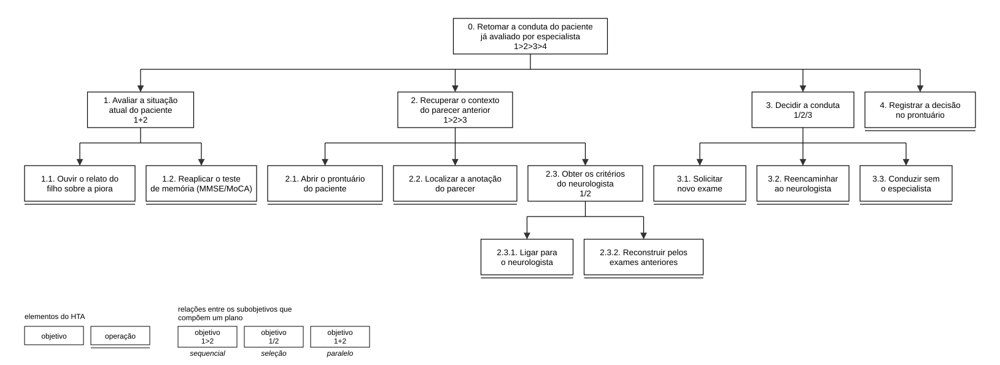
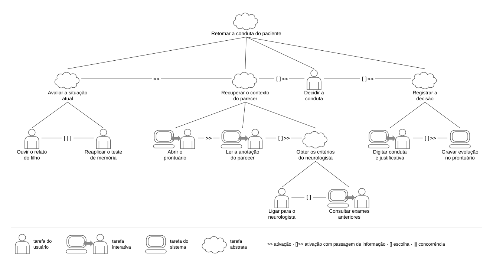
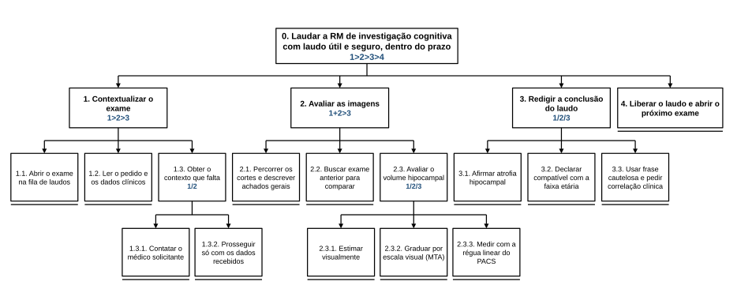
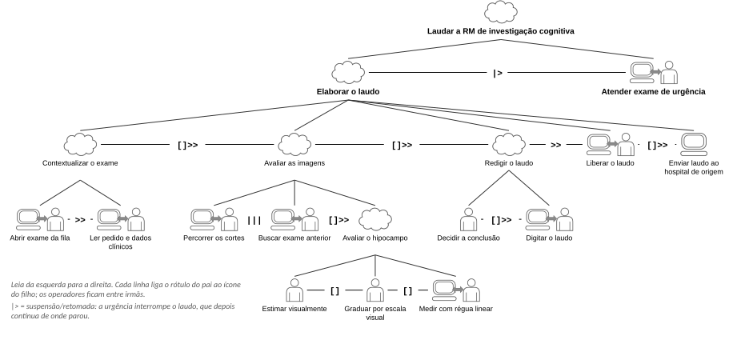
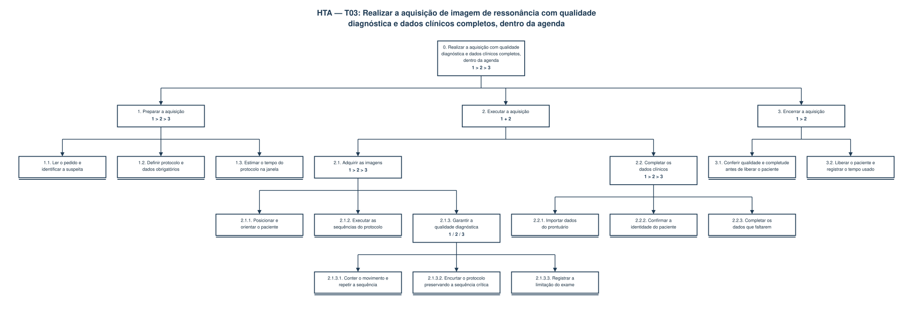

# Entrega 5 — Análise de tarefas: HTA, GOMS e CTT

**Data:** {{dd/mm/aaaa}}  
**Status:** 🟨 em andamento  
**Responsabilidade:** cada integrante modela pelo menos 1 HTA, 1 GOMS e 1 CTT. As três técnicas podem abordar a mesma funcionalidade ou funcionalidades distintas, conforme a orientação da disciplina.

## Objetivo da atividade

Modelar tarefas importantes sob perspectivas complementares: decomposição hierárquica (HTA), estrutura de metas/métodos/operações (GOMS) e relações temporais entre tarefas (CTT). O diagrama deve ser acompanhado de interpretação textual.

## Para projetos cujo TCC não previa interface

Modele **tarefas humanas relacionadas ao uso da contribuição técnica**, e não a implementação interna do algoritmo. Exemplos de boas tarefas para análise:

- investigar uma consulta de baixo desempenho;
- configurar uma análise e selecionar parâmetros;
- submeter um dataset e verificar sua validade;
- acompanhar uma execução demorada;
- comparar dois resultados/modelos;
- interpretar uma recomendação e decidir se a aceita;
- localizar uma execução anterior usando busca/filtros;
- gerar e compartilhar um relatório;
- administrar papéis/permissões quando isso for parte do trabalho real;
- revisar um alerta e registrar uma decisão.

Um CRUD pode gerar tarefas relevantes, mas “cadastrar usuário” só merece modelagem se tiver significado no domínio (papéis, validações, riscos, permissões, dependências).

## Seleção das tarefas

| ID | Tarefa | Persona/cenário de origem | Frequência/criticidade | Autor responsável |
|---|---|---|---|---|
| T01 | Retomar a conduta de um paciente já avaliado por especialista | P01/C02 | [H] frequência média (sempre que um caso encaminhado volta ao clínico); criticidade alta (a conduta é decidida sem o raciocínio já obtido) | Paulo Hudson Josué da Silva |
| T02 | {{...}} | P03/C01 | {{...}} | Raphael Garavati Erbert |
| T03 | Realizar a aquisição de imagem de ressonância com qualidade diagnóstica e dados clínicos completos, dentro da agenda | P04/C03 | [H] frequência alta (a cada exame de investigação de demência); criticidade média-alta (a qualidade dos dados de entrada condiciona todo o restante do fluxo — Entrega 1, item 3.2) | Nathan Gabriel da Fonseca Leite |
| T04 | {{...}} | P02/C04 | {{...}} | Ana Carolina Lazzuri |

---

## HTA — T01 Retomar a conduta de um paciente já avaliado por especialista

**Autor(a):** Paulo Hudson Josué da Silva — 22.222.013-9

### Descrição da tarefa

**Objetivo:** retomar com segurança a conduta do Sr. Ivo, aproveitando o raciocínio do parecer que o neurologista deu por telefone dois meses antes. **Ponto de início:** o paciente volta à consulta e o filho relata piora da memória. **Conclusão esperada:** uma conduta decidida (novo exame, reencaminhamento ou acompanhamento) e registrada no prontuário com justificativa. **Contexto:** consultório de atenção primária, agenda cheia, especialista indisponível no momento da consulta e, no prontuário, só a nota "neuro: sem AD por ora, reavaliar" (P01, cenário C02).

A modelagem descreve como a tarefa é feita hoje, com o prontuário eletrônico e o telefone, e não com a interface que o projeto ainda vai propor.

### Diagrama



### Decomposição e planos

| ID | Objetivo/operação | Plano/ordem | Problema ou decisão de design observada |
|---|---|---|---|
| 0 | Retomar a conduta do paciente já avaliado por especialista | 1 > 2 > 3 > 4 | **Input:** o paciente volta com o filho relatando piora; no prontuário há só uma anotação breve do parecer. **Feedback:** a conduta fica registrada com justificativa. **Problema:** o parecer foi obtido por canal informal e o raciocínio do especialista não foi registrado. |
| 1 | Avaliar a situação atual do paciente | 1 + 2 (em qualquer ordem) | — |
| 1.1 | Ouvir o relato do filho sobre a piora | operação | **Input:** relato da família sobre as últimas semanas. |
| 1.2 | Reaplicar o teste de memória (MMSE/MoCA) | operação | **Feedback:** novo escore, que só tem valor se puder ser comparado ao anterior. |
| 2 | Recuperar o contexto do parecer anterior | 1 > 2 > 3 | — |
| 2.1 | Abrir o prontuário do paciente | operação | — |
| 2.2 | Localizar a anotação do parecer | operação | **Problema:** a anotação é uma nota de rodapé, misturada às anotações de rotina; o prontuário não distingue um parecer de especialista de uma anotação comum [H]. **Recomendação:** registrar o parecer em um lugar próprio do caso, visível quando o caso é retomado. |
| 2.3 | Obter os critérios do neurologista | 1 / 2 | **Problema:** os critérios existiram só na ligação; nenhuma das duas opções garante recuperá-los. |
| 2.3.1 | Ligar para o neurologista | operação | **Problema:** depende da disponibilidade do especialista — no cenário, ele está em cirurgia. |
| 2.3.2 | Reconstruir pelos exames anteriores | operação | **Problema:** o médico clínico não interpreta MRI tecnicamente (P01); o que ele reconstrói é a própria leitura, não o raciocínio do especialista. **Recomendação:** guardar junto do parecer os exames e achados que sustentaram a conclusão (H06). |
| 3 | Decidir a conduta | 1 / 2 / 3 (conforme o contexto recuperado em 2) | **Problema:** sem o contexto, a escolha é feita sob incerteza. |
| 3.1 | Solicitar novo exame | operação | **Problema:** risco de repetir um exame já feito e revisado. |
| 3.2 | Reencaminhar ao neurologista | operação | **Problema:** ocupa de novo uma vaga de uma fila que já é longa (Entrega 1, item 4.2). |
| 3.3 | Conduzir sem o especialista | operação | **Problema:** a decisão ignora um raciocínio clínico que já tinha sido obtido. |
| 4 | Registrar a decisão no prontuário | operação | **Recomendação:** registrar a conduta ligada ao parecer anterior, para que a próxima retomada do caso não repita o problema (Entrega 1, item 5.4). |

**Verificação do HTA:**

- O objetivo 0 representa uma meta do usuário? Sim — retomar a conduta é o que o Dr. Marcos quer alcançar, não uma função do sistema.
- As subtarefas são necessárias e suficientes? Sim — cobrem o que o cenário C02 mostra, da chegada do paciente ao registro da decisão.
- Os **planos** indicam ordem, alternativa, repetição ou condição? Sim — há planos sequenciais (0 e 2), de seleção (2.3 e 3) e paralelo (1).
- A decomposição parou em nível útil para projeto de interação? Sim — as operações são ações que o médico reconhece; o nível de cliques e teclas fica para o GOMS.

---

## GOMS — T01 Retomar a conduta de um paciente já avaliado por especialista

**Autor(a):** Paulo Hudson Josué da Silva — 22.222.013-9

### Goal

`G0: retomar a conduta do paciente já avaliado por especialista`

### Métodos, operadores e regras de seleção

- **Method M1:** perguntar diretamente ao neurologista (para G2.3 — obter os critérios do neurologista)
  - Operators: discar o número do neurologista; aguardar o atendimento; perguntar quais exames revisou e por que descartou Alzheimer; guardar a resposta na memória
- **Method M2:** reconstruir o raciocínio pelos exames anteriores (para G2.3)
  - Operators: deslocar o cursor para a aba de exames; clicar no laudo de MRI anterior; ler a conclusão do laudo; clicar no resultado do MMSE anterior; comparar o MMSE anterior com o atual; inferir o critério usado pelo neurologista
- **Selection Rule SR1:** usar M1 quando o neurologista está disponível e a consulta permite esperar; usar M2 quando o neurologista não atende ou a consulta não permite esperar.
- **Method M3:** solicitar novo exame (para G3 — decidir a conduta)
  - Operators: deslocar o cursor para "solicitar exame"; clicar em "solicitar exame"; selecionar o tipo de exame; digitar a justificativa clínica; clicar em "enviar pedido"
- **Method M4:** reencaminhar ao neurologista (para G3)
  - Operators: deslocar o cursor para "encaminhamento"; clicar em "encaminhamento"; selecionar a especialidade "neurologia"; digitar o motivo; clicar em "enviar"
- **Method M5:** conduzir sem o especialista (para G3)
  - Operators: definir a conduta (por exemplo, reavaliar em um intervalo menor); explicar a conduta ao paciente e ao filho
- **Selection Rule SR2:** usar M3 quando os exames anteriores não explicam a piora relatada; usar M4 quando o raciocínio anterior não foi recuperado e a piora é significativa; usar M5 quando o raciocínio foi recuperado e a piora é compatível com o quadro já avaliado.

Modelo completo, no formato da aula (Barbosa e Silva, 2010). Os subobjetivos sem alternativa (G1, G2.1, G2.2 e G4) têm só operadores; os métodos acima aparecem dentro de G2.3 e G3. Os operadores sobre o prontuário assumem um prontuário eletrônico genérico, com busca, abas e botão de salvar [H].

```text
GOAL 0: retomar a conduta do paciente já avaliado por especialista
  GOAL 1: avaliar a situação atual do paciente
    OP. 1.1: ouvir o relato do filho sobre a piora da memória
    OP. 1.2: aplicar o MMSE/MoCA
  GOAL 2: recuperar o contexto do parecer anterior
    GOAL 2.1: abrir o prontuário do paciente
      OP. 2.1.1: deslocar o cursor para o campo de busca de pacientes
      OP. 2.1.2: digitar o nome do paciente
      OP. 2.1.3: clicar no registro do paciente
    GOAL 2.2: localizar a anotação do parecer
      OP. 2.2.1: deslocar o cursor para a aba de evoluções
      OP. 2.2.2: clicar na aba de evoluções
      OP. 2.2.3: rolar a lista até a data do encaminhamento
      OP. 2.2.4: ler a nota "neuro: sem AD por ora, reavaliar"
    GOAL 2.3: obter os critérios do neurologista
      METHOD 2.3.A: perguntar diretamente ao neurologista
      (SEL. RULE: o neurologista está disponível e a consulta permite esperar)
        OP. 2.3.A.1: discar o número do neurologista
        OP. 2.3.A.2: aguardar o atendimento
        OP. 2.3.A.3: perguntar quais exames revisou e por que descartou Alzheimer
        OP. 2.3.A.4: guardar a resposta na memória
      METHOD 2.3.B: reconstruir o raciocínio pelos exames anteriores
      (SEL. RULE: o neurologista não atende ou a consulta não permite esperar)
        OP. 2.3.B.1: deslocar o cursor para a aba de exames
        OP. 2.3.B.2: clicar no laudo de MRI anterior
        OP. 2.3.B.3: ler a conclusão do laudo
        OP. 2.3.B.4: clicar no resultado do MMSE anterior
        OP. 2.3.B.5: comparar o MMSE anterior com o atual
        OP. 2.3.B.6: inferir o critério usado pelo neurologista
  GOAL 3: decidir a conduta
    METHOD 3.A: solicitar novo exame
    (SEL. RULE: os exames anteriores não explicam a piora relatada)
      OP. 3.A.1: deslocar o cursor para "solicitar exame"
      OP. 3.A.2: clicar em "solicitar exame"
      OP. 3.A.3: selecionar o tipo de exame
      OP. 3.A.4: digitar a justificativa clínica
      OP. 3.A.5: clicar em "enviar pedido"
    METHOD 3.B: reencaminhar ao neurologista
    (SEL. RULE: o raciocínio anterior não foi recuperado e a piora é significativa)
      OP. 3.B.1: deslocar o cursor para "encaminhamento"
      OP. 3.B.2: clicar em "encaminhamento"
      OP. 3.B.3: selecionar a especialidade "neurologia"
      OP. 3.B.4: digitar o motivo do encaminhamento
      OP. 3.B.5: clicar em "enviar"
    METHOD 3.C: conduzir sem o especialista
    (SEL. RULE: o raciocínio foi recuperado e a piora é compatível com o quadro já avaliado)
      OP. 3.C.1: definir a conduta (por exemplo, reavaliar em um intervalo menor)
      OP. 3.C.2: explicar a conduta ao paciente e ao filho
  GOAL 4: registrar a decisão no prontuário
    OP. 4.1: deslocar o cursor para o campo de evolução
    OP. 4.2: digitar a conduta e a justificativa
    OP. 4.3: clicar em "salvar"
    OP. 4.4: verificar se a evolução aparece na lista
```


---

## CTT — T01 Retomar a conduta de um paciente já avaliado por especialista

**Autor(a):** Paulo Hudson Josué da Silva — 22.222.013-9

### Descrição

A árvore mostra a mesma tarefa do ponto de vista da ordem temporal e de quem executa cada parte. **Tarefas abstratas** (nuvem): Retomar a conduta do paciente, Avaliar a situação atual, Recuperar o contexto do parecer, Obter os critérios do neurologista e Registrar a decisão. **Tarefas do usuário** (pessoa): Ouvir o relato do filho, Reaplicar o teste de memória, Decidir a conduta e Ligar para o neurologista. **Tarefas interativas** (monitor + pessoa): Abrir o prontuário, Ler a anotação do parecer, Consultar exames anteriores e Digitar conduta e justificativa. **Tarefa do sistema** (monitor): Gravar evolução no prontuário.

Decidir a conduta e Ligar para o neurologista ficam fora do sistema — é por isso que o raciocínio do especialista nunca entra no prontuário. A única tarefa do sistema em toda a árvore é gravar a evolução: hoje o prontuário só recebe a decisão pronta.

### Diagrama



### Legenda e relações temporais usadas

| Operador/relação | Significado no diagrama | Exemplo no modelo |
|---|---|---|
| `>>` ativação | A segunda tarefa só começa quando a primeira termina | Avaliar a situação atual `>>` Recuperar o contexto do parecer; Abrir o prontuário `>>` Ler a anotação do parecer |
| `[]>>` ativação com passagem de informação | A segunda tarefa começa depois da primeira e usa a informação produzida por ela | Ler a anotação `[]>>` Obter os critérios; Recuperar o contexto `[]>>` Decidir a conduta; Decidir a conduta `[]>>` Registrar a decisão; Digitar conduta `[]>>` Gravar evolução |
| `[]` escolha | As duas estão disponíveis, mas quando uma começa a outra é descartada | Ligar para o neurologista `[]` Consultar exames anteriores |
| `\|\|\|` concorrência | Podem ser feitas em qualquer ordem ou ao mesmo tempo | Ouvir o relato do filho `\|\|\|` Reaplicar o teste de memória |


---

## HTA — T02 {{nome da tarefa}}

**Autor(a):** {{nome — matrícula}}

### Descrição da tarefa

{{objetivo, ponto de início, conclusão esperada, contexto}}

### Diagrama



### Decomposição e planos

| ID | Objetivo/operação | Plano/ordem | Problema ou decisão de design observada |
|---|---|---|---|
| 0 | {{objetivo principal}} | {{1 }} 2 > 3 / 1 ou 2 etc.> | {{...}} |

**Verificação do HTA:**

- O objetivo 0 representa uma meta do usuário?
- As subtarefas são necessárias e suficientes?
- Os **planos** indicam ordem, alternativa, repetição ou condição?
- A decomposição parou em nível útil para projeto de interação?

---

## GOMS — T02 {{nome da tarefa}}

**Autor(a):** {{nome — matrícula}}

### Goal

`G0: {{meta do usuário}}`

### Métodos, operadores e regras de seleção

- **Method M1:** {{...}}
  - Operators: {{perceber, apontar, clicar, digitar, decidir... conforme o nível adotado}}
- **Method M2:** {{...}}
  - Operators: {{...}}
- **Selection Rule SR1:** usar M1 quando {{condição}}; usar M2 quando {{condição}}.

> Não chame qualquer passo de “método”. Em GOMS, métodos são sequências alternativas capazes de atingir uma meta; regras de seleção explicam quando escolher entre eles.

---

## CTT — T02 {{nome da tarefa}}

**Autor(a):** {{nome — matrícula}}

### Descrição

{{...}}

### Diagrama



### Legenda e relações temporais usadas

| Operador/relação | Significado no diagrama | Exemplo no modelo |
|---|---|---|
| {{...}} | {{...}} | {{...}} |

Identifique, quando aplicável, tarefas de usuário, sistema, interação e tarefas abstratas. Verifique se concorrência, escolha, habilitação, desabilitação e repetição estão representadas corretamente segundo a notação adotada em aula.

---

## HTA — T03 Realizar a aquisição de imagem de ressonância dentro da agenda

**Autor(a):** Nathan Gabriel da Fonseca Leite — 221230287

### Descrição da tarefa

**Objetivo:** realizar a aquisição de imagem de ressonância com qualidade diagnóstica e dados clínicos completos, dentro da agenda (objetivo extraído do cenário C03, seção 4). **Ponto de início:** o paciente entra no setor de imagem com o pedido médico de investigação de déficit cognitivo. **Conclusão esperada:** o paciente é liberado com as imagens em qualidade diagnóstica adquiridas, os dados clínicos completos e a janela da agenda respeitada — sem necessidade de reconvocação. **Contexto:** setor de imagem hospitalar, escala com intervalos curtos entre pacientes [H, C03 Q1] e paciente idosa com dificuldade de cooperação (P04, cenário C03).

O objetivo tem três critérios de sucesso que valem ao mesmo tempo, e é a tensão entre eles que torna a tarefa relevante para IHC:

| Critério | Evidência no C03 |
|---|---|
| Qualidade diagnóstica | "exame limitado por artefato de movimento; ausência de sequência volumétrica" |
| Dados clínicos completos | "dados clínicos incompletos"; transcrição manual sujeita a lapsos [H, Q4] |
| Dentro da agenda | escala com intervalos curtos entre pacientes [H, Q1] |

Os dois primeiros **competem** com o terceiro: repetir uma sequência melhora a imagem e consome a janela. Por isso a restrição de tempo entra no objetivo, e não apenas no contexto.

A modelagem descreve como a tarefa é feita hoje, com o console do scanner, o PACS e o prontuário, e não com a interface que o projeto ainda vai propor. O envio do exame para análise fica fora do recorte: ele começa depois que a aquisição é encerrada, e é na liberação do paciente que a janela de correção se fecha.

### Diagrama



### Decomposição e planos

Cada plano é escrito dentro da caixa do objetivo e numera apenas os seus próprios subobjetivos (`1 > 2` sequencial, `1 / 2` seleção, `1 + 2` paralelo). No diagrama, as **operações** — as folhas da árvore — são marcadas com a linha dupla sob a caixa; as caixas sem essa linha são objetivos.

| ID | Objetivo/operação | Plano/ordem | Problema ou decisão de design observada |
|---|---|---|---|
| 0 | Realizar a aquisição com qualidade diagnóstica e dados clínicos completos, dentro da agenda | 1 > 2 > 3 | **Input:** pedido médico e janela da agenda. **Feedback:** confirmação de que o exame está completo antes de liberar o paciente. **Problema:** esse retorno não existe — a falha só aparece dias depois, no laudo, porque o fluxo não tem validador precoce de qualidade no PACS [H, Q5]. **Recomendação:** antecipar a conferência para antes da liberação do paciente (H07). |
| 1 | Preparar a aquisição | 1 > 2 > 3 | **Problema:** o pedido vem como "RM de crânio", sem indicar a suspeita, e a escolha do protocolo recai sobre o técnico — cuja autonomia formal para alterá-lo é uma questão em aberto [?, Q2]. |
| 1.1 | Ler o pedido e identificar a suspeita | operação | **Input:** texto livre do pedido médico. **Problema:** informação incompleta na origem. |
| 1.2 | Definir protocolo e dados obrigatórios | operação | **Feedback:** hoje inexistente — não há lista do que o caso exige. **Recomendação:** apresentar sequências e dados clínicos obrigatórios **antes** da aquisição (F03, `RASTREABILIDADE.md`). |
| 1.3 | Estimar o tempo do protocolo na janela | operação | **Problema:** o técnico não sabe de antemão se o protocolo completo cabe na janela; descobre durante a aquisição [H, Q1]. **Recomendação:** exibir a duração estimada contra o tempo restante. |
| 2 | Executar a aquisição | 1 + 2 (em qualquer ordem) | **Ação:** nada obriga os dados clínicos a esperarem as imagens; reuni-los enquanto o paciente é posicionado economiza janela. É por fazê-los **depois** que, no C03, a transcrição ocorre sob ritmo acelerado [H, Q4]. |
| 2.1 | Adquirir as imagens | 1 > 2 > 3 | — |
| 2.1.1 | Posicionar e orientar o paciente | operação | **Problema:** pacientes com declínio cognitivo têm dificuldade de permanecer imóveis. |
| 2.1.2 | Executar as sequências do protocolo | operação | **Input:** protocolo definido em 1.2. **Feedback:** imagens no console. |
| 2.1.3 | Garantir a qualidade diagnóstica | 1 / 2 / 3 | **Problema:** a escolha é feita sem critério escrito de quanto movimento é tolerável e sem saber quanto tempo resta. O conjunto de ações de contenção disponíveis na rotina é ele próprio uma lacuna [H, Q3]. Qual caminho se aplica é detalhado no GOMS (GOAL 2). **Recomendação:** indicar a qualidade em linguagem de aquisição (sequência, artefato, cobertura), nunca em métricas do modelo (Entrega 1, item 2.4). |
| 2.1.3.1 | Conter o movimento e repetir a sequência | operação | **Ação:** orientar novamente a paciente ou aplicar contenções leves antes de repetir [H, Q3]; só é possível com o paciente ainda no aparelho e com folga na janela. |
| 2.1.3.2 | Encurtar o protocolo preservando a sequência crítica | operação | **Problema:** depende de o serviço autorizar o técnico a ajustar o protocolo [?, Q2]. **Recomendação:** o sistema deve indicar qual sequência é indispensável para a suspeita, para que o corte não atinja justamente ela. |
| 2.1.3.3 | Registrar a limitação do exame | operação | **Recomendação:** a limitação deve acompanhar o caso até quem lauda, e não ficar só no laudo final. |
| 2.2 | Completar os dados clínicos | 1 > 2 > 3 | **Problema:** transcrição manual do prontuário para a requisição, sujeita a lapsos de digitação [H, Q4]. |
| 2.2.1 | Importar dados do prontuário | operação | **Recomendação:** trazer idade, queixa, MMSE/MoCA e histórico sem redigitação. |
| 2.2.2 | Confirmar a identidade do paciente | operação | **Problema:** risco de associar imagens e dados a pacientes diferentes (Entrega 1, item 5.3). **Recomendação:** confirmação explícita, feita por pessoa. |
| 2.2.3 | Completar os dados que faltarem | operação | **Feedback:** indicar o que ainda falta, em vez de aceitar o caso incompleto em silêncio. |
| 3 | Encerrar a aquisição | 1 > 2 | **Ação:** é o último momento em que a correção ainda é barata. |
| 3.1 | Conferir qualidade e completude antes de liberar o paciente | operação | **Problema:** essa conferência não existe no fluxo atual — é o ponto exato da ruptura do C03 [H, Q5]. **Recomendação:** bloquear o encerramento enquanto houver item obrigatório pendente (F03). |
| 3.2 | Liberar o paciente e registrar o tempo usado | operação | **Feedback:** registrar o tempo efetivo contra a janela alimenta o indicador de agenda do setor. |

**Verificação do HTA:**

- O objetivo 0 representa uma meta do usuário? Sim — é o estado que Bruno quer alcançar (exame adquirido, completo e dentro da janela), não uma função do sistema.
- As subtarefas são necessárias e suficientes? Sim — retirar qualquer um dos três objetivos de primeiro nível impede alcançar o objetivo, e nenhuma outra etapa aparece no C03 dentro deste recorte.
- Os **planos** indicam ordem, alternativa, repetição ou condição? Sim — há plano sequencial (0, 1, 2.1, 2.2 e 3), paralelo (2) e de seleção entre três caminhos (2.1.3).
- A decomposição parou em nível útil para projeto de interação? Sim — as folhas são operações observáveis (ler, definir, estimar, posicionar, conter, importar, conferir, liberar). Descer até cliques pressuporia uma interface que só será projetada na Entrega 6.

---

## GOMS — T03 Realizar a aquisição de imagem de ressonância dentro da agenda

**Autor(a):** Nathan Gabriel da Fonseca Leite — 221230287

O GOMS reabre o ponto que o HTA marca apenas como seleção: **quando há mais de uma forma de atingir um subobjetivo, o que decide qual usar**. Dois subobjetivos têm métodos alternativos — obter imagens com qualidade diagnóstica (GOAL 2) e completar os dados clínicos (GOAL 3) —, e são exatamente os dois pontos do HTA com mais de um caminho possível. Nas regras de seleção de GOAL 2, o tempo restante na janela aparece como condição explícita: é ele que arbitra o conflito entre qualidade e agenda.

### Modelo GOMS

Notação da aula: `GOAL`, `METHOD`, `(SEL. RULE: ...)` logo abaixo de cada método, e `OP.` para os operadores, com a numeração herdada do nível acima.

```
GOAL 0: realizar a aquisição de imagem de ressonância com qualidade
        diagnóstica e dados clínicos completos, dentro da agenda

  GOAL 1: definir o que o caso exige e o tempo disponível
      OP. 1.1: ler o pedido e identificar a suspeita clínica
      OP. 1.2: perceber o protocolo e os dados clínicos obrigatórios
      OP. 1.3: estimar o tempo do protocolo na janela da agenda

  GOAL 2: obter imagens com qualidade diagnóstica

      METHOD 2.A: conter o movimento e repetir a sequência
      (SEL. RULE: paciente ainda no aparelho, tolera a repetição
       e ainda há folga na janela da agenda)
          OP. 2.A.1: perceber o artefato nas imagens
          OP. 2.A.2: decidir que o problema é recuperável
          OP. 2.A.3: orientar a paciente novamente
          OP. 2.A.4: aplicar contenções leves, se necessário   [H, C03 Q3]
          OP. 2.A.5: acionar o console e repetir a sequência
          OP. 2.A.6: perceber o novo resultado

      METHOD 2.B: encurtar o protocolo preservando a sequência crítica
      (SEL. RULE: a janela da agenda está acabando, a sequência crítica
       ainda não foi adquirida e o serviço autoriza o técnico a ajustar
       o protocolo — condição em aberto, C03 Q2)
          OP. 2.B.1: perceber o tempo restante
          OP. 2.B.2: decidir qual sequência é crítica para a suspeita
          OP. 2.B.3: suprimir as sequências acessórias
          OP. 2.B.4: adquirir a sequência crítica

      METHOD 2.C: registrar a limitação do exame
      (SEL. RULE: a limitação é parcial e não atinge a região de interesse)
          OP. 2.C.1: perceber a limitação
          OP. 2.C.2: decidir que ela não impede a análise
          OP. 2.C.3: clicar em "registrar limitação"
          OP. 2.C.4: digitar o motivo

      METHOD 2.D: reconvocar o paciente
      (SEL. RULE: a janela acabou ou o paciente não tolera,
       e o item faltante é obrigatório)
          OP. 2.D.1: perceber que o item faltante é obrigatório
          OP. 2.D.2: decidir que não há como corrigir agora
          OP. 2.D.3: marcar novo exame na agenda
          OP. 2.D.4: notificar o médico solicitante

  GOAL 3: completar os dados clínicos do caso

      METHOD 3.A: importar do prontuário
      (SEL. RULE: os dados estão estruturados e disponíveis no prontuário)
          OP. 3.A.1: selecionar o paciente
          OP. 3.A.2: importar idade, queixa e MMSE
          OP. 3.A.3: confirmar a identidade
          OP. 3.A.4: perceber o que ficou faltando

      METHOD 3.B: completar manualmente
      (SEL. RULE: o dado só existe em evolução antiga ou em laudo
       não estruturado)
          OP. 3.B.1: procurar o dado no prontuário
          OP. 3.B.2: digitar o valor no caso          [H, C03 Q4]
          OP. 3.B.3: confirmar a identidade
          OP. 3.B.4: perceber o que ficou faltando

  GOAL 4: encerrar a aquisição dentro da janela
      OP. 4.1: conferir qualidade e completude antes de liberar
      OP. 4.2: liberar o paciente
      OP. 4.3: registrar o tempo usado na janela da agenda
```

Os operadores estão em nível de tarefa (*perceber*, *decidir*, *orientar*, *acionar*, *clicar*, *digitar*, *confirmar*). A variante **GOMS-KLM** (K, P, H, B, M, R, com tempos somados) não foi aplicada porque pressupõe uma interface concreta cujas teclas e cliques possam ser cronometrados; ela fica registrada para a Entrega 11, onde será especialmente pertinente por o objetivo ter restrição de tempo.

> **Sobre a forma do artefato:** o GOMS é um **modelo textual**. Diferente do HTA e do CTT, ele não se representa como diagrama de caixas e setas — a hierarquia é expressa pela indentação, como nos exemplos da aula. O mesmo modelo está tipografado em [`../assets/05_tarefas/goms_t03.svg`](../assets/05_tarefas/goms_t03.svg), para uso em slides e impressão.

### Comparação entre os métodos de GOAL 2

| Método | Custo na janela da agenda | Custo para o paciente | Qualidade diagnóstica resultante | Risco |
|---|---|---|---|---|
| 2.A Conter e repetir | Alto — consome o tempo restante | Permanecer mais tempo no aparelho | Preservada | Baixo — corrige o problema na origem |
| 2.B Encurtar o protocolo | Baixo — cabe na janela | Nenhum | Preservada na região de interesse; perde achados acessórios | Médio — depende de acertar a sequência crítica e de haver autonomia para alterar o protocolo [?, Q2] |
| 2.C Registrar limitação | Nenhum | Nenhum imediato | Comprometida, mas declarada | Alto — a limitação pode não chegar a quem decide |
| 2.D Reconvocar | Nenhum agora; consome vaga futura | Nova viagem, acompanhante, semanas de atraso | Adiada | Alto — é o desfecho do cenário C03 |

**O que o modelo mostra:** 2.A e 2.B são os únicos métodos que ainda entregam qualidade diagnóstica, e ambos só existem **enquanto o paciente está no aparelho**. Eles se distinguem pelo tempo: 2.A exige folga na janela, 2.B é a saída quando a folga acabou. Hoje, como a falta só é percebida dias depois (H07), o processo não escolhe entre eles — cai direto em 2.D, o método que mais custa ao paciente. A implicação de design é que a verificação precisa acontecer cedo o bastante para que 2.A e 2.B ainda sejam aplicáveis, e que a interface deve informar o tempo restante, já que é ele que distingue os dois. Em GOAL 3, 3.B existe apenas porque o prontuário não entrega o MMSE de forma estruturada — eliminar essa causa elimina o método mais lento e mais sujeito a erro [H, Q4].

---

## CTT — T03 Realizar a aquisição de imagem de ressonância dentro da agenda

**Autor(a):** Nathan Gabriel da Fonseca Leite — 221230287

### Descrição

O CTT modela o mesmo objetivo sob a perspectiva temporal, distinguindo o que é feito pelo técnico, o que é feito pelo sistema e o que exige interação entre os dois. Ele mostra dois pontos que o HTA não representa: a **concorrência** entre adquirir as imagens e completar os dados clínicos, e a **desativação** da aquisição quando o paciente não tolera o exame.

### Diagrama

.svg)

### Legenda e relações temporais usadas

| Operador/relação | Significado no diagrama | Exemplo no modelo |
|---|---|---|
| `>>` ativação | A segunda tarefa só pode iniciar após a primeira terminar | "Completar dados clínicos" `>>` "Encerrar a aquisição" |
| `[ ]>>` ativação com passagem de informação | Além de só iniciar depois, a segunda tarefa recebe a informação produzida pela primeira | "Preparar a aquisição" `[ ]>>` "Adquirir as imagens": o protocolo definido determina as sequências |
| `[ ]` escolha | Ambas estão habilitadas, mas iniciar uma desabilita a outra | "Conter o movimento e repetir a sequência" `[ ]` "Encurtar o protocolo" `[ ]` "Registrar limitação do exame" — corresponde à seleção `1 / 2 / 3` do objetivo 2.1.3 do HTA e aos métodos 2.A, 2.B e 2.C do GOMS |
| `\|\|\|` concorrência | As tarefas podem ser realizadas em qualquer ordem ou ao mesmo tempo | "Adquirir as imagens" `\|\|\|` "Completar dados clínicos" — corresponde ao plano `1 + 2` do objetivo 2 do HTA |
| `[>` desativação | A primeira tarefa é completamente interrompida pela segunda | "Executar as sequências do protocolo" `[>` "Interromper por intolerância do paciente" — é o que acontece no C03, quando Dona Aparecida pede para sair |

As demais relações da notação (`\| [ ] \|` concorrência com comunicação, `\|=\|` independência e `\|>` suspensão/retomada) não aparecem neste modelo porque nenhuma situação da tarefa as exige.

**Tipos de tarefa no modelo** (os quatro tipos da notação, com os ícones da aula):

- **Tarefas do usuário** (realizadas fora do sistema): ler o pedido médico; definir protocolo e dados obrigatórios; estimar o tempo na janela da agenda; posicionar e orientar o paciente.
- **Tarefas do sistema** (processamento sem interação): validar qualidade diagnóstica; importar dados do prontuário; conferir qualidade e completude; registrar o tempo usado na janela.
- **Tarefas interativas** (diálogo usuário–sistema): executar as sequências do protocolo; interromper por intolerância do paciente; conter o movimento e repetir a sequência; encurtar o protocolo; registrar limitação do exame; confirmar identidade do paciente; completar dados que faltarem; liberar o paciente.
- **Tarefas abstratas** (composição que auxilia a decomposição): realizar a aquisição; preparar a aquisição; adquirir as imagens; completar dados clínicos; encerrar a aquisição.

**O que o modelo revela:** validar a qualidade diagnóstica, importar os dados clínicos e conferir a completude estão tipadas como **tarefas do sistema**, mas hoje todas são feitas por pessoas — o técnico avalia a imagem no olho, transcreve manualmente os dados [H, Q4] e não faz conferência nenhuma antes de liberar o paciente [H, Q5]. "Estimar o tempo na janela da agenda" aparece como tarefa do **usuário** justamente porque nenhum sistema oferece esse dado hoje; convertê-la em tarefa do sistema é uma das oportunidades de design mais diretas deste modelo. A confirmação de identidade permanece como tarefa interativa porque a responsabilidade é humana e não deve ser automatizada em silêncio.

---

## Síntese da equipe

Quais problemas de interação, oportunidades e requisitos apareceram a partir das modelagens? Quais tarefas irão para o protótipo e para o teste de usabilidade?

**T01 (Paulo):** as três técnicas apontam o mesmo ponto de ruptura — o parecer do especialista não fica registrado de forma recuperável (HTA 2.2 e 2.3), o que força o médico a um método que exige uma inferência que ele não domina (GOMS, M2) e deixa as etapas críticas fora do sistema (CTT). Requisitos candidatos, ainda hipóteses: [H] o parecer do especialista fica registrado no próprio caso, com os exames e achados que o sustentaram, e aparece quando o caso é retomado (H06); [H] o teste de memória anterior e o atual aparecem lado a lado; [H] a nova conduta fica ligada ao parecer anterior. Tarefa candidata para o protótipo e o teste de usabilidade: retomar um caso e localizar o parecer anterior.

## Checklist

- [ ] Cada integrante produziu ao menos 1 HTA, 1 GOMS e 1 CTT.
- [ ] Cada artefato identifica autor e tarefa.
- [ ] Diagramas são legíveis e possuem fonte editável quando possível.
- [ ] HTA contém planos, não apenas árvore de tópicos.
- [ ] GOMS distingue Goals, Operators, Methods e Selection Rules.
- [ ] CTT usa operadores temporais e tipos de tarefa coerentes.
- [ ] Há texto explicando cada diagrama.
- [ ] Tarefas estão ligadas a cenários/personas na rastreabilidade.
- [ ] Em TCC técnico, as tarefas descrevem o que a pessoa faz com a contribuição/resultados, não passos internos do código.
- [ ] CRUDs, relatórios, filtros e atividades administrativas foram escolhidos por relevância ao objetivo do usuário.
