# Entrega 6 — Prototipação em papel

**Data:** 30/10/2026  
**Status:** 🟩 Concluída
**Responsabilidade:** 1 solução integrada por equipe

## Objetivo da atividade

Externalizar rapidamente ideias de interação em baixa fidelidade para explorar alternativas antes de investir em detalhes visuais. O valor da atividade está no **ciclo construir → simular → observar → revisar**, não na beleza do desenho.

## Forma do protótipo nesta entrega

A equipe já tinha uma interface navegável, construída a partir das Entregas 1 a 5, e por isso documentou o protótipo com **prints da plataforma** em vez de desenhos em papel.

> **Sobre o risco dessa escolha.** Uma interface com aparência acabada tende a ser defendida em vez de explorada. A equipe assume que, nesta fase, nenhuma decisão de interação está fechada: a revisão da primeira versão (seção 5) eliminou visualizador em três planos, abas de fatores, percentis normativos, perfis de usuário e painel de indicadores, e a mesma disposição vale para o que está publicado agora. Aparência mais pronta não é sinal de interação resolvida.

## 1. Escopo do protótipo

**Personas:** P01 — Dr. Marcos Andrade (médico clínico, persona prioritária); P02 — Dr. César Andrade de Melo (neurologista); P04 — Bruno Tavares Lima (técnico em radiologia, na entrada do caso). P03 — Dra. Helena Siqueira Prado (radiologista) é atendida só na consulta do mapa de atenção e da volumetria.  
**Cenários/tarefas cobertos:** C02/T01, C04/T04, C03/T03 e, de forma parcial, C01/T02 (ver tabela abaixo).  
**Objetivos principais:** compreender a sugestão do modelo e calibrar a confiança pela evidência; registrar uma decisão justificada e rastreável; enviar um exame com os dados que o modelo usa; perceber quando a análise está em andamento ou falhou.

#### O técnico (P04) continua no escopo

A seção 5 registra que o envio em quatro etapas foi substituído por um formulário único porque "dependia do perfil do técnico". Essa frase era ambígua e precisa ser corrigida: **o que saiu do protótipo foi uma solução de interface, não um usuário do projeto.** Para não deixar a dúvida em aberto:

| Pergunta | Resposta | Consequência |
|---|---|---|
| P04 — Bruno Tavares Lima continua sendo persona do sistema? | **Sim**, como persona primária da atividade A01 | Entrega 3 permanece como está |
| O técnico continua usando a interface? | **Sim**, no envio do caso (UI06, UI06b, UI07, UI08) | O formulário de envio é a tela dele |
| T03 continua sendo tarefa do projeto? | **Sim** | HTA, GOMS e CTT da Entrega 5 permanecem válidos |
| H07 continua orientando uma necessidade de design? | **Sim**, e é a necessidade **menos atendida** pelo protótipo atual | Tratada na seção 5.1 |

O que foi retirado foi o **perfil de usuário separado**, com login próprio e checklist de quatro etapas: ele dependia de um backend de aplicação com contas e permissões que o repositório do modelo não sustenta. Como consequência, a conferência de qualidade antes da liberação do paciente — que é o núcleo de T03 e de H07 — deixou de ter lugar na interface e voltou a ser lacuna. Isso é uma **lacuna de implementação, não uma redução de escopo**, e está registrado como tal na `RASTREABILIDADE.md`.

### Cobertura das tarefas da Entrega 5

| Tarefa | Estado no protótipo | O que o protótipo cobre | O que não cobre |
|---|---|---|---|
| T01 — Retomar a conduta de um paciente já avaliado por especialista (P01/C02) | **parcialmente implementado** | Localizar o caso (HTA 2.1); registrar a decisão com justificativa, nome e horário, sem possibilidade de edição (HTA 4), para que a próxima retomada encontre o raciocínio | Não há onde registrar nem consultar o **parecer do especialista**, nem histórico de exames anteriores (HTA 2.2 e 2.3). É a principal lacuna do protótipo frente à T01 (H06) |
| T04 — Decidir a conduta diante de evidências conflitantes (P02/C04) | **parcialmente implementado** | Ver a sugestão com a faixa de confiança e os dados que entraram no modelo; registrar "concordo parcialmente" ou "discordo" com justificativa (HTA 3 e 4.2) | O relato da família só existe como observação em texto livre, sem data por episódio; os testes cognitivos não aparecem; não há comparação lado a lado (HTA 1 e 2) |
| T03 — Realizar a aquisição com qualidade diagnóstica e dados completos (P04/C03) | **não implementado** no que é essencial | Envio do exame com campos obrigatórios validados antes do envio; estado de falha quando o exame ou os dados não passam na validação do processamento (GOMS T03, GOAL 3 e 4) | A falha só aparece **depois** do envio e do processamento (UI08), o que reproduz o problema da H07; não há conferência de qualidade antes de liberar o paciente |
| T02 — Laudar uma RM com atrofia limítrofe (P03/C01) | **parcialmente implementado** | Consulta do mapa de atenção sobre o corte axial e da volumetria do hipocampo em relação ao volume intracraniano | Não há redação de laudo nem pergunta clínica junto do exame (H08) |

## 1.1 Possíveis famílias de interface

Das famílias sugeridas, o protótipo usa só as que as tarefas pedem:

| Família | Onde aparece | Tarefa que justifica |
|---|---|---|
| Entrada/seleção de dados com validação | UI06 Novo caso | T03 — enviar o exame com os dados que o modelo usa |
| Acompanhamento de execução | UI07 Processando, UI08 Falha | T03 — saber se a análise terminou ou falhou |
| Relatório/resultados com explicação | UI03, UI04 | T01 e T04 — interpretar a sugestão antes de decidir |
| Histórico com busca e filtros | UI02 Casos | T01 — localizar o caso do paciente que voltou |
| Auditoria | UI05d e UI09 (confirmação antes de gravar; decisão com nome e horário, somente leitura) | T01 e T04 — registrar a decisão e a justificativa |

Não foram criados dashboard, administração de usuários nem comparação. Os indicadores de UI02 funcionam como **filtro** da lista, e não como painel de monitoramento. A comparação seria necessária para T01 e T04 e está registrada como lacuna.

## 2. Fluxos escolhidos

| Fluxo | Tarefa/objetivo | Por que foi priorizado |
|---|---|---|
| PF01 | Interpretar a sugestão de um caso e registrar a decisão (UI02 → UI03 → UI05 → UI05d → UI09) | É o objetivo principal do usuário prioritário (Entrega 1, item 7.3) e cobre o registro da decisão de T01 (HTA 4) e T04 (HTA 4.2) |
| PF02 | Decidir em um caso de confiança baixa e registrar a divergência (UI02 → UI04 → UI05c → UI05d → UI09) | É onde a confiança calibrada é testada (H03): a interface precisa frear um "concordo" automático; é o caso de evidências que não fecham, como em T04 |
| PF03 | Enviar um novo caso e acompanhar a análise (UI02 → UI06 → UI06b → UI07 → UI03) | É a entrada do fluxo (T03, GOMS GOAL 3 e 4) e mostra o estado de processamento |
| PF04 | Lidar com uma análise que falhou (UI02 → UI08 → UI06) | Reproduz a ruptura do C03: o problema no exame ou nos dados só aparece depois do envio e do processamento (H07) |
| PF05 | Localizar um caso já decidido e consultar a decisão (UI02 → UI09) | É o primeiro passo da retomada de T01 (HTA 2.1) |

## 3. Telas e estados

### Versão das telas e correspondência de identificadores

Os prints desta seção são da **versão de 12/11**, refeita depois do feedback da Entrega 6. A simulação da seção 4 foi feita sobre a **versão de 28/10**, a mesma que o professor avaliou. Entre as duas, três telas deixaram de existir e as seguintes foram renumeradas para que a sequência não tenha lacunas. Todo o documento, inclusive o registro da seção 4, usa os códigos atuais; a tabela abaixo serve para ler o feedback do professor, que usa os códigos antigos `P0x`, contra as telas de hoje.

| Versão de 28/10 (códigos do feedback) | Versão de 12/11 (esta seção) | O que mudou |
|---|---|---|
| P01, P01b, P02, P02b, P02c | UI01, UI01b, UI02, UI02b, UI02c | só o código |
| P03 | UI03 | o mapa de atenção fica sempre sobreposto ao corte; entrou o card "O que mais pesou neste caso" |
| P03b — Mapa de atenção oculto | **retirada do escopo** | não há mais controle para ocultar o mapa nem para ajustar a opacidade |
| P03c — Glossário | UI03b | só o código |
| P04, P05, P05b, P05c, P05d | UI04, UI05, UI05b, UI05c, UI05d | só o código |
| P05e — Decisão registrada | **retirada do escopo** | depois do registro, o sistema leva ao caso concluído (UI09), que mostra a decisão com nome e horário |
| P06 — Relatório | **retirada do escopo** | a versão atual não gera relatório imprimível |
| P07, P07b | UI06, UI06b | só o código |
| P08, P09, P10 | UI07, UI08, UI09 | só o código; a falha mostrada em UI08 passou a ser um valor clínico fora da faixa, e não uma série errada |

**Consequências da retirada.** As três telas foram retiradas do escopo do projeto por decisão da equipe, e não ficam como "próxima versão". O que isso implica:

- **P05e:** nenhuma perda. A verificação de que a decisão foi gravada, com nome e horário, passou para o caso concluído (UI09).
- **P03b:** o candidato RC01 da Entrega 2 (comparar a imagem original com o destaque da IA) sai do escopo junto com a tela. RC01 nunca foi validado com usuários, então a retirada não contradiz uma necessidade confirmada.
- **P06:** levar a sugestão e a decisão para o prontuário deixa de ser responsabilidade da interface. A decisão é consultada no próprio sistema (UI09), e a transcrição para o prontuário, quando houver, fica fora do que o projeto apoia. É uma limitação a declarar para T01, porque é nessa transcrição que o C02 mostra a informação se perdendo.

### Mapa de navegação

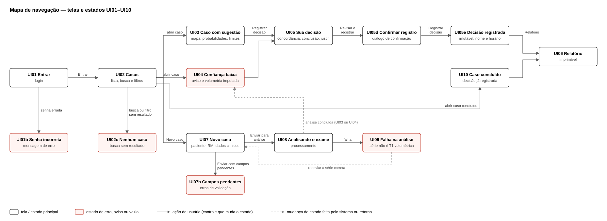

### Índice das telas e estados

| ID | Tela/estado | Controles que mudam o estado | Tarefa, decisão ou informação que justifica |
|---|---|---|---|
| UI01 | Entrar | "Entrar"; "Preencher" (conta de demonstração) | A decisão é gravada com o nome de quem decidiu (auditoria); estação de trabalho compartilhada (Entrega 3, P01) |
| UI01b | Senha incorreta | Corrigir e tentar de novo | Estado de erro do acesso |
| UI02 | Casos | Indicadores (filtram a lista), busca por nome ou prontuário, filtro de status, "Novo caso", clicar no caso | T01 HTA 2.1 / GOMS GOAL 2.1 — abrir o caso do paciente |
| UI02b | Lista filtrada (aguardando revisão) | "Limpar" | Fila do que falta revisar |
| UI02c | Nenhum caso encontrado | "Limpar filtros" | Estado vazio da busca |
| UI03 | Caso com sugestão | Termos do glossário, "Registrar decisão" | T01 e T04 — interpretar a sugestão: número com faixa de confiança, de onde veio a sugestão, o que mais pesou no caso, limites do modelo e dados que entraram |
| UI03b | Termo do glossário aberto | Passar o mouse no termo | Entender um termo técnico sem sair da tela (F06) |
| UI04 | Caso com confiança baixa | Os mesmos de UI03 | T04 — sugestão que não fecha: aviso de confiança baixa e de probabilidades próximas entre si |
| UI05 | Sua decisão | Concordo / Concordo parcialmente / Discordo; conclusão; justificativa; "Revisar e registrar" | T01 HTA 4 e T04 HTA 4.2 — registrar a decisão com o raciocínio |
| UI05b | Campos pendentes na decisão | Preencher os campos | Não registrar uma decisão sem conclusão ou justificativa |
| UI05c | "Concordo" em caso de confiança baixa | Rever a escolha | H03 — evitar concordância automática com uma sugestão fraca |
| UI05d | Confirmar registro | "Voltar e revisar"; "Registrar decisão" | A decisão não pode ser desfeita: o médico confere antes |
| UI06 | Novo caso | Campos do paciente, RM (arrastar ou selecionar), dados clínicos, "Enviar para análise" | T03 GOMS GOAL 3 e 4 — completar os dados e entregar o exame |
| UI06b | Novo caso com campos pendentes | Corrigir os campos indicados | Impedir o envio de um caso incompleto |
| UI07 | Analisando o exame | Nenhum (o sistema avisa quando termina) | Acompanhar a análise; o usuário pode sair da tela |
| UI08 | Falha na análise | Nenhum na própria tela: para reenviar, o usuário volta a "Casos" e cria um novo caso | T03 — o exame ou os dados enviados foram recusados no processamento; a tela mostra o motivo em termos técnicos |
| UI09 | Caso concluído | Nenhum: a decisão aparece em modo somente leitura | T01 — consultar uma decisão já registrada. É também a verificação do resultado logo depois do registro: o médico vê a decisão gravada, com nome e horário (GOMS T01, OP. 4.4) |

### UI01 — Entrar

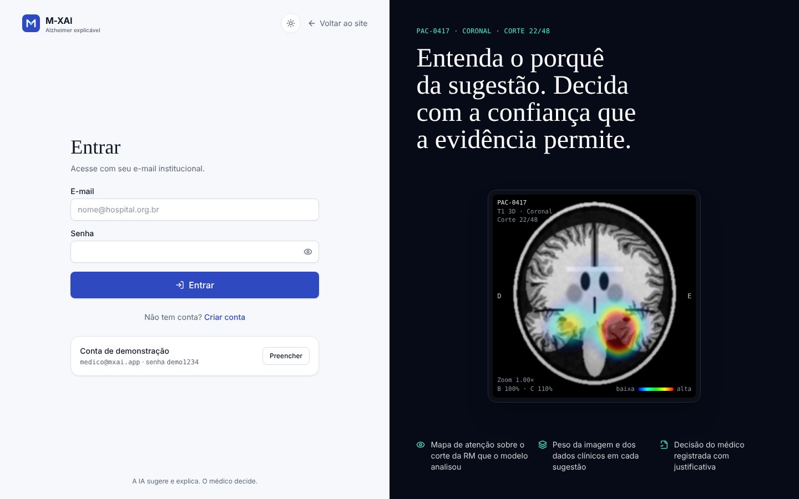

**UI01b — senha incorreta**

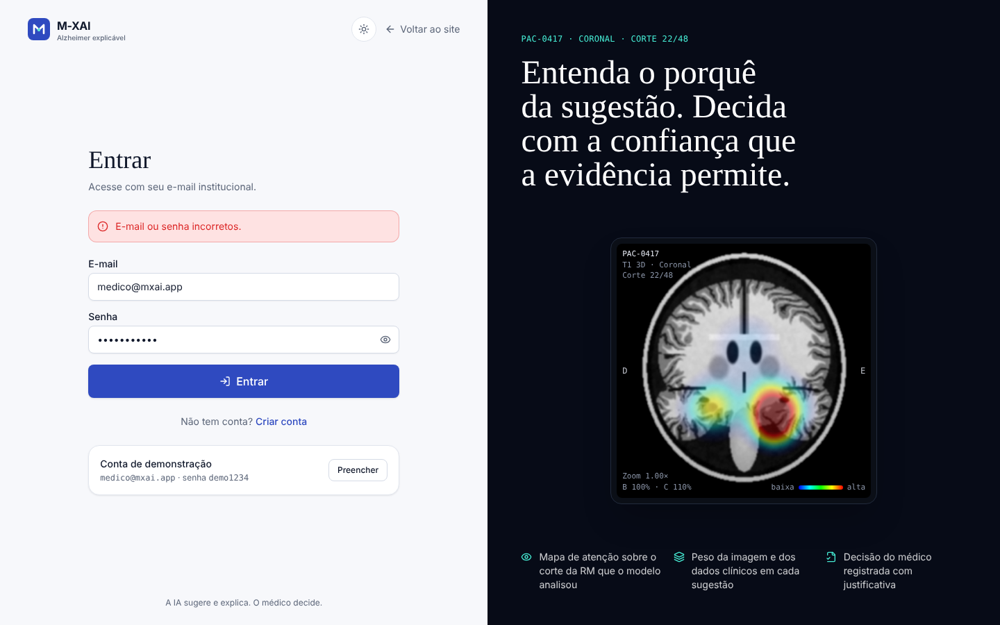

### UI02 — Casos

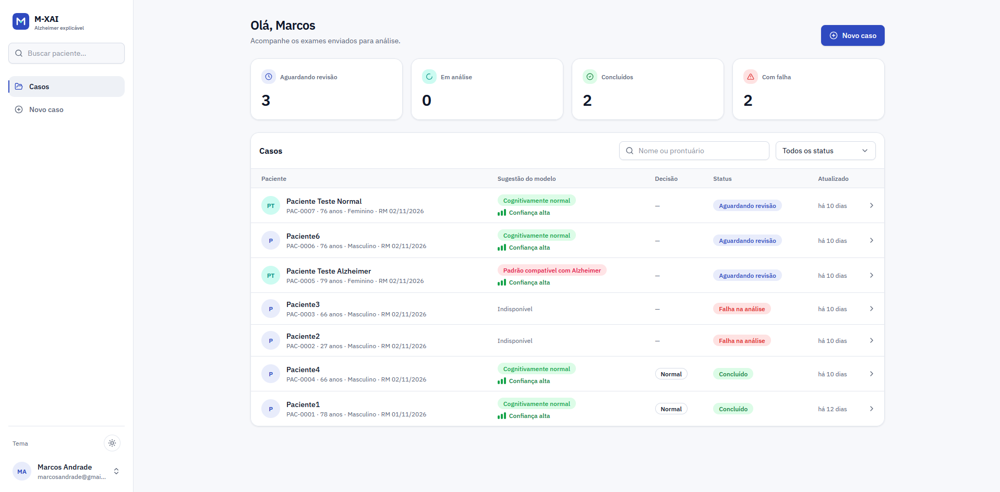

**UI02b — lista filtrada por "Aguardando revisão"** (clique no indicador)

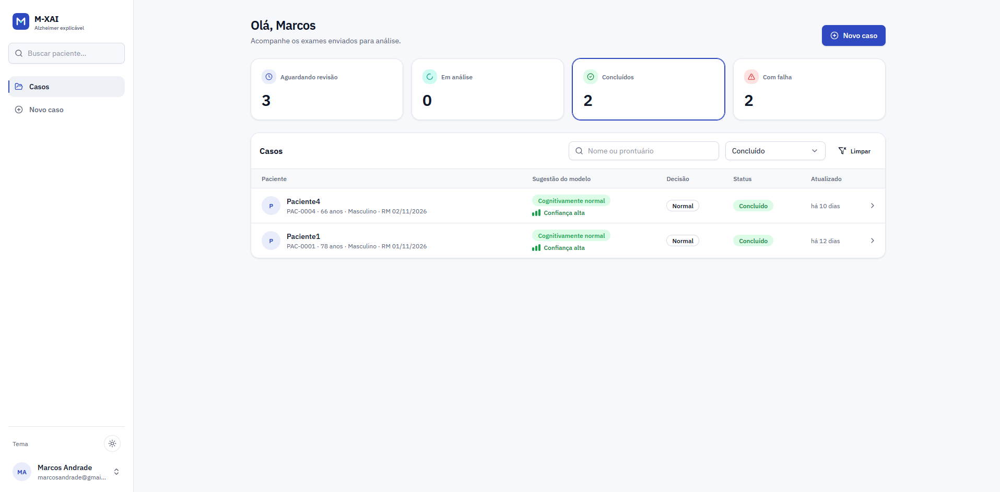

**UI02c — busca sem resultado**

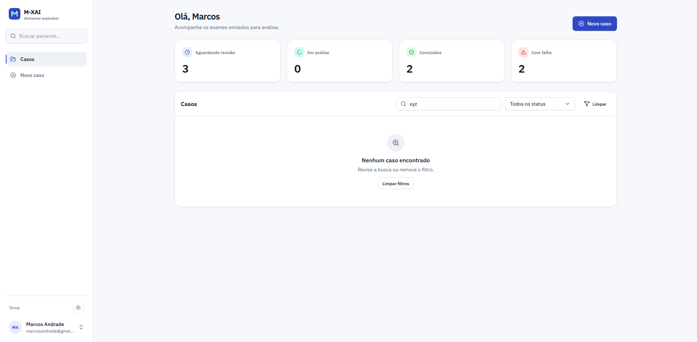

### UI03 — Caso com sugestão

Primeira tela do caso: à esquerda, o corte da RM com o mapa de atenção; à direita, a sugestão com a faixa de confiança, de onde veio a sugestão (imagem × dados clínicos) e os limites do modelo.

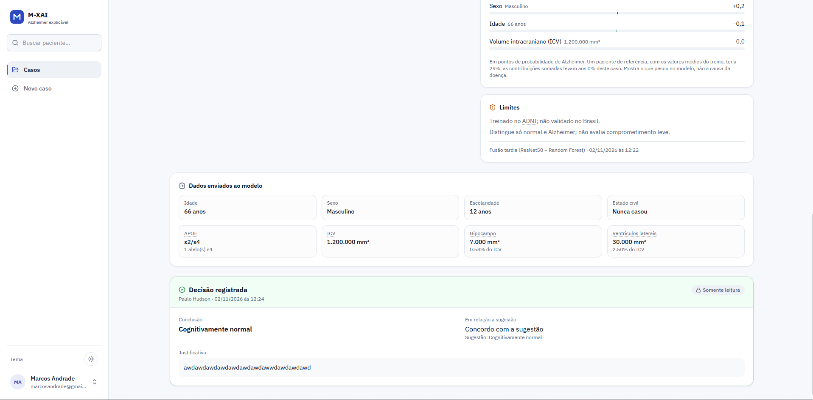

Página inteira do caso, com os dados enviados ao modelo e a seção de decisão:

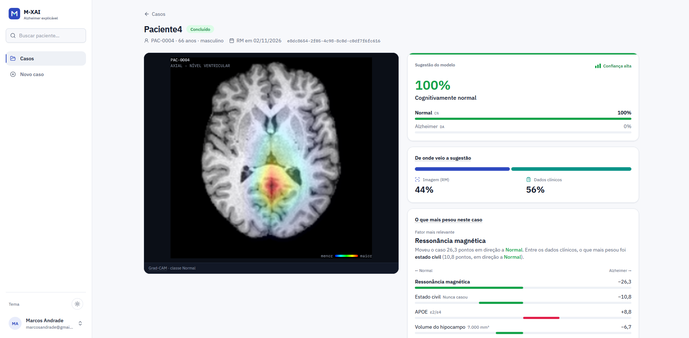

**UI03b — termo do glossário**

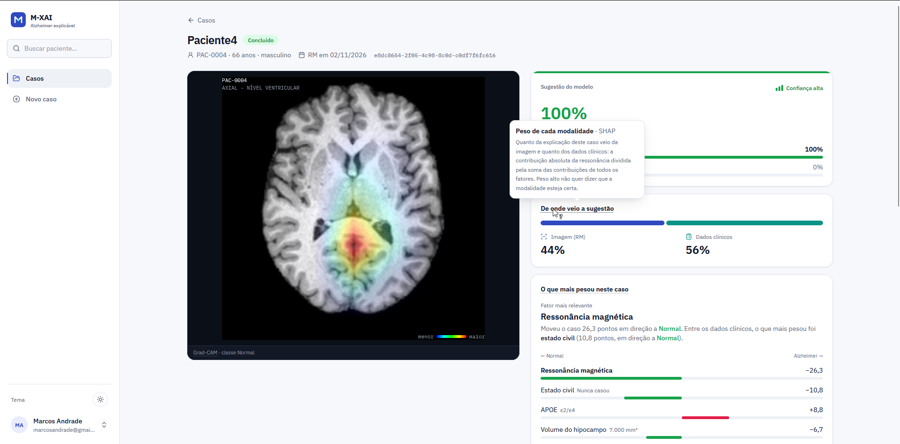

### UI04 — Caso com confiança baixa

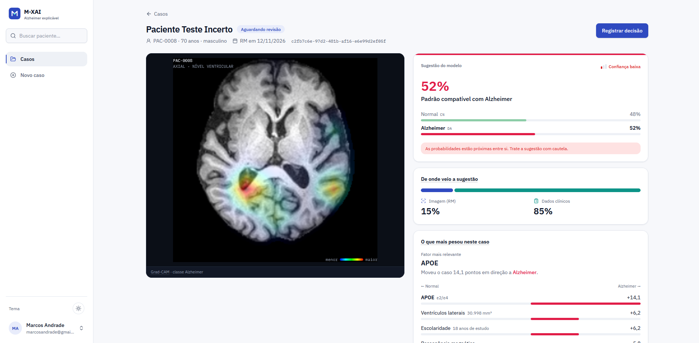

### UI05 — Sua decisão

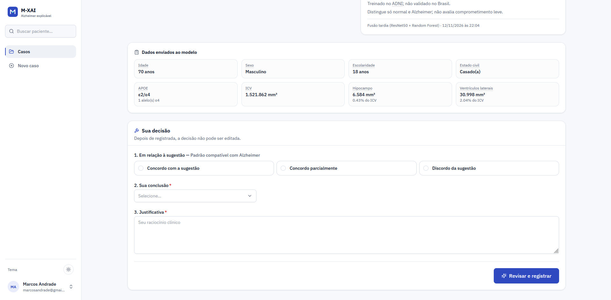

**UI05b — campos pendentes**

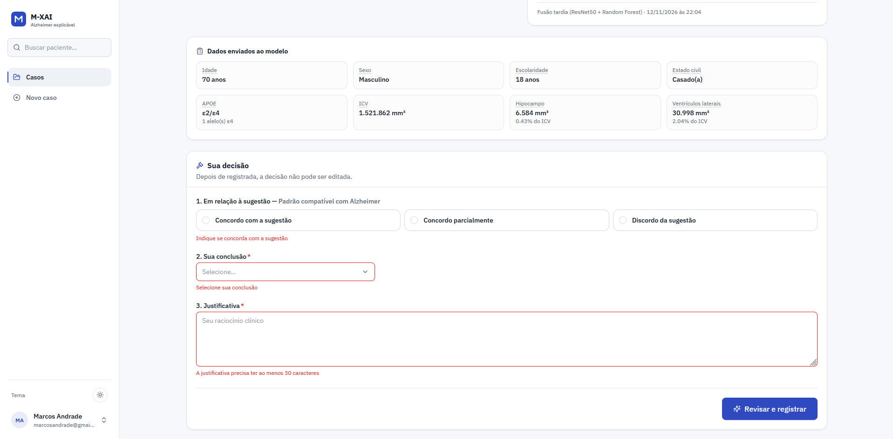

**UI05c — "Concordo" num caso de confiança baixa**

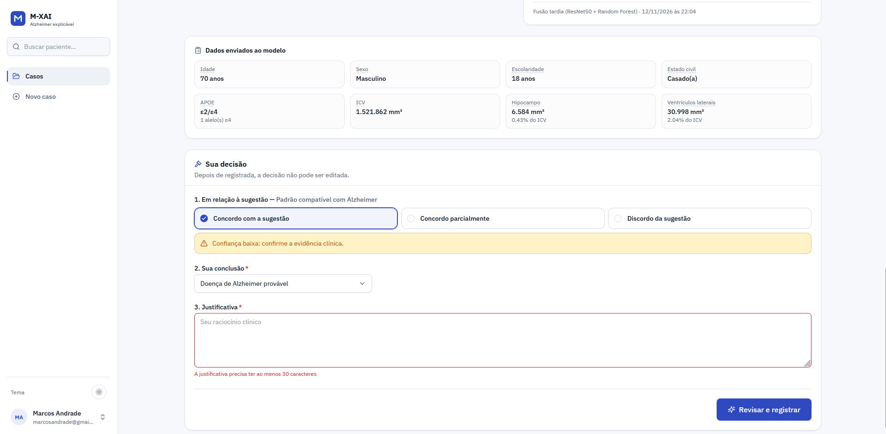

**UI05d — confirmar registro**

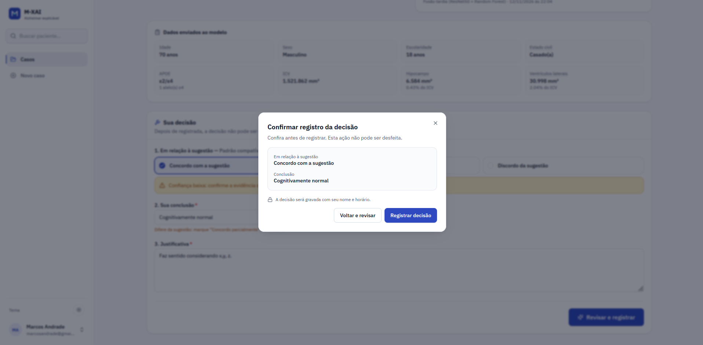

### UI06 — Novo caso

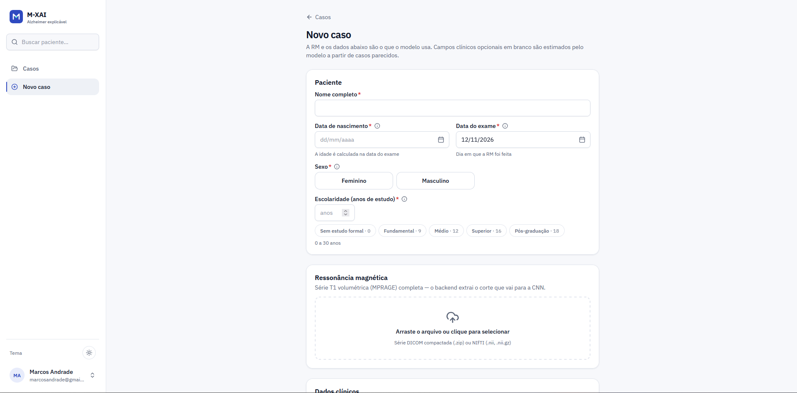

**UI06b — campos pendentes**

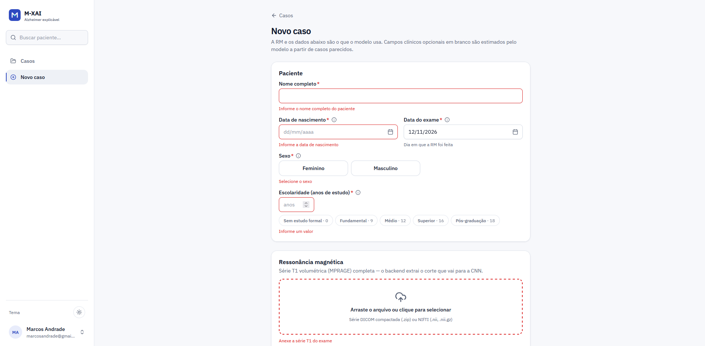

**UI06 preenchido, com o exame de exemplo anexado**

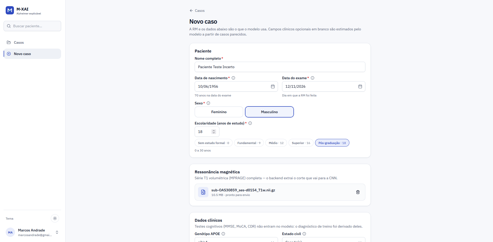

### UI07 — Analisando o exame

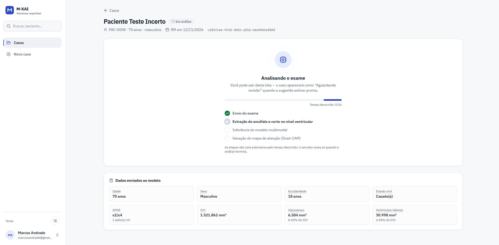

### UI08 — Falha na análise

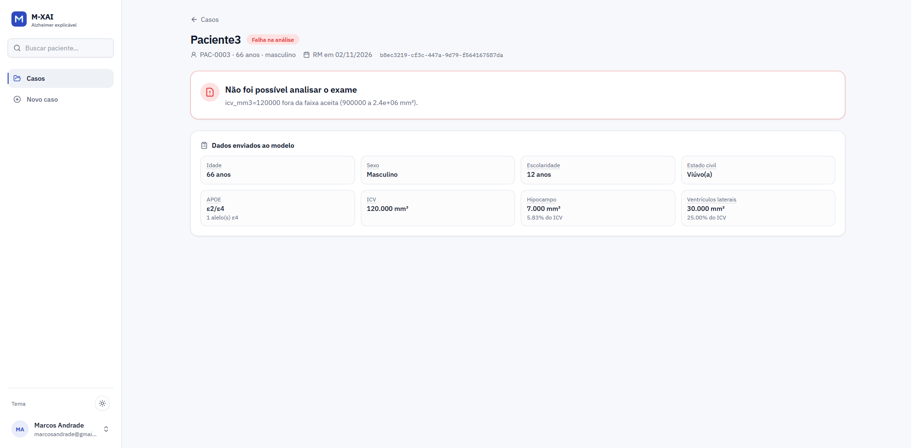

### UI09 — Caso concluído

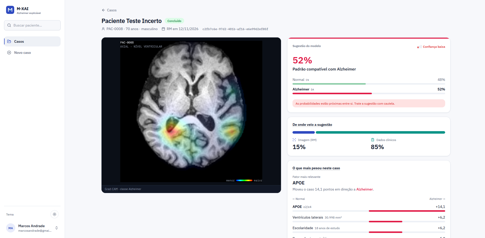

### Revisão da equipe sobre as telas

Antes da simulação, a equipe comparou as telas com as Entregas 4 e 5. Os pontos abaixo são da própria equipe e não substituem a observação da seção 4.

| Tela/ação | Problema observado | Origem na documentação | Consequência para o design |
|---|---|---|---|
| UI03, UI09 | Não há onde registrar nem consultar o parecer do especialista, nem exames anteriores do mesmo paciente | T01, HTA 2.2 e 2.3; H06 | Incluir o parecer do especialista no caso, com os exames que o sustentaram, sem reduzir a solução a "reabrir caso" (feedback da Entrega 5) |
| UI03, UI04 | O relato da família aparece só como "Observações (fora do modelo)", em texto livre e sem data | T04, HTA 1.1 e 2.1 | Registrar os episódios relatados com data e mostrá-los ao lado dos dados objetivos |
| UI06 → UI08 | Problemas no exame ou nos dados (série errada, valor fora da faixa aceita) só são apontados depois do envio e do processamento | T03, H07 | Verificar no momento do envio, antes do processamento (seção 5.1) |
| UI08 | A tela explica a falha, mas não oferece nenhuma ação: para reenviar, o usuário volta à lista e cria o caso de novo, redigitando os dados | T03, GOMS GOAL 3 (transcrição sujeita a erro) | Oferecer "Reenviar exame" no próprio caso, mantendo os dados já preenchidos |
| UI02, menu do usuário | A conta de demonstração se chamava "Dra. Helena Prado", mesmo nome da persona radiologista (P03), mas quem registra a decisão nas telas é o **médico clínico**, papel de P01 | Entrega 3, P03 e P01; seção 1 (usuário do protótipo) | **Corrigido na versão de 12/11:** a conta passou a ser "Marcos Andrade" (P01) em todas as telas, e a decisão é gravada com esse nome. P03 não decide conduta: ela lauda (T02). A questão de fundo — quais perfis podem visualizar, decidir, registrar e revisar — continua aberta e vai para o modelo conceitual (Entrega 9) |
| UI03 (caso Ivo, versão de 28/10) | A observação dizia que o esquecimento foi relatado "pela esposa"; no C02 quem relata é o filho | Entrega 4, C02 | **Deixou de se aplicar na versão de 12/11:** os casos de demonstração foram substituídos, e o caso Ivo aparece só no registro da sessão (seção 4) |
| UI06 | Os testes cognitivos (MMSE, MoCA) não aparecem em lugar nenhum, porque não entram no modelo; T01 e T04 dependem da comparação desses escores | T01 HTA 1.2; T04 HTA 1.2.1 | Mostrar os escores como contexto clínico, separados do que entra no modelo |

## 4. Simulação / walkthrough

Realize uma simulação com uma pessoa que não participou da elaboração dessas telas. Um colega pode ser usado **para essa iteração formativa**, mas isso não substitui os participantes finais da Entrega 14.

### Participante e condução

- **Participante:** Nathan Gabriel da Fonseca Leite, integrante da equipe. Não participou da construção das telas do front-end e teve o primeiro contato com a interface nesta sessão.
- **Papel assumido:** médico clínico (P01 — Dr. Marcos Andrade), com pouco tempo de consulta, que precisa interpretar a sugestão sem tratá-la como diagnóstico.
- **Limitação:** Nathan conhece o domínio e as personas do projeto e não é profissional de saúde. A sessão vale como iteração formativa: não valida as hipóteses com usuários reais (Entrega 7) nem substitui os participantes da Entrega 14.

### Roteiro da sessão

- **Duração:** cerca de 20 minutos.
- **Abertura:** "Imagine que você é um médico clínico e tem pouco tempo de consulta. A ferramenta apresenta uma sugestão e explica as evidências, mas a decisão final é sua. Use a interface como achar mais natural e diga em voz alta o que estiver pensando."
- **Condução:** a equipe apresentou as tarefas e registrou ações, dúvidas e comentários. Durante a execução, ninguém explicou onde clicar nem antecipou o resultado esperado.

| # | Tarefa apresentada a Nathan | Fluxo | O que observar |
|---|---|---|---|
| 1 | "O Sr. Ivo voltou à consulta. Encontre o caso dele e explique o que o modelo sugere e qual é o nível de confiança." | PF05 → PF01 | Se localiza o caso; se diferencia a probabilidade da faixa de confiança; se consulta os limites |
| 2 | "Analise o caso da Maria Silva e registre a conduta que você considera adequada." | PF02 | Se percebe a baixa confiança e a volumetria imputada; se o aviso influencia a decisão; se entende que o registro não pode ser alterado depois (ver 5.3) |
| 3 | "Cadastre um novo caso usando o exame de exemplo e acompanhe o processamento." | PF03 | Se entende os campos obrigatórios, o que entra no modelo e o que fazer durante a espera |
| 4 | "O caso do José Carlos aparece sem sugestão. Descubra o que aconteceu e como você resolveria." | PF04 | Se compreende a falha e identifica o próximo passo sem ajuda |

### Registro da sessão

As falas entre aspas são de Nathan, registradas durante a sessão.

| Etapa | Ação e fala de Nathan | Observação do moderador | Resultado |
|---|---|---|---|
| **Tarefa 1 — localizar o caso** | Nathan olha a lista e comenta: "O Ivo está aqui em cima. Acho que nem preciso pesquisar." Abre o registro e diz: "Encontrei o exame. Vou olhar o resultado antes de decidir." | O caso está na primeira linha da lista; a busca por nome ou prontuário também está disponível. | **Concluída sem ajuda.** A localização do caso é direta e atende ao HTA T01 2.1. |
| **Tarefa 1 — interpretar a sugestão** | Ao abrir o caso, Nathan comenta: "Noventa e quatro por cento… parece bem alto. Mas onde vejo se o modelo está seguro disso?" Depois de procurar no card, encontra a faixa de confiança: "Ah, está aqui no canto. Eu olharia isso junto com os 94%, não separado." | O percentual é o elemento de maior destaque; a faixa de confiança aparece menor e afastada, no canto do card. | **Concluída com hesitação.** Há risco de o usuário se prender ao percentual e não perceber a confiança calibrada. |
| **Tarefa 1 — conferir os limites** | Nathan rola um pouco a tela e diz: "Certo, aqui explica o que o modelo não consegue avaliar. Isso muda como eu interpreto o resultado." | Os limites aparecem abaixo de "De onde veio a sugestão" e permanecem visíveis na captura de tela utilizada. | **Concluída.** Manter os limites próximos da sugestão. |
| **Tarefa 2 — avaliar baixa confiança** | Ao abrir Maria Silva, Nathan comenta: "Aqui está diferente. As probabilidades estão próximas e ainda tem um dado imputado. Eu não trataria isso como uma resposta fechada." | A tela sinaliza baixa confiança pela faixa vermelha, pela mensagem textual e pelo aviso sobre volumetria incompleta. | **Concluída.** Os sinais de alerta são percebidos; manter a sinalização redundante. |
| **Tarefa 2 — registrar a decisão** | Nathan seleciona "Concordo parcialmente" e comenta: "Quero deixar claro que estou considerando a queixa e os outros dados, não só o resultado." Ao visualizar a confirmação, pergunta: "Depois que eu registrar, não consigo corrigir?" | A interface exige conclusão e justificativa, e informa que o registro não pode ser desfeito. | **Concluída com confirmação de entendimento.** A irreversibilidade está indicada, mas deve continuar explícita antes da gravação. |
| **Tarefa 3 — cadastrar novo caso** | Nathan abre "Novo caso" e diz: "Vou preencher os dados do paciente e anexar a ressonância." Ao encontrar os campos obrigatórios, comenta: "Se eu esquecer alguma coisa, o sistema aponta onde está faltando?" | O formulário valida os campos e leva o foco ao primeiro erro. O link "Usar exame de exemplo" é pequeno dentro da área de envio. | **Concluída.** A validação é compreensível; o acesso ao exame de exemplo poderia ter mais destaque na demonstração. |
| **Tarefa 3 — entender os dados do modelo** | Nathan lê o aviso sobre MMSE e MoCA: "Então esses testes não são usados pelo modelo? Seria bom eu conseguir registrar o resultado deles em outro lugar para considerar na avaliação clínica." | O formulário explica que os testes cognitivos não entram no modelo, mas não oferece campo para registrá-los como contexto. | **Concluída com ressalva.** Confirmada a necessidade de separar contexto clínico dos dados de entrada do modelo. |
| **Tarefa 3 — acompanhar o processamento** | Durante a espera, Nathan comenta: "Está processando. Posso adiantar outra coisa e voltar quando terminar?" | UI07 informa que a análise está em andamento, permite sair da tela e apresenta aviso quando termina. | **Concluída sem ajuda.** O estado de processamento comunica o que está acontecendo. |
| **Tarefa 4 — entender a falha** | Nathan abre o caso de José Carlos e diz: "A análise falhou. Mas o que significa essa parte de T1 volumétrica e skull strip? Eu teria que perguntar para o pessoal da ressonância." | A mensagem apresenta termos técnicos que podem não fazer parte do vocabulário de um médico clínico. | **Concluída parcialmente.** Nathan identifica que houve um problema no exame, mas não entende com clareza a causa nem a orientação. |
| **Tarefa 4 — decidir o próximo passo** | Nathan procura uma ação e comenta: "Não tem um botão para corrigir ou mandar o exame de novo? Vou voltar para a lista… mas vou ter que cadastrar tudo outra vez?" | UI08 não oferece ação de reenvio; é necessário voltar à lista e iniciar um novo cadastro. | **Não concluída de forma direta.** O fluxo exige redigitação e deve oferecer reenvio no próprio caso. |

### Síntese do teste

A sessão indica que Nathan consegue localizar casos, interpretar os principais elementos da sugestão, registrar uma decisão e cadastrar um exame. As maiores dificuldades aparecem quando a interface precisa comunicar **o grau de confiança** e, principalmente, orientar o usuário diante de uma **falha técnica**.

Os pontos que merecem revisão são:

1. **Confiança:** aproximar visualmente a faixa de confiança do percentual da sugestão, para que os dois sejam interpretados em conjunto.
2. **Limite do modelo:** quando a classificação for binária, deixar claro junto da sugestão que o modelo não avalia comprometimento leve.
3. **Justificativa da decisão:** em casos de baixa confiança, solicitar que a justificativa indique qual evidência clínica sustenta a concordância.
4. **Falha na análise:** substituir termos técnicos isolados por uma explicação em linguagem clínica e indicar o próximo passo.
5. **Reenvio:** disponibilizar a ação "Reenviar exame" no próprio caso, mantendo os dados já preenchidos.
6. **Contexto clínico:** oferecer espaço para registrar MMSE e MoCA sem misturá-los às entradas do modelo.

#### O que esta sessão sustenta e o que não sustenta

A distinção importa porque os seis pontos acima não têm todos o mesmo peso de evidência.

| A sessão fornece evidência sobre | A sessão **não** confirma |
|---|---|
| Visibilidade dos elementos na tela e dificuldade de encontrar ações | Que médicos interpretariam o percentual e a faixa de confiança do mesmo modo |
| Compreensão geral do fluxo e organização visual | Que radiologistas precisam das informações propostas |
| Clareza das mensagens, inclusive a de falha | Que técnicos realizam o processo que o protótipo pressupõe |
| Existência (ou ausência) de caminho de recuperação de erro | Que o vocabulário clínico adotado está correto |
| | Que o fluxo corresponde ao trabalho real em um serviço de imagem |

Tudo o que está na coluna da direita permanece como **hipótese aberta** e vai para a coleta da Entrega 7 (H03, H06, H07, H08 e as hipóteses H09 a H15) e para a observação da Entrega 14. Os achados vêm de um único participante da própria equipe, sem formação em saúde: eles orientam a próxima iteração e não validam nenhuma hipótese clínica.

### Revisão da primeira versão (23/10)

Antes da versão publicada, a equipe revisou a primeira versão (commit `f25089a`) em duas frentes:
- comparar cada tela com o que o modelo do TCC realmente devolve (repositório `tcc-alzheimer-diagnosis-multimodal-xai`, branch `codigo-treinamento`);
- comparar cada tela com as tarefas da Entrega 5.

**Primeira versão (23/10), antes da revisão:**

| Painel | Caso | Novo caso |
|---|---|---|
| 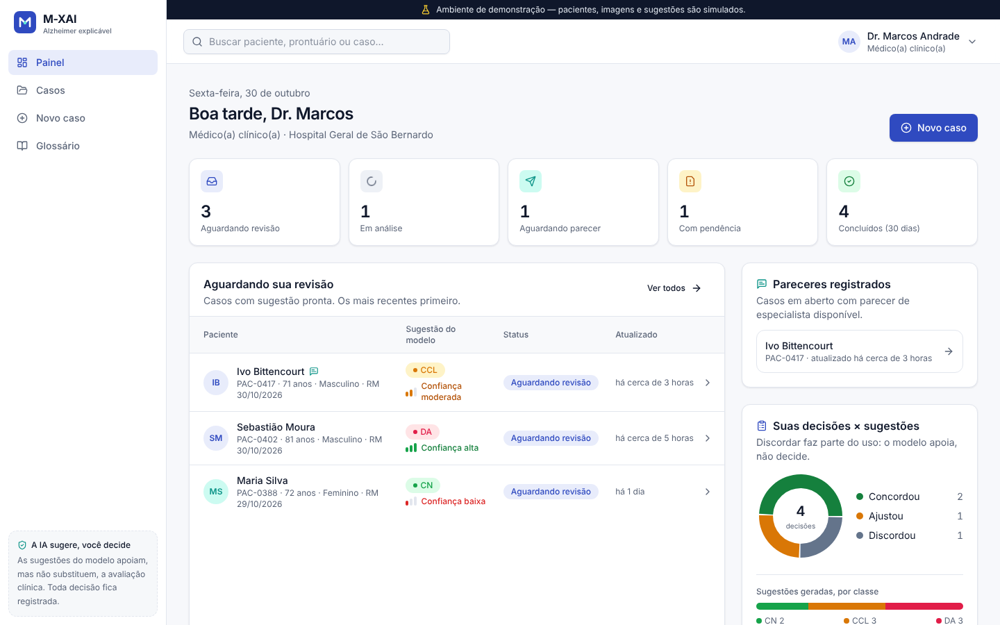 | 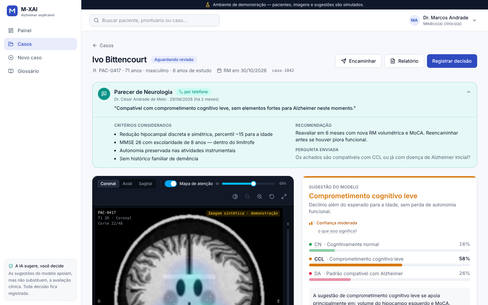 | 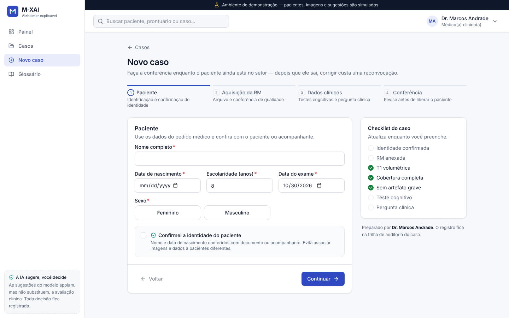 |

Página inteira do caso na primeira versão:

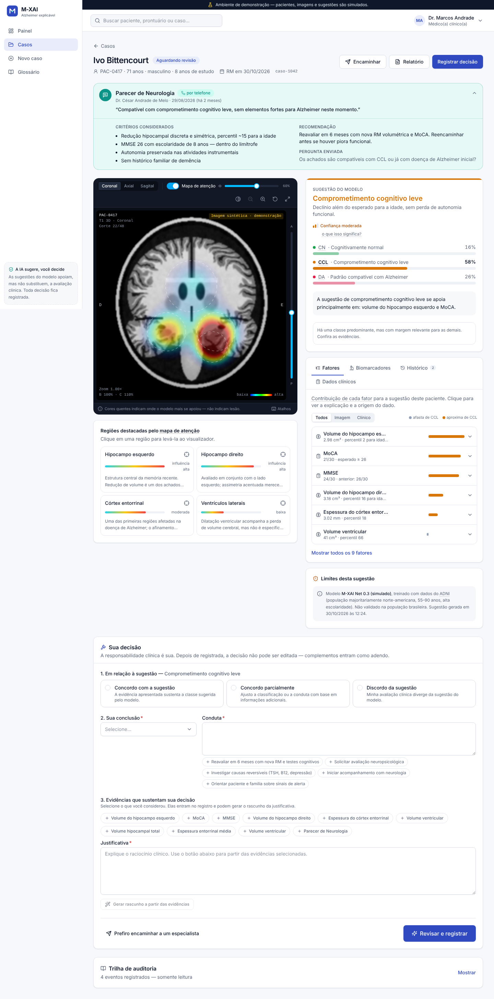

| Observação | Tela/ação | Evidência | Consequência para o design |
|---|---|---|---|
| O visualizador oferecia três planos (coronal, axial, sagital) e listava regiões nomeadas ("hipocampo esquerdo — influência alta") | Caso → visualizador e "Regiões destacadas pelo mapa de atenção" | O Grad-CAM do modelo é de **um corte axial 2D**, em grade 7×7, sem rótulo anatômico (`gradcam.py`) | A explicação não pode afirmar mais do que o modelo calcula: mostrar só o corte axial com o mapa, sem nomear regiões (confiança calibrada, H03) |
| A aba "Fatores" mostrava a contribuição de cada variável (volume do hipocampo, MoCA, MMSE…) | Caso → aba Fatores | O SHAP do modelo só separa **imagem × dados clínicos**; o ramo tabular é uma Random Forest (§5.2 do README do modelo) | Trocar a lista de fatores pelo peso de cada modalidade ("De onde veio a sugestão") |
| A aba "Biomarcadores" mostrava percentis normativos ("percentil 2 para a idade") | Caso → aba Biomarcadores | O pipeline não tem referência normativa | Mostrar o volume e a proporção em relação ao volume intracraniano, sem percentil |
| MMSE e MoCA eram pedidos no envio e apareciam entre os fatores da sugestão | Novo caso → etapa "Dados clínicos"; Caso → Fatores | O rótulo da ADNI é derivado desses testes; usá-los como entrada faria o modelo "ver a resposta" | Retirar os testes cognitivos do que entra no modelo e avisar no formulário. Como T01 e T04 dependem desses escores, eles devem voltar como **contexto clínico** separado (seção 3) |
| Perfis (técnico, radiologista, neurologista), encaminhamento, parecer estruturado, trilha de auditoria e painel com gráficos dependiam de dados que nenhum serviço fornece | Painel; Caso → "Encaminhar" e "Parecer de Neurologia" | O repositório do modelo tem só o código de treino; essas funções exigiriam um backend de aplicação inteiro além da inferência | Reduzir o escopo ao que o backend sustenta. Com isso, o **parecer do especialista (T01)** e a **conferência antes da liberação (T03)** voltam a ser lacunas, registradas na seção 3 |
| O painel inicial reunia indicadores, gráficos e listas que não respondiam a uma tarefa da Entrega 5 | Painel | Checklist desta entrega: "não criar dashboard apenas para parecer completo" | Manter só a lista de casos, com indicadores que funcionam como filtro |

## 5. Alterações após a simulação

### 5.1 Prevenção e recuperação na tarefa do técnico (T03 / H07)

Os itens de UI06 e UI08 na tabela abaixo foram tratados na primeira redação como um problema só ("a falha aparece tarde"). São dois problemas de naturezas diferentes, e misturá-los faz a interface resolver o mais fácil e deixar o mais importante de fora.

**O que H07 afirma:** problemas de qualidade da RM e dados clínicos incompletos só são percebidos **depois que o paciente sai do setor**. O custo descrito em C03 é a reconvocação, não o retrabalho de digitação. Logo o alvo de design é o momento anterior à liberação do paciente.

| | **Prevenção** — antes de liberar o paciente | **Recuperação** — depois que o erro já ocorreu |
|---|---|---|
| Momento | Paciente ainda na sala, exame ainda refazível | Paciente já foi embora |
| Tarefa da Entrega 5 | T03, HTA 2.1.3 (garantir a qualidade diagnóstica) e 2.2 (reunir os dados clínicos) | T03, HTA 2.1.3.4 (reconvocar) e GOMS GOAL 3 |
| Custo se falhar | Reconvocação do paciente, atraso no diagnóstico (C03) | Redigitação e nova espera de processamento |
| Estado no protótipo | **não implementado** | **não implementado** (UI08 não oferece ação) |

**O que pode ser verificado antes do envio e antes da liberação.** Esta coluna é a que o protótipo não tem, e é a que responde a H07. Ela se divide no que a interface consegue checar sozinha e no que depende do julgamento do técnico:

| Verificação | Quem verifica | Onde deve aparecer |
|---|---|---|
| Identificação do paciente confere com o pedido | técnico (a interface mostra os dois lados) | UI06, antes do botão de envio |
| A série enviada é a que o modelo usa (T1 volumétrica) | **a interface**, lendo o cabeçalho do arquivo | UI06, na seleção do arquivo — não depois do processamento |
| A cobertura inclui a região de interesse | **a interface**, por conferência de dimensões | UI06, na seleção do arquivo |
| Não há artefato de movimento que inviabilize a leitura | técnico (julgamento visual) | UI06, confirmação explícita com pré-visualização |
| Os dados clínicos obrigatórios estão preenchidos e plausíveis | **a interface**, por validação de campo | UI06b (já existe parcialmente). O print de UI08 mostra exatamente o que falta: um volume intracraniano de 120.000 mm³, fora da faixa que o próprio sistema conhece, foi aceito no formulário e só recusado depois do processamento |
| O estudo chegou íntegro antes de liberar o paciente | **a interface**, por confirmação de recebimento | UI07, com retorno rápido o suficiente para ser útil antes da liberação |

**Consequência para o design.** A validação de UI06/UI06b hoje é só de campo de formulário; ela não examina o arquivo. A verificação do tipo de série e da cobertura precisa acontecer **no momento da seleção do arquivo**, e não depois do processamento, porque é só aí que ela chega em tempo de evitar a reconvocação. Essa é a lacuna central da seção 1.

**Recuperação (UI08).** Mesmo com prevenção, a falha vai ocorrer. A tela atual é um fim de caminho: ela explica o erro em termos técnicos (na versão atual, "icv_mm3=120000 fora da faixa aceita (900000 a 2.4e+06 mm³)") e não oferece ação, obrigando o usuário a recriar o caso e redigitar tudo. Duas mudanças:

1. **"Reenviar exame" no próprio caso,** preservando os dados clínicos já preenchidos e substituindo apenas o arquivo — porque a transcrição (GOMS GOAL 3) é justamente onde o técnico erra, e fazê-lo redigitar introduz um segundo erro para corrigir o primeiro.
2. **Mensagem em linguagem clínica,** dizendo o que está errado e o que fazer, na linguagem do serviço e não na do modelo. Para a falha do print atual, em lugar de "icv_mm3=120000 fora da faixa aceita", algo como "O volume intracraniano informado (120.000 mm³) está muito abaixo do esperado para um adulto (entre 900.000 e 2.400.000 mm³). Confira o valor no laudo de volumetria e reenvie." Para uma série errada, algo como "O arquivo enviado é uma sequência FLAIR. A análise precisa da T1 volumétrica do mesmo exame. Selecione a outra série no PACS e reenvie."

Nenhuma das duas está implementada; ambas são requisito para a Entrega 8 e estão registradas na `RASTREABILIDADE.md`.

### 5.2 Mudanças já implementadas e propostas

A revisão abaixo reúne três momentos: as mudanças da primeira versão (23/10) para a versão avaliada (28/10), as alterações propostas a partir da sessão com Nathan e as mudanças da versão de 12/11, feita depois do feedback. Os prints de "Depois" são as telas atuais da seção 3; os itens marcados como **próxima versão** ainda não devem ser entendidos como implementados.

| Antes | Problema identificado | Depois / alteração | Origem e justificativa |
|---|---|---|---|
| Visualizador com três planos e regiões anatômicas nomeadas, com nível de influência | A interface mostrava uma explicação mais precisa do que a que o modelo produz | **Implementado:** corte axial com mapa de atenção (UI03). Na versão de 28/10 havia também opacidade ajustável e tecla O para ocultar o mapa; esse controle foi retirado na versão de 12/11 (seção 3) | Revisão técnica da primeira versão: a explicação precisa corresponder ao que o modelo calcula; uma explicação inventada leva a confiança indevida (H03) |
| Aba "Fatores" com SHAP por variável clínica | O modelo não separa a contribuição de cada variável | **Implementado:** card "De onde veio a sugestão", com o peso da imagem e dos dados clínicos (UI03) | Revisão técnica de 28/10: o SHAP disponível naquela versão só separava as duas modalidades. A contribuição por variável voltou na versão de 12/11 (linha abaixo) |
| Card "De onde veio a sugestão" só com o peso de cada modalidade (UI03, versão de 28/10) | Saber que 56% da explicação veio dos dados clínicos não diz **qual** dado pesou. Sem isso, o médico não tem como julgar se a sugestão se apoia em algo clinicamente plausível (volume do hipocampo, APOE) ou em algo que deveria fazê-lo desconfiar | **Implementado (versão de 12/11):** card "O que mais pesou neste caso", com a contribuição de cada variável em pontos de probabilidade, em direção a Normal ou a Alzheimer, e o fator mais relevante em destaque (UI03, UI04). O próprio card avisa que "mostra o que pesou no modelo, não a causa da doença" | Decisão da equipe: o médico precisa saber qual variável sustentou a sugestão para decidir se confia ou desconfia dela (H01, H03). A volta só é coerente com a revisão técnica de 28/10 porque os valores vêm do modelo: o card parte da probabilidade de um paciente de referência (média do treino) e soma as contribuições até a probabilidade do caso. Fica como hipótese para a avaliação se o médico lê corretamente uma contribuição alta de uma variável sem relação clínica (por exemplo, estado civil) como motivo para desconfiar, e não como achado (H03) |
| Aba "Biomarcadores" com percentil normativo | Não há referência normativa para calcular o percentil | **Implementado:** "Dados enviados ao modelo", com volume e proporção do volume intracraniano, e aviso "Imputado" quando o dado falta (UI03, UI04) | Revisão técnica: mostrar o que o modelo de fato recebeu, inclusive o que foi estimado |
| MMSE e MoCA como entrada do modelo | Os testes que geram o rótulo entravam como dado de entrada | **Implementado:** formulário avisa que os testes cognitivos não entram no modelo (UI06) | Revisão técnica: evitar que o modelo "veja a resposta". Os escores ainda precisam voltar como contexto clínico |
| Envio em 4 etapas com checklist do técnico (identidade, T1 volumétrica, cobertura, artefato) | O protótipo tratava o técnico como um **perfil de usuário separado**, com login e checklist próprios, que o backend disponível não sustenta | **Implementado:** formulário único, com validação antes do envio (UI06, UI06b) | Revisão técnica. **O que saiu foi a solução de interface, não o usuário:** P04 e T03 continuam no escopo (seção 1). A conferência antes da liberação (T03, H07) volta a ser lacuna e é tratada na seção 5.1 |
| Painel com indicadores, gráficos e pareceres registrados | Informações sem tarefa correspondente | **Implementado:** lista de casos com indicadores que filtram, busca e filtro de status (UI02) | Revisão técnica: cada tela precisa responder a uma tarefa; o painel não respondia a nenhuma |
| Perfis, encaminhamento, parecer estruturado e trilha de auditoria | Dependiam de um backend de aplicação inexistente | **Implementado parcialmente:** uma única conta; decisão registrada com nome e horário, sem edição (UI05d, UI09) | Revisão técnica: o registro da decisão sustenta T01 (HTA 4) e T04 (HTA 4.2). O parecer do especialista volta como prioridade quando houver backend de aplicação (H06). **A proibição de editar é hipótese, não requisito** — ver 5.3 |
| Glossário em página própria | Exigia sair do caso para entender um termo | **Implementado:** glossário como dica no próprio termo (UI03b) | Revisão técnica: entender o termo sem perder o contexto do caso (F06) |
| Opacidade ajustável e tecla O para ocultar o mapa de atenção (P03b, versão de 28/10) | — | **Retirado do escopo (versão de 12/11):** o mapa fica sempre sobreposto ao corte | Decisão da equipe. O candidato RC01 (Entrega 2), que motivava o controle, sai do escopo junto; nunca tinha sido validado com usuários |
| Página "Decisão registrada" depois do registro (P05e, versão de 28/10) | — | **Retirado do escopo (versão de 12/11):** depois de registrar, o sistema leva ao caso concluído (UI09), que mostra a decisão com nome e horário | Decisão da equipe. Sem perda: a verificação do resultado (GOMS T01, OP. 4.4) passa a ser feita em UI09 |
| Relatório imprimível (P06, versão de 28/10) | — | **Retirado do escopo (versão de 12/11):** a interface não gera mais relatório | Decisão da equipe. Levar a decisão ao prontuário deixa de ser apoiado pela interface; é limitação declarada de T01 (seção 3) |
| Faixa de confiança pequena, no canto do card (UI03) | Os dois números são de naturezas diferentes e a tela os apresenta como se fossem o mesmo tipo de informação: **94% é a probabilidade da classe** (o quanto o modelo favorece esse diagnóstico entre as alternativas); **a faixa de confiança é a calibração** (o quanto essa probabilidade é confiável, dada a qualidade dos dados daquele caso). Um percentual alto com calibração ruim é exatamente o caso perigoso, e a tela atual permite ler só o primeiro | **Próxima versão:** dois rótulos distintos e separados no card — "Probabilidade da classe: 94%" e, imediatamente abaixo e com o mesmo peso visual, "Confiabilidade desta estimativa: alta / média / baixa", com a razão da classificação ("volumetria imputada", "dado faltante"). Nunca combinar os dois em um número único nem em uma única barra | Sessão com Nathan, tarefa 1; confiança calibrada (H03; Entrega 2, RC03 e RC10) |
| "Concordo" em confiança baixa só mostra um aviso de uma linha (UI05c) | Nathan percebeu o aviso, mas a interface ainda permite registrar sem relacionar a justificativa à evidência clínica | **Próxima versão:** em confiança baixa, a justificativa precisa citar a evidência clínica que sustenta a concordância | Sessão com Nathan, tarefa 2; evitar concordância automática com uma sugestão fraca (H03) |
| Limite "não avalia comprometimento leve" só no card de limites (UI04) | A informação pode passar despercebida quando o usuário concentra a atenção na sugestão | **Próxima versão:** quando o modelo for binário, avisar junto da sugestão | Sessão com Nathan, tarefa 2; Entrega 2, RC11 |
| Mensagem de falha técnica e sem ação (UI08) | Nathan não compreendeu os termos técnicos e não encontrou como corrigir o envio | **Próxima versão:** mensagem em linguagem clínica e botão "Reenviar exame", mantendo os dados | Sessão com Nathan, tarefa 4; T03 e H07, evitar redigitação e reconvocação |
| Testes cognitivos sem lugar na interface (UI06) | Retirar MMSE e MoCA da entrada do modelo foi correto (evita que o modelo veja a resposta), mas eles foram retirados **da interface inteira**, e T01 e T04 dependem de comparar esses escores com a sugestão | **Próxima versão:** bloco "Contexto clínico" no envio (UI06) e no caso (UI03, UI04), com MMSE, MoCA e data de aplicação, **visualmente separado** do bloco "Dados enviados ao modelo" e com a frase "não entra no cálculo da sugestão" junto do bloco. Separar a entrada do modelo do contexto clínico é decisão de **apresentação**, não de exclusão do dado | Sessão com Nathan, tarefa 3; T01 HTA 1.2 e T04 HTA 1.2.1; revisão técnica da primeira versão |

### 5.3 O registro da decisão precisa ser imutável? (hipótese aberta)

UI05d avisa que a decisão "não pode ser desfeita" e UI09 a exibe em modo "somente leitura", sem permitir qualquer alteração, e o roteiro da sessão chama isso de "registro irreversível". Isso foi derivado de uma exigência de **auditoria**, mas a equipe transformou auditoria em **imutabilidade absoluta** sem verificar se é isso que a prática clínica exige. São coisas diferentes:

- **Auditoria** exige saber quem registrou o quê, quando, e que nada desapareça sem deixar rastro.
- **Imutabilidade absoluta** exige que nada possa ser alterado nunca.

A segunda não decorre da primeira. O documento clínico análogo é o laudo, e na prática de serviços de imagem laudos são complementados e retificados por **adendo** ou por **nova versão**, com o texto original preservado e visível. Um erro de digitação ou uma conduta que mudou depois do parecer do especialista (que é exatamente o caso de C02 e T01) não têm saída na interface atual: o médico teria que registrar uma segunda decisão sem relação explícita com a primeira, o que piora a rastreabilidade em vez de melhorá-la.

As três opções, com o que cada uma custa:

| Opção | Rastreabilidade | Risco |
|---|---|---|
| **Imutável** (atual) | total | força registros paralelos e desconexos quando a conduta muda; penaliza erro de digitação |
| **Correção com motivo** (janela curta, registro do que mudou) | preserva o original e o motivo | exige definir a janela e quem pode corrigir |
| **Adendo / nova versão** (original visível, complemento datado) | preserva a cronologia do raciocínio | mais complexo de implementar e de ler na tela |

A equipe **não decide isso nesta entrega**. A terceira opção é a que mais se aproxima da prática de laudo e a que melhor atende T01, mas isso é suposição da equipe sobre o trabalho médico, não achado. A pergunta vai para a coleta da Entrega 7 como hipótese **H15** na `RASTREABILIDADE.md`, e UI05d/UI09 ficam marcadas como **hipótese aberta**, não como requisito implementado.

## Checklist

- [x] O protótipo cobre tarefas relevantes da Entrega 5.
- [x] Cada tela/estado pode ser justificado por uma tarefa, decisão ou informação necessária.
- [x] O projeto não criou dashboard/CRUD/login apenas para parecer “completo”.
- [x] Telas/estados estão numerados e navegáveis na documentação.
- [x] Há pelo menos uma simulação/walkthrough documentado.
- [x] Críticas não foram apenas listadas: geraram decisão de revisão.
- [x] O protótipo mantém mentalidade de baixa fidelidade: nenhuma decisão de interação está fechada (seção "Forma do protótipo").
- [x] A documentação distingue o que está implementado, o que é próxima versão e o que é hipótese aberta.
- [x] A documentação distingue prevenção de recuperação de erro (seção 5.1).
- [x] A documentação declara o que a simulação não valida (seção 4).
