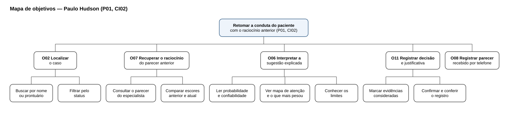

# Entrega 9 — Modelo conceitual e design centrado na comunicação

**Data:** 16/11/2026  
**Status:** 🟨 em andamento  
**Responsabilidade:** soluções individuais, com consolidação da equipe para mapa de objetivos e esquema de signos.

## Objetivo da atividade

Passar do cenário de problema para uma concepção da interação, explicitando objetivos, tópicos de conversa, falas e signos que a interface deverá comunicar/manipular.

## Transformando resultados técnicos em conceitos compreensíveis

Em TCCs algorítmicos ou orientados a dados, esta entrega deve evitar que a interface exponha apenas estruturas internas do código. Identifique os **conceitos e signos que fazem sentido para o usuário**.

Exemplos:

- `query plan`, custo estimado, recomendação e impacto para um DBA;
- modelo, dataset, versão, execução e métrica para engenheiro de IA;
- período, indicador, grupo, tendência e filtro para gestor/analista;
- alerta, severidade, evidência, responsável e status para analista de segurança.

Se um termo técnico for necessário, modele como será comunicado, explicado e relacionado à tarefa.

Dashboards, relatórios, filtros e CRUDs devem aparecer no modelo conceitual por meio dos **objetivos, signos e conversas** que justificam sua existência.

## 1. Cenários de interação

Para cada cenário de problema, produza uma versão em que a solução já pode ser descrita. **Destaque claramente o texto alterado** em relação ao cenário original.

### CI01 — {{título}}

**Autor(a):** {{nome — matrícula}}  
**Origem:** cenário problema {{C01}}

{{cenário de interação com alterações marcadas}}

### Diferenças relevantes

| Alteração | Por que foi necessária | Evidência/artefato que justifica |
|---|---|---|
| {{...}} | {{...}} | {{...}} |

### CI02 — O parecer que ficou no caso

**Autor(a):** Paulo Hudson Josué da Silva — 22.222.013-9  
**Origem:** cenário problema C02 — "O parecer que se perdeu" (P01, tarefa T01)

*Em **negrito**, o texto novo ou alterado em relação ao cenário refinado C02 da Entrega 4; em ~~tachado~~, o texto retirado.*

Dois meses atrás, o Dr. Marcos Andrade encaminhou informalmente o Sr. Ivo Bittencourt, 71 anos, ao neurologista Dr. César Andrade de Melo, após identificar um MMSE limítrofe e um laudo de MRI pouco conclusivo. Como a fila oficial de encaminhamento levaria meses e o quadro não parecia grave o suficiente para justificar a espera, Marcos preferiu resolver por conhecimento pessoal. Ligou para César, que atendeu o caso como favor entre colegas. César respondeu que os achados eram "compatíveis com comprometimento cognitivo leve, sem elementos fortes para Alzheimer neste momento" e sugeriu reavaliação em seis meses. ~~Marcos anotou rapidamente "neuro: sem AD por ora, reavaliar" numa nota de rodapé do prontuário. Como o prontuário eletrônico atual não possui campos estruturados para distinguir pareceres informais de anotações comuns, os critérios técnicos exatos utilizados por César para afastar Alzheimer não foram gravados no sistema.~~ **Ainda durante a ligação, Marcos registrou o parecer no caso do paciente, em campos próprios: quem deu o parecer, a data, o canal ("telefone"), a conclusão, os critérios citados por César (redução hipocampal discreta para a idade, MMSE compatível com a escolaridade, autonomia preservada), os exames que ele revisou e a recomendação de reavaliar em seis meses. O registro ficou identificado como parecer de especialista, separado das anotações de rotina.**

Hoje, o Sr. Ivo retorna à consulta acompanhado do filho, relatando piora perceptível da memória nas últimas semanas. ~~Marcos abre o prontuário e encontra apenas essa anotação breve. Ele não lembra quais exames o neurologista revisou, nem por que descartou Alzheimer naquele momento.~~ **Marcos localiza o caso pela busca e encontra o parecer de César no topo, com os critérios e os exames que o sustentaram. Ele reaplica o MMSE, e o bloco de contexto clínico mostra o escore anterior e o atual lado a lado, separado dos dados que entram no modelo.** A agenda do dia está cheia. ~~Tenta ligar para César, mas ele está em cirurgia e não retorna a tempo da consulta. Na ausência de um canal estruturado para resgatar o histórico, Marcos estima que gastaria preciosa parte da consulta tentando auditar papéis físicos ou registros dispersos.~~ **César está em cirurgia, mas Marcos não precisa ligar: confronta a piora relatada com os critérios registrados. Ele também consulta a sugestão do modelo para o exame mais recente, que mostra separadamente a probabilidade da classe e a confiabilidade dessa estimativa, as variáveis que mais pesaram e os limites do modelo.** Marcos precisa decidir se pede um novo exame do zero, se reencaminha o paciente ao mesmo neurologista — sobrecarregando a fila oficial — ou se toma uma conduta sozinho, ~~sem o contexto completo da avaliação anterior~~ **agora com o contexto da avaliação anterior. Ele registra a decisão, marca como evidências consideradas o parecer de César e os dois escores, e confere o registro gravado com seu nome e horário, ligado ao parecer anterior.** ~~Qualquer que seja a conduta tomada nesta consulta, Marcos só saberá se ela foi adequada caso ocorra uma nova piora clínica perceptível ou se o paciente for atendido posteriormente por outro colega.~~ **Qualquer que seja a conduta, quem abrir o caso depois encontrará, em ordem, o raciocínio de César e o de Marcos.**

### Diferenças relevantes

| Alteração | Por que foi necessária | Evidência/artefato que justifica |
|---|---|---|
| Parecer de especialista registrado em campos próprios (autor, data, canal, conclusão, critérios, exames, recomendação) | O raciocínio do especialista existia só na ligação; o método de reconstrução pelos exames termina numa inferência que o clínico não domina | H06; T01 HTA 2.2 e 2.3, GOMS M2 (Entrega 5); feedback da Entrega 5: preservar a continuidade do raciocínio, não reduzir a solução a "reabrir caso" |
| Parecer identificado como tal, separado das anotações de rotina | A nota de rodapé se mistura às anotações comuns | T01 HTA 2.2 (recomendação); C02 Q1 |
| Escores anterior e atual lado a lado, fora dos dados do modelo | O novo escore só tem valor se comparado ao anterior; MMSE e MoCA não entram no modelo, mas são contexto da decisão | T01 HTA 1.2; Entrega 6, seção 5.2 (bloco "Contexto clínico") |
| Probabilidade da classe e confiabilidade da estimativa como signos separados | Um percentual alto com confiabilidade baixa é o caso perigoso, e os dois eram lidos como uma coisa só | H03; Entrega 6, seção 5.2; Entrega 8, MU06 |
| Decisão ligada ao parecer anterior, com as evidências marcadas | Sem a ligação, a próxima retomada repete o problema | T01 HTA 4; F05 (`RASTREABILIDADE.md`); H15 em aberto (correção por adendo) |

## 2. Design centrado na comunicação

**Nome do cenário:** {{CI01}}

| Tópico > subtópico | Falas e signos envolvidos | Intenção/efeito esperado |
|---|---|---|
| {{objetivo}} | `U: ...` / `D: ...` | {{...}} |
| > {{subtópico}} | {{...}} | {{...}} |

**Nome do cenário:** CI02 — O parecer que ficou no caso (Paulo Hudson Josué da Silva)

| Tópico > subtópico | Falas e signos envolvidos | Intenção/efeito esperado |
|---|---|---|
| Registrar parecer de especialista | `U: "Registrar parecer"` / `D: campos "Especialista", "Data", "Canal", "Conclusão", "Critérios considerados", "Exames revisados", "Recomendação"` | Transformar a ligação em um registro recuperável, com a origem explícita |
| > Confirmar o registro | `D: "Parecer de Neurologia — Dr. César Andrade de Melo · 29/08 · por telefone"` | O parecer fica identificado como tal, separado das anotações de rotina |
| Retomar o raciocínio do parecer anterior | `U: busca "Ivo"` / `D: lista com o caso, o status e a data do último registro` | Localizar o caso sem percorrer evoluções |
| > Consultar o parecer | `D: "Compatível com comprometimento cognitivo leve, sem elementos fortes para Alzheimer neste momento" · "Critérios: …" · "Reavaliar em 6 meses"` | Recuperar o raciocínio sem depender da memória nem do telefone |
| > Comparar escores | `D: "Contexto clínico (não entra no cálculo da sugestão): MMSE 26 em 29/08 · 23 hoje"` | Ver a variação sem misturar contexto clínico com entrada do modelo |
| Interpretar a sugestão explicada | `D: "Probabilidade da classe: 64% — padrão compatível com Alzheimer"` · `D: "Confiabilidade desta estimativa: moderada"` | Ler os dois números como coisas diferentes |
| > Ver o que mais pesou | `D: "O que mais pesou neste caso: volume do hipocampo, em direção a Alzheimer"` · `D: "Mostra o que pesou no modelo, não a causa da doença"` | Julgar se a sugestão se apoia em algo clinicamente plausível ou em algo que deve gerar desconfiança |
| > Conhecer os limites | `D: "Treinado na ADNI; não validado no Brasil" · "Distingue só normal e Alzheimer; não avalia comprometimento leve"` | Calibrar a confiança antes de decidir |
| Registrar decisão e justificativa | `U: escolhe "Concordo parcialmente", escreve a conduta e marca as evidências "Parecer de Neurologia" e "MMSE"` / `D: "A decisão será gravada com seu nome e horário e ficará ligada ao parecer de 29/08"` | Tornar a decisão rastreável e conectada ao raciocínio anterior |
| > Conferir o registro | `U: "Registrar decisão"` / `D: "Decisão registrada · Dr. Marcos Andrade · 13/11, 10:42"` | Verificar que o objetivo foi atingido (operador de verificação do GOMS T01) |

**Convenção:** `U` = usuário; `D` = preposto do designer/sistema, conforme a abordagem de Engenharia Semiótica adotada na disciplina.

## 3. Mapa de objetivos

Cada integrante apresenta seu mapa e a equipe cria um **mapa consolidado**, eliminando duplicidades e resolvendo conflitos de nomenclatura.

### Dicionário de objetivos

| ID | Objetivo | Persona(s) | Cenário(s) | Prioridade |
|---|---|---|---|---|
| O01 | {{...}} | {{P01}} | {{CI01}} | {{...}} |

## 4. Esquema conceitual de signos

Consolide as informações em **uma tabela única**.

| Grupo | Signo | Origem | Observações/semântica | Tipo de conteúdo | Restrição | Valor padrão | Prevenção | Recuperação |
|---|---|---|---|---|---|---|---|---|
| Credenciais | usuário | domínio | {{...}} | texto | não nulo | — | {{...}} | {{...}} |

### Regras para os signos

- Use o vocabulário do domínio do usuário.
- Evite duplicar o mesmo conceito com nomes diferentes.
- Diferencie informação fornecida pelo usuário, produzida pelo sistema e derivada do domínio.
- Registre prevenção e recuperação apenas quando fizer sentido; explique as siglas usadas.

## Síntese

Quais objetivos/tópicos/signos deverão necessariamente aparecer nos diagramas MoLIC?

## Checklist

- [ ] Cenários de interação mostram alterações em relação aos cenários de problema.
- [ ] Cada solução individual identifica autor e cenário de origem.
- [ ] Tópicos/falas/signos são coerentes com objetivos do usuário.
- [ ] Mapas individuais foram consolidados.
- [ ] O esquema de signos está em uma tabela única e sem duplicações conceituais.
- [ ] Nomes de objetivos/signos serão reutilizados na Entrega 10.
- [ ] Em TCC técnico, signos representam conceitos do domínio compreensíveis ao usuário, não apenas variáveis/estruturas internas.
- [ ] Padrões como dashboard, relatório, filtros, administração e CRUD possuem objetivos e signos correspondentes.
- [ ] A interface comunica não só o resultado técnico, mas também seu significado para a tarefa.
