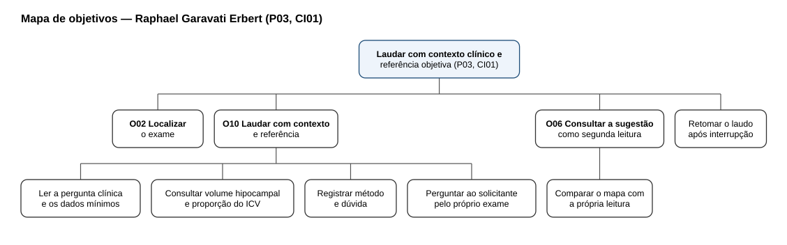
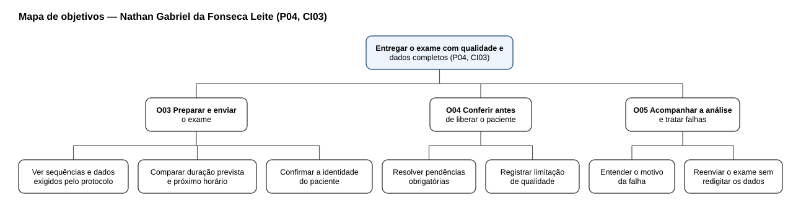
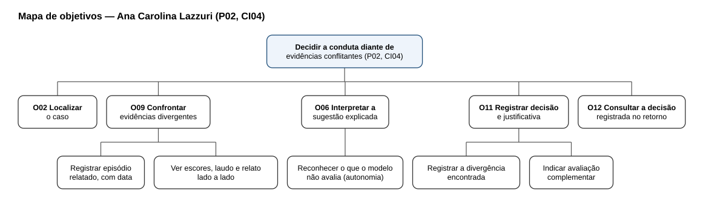
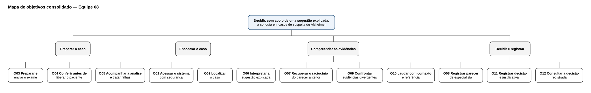

# Entrega 9 — Modelo conceitual e design centrado na comunicação

**Data:** 16/11/2026  
**Status:** 🟩 concluída  
**Responsabilidade:** soluções individuais, com consolidação da equipe para mapa de objetivos e esquema de signos.

## Objetivo da atividade

Passar do cenário de problema para uma concepção da interação, explicitando objetivos, tópicos de conversa, falas e signos que a interface deverá comunicar/manipular.

## Transformando resultados técnicos em conceitos compreensíveis

Em TCCs algorítmicos ou orientados a dados, esta entrega deve evitar que a interface exponha apenas estruturas internas do código. Identifique os **conceitos e signos que fazem sentido para o usuário**.

Exemplos:

- `query plan`, custo estimado, recomendação e impacto para um DBA;
- modelo, dataset, versão, execução e métrica para engenheiro de IA;
- período, indicador, grupo, tendência e filtro para gestor/analista;
- alerta, severidade, evidência, responsável e status para analista de segurança.

Se um termo técnico for necessário, modele como será comunicado, explicado e relacionado à tarefa.

Dashboards, relatórios, filtros e CRUDs devem aparecer no modelo conceitual por meio dos **objetivos, signos e conversas** que justificam sua existência.

## 1. Cenários de interação

Para cada cenário de problema, produza uma versão em que a solução já pode ser descrita. **Destaque claramente o texto alterado** em relação ao cenário original.

### CI01 — O laudo que registrou o que foi avaliado

**Autor(a):** Raphael Garavati Erbert — 22.123.014-7  
**Origem:** cenário problema C01 — "O laudo que não disse nada" (P03, tarefa T02)

*Em **negrito**, o texto novo ou alterado em relação ao cenário refinado C01 da Entrega 4; em ~~tachado~~, o texto retirado.*

Numa quarta-feira à tarde, a Dra. Helena Siqueira Prado, radiologista de um serviço de telerradiologia, tem 41 exames na fila de laudos, vindos de hospitais diferentes. O serviço opera sob metas estritas de prazo por exame, monitoradas por relatórios de produtividade. Ela abre a ressonância de crânio de um paciente idoso. ~~O pedido diz apenas "RM de crânio — investigação de déficit cognitivo", e o campo de dados clínicos traz só a idade. Esses dados clínicos foram repassados de forma resumida pelo técnico do hospital de origem.~~ **Junto das imagens, o caso traz a pergunta clínica escrita pelo solicitante ("queixa de memória há cerca de um ano; distinguir declínio esperado para a idade de doença de Alzheimer") e um bloco de contexto clínico com idade, escolaridade e o MMSE mais recente, com a data de aplicação.** Helena percorre os cortes e nota que os hipocampos parecem um pouco reduzidos, mas não o suficiente para afirmar atrofia com segurança. Não há exame anterior para comparar. ~~Ela pensa em medir, mas fazer a medição à mão levaria um tempo que a fila não permite; o PACS do serviço dispõe apenas de ferramentas de medidas lineares, carecendo de volumetria automática para o hipocampo.~~ **Ela abre a análise do modelo, apresentada como segunda leitura: o volume hipocampal enviado ao modelo aparece com a proporção em relação ao volume intracraniano (ou marcado como "imputado", quando não foi informado), e o mapa de atenção aparece sobreposto a um corte axial. A tela informa que o mapa mostra onde o modelo se apoiou, e não uma lesão, e que o modelo não foi validado na população brasileira.** Enquanto analisa o caso, chegam exames de urgência (como suspeita de AVC) que ganham prioridade imediata na fila. **Helena suspende o laudo e, ao voltar, encontra o caso no ponto em que parou, com a anotação de dúvida que tinha deixado.** ~~Sem ferramentas objetivas e sem contexto clínico, Helena opta por escrever uma frase cautelosa ("Redução volumétrica hipocampal discreta... Correlacionar com dados clínicos") para se proteger de falsos positivos, sem dispor de um canal ágil para sanar a dúvida com o solicitante ou de auditoria interna que avalie o impacto dessa inconclusão no destino do paciente.~~ **Com a pergunta clínica e uma referência objetiva à mão, Helena descreve o achado e preenche, em campos próprios do laudo, o que avaliou, por qual método (inspeção visual e volume informado) e a dúvida que permanece. A conclusão continua sendo dela. Como a dúvida depende de um dado que só o solicitante tem, ela envia uma pergunta ligada ao próprio exame, sem travar a fila.** Libera o laudo e abre o próximo exame.

### Diferenças relevantes

| Alteração | Por que foi necessária | Evidência/artefato que justifica |
|---|---|---|
| A pergunta clínica e o contexto clínico mínimo acompanham o exame | Sem eles, a seleção de T02 recai em "prosseguir só com os dados recebidos", e a dúvida passa para a conclusão | H08; T02 HTA 1.2 e 1.3 (Entrega 5); C01 Q3 |
| O volume hipocampal e o mapa de atenção aparecem como segunda leitura, sem regiões nomeadas nem percentil | A medida manual não cabe no prazo da fila; a referência objetiva não pode afirmar mais do que o modelo calcula | T02 HTA 2.3.3 e GOMS GOAL 2.6; Entrega 6, seção 5.2 (o que o modelo produz) |
| O laudo suspenso preserva a etapa e a dúvida registrada | A urgência interrompe o laudo, e a dúvida não fica registrada em lugar nenhum | T02 CTT, operador `\|>`; C01 Q5 |
| Campos do laudo para método e dúvida | A frase cautelosa devolve a dúvida ao médico clínico, que não interpreta RM | T02 HTA 3.3 (recomendação); P01 (Entrega 3) |
| Pergunta ao solicitante ligada ao exame | Não há canal ágil com o solicitante | T02 HTA 1.3.1 (recomendação); C01 Q6 |

### CI02 — O parecer que ficou no caso

**Autor(a):** Paulo Hudson Josué da Silva — 22.222.013-9  
**Origem:** cenário problema C02 — "O parecer que se perdeu" (P01, tarefa T01)

*Em **negrito**, o texto novo ou alterado em relação ao cenário refinado C02 da Entrega 4; em ~~tachado~~, o texto retirado.*

Dois meses atrás, o Dr. Marcos Andrade encaminhou informalmente o Sr. Ivo Bittencourt, 71 anos, ao neurologista Dr. César Andrade de Melo, após identificar um MMSE limítrofe e um laudo de MRI pouco conclusivo. Como a fila oficial de encaminhamento levaria meses e o quadro não parecia grave o suficiente para justificar a espera, Marcos preferiu resolver por conhecimento pessoal. Ligou para César, que atendeu o caso como favor entre colegas. César respondeu que os achados eram "compatíveis com comprometimento cognitivo leve, sem elementos fortes para Alzheimer neste momento" e sugeriu reavaliação em seis meses. ~~Marcos anotou rapidamente "neuro: sem AD por ora, reavaliar" numa nota de rodapé do prontuário. Como o prontuário eletrônico atual não possui campos estruturados para distinguir pareceres informais de anotações comuns, os critérios técnicos exatos utilizados por César para afastar Alzheimer não foram gravados no sistema.~~ **Ainda durante a ligação, Marcos registrou o parecer no caso do paciente, em campos próprios: quem deu o parecer, a data, o canal ("telefone"), a conclusão, os critérios citados por César (redução hipocampal discreta para a idade, MMSE compatível com a escolaridade, autonomia preservada), os exames que ele revisou e a recomendação de reavaliar em seis meses. O registro ficou identificado como parecer de especialista, separado das anotações de rotina.**

Hoje, o Sr. Ivo retorna à consulta acompanhado do filho, relatando piora perceptível da memória nas últimas semanas. ~~Marcos abre o prontuário e encontra apenas essa anotação breve. Ele não lembra quais exames o neurologista revisou, nem por que descartou Alzheimer naquele momento.~~ **Marcos localiza o caso pela busca e encontra o parecer de César no topo, com os critérios e os exames que o sustentaram. Ele reaplica o MMSE, e o bloco de contexto clínico mostra o escore anterior e o atual lado a lado, separado dos dados que entram no modelo.** A agenda do dia está cheia. ~~Tenta ligar para César, mas ele está em cirurgia e não retorna a tempo da consulta. Na ausência de um canal estruturado para resgatar o histórico, Marcos estima que gastaria preciosa parte da consulta tentando auditar papéis físicos ou registros dispersos.~~ **César está em cirurgia, mas Marcos não precisa ligar: confronta a piora relatada com os critérios registrados. Ele também consulta a sugestão do modelo para o exame mais recente, que mostra separadamente a probabilidade da classe e a confiabilidade dessa estimativa, as variáveis que mais pesaram e os limites do modelo.** Marcos precisa decidir se pede um novo exame do zero, se reencaminha o paciente ao mesmo neurologista — sobrecarregando a fila oficial — ou se toma uma conduta sozinho, ~~sem o contexto completo da avaliação anterior~~ **agora com o contexto da avaliação anterior. Ele registra a decisão, marca como evidências consideradas o parecer de César e os dois escores, e confere o registro gravado com seu nome e horário, ligado ao parecer anterior.** ~~Qualquer que seja a conduta tomada nesta consulta, Marcos só saberá se ela foi adequada caso ocorra uma nova piora clínica perceptível ou se o paciente for atendido posteriormente por outro colega.~~ **Qualquer que seja a conduta, quem abrir o caso depois encontrará, em ordem, o raciocínio de César e o de Marcos.**

### Diferenças relevantes

| Alteração | Por que foi necessária | Evidência/artefato que justifica |
|---|---|---|
| Parecer de especialista registrado em campos próprios (autor, data, canal, conclusão, critérios, exames, recomendação) | O raciocínio do especialista existia só na ligação; o método de reconstrução pelos exames termina numa inferência que o clínico não domina | H06; T01 HTA 2.2 e 2.3, GOMS M2 (Entrega 5); feedback da Entrega 5: preservar a continuidade do raciocínio, não reduzir a solução a "reabrir caso" |
| Parecer identificado como tal, separado das anotações de rotina | A nota de rodapé se mistura às anotações comuns | T01 HTA 2.2 (recomendação); C02 Q1 |
| Escores anterior e atual lado a lado, fora dos dados do modelo | O novo escore só tem valor se comparado ao anterior; MMSE e MoCA não entram no modelo, mas são contexto da decisão | T01 HTA 1.2; Entrega 6, seção 5.2 (bloco "Contexto clínico") |
| Probabilidade da classe e confiabilidade da estimativa como signos separados | Um percentual alto com confiabilidade baixa é o caso perigoso, e os dois eram lidos como uma coisa só | H03; Entrega 6, seção 5.2; Entrega 8, MU06 |
| Decisão ligada ao parecer anterior, com as evidências marcadas | Sem a ligação, a próxima retomada repete o problema | T01 HTA 4; F05 (`RASTREABILIDADE.md`); H15 em aberto (correção por adendo) |

### CI03 — O exame conferido antes da saída

**Autor(a):** Nathan Gabriel da Fonseca Leite — 22.123.028-7  
**Origem:** cenário problema C03 — "O exame que precisou ser refeito" (P04, tarefa T03)

*Em **negrito**, o texto novo ou alterado em relação ao cenário refinado C03 da Entrega 4; em ~~tachado~~, o texto retirado.*

Numa segunda-feira de manhã, Bruno Tavares Lima, técnico em radiologia, recebe no setor de imagem a Sra. Aparecida Souza, 74 anos, acompanhada do filho, Rogério. O pedido médico diz apenas "RM de crânio — investigação de déficit cognitivo". ~~Bruno usa o protocolo padrão de crânio que o setor aplica na maioria dos casos.~~ **Ao abrir o caso, Bruno vê, para a suspeita informada, as sequências que o protocolo do serviço exige — entre elas a T1 volumétrica — e os dados clínicos obrigatórios, além da duração prevista do protocolo ao lado do horário do próximo paciente.** Como a escala do aparelho opera com intervalos curtos entre pacientes, a margem de manobra para lidar com imprevistos é reduzida.

Durante o exame, Dona Aparecida fica inquieta e mexe a cabeça várias vezes. Diante da movimentação, Bruno pondera as alternativas técnicas disponíveis em seu treinamento — como tentar orientar a paciente novamente ou aplicar contenções leves —, mas, percebendo o desconforto dela e pressionado pela agenda, Bruno repete apenas uma das sequências ~~e encerra o exame. Na tela do console, as imagens parecem visualmente aceitáveis. Depois que a paciente vai embora, Bruno envia o exame ao PACS e transcreve manualmente do prontuário as informações clínicas para a requisição de laudo — um procedimento sujeito a lapsos devido à digitação manual sob ritmo acelerado~~. **Antes de liberar a paciente, Bruno abre a conferência do caso. Ao selecionar o arquivo, a interface lê o cabeçalho da série e avisa que a T1 volumétrica não está entre as séries enviadas; a lista de pendências mostra também que o MMSE não consta da requisição. Os dados clínicos vêm do prontuário sem redigitação, e Bruno confirma a identidade da paciente comparando nome e data de nascimento com o pedido. Enquanto houver pendência obrigatória, o envio para laudo fica bloqueado. A interface aponta as pendências; decidir o que fazer com cada uma continua sendo de Bruno e, quando o protocolo exigir, do radiologista.** **Com a paciente ainda no aparelho, Bruno adquire a sequência volumétrica, registra a limitação de movimento observada em uma das outras sequências — que passa a acompanhar o estudo até quem lauda — e só então libera Dona Aparecida.**

~~Três dias depois, o laudo volta com a observação "exame limitado por artefato de movimento; ausência de sequência volumétrica; dados clínicos incompletos". Como o fluxo operacional do serviço carece de um validador automatizado de qualidade de imagem no PACS logo após o escaneamento, a falha só é descoberta após a saída da paciente, tornando indispensável a reconvocação e gerando atraso de semanas no diagnóstico.~~ **Três dias depois, o laudo chega sem pedido de reconvocação, e a radiologista viu no próprio estudo a limitação registrada por Bruno. Se o envio tivesse falhado depois da saída da paciente, a mensagem diria em linguagem do serviço o que estava errado e ofereceria "Reenviar exame", mantendo os dados já preenchidos.**

### Diferenças relevantes

| Alteração | Por que foi necessária | Evidência/artefato que justifica |
|---|---|---|
| Sequências e dados obrigatórios apresentados antes da aquisição | A escolha do protocolo dependia da memória do técnico diante de um pedido genérico | T03 HTA 1.2 (recomendação); H10 (em aberto) |
| Duração prevista ao lado do próximo horário | É o tempo restante que distingue repetir a sequência de encurtar o protocolo | T03 HTA 1.3; GOMS T03 2.A e 2.B; H09 (em aberto) |
| Verificação do tipo de série na seleção do arquivo e lista de pendências antes da liberação, com envio bloqueado | Só antes da liberação a correção ainda é barata; depois, resta reconvocar | H07; T03 HTA 3; F03 e Entrega 6, seção 5.1 |
| Dados clínicos sem redigitação, com identidade confirmada por pessoa | A transcrição é onde o escore se perde; a identidade precisa de confirmação explícita | T03 HTA 2.2.2 e 2.2.3; H13 |
| Limitação aceita registrada e enviada com o estudo | A limitação não chegava a quem lauda | T03 HTA 2.1.3.3 |
| A interface aponta pendências, mas a decisão é do técnico ou do radiologista | Não se sabe quais decisões pertencem a cada profissional; a interface não pode tomar decisão que não é dela | H11; feedback da Entrega 5 sobre T03 |
| Mensagem de falha em linguagem do serviço e "Reenviar exame" | A tela de falha era um fim de caminho e obrigava a redigitar tudo | F04; Entrega 6, seção 5.1 |

### CI04 — A decisão com as evidências lado a lado

**Autor(a):** Ana Carolina Lazzuri — 22.123.001-4  
**Origem:** cenário problema C04 — "A dúvida sobre a autonomia do paciente" (P02, tarefa T04)

*Em **negrito**, o texto novo ou alterado em relação ao cenário refinado C04 da Entrega 4; em ~~tachado~~, o texto retirado.*

Numa tarde de quinta-feira, o Dr. César Andrade de Melo, neurologista, atende o Sr. Roberto Mendes, 76 anos, acompanhado de sua filha. Na consulta anterior, os testes cognitivos (MMSE) e o laudo de ressonância magnética indicavam um quadro limítrofe de declínio leve. No entanto, a filha relata episódios recentes preocupantes: o paciente se perdeu voltando da padaria e apresentou pequenos lapsos ao gerenciar contas domésticas, embora insista veementemente em continuar dirigindo seu automóvel. César precisa decidir se emite um laudo restritivo recomendando a suspensão da CNH e maior supervisão domiciliar. **Durante a consulta, ele registra no caso cada episódio relatado pela filha, com a data aproximada e a atividade afetada (deslocamento, finanças, direção).**

~~Ele analisa os dados objetivos do prontuário, que mostram pontuação estável, confrontando-os com o relato empírico da filha. Na ausência de um protocolo padronizado no sistema para ponderar relatos subjetivos de familiares frente a métricas de exames de imagem, César precisa ponderar a decisão com base em sua experiência clínica pessoal.~~ **A tela de evidências mostra lado a lado a evolução do MMSE, a conclusão do laudo de MRI, a sugestão do modelo — com a probabilidade da classe e a confiabilidade da estimativa — e os episódios relatados em uma linha do tempo. Um aviso fixo junto da sugestão informa que o modelo analisa padrões de imagem e dados clínicos e não avalia capacidade funcional nem aptidão para dirigir. Com as fontes reunidas, César percebe que os episódios são posteriores ao último teste; a ponderação continua sendo dele.** Para mitigar o risco de uma restrição abrupta sem respaldo inequívoco, ele considera como alternativa solicitar uma avaliação neuropsicológica complementar antes de emitir um parecer definitivo. César pondera o impacto de restringir a autonomia de um paciente que ainda preserva lucidez parcial, equilibrando o risco severo de um acidente de trânsito com o dano psicológico de uma limitação precipitada. **Ele registra a conduta, as evidências que considerou e a divergência encontrada entre o relato e os escores.** ~~sabendo que a aceitação dessa conduta por parte da família e do paciente só poderá ser avaliada com segurança nos retornos dos meses seguintes~~ **A aceitação da conduta continua a ser acompanhada nos retornos, mas agora cada retorno parte do que foi decidido e por quê, e os novos episódios entram na mesma linha do tempo.**

### Diferenças relevantes

| Alteração | Por que foi necessária | Evidência/artefato que justifica |
|---|---|---|
| Episódios relatados registrados com data e atividade afetada | O relato era oral e ficava em texto livre, sem data | T04 HTA 1.1; Entrega 7, A02; `RASTREABILIDADE.md`, R04 |
| Escores, laudo, sugestão e relato lado a lado | O confronto entre as fontes acontecia só no raciocínio do médico | T04 HTA 2.1 e CTT ("Confrontar as evidências" como tarefa do usuário) |
| Aviso fixo de que o modelo não avalia autonomia | A sugestão não pode ser lida como resposta sobre dirigir ou morar sozinho | Feedback da Entrega 5 sobre T04; Entrega 8, restrições e MU02 |
| Registro da conduta com evidências consideradas e divergência | O conflito entre avaliação objetiva e relato era registrado em texto livre | T04 HTA 4.2; C04 Q4 |
| Retornos partem da decisão registrada | A aceitação da conduta só aparece nos retornos seguintes | C04 Q5; T04 HTA 3.3 |

## 2. Design centrado na comunicação

**Nome do cenário:** CI01 — O laudo que registrou o que foi avaliado (Raphael Garavati Erbert)

| Tópico > subtópico | Falas e signos envolvidos | Intenção/efeito esperado |
|---|---|---|
| Laudar com contexto clínico e referência | `D: "Fila de laudos — 41 exames; urgências no topo"` / `U: abre o próximo exame` | Começar pelo exame sem perder a visão da fila |
| > Ler a pergunta clínica | `D: "Pergunta clínica: distinguir declínio esperado para a idade de doença de Alzheimer"` · `D: "Contexto clínico: 72 anos · 11 anos de escolaridade · MMSE 25, aplicado em 03/09"` | A leitura do caso limítrofe parte da dúvida de quem pediu o exame |
| > Consultar a referência objetiva | `U: abre "Análise do modelo (segunda leitura)"` / `D: "Hipocampo: 5.900 mm³ · 0,39% do volume intracraniano"` ou `D: "Hipocampo: imputado — valor estimado pelo modelo"` | Dar uma referência objetiva sem substituir a leitura; deixar claro quando o número foi estimado |
| > Ver o mapa de atenção | `D: corte axial com o mapa de atenção sobreposto` · `D: "O mapa mostra onde o modelo se apoiou, não uma lesão"` / `U: compara o mapa com a própria leitura dos cortes` | Evitar que o destaque seja lido como achado anatômico |
| > Retomar após interrupção | `D: "Urgência na fila — suspender este laudo?"` / `U: "Suspender"` · `D: "Laudo suspenso · dúvida anotada: volume limítrofe para a idade"` | Voltar ao caso no ponto em que parou |
| > Registrar método e dúvida | `U: preenche "Método: inspeção visual + volume informado"` e `"Dúvida: redução discreta, sem exame anterior"` / `D: "Esses campos acompanham o laudo para o solicitante"` | O laudo diz o que foi avaliado, em vez de só pedir correlação clínica |
| > Perguntar ao solicitante | `U: "Enviar pergunta ao solicitante"` / `D: "Pergunta enviada pelo exame — a resposta aparece neste caso"` | Resolver a dúvida sem travar a fila |

**Nome do cenário:** CI02 — O parecer que ficou no caso (Paulo Hudson Josué da Silva)

| Tópico > subtópico | Falas e signos envolvidos | Intenção/efeito esperado |
|---|---|---|
| Registrar parecer de especialista | `U: "Registrar parecer"` / `D: campos "Especialista", "Data", "Canal", "Conclusão", "Critérios considerados", "Exames revisados", "Recomendação"` | Transformar a ligação em um registro recuperável, com a origem explícita |
| > Confirmar o registro | `D: "Parecer de Neurologia — Dr. César Andrade de Melo · 29/08 · por telefone"` | O parecer fica identificado como tal, separado das anotações de rotina |
| Retomar o raciocínio do parecer anterior | `U: busca "Ivo"` / `D: lista com o caso, o status e a data do último registro` | Localizar o caso sem percorrer evoluções |
| > Consultar o parecer | `D: "Compatível com comprometimento cognitivo leve, sem elementos fortes para Alzheimer neste momento" · "Critérios: …" · "Reavaliar em 6 meses"` | Recuperar o raciocínio sem depender da memória nem do telefone |
| > Comparar escores | `D: "Contexto clínico (não entra no cálculo da sugestão): MMSE 26 em 29/08 · 23 hoje"` | Ver a variação sem misturar contexto clínico com entrada do modelo |
| Interpretar a sugestão explicada | `D: "Probabilidade da classe: 64% — padrão compatível com Alzheimer"` · `D: "Confiabilidade desta estimativa: moderada"` | Ler os dois números como coisas diferentes |
| > Ver o que mais pesou | `D: "O que mais pesou neste caso: volume do hipocampo, em direção a Alzheimer"` · `D: "Mostra o que pesou no modelo, não a causa da doença"` | Julgar se a sugestão se apoia em algo clinicamente plausível ou em algo que deve gerar desconfiança |
| > Conhecer os limites | `D: "Treinado na ADNI; não validado no Brasil" · "Distingue só normal e Alzheimer; não avalia comprometimento leve"` | Calibrar a confiança antes de decidir |
| Registrar decisão e justificativa | `U: escolhe "Concordo parcialmente", escreve a conduta e marca as evidências "Parecer de Neurologia" e "MMSE"` / `D: "A decisão será gravada com seu nome e horário e ficará ligada ao parecer de 29/08"` | Tornar a decisão rastreável e conectada ao raciocínio anterior |
| > Conferir o registro | `U: "Registrar decisão"` / `D: "Decisão registrada · Dr. Marcos Andrade · 13/11, 10:42"` | Verificar que o objetivo foi atingido (operador de verificação do GOMS T01) |

**Nome do cenário:** CI03 — O exame conferido antes da saída (Nathan Gabriel da Fonseca Leite)

| Tópico > subtópico | Falas e signos envolvidos | Intenção/efeito esperado |
|---|---|---|
| Preparar e enviar o exame | `U: abre o caso a partir do pedido` / `D: "Suspeita informada: investigação de déficit cognitivo"` | Partir do pedido real, mesmo genérico |
| > Ver o que o protocolo exige | `D: "Sequências exigidas: T1 volumétrica, …" · "Dados obrigatórios: idade, queixa, teste cognitivo"` | Não depender da memória para saber o que o caso exige |
| > Comparar tempo e agenda | `D: "Duração prevista: 28 min · próximo paciente às 9h40"` | Decidir entre repetir e encurtar com o tempo à vista |
| > Confirmar a identidade | `D: "Pedido: Aparecida Souza, 12/03/1952 · Prontuário: Aparecida Souza, 12/03/1952"` / `U: "Confirmo a identidade"` | Evitar associar o exame ao paciente errado |
| Conferir antes de liberar o paciente | `U: seleciona o arquivo` / `D: "A série enviada não é a T1 volumétrica. Selecione a T1 volumétrica do mesmo exame."` | Detectar o problema enquanto ainda é possível corrigir |
| > Resolver pendências | `D: "2 pendências obrigatórias: T1 volumétrica · teste cognitivo"` · `D: "Envio para laudo bloqueado até resolver"` | Impedir a saída do paciente com exame incompleto, sem decidir no lugar do técnico |
| > Registrar limitação | `U: "Registrar limitação: movimento na sequência axial"` / `D: "A limitação acompanhará o estudo até quem lauda"` | Levar a limitação aceita para quem lê o exame |
| Acompanhar a análise e tratar falhas | `D: "Analisando o exame — você pode sair desta tela"` | Saber que a análise está em andamento |
| > Reenviar após falha | `D: "O arquivo enviado é uma sequência FLAIR; a análise precisa da T1 volumétrica do mesmo exame."` / `U: "Reenviar exame"` / `D: "Dados clínicos mantidos — selecione o novo arquivo"` | Corrigir sem redigitar e sem jargão do modelo |

**Nome do cenário:** CI04 — A decisão com as evidências lado a lado (Ana Carolina Lazzuri)

| Tópico > subtópico | Falas e signos envolvidos | Intenção/efeito esperado |
|---|---|---|
| Confrontar evidências divergentes | `U: abre o caso do Sr. Roberto` / `D: "Evidências do caso"` | Reunir as fontes num só lugar |
| > Registrar episódio relatado | `U: "Adicionar episódio"` / `D: campos "Data aproximada", "Atividade afetada (deslocamento, finanças, direção, outra)", "Relatado por", "Descrição"` | Tirar o relato do texto livre e datá-lo |
| > Ver as fontes lado a lado | `D: linha do tempo com "MMSE 27 (02/06) · 27 (13/11)", "Laudo de MRI: alterações limítrofes", episódios de 20/10 e 02/11` | Mostrar que os episódios são posteriores ao último teste |
| Interpretar a sugestão explicada | `D: "Probabilidade da classe: 58% — padrão compatível com Alzheimer · Confiabilidade desta estimativa: baixa"` | Ler a sugestão com a confiabilidade ao lado |
| > Reconhecer o que o modelo não avalia | `D: "O modelo analisa padrões de imagem e dados clínicos. Não avalia capacidade funcional nem aptidão para dirigir."` | Evitar que o score determine a conduta sobre a autonomia |
| Registrar decisão e justificativa | `U: escreve a conduta "solicitar avaliação neuropsicológica antes de parecer sobre direção"` e marca as evidências | A decisão fica com as fontes que a sustentaram |
| > Registrar a divergência | `U: preenche "Divergência: escores estáveis × episódios recentes relatados"` / `D: "A divergência aparecerá no próximo retorno"` | O retorno parte do conflito já identificado |
| > Conferir o registro | `D: "Decisão registrada · Dr. César Andrade de Melo · 13/11, 15:20"` | Verificar que o registro foi gravado |

**Convenção:** `U` = usuário; `D` = preposto do designer/sistema, conforme a abordagem de Engenharia Semiótica adotada na disciplina.

## 3. Mapa de objetivos

Cada integrante apresenta seu mapa e a equipe cria um **mapa consolidado**, eliminando duplicidades e resolvendo conflitos de nomenclatura.

Na consolidação, "localizar o exame" (P03) e "localizar o caso" (P01, P02) viraram um só objetivo, O02, e "consultar a sugestão como segunda leitura" (P03) e "interpretar a sugestão explicada" (P01, P02) viraram O06. "Retomar o laudo após interrupção" (P03) ficou como subobjetivo de O10, porque só aparece na tarefa da radiologista.

### Dicionário de objetivos

| ID | Objetivo | Persona(s) | Cenário(s) | Prioridade |
|---|---|---|---|---|
| O01 | Acessar o sistema com segurança, em estação compartilhada | P01, P02, P03, P04 | CI01, CI02, CI03, CI04 | média |
| O02 | Localizar o caso ou o exame por nome, prontuário ou status | P01, P02, P03 | CI01, CI02, CI04 | alta |
| O03 | Preparar e enviar o exame com os dados que o caso exige | P04 | CI03 | alta |
| O04 | Conferir qualidade e completude antes de liberar o paciente | P04 | CI03 | alta |
| O05 | Acompanhar a análise e tratar falhas sem redigitar dados | P04, P01 | CI03 | média |
| O06 | Interpretar a sugestão explicada: probabilidade, confiabilidade, mapa de atenção, peso de cada modalidade, contribuição de cada variável e limites | P01, P02, P03 | CI01, CI02, CI04 | alta |
| O07 | Recuperar o raciocínio de um parecer anterior | P01 | CI02 | alta |
| O08 | Registrar parecer de especialista, com origem e critérios | P01, P02 | CI02 | alta |
| O09 | Confrontar evidências divergentes (escores, laudo, sugestão e relato) | P02, P01 | CI04 | alta |
| O10 | Laudar com contexto clínico e referência objetiva, registrando método e dúvida | P03 | CI01 | alta |
| O11 | Registrar a decisão profissional, a justificativa e as evidências consideradas | P01, P02 | CI02, CI04 | alta |
| O12 | Consultar a decisão registrada no caso concluído | P01, P02 | CI02, CI04 | média |

## 4. Esquema conceitual de signos

Consolide as informações em **uma tabela única**.

| Grupo | Signo | Origem | Observações/semântica | Tipo de conteúdo | Restrição | Valor padrão | Prevenção | Recuperação |
|---|---|---|---|---|---|---|---|---|
| Credenciais | e-mail institucional | domínio | Identifica o profissional que registra pareceres, laudos e decisões | texto | não nulo; formato de e-mail | — | PA: validação de formato | CE: "E-mail ou senha incorretos" |
| Credenciais | senha | domínio | Segredo de acesso em estação compartilhada | texto oculto | não nulo | — | PP: indicação de requisitos | CE: "E-mail ou senha incorretos" |
| Credenciais | sessão | aplicação | Acesso encerrado por inatividade, por causa de estações compartilhadas | estado | expira por inatividade | ativa ao entrar | PP: aviso antes de expirar | RA: entrar de novo e voltar ao caso |
| Identificação do caso | paciente | domínio | Nome completo de quem fez o exame | texto | não nulo; ≥ 5 caracteres | — | PA: campo obrigatório | CE: mensagem no campo |
| Identificação do caso | prontuário | domínio | Código do paciente no serviço | texto | não nulo; único | — | PA: busca por código | CE: "Nenhum caso encontrado" |
| Identificação do caso | data de nascimento | domínio | Usada para conferir a identidade e derivar a idade | data | entre 18 e 110 anos atrás | — | PA: seletor de data com limite | CE: "Data fora do intervalo esperado" |
| Identificação do caso | identidade confirmada | aplicação | Confirmação explícita, feita pelo técnico, de que pedido e prontuário são do mesmo paciente | sim/não | obrigatória antes do envio | não | PA: envio bloqueado sem confirmação | RA: corrigir o paciente antes do envio |
| Identificação do caso | status do caso | aplicação | Aguardando revisão · Em análise · Concluído · Com falha | lista fechada | um por caso | Em análise (após envio) | PP: rótulo em texto, não só cor | — |
| Identificação do caso | motivo da falha | aplicação | Explica, em linguagem do serviço, por que a análise não foi feita e o que fazer | texto | presente quando status = Com falha | — | — | RA: "Reenviar exame" com os dados mantidos |
| Pedido e contexto clínico | pergunta clínica | domínio | Dúvida que o solicitante quer ver respondida pelo exame | texto | recomendada | — | PP: exemplo no campo | — |
| Pedido e contexto clínico | escolaridade | domínio | Anos de estudo; também entra no modelo | número | 0 a 30 | — | PA: limite do campo | CE: "Máximo 30" |
| Pedido e contexto clínico | MMSE / MoCA | domínio | Escore do teste cognitivo, com data de aplicação; contexto clínico que **não entra** no cálculo da sugestão | número + data | MMSE 0–30; MoCA 0–30 | — | PP: frase "não entra no cálculo da sugestão" junto do bloco | CE: valor fora da escala |
| Pedido e contexto clínico | episódio relatado | domínio | Fato do dia a dia relatado por familiar, com data aproximada, atividade afetada e quem relatou | texto + data + lista | atividade em lista fechada | — | PA: lista de atividades (deslocamento, finanças, direção, outra) | RA: editar o episódio até o registro da decisão |
| Entradas do modelo | RM T1 volumétrica | domínio | Série de ressonância usada pelo modelo; outras séries não servem | arquivo (DICOM .zip ou NIfTI) | tipo de série verificado na seleção | — | PA: leitura do cabeçalho na seleção do arquivo | CE: "A série enviada não é a T1 volumétrica" |
| Entradas do modelo | genótipo APOE | domínio | O modelo usa o número de alelos ε4 | lista fechada | opcional | Não informado | PP: dica "o modelo usa o número de alelos ε4" | — |
| Entradas do modelo | volume hipocampal | domínio | Soma dos hipocampos, em mm³, exibida também como proporção do volume intracraniano | número | positivo; opcional | — | PA: só números positivos | CE: "Deve ser positivo" |
| Entradas do modelo | volume intracraniano | domínio | Referência para as proporções dos volumes | número | positivo; opcional | — | PA: só números positivos | CE: "Deve ser positivo" |
| Entradas do modelo | valor imputado | aplicação | Valor que faltou e foi estimado pelo modelo a partir de casos parecidos | rótulo | aparece quando o campo veio vazio | — | PP: aviso nos limites da sugestão | — |
| Aquisição e qualidade | sequência exigida | domínio | Sequência que o protocolo do serviço exige para a suspeita informada | lista | definida pelo serviço | conforme protocolo | PP: lista visível antes da aquisição | — |
| Aquisição e qualidade | duração prevista | aplicação | Tempo estimado do protocolo, ao lado do horário do próximo paciente | duração | somente leitura | — | PP: comparação com a agenda | — |
| Aquisição e qualidade | pendência obrigatória | aplicação | Item exigido que ainda falta (série, dado clínico, identidade) | lista | envio bloqueado enquanto houver pendência | — | PA: bloqueio do envio | RA: resolver a pendência com o paciente no setor |
| Aquisição e qualidade | limitação registrada | domínio | Limitação de qualidade aceita pelo técnico (ex.: movimento em uma sequência), enviada com o estudo | texto | opcional | — | PP: sugestão de registrar quando houver repetição | — |
| Resultado do modelo | sugestão do modelo | aplicação | Classe que o modelo favorece; apoio à decisão, não diagnóstico | rótulo | somente leitura | — | PP: rótulo "Sugestão do modelo" | — |
| Resultado do modelo | probabilidade da classe | aplicação | Quanto o modelo favorece cada classe entre as alternativas retornadas (hoje normal × Alzheimer) | percentual por classe | soma 100%; somente leitura | — | PP: rótulo próprio, separado da confiabilidade | — |
| Resultado do modelo | confiabilidade da estimativa | aplicação | Faixa (alta · moderada · baixa) que indica quanto a probabilidade é confiável naquele caso; limiares provisórios | lista fechada | somente leitura | — | PP: texto além da cor; PA: em faixa baixa, a justificativa precisa citar a evidência clínica | — |
| Resultado do modelo | mapa de atenção | aplicação | Áreas de um corte axial em que o modelo mais se apoiou; não indica lesão nem região anatômica | imagem sobreposta | um corte por exame; sempre sobreposto | visível | PP: legenda "não indica lesão" | — |
| Resultado do modelo | peso de cada modalidade | aplicação | Quanto a sugestão veio da imagem e quanto dos dados clínicos | percentual por modalidade | soma 100%; somente leitura | — | PP: termo explicado no glossário | — |
| Resultado do modelo | contribuição por variável | aplicação | Quanto cada variável deslocou a probabilidade, em pontos, em direção a Normal ou a Alzheimer, a partir de um paciente de referência (média do treino); mostra o que pesou no modelo, não a causa da doença | lista de valores | somente leitura; ordenada pela maior contribuição | fator mais relevante em destaque | PP: aviso "não é a causa da doença" | — |
| Resultado do modelo | limites da sugestão | domínio | Avisos do caso e do modelo (treinado na ADNI, não validado no Brasil, não avalia comprometimento leve, não avalia autonomia) | lista de textos | sempre visível junto da sugestão | — | PP: aviso fixo | — |
| Parecer do especialista | parecer de especialista | domínio | Registro do raciocínio de outro profissional, separado das anotações de rotina | registro estruturado | autor, data, canal e conclusão obrigatórios | — | PA: campos obrigatórios | RA: adendo com o original visível (H15) |
| Parecer do especialista | canal do parecer | domínio | Como o parecer foi obtido: telefone, consulta presencial ou sistema | lista fechada | obrigatório | — | PA: lista fechada | — |
| Parecer do especialista | critérios considerados | domínio | Achados e testes que sustentaram a conclusão do especialista | lista de textos | ao menos um | — | PP: exemplos no campo | — |
| Parecer do especialista | exames revisados | domínio | Exames que o especialista usou, ligados ao caso | lista de referências | — | — | PA: seleção entre os exames do caso | — |
| Laudo | método de avaliação | domínio | Como o hipocampo foi avaliado: inspeção visual, escala visual, medida ou volume informado | lista fechada (múltipla) | recomendado em caso limítrofe | — | PP: lembrete em achado limítrofe | — |
| Laudo | dúvida registrada | domínio | O que permaneceu incerto e o que ajudaria a resolver | texto | opcional | — | — | RA: preservada ao suspender o laudo |
| Laudo | pergunta ao solicitante | domínio | Dúvida enviada pelo próprio exame, sem travar a fila | texto | — | — | — | RA: resposta aparece no caso |
| Decisão profissional | concordância | domínio | Concordo · Concordo parcialmente · Discordo, em relação à sugestão | lista fechada | obrigatória | — | PA: escolha obrigatória | CE: "Indique se concorda com a sugestão" |
| Decisão profissional | conclusão | domínio | Cognitivamente normal · Comprometimento cognitivo leve · Doença de Alzheimer provável · Inconclusivo | lista fechada | obrigatória; pode diferir da sugestão | a sugestão, quando "Concordo" | PP: aviso quando difere da sugestão com "Concordo" | CE: mensagem no campo |
| Decisão profissional | conduta | domínio | O que será feito (novo exame, encaminhamento, avaliação complementar, reavaliação) | texto | obrigatória | — | PP: sugestões de conduta | — |
| Decisão profissional | evidências consideradas | domínio | Fontes marcadas pelo médico (parecer, escores, laudo, sugestão, episódios) | lista de referências | — | — | PP: lista das fontes do caso | — |
| Decisão profissional | justificativa | domínio | Raciocínio clínico do profissional | texto | ≥ 30 caracteres | — | PA: tamanho mínimo | CE: "A justificativa precisa ter ao menos 30 caracteres" |
| Decisão profissional | divergência registrada | domínio | Conflito entre fontes identificado pelo médico (ex.: escores estáveis × episódios recentes) | texto | opcional | — | — | — |
| Decisão profissional | decisão registrada | aplicação | Decisão gravada com autor e horário, ligada às evidências e ao parecer anterior | registro | não editável; correção por adendo com o original visível, em aberto (H15) | — | AL: confirmação antes de gravar | RA: adendo |
| Apoio | termo do glossário | aplicação | Definição curta exibida no próprio termo (ex.: confiabilidade, mapa de atenção, ADNI) | texto | — | — | PP: explicação no ponto de uso | — |

Siglas (Barbosa e Silva, 2010): **PP** — prevenção passiva (a interface explica para evitar o erro); **PA** — prevenção ativa (a interface impede a ação incorreta); **AL** — alerta (a interface descreve o risco e pede confirmação); **RA** — recuperação apoiada (depois do erro, a interface mostra como corrigir); **CE** — captura de erro (depois do erro, a interface informa o problema e, quando a correção é fora dela, o que fazer).

### Regras para os signos

- Use o vocabulário do domínio do usuário.
- Evite duplicar o mesmo conceito com nomes diferentes.
- Diferencie informação fornecida pelo usuário, produzida pelo sistema e derivada do domínio.
- Registre prevenção e recuperação apenas quando fizer sentido; explique as siglas usadas.

## Síntese

Quais objetivos/tópicos/signos deverão necessariamente aparecer nos diagramas MoLIC?

Cada integrante modela na Entrega 10 o seu cenário, reutilizando os nomes desta entrega:

- **Raphael (CI01):** tópicos "Laudar com contexto clínico e referência", "Consultar a referência objetiva", "Ver o mapa de atenção", "Retomar após interrupção", "Registrar método e dúvida" e "Perguntar ao solicitante" (O02, O06, O10). Signos obrigatórios: pergunta clínica, MMSE / MoCA, volume hipocampal, valor imputado, mapa de atenção, método de avaliação, dúvida registrada e pergunta ao solicitante. A suspensão por urgência precisa aparecer como ruptura com retorno ao ponto em que o laudo parou.
- **Paulo (CI02):** tópicos "Registrar parecer de especialista", "Retomar o raciocínio do parecer anterior", "Interpretar a sugestão explicada" e "Registrar decisão e justificativa" (O02, O06, O07, O08, O11). Signos obrigatórios: parecer de especialista, canal do parecer, critérios considerados, exames revisados, MMSE / MoCA, probabilidade da classe, confiabilidade da estimativa, contribuição por variável, limites da sugestão, concordância, conduta, evidências consideradas, justificativa e decisão registrada.
- **Nathan (CI03):** tópicos "Preparar e enviar o exame", "Conferir antes de liberar o paciente" e "Acompanhar a análise e tratar falhas" (O03, O04, O05). Signos obrigatórios: sequência exigida, duração prevista, identidade confirmada, RM T1 volumétrica, pendência obrigatória, limitação registrada, status do caso e motivo da falha. O bloqueio do envio com pendência e o "Reenviar exame" precisam aparecer como fala de recuperação.
- **Ana (CI04):** tópicos "Confrontar evidências divergentes", "Interpretar a sugestão explicada" e "Registrar decisão e justificativa" (O06, O09, O11). Signos obrigatórios: episódio relatado, MMSE / MoCA, sugestão do modelo, probabilidade da classe, confiabilidade da estimativa, limites da sugestão (incluindo "não avalia autonomia"), conduta, divergência registrada e decisão registrada.

Em todos os diagramas, "Acessar o sistema" (O01) e "Localizar o caso" (O02) entram como abertura comum, e a confirmação antes de gravar a decisão precisa aparecer como fala do preposto do designer, seguida da verificação de que o registro foi gravado.

## Checklist

- [x] Cenários de interação mostram alterações em relação aos cenários de problema.
- [x] Cada solução individual identifica autor e cenário de origem.
- [x] Tópicos/falas/signos são coerentes com objetivos do usuário.
- [x] Mapas individuais foram consolidados.
- [x] O esquema de signos está em uma tabela única e sem duplicações conceituais.
- [x] Nomes de objetivos/signos serão reutilizados na Entrega 10.
- [x] Em TCC técnico, signos representam conceitos do domínio compreensíveis ao usuário, não apenas variáveis/estruturas internas.
- [x] Padrões como dashboard, relatório, filtros, administração e CRUD possuem objetivos e signos correspondentes.
- [x] A interface comunica não só o resultado técnico, mas também seu significado para a tarefa.
