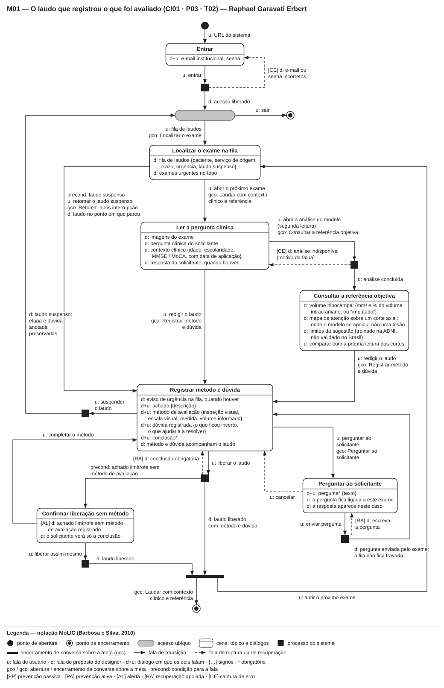
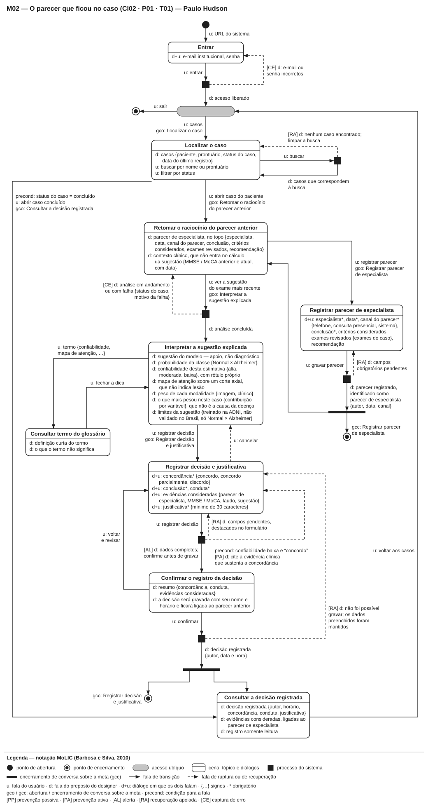
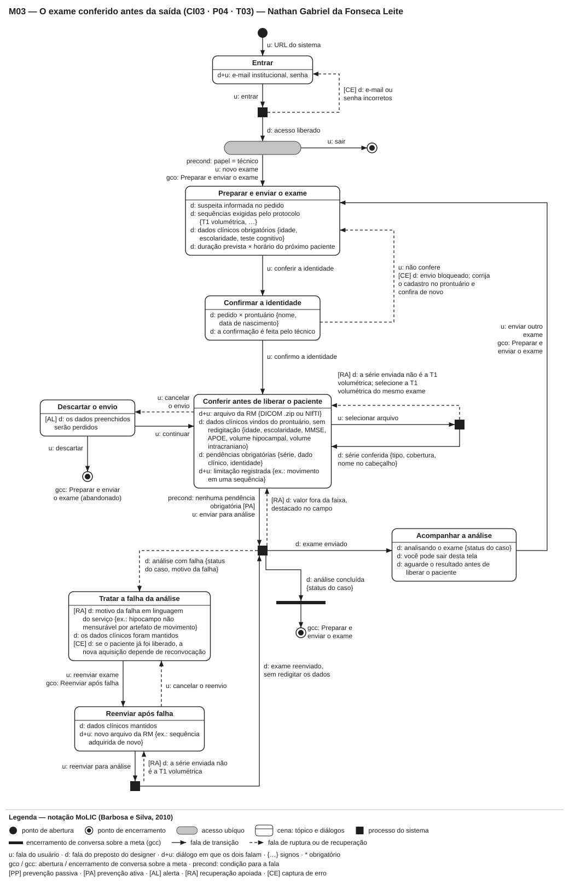
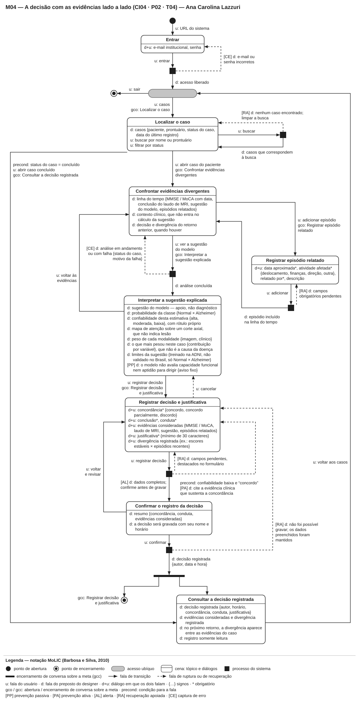

# Entrega 10 — MoLIC

**Data:** 20/11/2026  
**Status:** 🟨 em andamento  
**Responsabilidade:** 1 solução completa por integrante

## Objetivo da atividade

Modelar a interação como uma **conversa entre usuário e preposto do designer**, oferecendo visão global dos caminhos que permitem ao usuário atingir seus objetivos — incluindo alternativas e rupturas relevantes. MoLIC não deve ser reduzida a um fluxograma de telas.

> Use a **notação MoLIC ensinada na disciplina**. Este template foca critérios de qualidade e não substitui a legenda/notação apresentada em aula.

## Atenção a TCCs sem interface original

O MoLIC não modela o algoritmo por dentro. Ele modela a **conversa de interação necessária para que uma pessoa use a contribuição**.

Exemplos de conversas:

- usuário escolhe dados/parâmetros → sistema valida → usuário inicia análise → sistema comunica processamento → usuário interpreta resultado;
- usuário consulta histórico → refina filtros → abre execução → compara com outra;
- administrador seleciona perfil → altera permissão → sistema comunica consequências → administrador confirma/cancela;
- analista recebe alerta → examina evidências → classifica ocorrência → registra decisão.

Modele também rupturas plausíveis: entrada inválida, falha de processamento, ausência de resultado, permissão insuficiente, filtro sem resultados, conflito de alteração, cancelamento ou necessidade de recuperação.

## M01 — {{nome do cenário/objetivo}}

**Autor(a):** {{nome — matrícula}}  
**Cenário de interação de origem:** {{CI01}}  
**Objetivo(s):** {{O01}}  
**Tarefa(s) relacionada(s):** {{T01}}  
**Signos relevantes:** {{...}}

### Diagrama

**Fonte editável:** {{adicione aqui o link para o arquivo `.drawio`, `.svg` editável ou outro formato utilizado pela equipe}}

### Leitura do diagrama

Explique em texto o caminho principal e pelo menos os caminhos alternativos/rupturas mais importantes.

#### Caminho principal

1. {{ponto de abertura → cena...}}
2. {{...}}

#### Alternativas e rupturas

| Situação | Onde ocorre | Como o usuário percebe | Caminho de recuperação/saída |
|---|---|---|---|
| {{dado inválido}} | {{...}} | {{fala/feedback}} | {{...}} |

### Checklist específico de modelagem

- [ ] Existe **ponto de abertura** coerente com o início do objetivo.
- [ ] As **cenas de conversa** representam tópicos/assuntos, não nomes de páginas apenas.
- [ ] As transições/falas deixam claro o que o usuário ou o sistema comunica.
- [ ] Há **ponto(s) de encerramento** para objetivos concluídos/abandonados quando aplicável.
- [ ] Processamentos do sistema estão representados conforme a notação adotada em aula, sem “inventar” fala do usuário.
- [ ] Rupturas (breakdowns) relevantes têm feedback e caminho de recuperação, não becos sem saída.
- [ ] Acessos ubíquos/atalhos só aparecem quando semanticamente justificáveis.
- [ ] O diagrama cobre caminhos alternativos importantes, e não apenas o “happy path”.
- [ ] Nomes de objetivos, tópicos e signos são coerentes com a Entrega 9.
- [ ] O diagrama é legível em tamanho normal no GitHub.
- [ ] O MoLIC representa a conversa usuário–sistema, não o fluxo interno do algoritmo.
- [ ] Processamento, filtros, administração, relatórios e históricos incluem retornos/rupturas quando relevantes.

> Repita M02, M03... para todos os integrantes.

## M02 — O parecer que ficou no caso

**Autor(a):** Paulo Hudson Josué da Silva — 22.222.013-9  
**Cenário de interação de origem:** CI02 — "O parecer que ficou no caso"  
**Objetivo(s):** O01, O02, O06, O07, O08, O11, O12  
**Tarefa(s) relacionada(s):** T01 — Retomar a conduta de um paciente já avaliado por especialista  
**Signos relevantes:** parecer de especialista, canal do parecer, critérios considerados, exames revisados, MMSE / MoCA, status do caso, motivo da falha, sugestão do modelo, probabilidade da classe, confiabilidade da estimativa, mapa de atenção, peso de cada modalidade, contribuição por variável, limites da sugestão, termo do glossário, concordância, conclusão, conduta, evidências consideradas, justificativa, decisão registrada

### Diagrama

**Fonte editável:** [`molic_m02.svg`](../assets/10_molic/molic_m02.svg) — SVG em texto puro, editável no Inkscape ou em qualquer editor de texto

### Leitura do diagrama

Explique em texto o caminho principal e pelo menos os caminhos alternativos/rupturas mais importantes.

#### Caminho principal

1. Ponto de abertura → **Entrar**: o médico informa e-mail institucional e senha; o processo do sistema libera o acesso e a conversa chega ao acesso ubíquo (O01).
2. `u: casos` abre a conversa sobre **Localizar o caso** (O02): a busca pelo nome devolve o caso do Sr. Ivo, com status e data do último registro.
3. `u: abrir caso do paciente` abre **Retomar o raciocínio do parecer anterior** (O07): o parecer de Neurologia aparece no topo, com especialista, data, canal, conclusão, critérios considerados, exames revisados e recomendação. O contexto clínico mostra o MMSE anterior e o atual lado a lado, com a indicação de que não entra no cálculo da sugestão.
4. Esse parecer chegou ao caso dois meses antes, pela mesma cena: durante a ligação, `u: registrar parecer` abriu **Registrar parecer de especialista** (O08). Depois de `u: gravar parecer`, o processo respondeu `d: parecer registrado, identificado como parecer de especialista`, a conversa sobre essa meta se encerrou (gcc) e voltou ao caso.
5. `u: ver a sugestão do exame mais recente` passa por um processo do sistema; com a análise concluída, a conversa vai para **Interpretar a sugestão explicada** (O06): a probabilidade da classe e a confiabilidade da estimativa aparecem como signos separados, ao lado do mapa de atenção, do peso de cada modalidade, do que mais pesou no caso e dos limites do modelo. Um termo desconhecido abre **Consultar termo do glossário**, e `u: fechar a dica` volta à sugestão.
6. `u: registrar decisão` abre **Registrar decisão e justificativa** (O11): concordância, conclusão, conduta, evidências consideradas (o parecer de Neurologia e os dois escores) e justificativa.
7. Com os dados completos, o processo leva a **Confirmar o registro da decisão** [AL]: o preposto mostra o resumo e avisa que a decisão será gravada com nome e horário e ficará ligada ao parecer anterior. `u: confirmar` → processo → `d: decisão registrada {autor, data e hora}`, e a conversa sobre a meta se encerra (gcc).
8. A conversa segue para **Consultar a decisão registrada** (O12), onde o médico confere o que foi gravado e as evidências ligadas ao parecer. `u: voltar aos casos` retorna ao acesso ubíquo, e `u: sair` encerra a interação.

#### Alternativas e rupturas

| Situação | Onde ocorre | Como o usuário percebe | Caminho de recuperação/saída |
|---|---|---|---|
| E-mail ou senha incorretos | Entrar → processo de acesso | [CE] "E-mail ou senha incorretos" | Volta a Entrar para nova tentativa |
| Busca sem resultado (ex.: "Bitencourt", com erro de grafia) | Localizar o caso → processo de busca | [RA] "Nenhum caso encontrado", com a opção de limpar a busca | `limpar a busca` devolve a lista completa e o médico procura de novo |
| Análise em andamento ou com falha | Retomar o raciocínio → processo antes da sugestão | [CE] o preposto mostra o status do caso e o motivo da falha | Volta ao caso; o médico decide com o parecer e os escores, ou aguarda. O reenvio do exame é do técnico (M03) |
| Termo técnico desconhecido | Interpretar a sugestão explicada | Dica do glossário com o que o termo significa e o que não significa | `u: fechar a dica` volta à sugestão |
| Parecer sem campo obrigatório | Registrar parecer de especialista → processo de gravação | [RA] campos obrigatórios pendentes, destacados | Completar e gravar de novo; nada é gravado antes disso |
| Decisão com campo obrigatório vazio | Registrar decisão e justificativa → processo | [RA] campos pendentes destacados no formulário | Completar os campos e registrar de novo |
| "Concordo" com confiabilidade baixa | Registrar decisão e justificativa → processo | [PA] o preposto pede que a justificativa cite a evidência clínica que sustenta a concordância | Citar a evidência ou rever a concordância; a decisão continua sendo do médico |
| Médico quer rever antes de gravar | Confirmar o registro da decisão | [AL] resumo antes da gravação | `u: voltar e revisar` volta ao formulário com os dados preenchidos |
| Falha ao gravar | Confirmar → processo de gravação | [RA] "não foi possível gravar; os dados preenchidos foram mantidos" | Volta ao formulário e registra de novo, sem redigitar |
| Desistir do registro | Registrar decisão e justificativa | `u: cancelar` | Volta à sugestão sem gravar nada |
| Retorno a um caso já concluído | Localizar o caso | precond: status do caso = concluído | A conversa abre direto em Consultar a decisão registrada |

### Checklist específico de modelagem

- [x] Existe **ponto de abertura** coerente com o início do objetivo.
- [x] As **cenas de conversa** representam tópicos/assuntos, não nomes de páginas apenas.
- [x] As transições/falas deixam claro o que o usuário ou o sistema comunica.
- [x] Há **ponto(s) de encerramento** para objetivos concluídos/abandonados quando aplicável.
- [x] Processamentos do sistema estão representados conforme a notação adotada em aula, sem “inventar” fala do usuário.
- [x] Rupturas (breakdowns) relevantes têm feedback e caminho de recuperação, não becos sem saída.
- [x] Acessos ubíquos/atalhos só aparecem quando semanticamente justificáveis.
- [x] O diagrama cobre caminhos alternativos importantes, e não apenas o “happy path”.
- [x] Nomes de objetivos, tópicos e signos são coerentes com a Entrega 9.
- [x] O diagrama é legível em tamanho normal no GitHub.
- [x] O MoLIC representa a conversa usuário–sistema, não o fluxo interno do algoritmo.
- [x] Processamento, filtros, administração, relatórios e históricos incluem retornos/rupturas quando relevantes.

## M03 — O exame conferido antes da saída

**Autor(a):** Nathan Gabriel da Fonseca Leite — 22.123.028-7  
**Cenário de interação de origem:** CI03 — "O exame conferido antes da saída"  
**Objetivo(s):** O01, O03, O04, O05  
**Tarefa(s) relacionada(s):** T03 — Realizar a aquisição com qualidade diagnóstica e dados clínicos completos, dentro da agenda  
**Signos relevantes:** sequência exigida, duração prevista, identidade confirmada, RM T1 volumétrica, escolaridade, MMSE / MoCA, genótipo APOE, volume hipocampal, volume intracraniano, pendência obrigatória, limitação registrada, status do caso, motivo da falha

### Diagrama

**Fonte editável:** [`molic_m03.svg`](../assets/10_molic/molic_m03.svg) — SVG em texto puro, editável no Inkscape ou em qualquer editor de texto

### Leitura do diagrama

Explique em texto o caminho principal e pelo menos os caminhos alternativos/rupturas mais importantes.

#### Caminho principal

1. Ponto de abertura → **Entrar**: o técnico informa e-mail institucional e senha; o processo do sistema libera o acesso e a conversa chega ao acesso ubíquo (O01).
2. Com o papel de técnico, `u: novo exame` abre a conversa sobre a meta **Preparar e enviar o exame** (O03): o preposto mostra a suspeita informada no pedido, as sequências que o protocolo exige, os dados clínicos obrigatórios e a duração prevista ao lado do horário do próximo paciente.
3. `u: conferir a identidade` leva a **Confirmar a identidade**: nome e data de nascimento do pedido e do prontuário lado a lado; a confirmação é do técnico. `u: confirmo a identidade` abre **Conferir antes de liberar o paciente** (O04).
4. Em Conferir antes de liberar o paciente, `u: selecionar arquivo` passa por um processo que lê o cabeçalho e responde `d: série conferida {tipo, cobertura, nome no cabeçalho}`. Os dados clínicos vêm do prontuário sem redigitação, as pendências obrigatórias ficam listadas e o técnico pode registrar uma limitação aceita, que acompanha o estudo até quem lauda.
5. Sem pendência obrigatória, `u: enviar para análise` passa pelo processo do sistema, que responde `d: exame enviado` e abre **Acompanhar a análise** (O05): status do caso, aviso de que o técnico pode sair da tela e recomendação de aguardar o resultado antes de liberar o paciente.
6. Quando o processo conclui, `d: análise concluída {status do caso}` encerra a conversa sobre a meta (gcc). Em Acompanhar a análise, `u: enviar outro exame` reabre a meta para o próximo paciente.

#### Alternativas e rupturas

| Situação | Onde ocorre | Como o usuário percebe | Caminho de recuperação/saída |
|---|---|---|---|
| E-mail ou senha incorretos | Entrar → processo de acesso | [CE] "E-mail ou senha incorretos" | Volta a Entrar para nova tentativa |
| Pedido e prontuário não conferem | Confirmar a identidade | `u: não confere` e [CE]: envio bloqueado; o cadastro precisa ser corrigido no prontuário | A correção acontece fora do sistema; depois, o técnico volta a Preparar e enviar o exame e confere de novo |
| Série que não é a T1 volumétrica (ex.: FLAIR) | Conferir antes de liberar → processo do arquivo | [RA] "A série enviada não é a T1 volumétrica; selecione a T1 volumétrica do mesmo exame" | Selecionar outro arquivo; com o paciente ainda no setor, adquirir a sequência que falta |
| Pendência obrigatória (série, dado clínico ou identidade) | Conferir antes de liberar o paciente | [PA] a fala `u: enviar para análise` só existe sem pendência; a lista mostra o que falta | Resolver a pendência com o paciente no setor. A interface aponta; decidir o que fazer continua sendo do técnico e, quando o protocolo exigir, do radiologista |
| Valor fora da faixa | Conferir antes de liberar → processo de envio | [RA] valor destacado no próprio campo | Corrigir o valor e enviar de novo |
| Desistir do envio | Conferir antes de liberar o paciente | `u: cancelar o envio` abre a cena Descartar o envio [AL]: os dados preenchidos serão perdidos | `u: continuar` volta à conferência; `u: descartar` encerra a meta como abandonada (gcc) |
| Análise falha depois do envio | Processo da análise | Cena Tratar a falha da análise: [RA] motivo em linguagem do serviço (ex.: hipocampo não mensurável por artefato de movimento), com os dados clínicos mantidos | `u: reenviar exame` abre Reenviar após falha; com o novo arquivo, `u: reenviar para análise` volta ao processo, sem redigitar. `u: cancelar o reenvio` volta à falha |
| Falha percebida depois da liberação do paciente | Tratar a falha da análise | [CE] a nova aquisição depende de reconvocação | A reconvocação acontece fora do sistema; é a situação que a conferência antes da liberação tenta evitar |
| Arquivo errado no reenvio | Reenviar após falha → processo de reenvio | [RA] "A série enviada não é a T1 volumétrica" | Selecionar o arquivo certo e reenviar |

### Checklist específico de modelagem

- [x] Existe **ponto de abertura** coerente com o início do objetivo.
- [x] As **cenas de conversa** representam tópicos/assuntos, não nomes de páginas apenas.
- [x] As transições/falas deixam claro o que o usuário ou o sistema comunica.
- [x] Há **ponto(s) de encerramento** para objetivos concluídos/abandonados quando aplicável.
- [x] Processamentos do sistema estão representados conforme a notação adotada em aula, sem “inventar” fala do usuário.
- [x] Rupturas (breakdowns) relevantes têm feedback e caminho de recuperação, não becos sem saída.
- [x] Acessos ubíquos/atalhos só aparecem quando semanticamente justificáveis.
- [x] O diagrama cobre caminhos alternativos importantes, e não apenas o “happy path”.
- [x] Nomes de objetivos, tópicos e signos são coerentes com a Entrega 9.
- [x] O diagrama é legível em tamanho normal no GitHub.
- [x] O MoLIC representa a conversa usuário–sistema, não o fluxo interno do algoritmo.
- [x] Processamento, filtros, administração, relatórios e históricos incluem retornos/rupturas quando relevantes.

## M04 — A decisão com as evidências lado a lado

**Autor(a):** Ana Carolina Lazzuri — 22.123.001-4  
**Cenário de interação de origem:** CI04 — "A decisão com as evidências lado a lado"  
**Objetivo(s):** O01, O02, O06, O09, O11, O12  
**Tarefa(s) relacionada(s):** T04 — Decidir a conduta sobre a autonomia do paciente diante de evidências conflitantes  
**Signos relevantes:** episódio relatado, MMSE / MoCA, status do caso, motivo da falha, sugestão do modelo, probabilidade da classe, confiabilidade da estimativa, mapa de atenção, peso de cada modalidade, contribuição por variável, limites da sugestão (incluindo "não avalia autonomia"), concordância, conclusão, conduta, evidências consideradas, justificativa, divergência registrada, decisão registrada

### Diagrama

**Fonte editável:** [`molic-Ana_m04.svg`](../assets/10_molic/molic-Ana_m04.svg)

### Leitura do diagrama

Explique em texto o caminho principal e pelo menos os caminhos alternativos/rupturas mais importantes.

#### Caminho principal

1. Ponto de abertura → **Entrar**: o neurologista informa e-mail institucional e senha; o processo do sistema libera o acesso e a conversa chega ao acesso ubíquo (O01).
2. `u: casos` abre **Localizar o caso** (O02), e `u: abrir caso do paciente` abre a conversa sobre a meta **Confrontar evidências divergentes** (O09): uma linha do tempo reúne o MMSE com datas, a conclusão do laudo de MRI, a sugestão do modelo e os episódios relatados; o contexto clínico aparece separado do que entra no cálculo da sugestão.
3. Durante a consulta, `u: adicionar episódio` abre **Registrar episódio relatado**: data aproximada, atividade afetada (deslocamento, finanças, direção, outra), quem relatou e descrição. Depois de `u: adicionar`, o processo responde `d: episódio incluído na linha do tempo`, e o neurologista vê que os episódios são posteriores ao último teste.
4. `u: ver a sugestão do modelo` passa por um processo do sistema e abre **Interpretar a sugestão explicada** (O06), a mesma cena do M02, com o aviso fixo [PP] de que o modelo não avalia capacidade funcional nem aptidão para dirigir. `u: voltar às evidências` retorna à linha do tempo.
5. `u: registrar decisão` abre **Registrar decisão e justificativa** (O11): concordância, conclusão, conduta (por exemplo, solicitar avaliação neuropsicológica antes de parecer sobre direção), evidências consideradas, justificativa e a divergência registrada entre escores estáveis e episódios recentes.
6. Com os dados completos, o processo leva a **Confirmar o registro da decisão** [AL]; `u: confirmar` → processo → `d: decisão registrada {autor, data e hora}`, e a conversa sobre a meta se encerra (gcc).
7. A conversa segue para **Consultar a decisão registrada** (O12): a conduta, as evidências e a divergência ficam visíveis, e no próximo retorno a divergência aparece entre as evidências do caso. `u: voltar aos casos` retorna ao acesso ubíquo.

#### Alternativas e rupturas

| Situação | Onde ocorre | Como o usuário percebe | Caminho de recuperação/saída |
|---|---|---|---|
| E-mail ou senha incorretos | Entrar → processo de acesso | [CE] "E-mail ou senha incorretos" | Volta a Entrar para nova tentativa |
| Busca sem resultado | Localizar o caso → processo de busca | [RA] "Nenhum caso encontrado", com a opção de limpar a busca | Limpar a busca e procurar de novo |
| Episódio sem campo obrigatório | Registrar episódio relatado → processo | [RA] campos obrigatórios pendentes | Completar e adicionar de novo |
| Análise em andamento ou com falha | Confrontar evidências → processo antes da sugestão | [CE] status do caso e motivo da falha | Volta às evidências; o neurologista decide com escores, laudo e episódios |
| Sugestão lida como resposta sobre dirigir | Interpretar a sugestão explicada | [PP] aviso fixo: o modelo não avalia capacidade funcional nem aptidão para dirigir | Prevenção: o aviso fica junto da sugestão o tempo todo |
| "Concordo" com confiabilidade baixa (o caso do Sr. Roberto) | Registrar decisão e justificativa → processo | [PA] o preposto pede que a justificativa cite a evidência clínica que sustenta a concordância | Citar a evidência ou rever a concordância |
| Decisão com campo obrigatório vazio | Registrar decisão e justificativa → processo | [RA] campos pendentes destacados | Completar os campos e registrar de novo |
| Neurologista quer rever antes de gravar | Confirmar o registro da decisão | [AL] resumo antes da gravação | `u: voltar e revisar` volta ao formulário com os dados |
| Falha ao gravar | Confirmar → processo de gravação | [RA] "não foi possível gravar; os dados preenchidos foram mantidos" | Volta ao formulário e registra de novo, sem redigitar |
| Desistir do registro | Registrar decisão e justificativa | `u: cancelar` | Volta à sugestão sem gravar nada |
| Retorno do paciente | Localizar o caso | precond: status do caso = concluído | Abre Consultar a decisão registrada; em Confrontar evidências, a decisão e a divergência anteriores aparecem na linha do tempo |

### Checklist específico de modelagem

- [x] Existe **ponto de abertura** coerente com o início do objetivo.
- [x] As **cenas de conversa** representam tópicos/assuntos, não nomes de páginas apenas.
- [x] As transições/falas deixam claro o que o usuário ou o sistema comunica.
- [x] Há **ponto(s) de encerramento** para objetivos concluídos/abandonados quando aplicável.
- [x] Processamentos do sistema estão representados conforme a notação adotada em aula, sem “inventar” fala do usuário.
- [x] Rupturas (breakdowns) relevantes têm feedback e caminho de recuperação, não becos sem saída.
- [x] Acessos ubíquos/atalhos só aparecem quando semanticamente justificáveis.
- [x] O diagrama cobre caminhos alternativos importantes, e não apenas o “happy path”.
- [x] Nomes de objetivos, tópicos e signos são coerentes com a Entrega 9.
- [x] O diagrama é legível em tamanho normal no GitHub.
- [x] O MoLIC representa a conversa usuário–sistema, não o fluxo interno do algoritmo.
- [x] Processamento, filtros, administração, relatórios e históricos incluem retornos/rupturas quando relevantes.

## Consolidação da equipe

### Cobertura dos objetivos

| Objetivo | MoLIC que cobre | Lacunas/duplicidades | Decisão |
|---|---|---|---|
| O01 | M01 | {{...}} | {{...}} |

### Preparação para o Figma

Liste os estados/telas que serão necessários **a partir das conversas modeladas**, incluindo feedback, confirmação, erro e recuperação.

## Erros frequentes a evitar

- desenhar apenas caixas com nomes de telas e setas de navegação;
- não modelar falhas, cancelamento, volta ou recuperação;
- usar rótulos genéricos (“Tela 1”, “Processo 2”) sem tópico de conversa;
- criar no Figma fluxos que não existem no MoLIC;
- diagrama sem legenda/fonte editável e com texto ilegível.
