# Entrega 11 — Protótipo no Figma

**Data:** 21/11/2026  
**Status:** 🟩 concluída  
**Responsabilidade:** 1 protótipo integrado por equipe cobrindo os fluxos MoLIC.

## Objetivo da atividade

Materializar o modelo de interação em um protótipo navegável, preservando a lógica dos objetivos, tópicos, signos, feedbacks, alternativas e recuperações definidos anteriormente.

## Link do Figma

**Protótipo navegável:** <https://www.figma.com/proto/wQIeoySFfUvRdhjPRIj1HJ?node-id=9-3&starting-point-node-id=9-3>  
**Arquivo editável:** <https://www.figma.com/design/wQIeoySFfUvRdhjPRIj1HJ>  
**Permissão:** "qualquer pessoa com o link pode ver". Antes de cada entrega, abrir o link do protótipo numa janela anônima: o avaliador não pode precisar pedir acesso.

No modo de apresentação, o painel lateral lista os fluxos. Os seis primeiros seguem os quatro diagramas MoLIC; os que começam com "Estado" abrem diretamente telas de erro, de vazio e de validação que não têm gatilho natural no clique a clique.

| Fluxo no Figma | Começa em | MoLIC / cenário | Perfil |
|---|---|---|---|
| 1 · Médico clínico — CI02 / M02 | UI01 | M02 — O parecer que ficou no caso | P01 Marcos Andrade |
| 2 · Neurologista — CI04 / M04 | UI12 | M04 — A decisão com as evidências lado a lado | P02 César Andrade de Melo |
| 3 · Técnico em radiologia — CI03 / M03 | UI06 | M03 — O exame conferido antes da saída | P04 Bruno Tavares Lima |
| 4 · Técnico — falha da análise e reenvio | UI08 | M03, ruptura "análise falha depois do envio" | P04 |
| 5 · Radiologista — CI01 / M01 | UI13 | M01 — O laudo que registrou o que foi avaliado | P03 Helena Siqueira Prado |
| 6 · Radiologista — urgência durante o laudo | UI16b | M01, ruptura "exame urgente chega no meio do laudo" | P03 |
| Estado · e-mail ou senha incorretos | UI01b | rupturas de Entrar (M01–M04) | todos |
| Estado · nenhum caso ainda | UI02d | estado vazio de Localizar o caso | P01 |
| Estado · parecer com campo pendente | UI11b | M02, "parecer sem campo obrigatório" | P01 |
| Estado · falha ao gravar a decisão | UI05f | M02 e M04, "falha ao gravar" | P01 (o componente é o mesmo para P02) |
| Estado · análise indisponível na radiologia | UI14b | M01, "análise do modelo indisponível" | P03 |
| Estado · conclusão obrigatória | UI16c | M01, "conclusão não preenchida" | P03 |
| Estado · liberar sem método | UI16d | M01, "achado limítrofe sem método" | P03 |
| Estado · pergunta em branco | UI17b | M01, "pergunta enviada em branco" | P03 |

> Os fluxos são numerados de 1 a 6, e não com a letra F, para não colidir com os padrões de interface F01–F08 da [`RASTREABILIDADE.md`](../RASTREABILIDADE.md).

### Como o protótipo foi construído

As 51 telas foram geradas como vetores (`assets/11_figma/figma_import/*.svg`) a partir de uma única biblioteca de componentes, em 1440 px de largura e com a fonte Inter, e importadas no Figma como quadros editáveis: textos continuam texto, e cada elemento clicável é uma camada com nome próprio no vocabulário da interface (`btn_registrar_decisao`, `campo_conclusao`, `card_parecer_de_especialista`). Os PNGs desta página são a renderização dos mesmos vetores. No arquivo, os quadros estão agrupados em seções por perfil e por diagrama MoLIC, e o quadro "Leia-me — como navegar no protótipo" explica fluxos e convenções. São 116 ligações clicáveis (*On click → Navigate to*), listadas no [mapa de navegação](#mapa-de-navegação).

**Fidelidade.** O feedback da Entrega 6 pediu mentalidade de baixa fidelidade: o protótipo serve para testar a conversa, não o acabamento. Por isso o visual é contido (uma fonte, uma cor de ação, cores de estado e nenhum elemento de marca), os valores do modelo são fixos por caso, e a ressonância é uma **ilustração esquemática vetorial**, e não um exame, para que ninguém faça leitura clínica da imagem durante o teste. O que muda de uma tela para a outra é o que o MoLIC muda: falas, signos, rupturas e recuperação.

**Convenções de interação.** Em formulários, clicar no botão principal com o formulário vazio leva ao estado de campos pendentes, e clicar num campo pendente simula o preenchimento. Painéis e diálogos (registrar decisão, registrar parecer, registrar episódio, confirmar, descartar, perguntar) são quadros próprios com o fundo escurecido, para que o caso continue visível atrás.

## Mapa de navegação

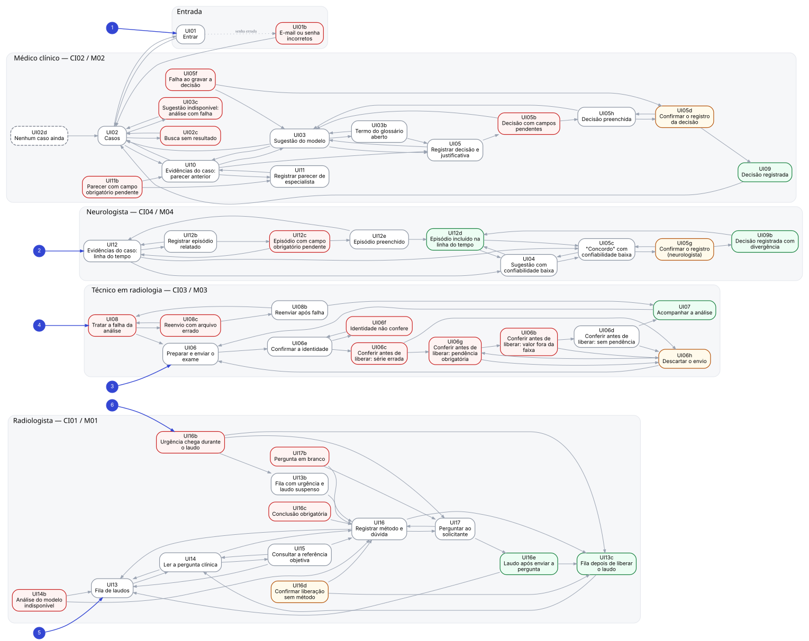

Círculos azuis numerados são os pontos de partida dos fluxos 1 a 6. Borda vermelha indica erro, ruptura ou interrupção; âmbar, confirmação antes de uma ação sem volta; verde, sucesso ou conclusão; tracejada, estado vazio. A seta pontilhada de UI01 para UI01b representa a tentativa com senha errada, que o Figma não distingue da certa: UI01b é aberta pelo fluxo "Estado · e-mail ou senha incorretos". O mapa substitui o [mapa da Entrega 6](../assets/06_prototipos/mapa_navegacao.svg), que continua no repositório como registro do "antes".

## Dicionário de objetivos usado

A consolidação da Entrega 9 (dicionário de objetivos e tabela única de signos) ainda está em modelo no repositório. Os nomes abaixo foram reconstruídos dos quatro diagramas MoLIC da Entrega 10, que já usam os mesmos códigos, e servem só para ligar cada tela ao seu objetivo. Quando a consolidação existir, a coluna "Objetivo" do catálogo deve ser conferida contra ela.

| ID | Objetivo (como aparece nos MoLIC) | MoLIC |
|---|---|---|
| O01 | Entrar | M01–M04 |
| O02 | Localizar o caso / localizar o exame na fila | M01, M02, M04 |
| O03 | Preparar e enviar o exame | M03 |
| O04 | Conferir antes de liberar o paciente | M03 |
| O05 | Acompanhar a análise | M03 |
| O06 | Interpretar a sugestão explicada / consultar a referência objetiva | M01, M02, M04 |
| O07 | Retomar o raciocínio do parecer anterior | M02 |
| O08 | Registrar parecer de especialista | M02 |
| O09 | Confrontar evidências divergentes | M04 |
| O10 | Laudar com contexto clínico e referência | M01 |
| O11 | Registrar decisão e justificativa | M02, M04 |
| O12 | Consultar a decisão registrada | M02, M04 |

## Cobertura MoLIC → Figma

### M01 — O laudo que registrou o que foi avaliado (radiologista, CI01)

| Cena ou ruptura do MoLIC | Fala / signo | Tela(s) | Ligação |
|---|---|---|---|
| Localizar o exame na fila (O02) | urgentes no topo, serviço de origem, prazo | UI13 | `btn_abrir_proximo`, `row_jose` → UI14 |
| Ler a pergunta clínica (O10) | pergunta clínica, contexto clínico (idade, escolaridade, MMSE com data) | UI14 | `btn_abrir_analise` → UI15; `btn_redigir_laudo` → UI16 |
| Consultar a referência objetiva (O06) | volume hipocampal e proporção do ICV, "imputado", mapa de atenção, limites | UI15 | `btn_redigir_laudo` → UI16; `link_voltar_exame` → UI14 |
| Registrar método e dúvida (O10) | achado, método de avaliação, dúvida que permanece, conclusão | UI16 | `btn_perguntar_solicitante` → UI17; `btn_liberar_laudo` → UI13c |
| Perguntar ao solicitante | pergunta ligada ao exame, "a fila não fica travada" | UI17 → UI16e | `btn_enviar_pergunta` → UI16e; `btn_cancelar_pergunta` → UI16 |
| `d: laudo liberado, com método e dúvida` (gcc) | aviso temporário, fila com um exame a menos | UI13c | `btn_abrir_proximo` → UI14 |
| [CE] análise do modelo indisponível | motivo; segunda leitura desabilitada; laudar sem ela | UI14b | `btn_redigir_laudo` → UI16 |
| Volume hipocampal não informado | "imputado (estimado pelo modelo)" explicado no card | UI15 | não é erro: só signo |
| Exame urgente no meio do laudo | aviso de urgência dentro da cena; `u: suspender o laudo` | UI16b → UI13b | `btn_suspender_laudo` → UI13b; `link_retomar_laudo` → UI16 |
| [RA] conclusão não preenchida | "Conclusão obrigatória" no campo e no topo | UI16c | `campo_conclusao` → UI16 |
| [AL] achado limítrofe sem método | "o solicitante verá só a conclusão"; a decisão é da radiologista | UI16d | `btn_completar_metodo` → UI16; `btn_liberar_assim_mesmo` → UI13c |
| [RA] pergunta em branco | "Escreva a pergunta antes de enviar" | UI17b | `campo_pergunta` → UI17 |
| Desistir da pergunta | `u: cancelar` | UI17 | `btn_cancelar_pergunta` → UI16 |

### M02 — O parecer que ficou no caso (médico clínico, CI02)

| Cena ou ruptura do MoLIC | Fala / signo | Tela(s) | Ligação |
|---|---|---|---|
| Entrar (O01) | e-mail institucional, senha | UI01 | `btn_entrar` → UI02 |
| Localizar o caso (O02) | busca, status do caso, data do último registro | UI02 | `row_ivo` → UI10; `campo_busca` → UI02c |
| Retomar o raciocínio do parecer anterior (O07) | parecer de especialista (especialista, data, canal, conclusão, critérios, exames revisados, recomendação); MMSE anterior e atual lado a lado; "não entra no cálculo da sugestão" | UI10 | `link_ver_sugestao` → UI03; `btn_registrar_decisao` → UI05 |
| Registrar parecer de especialista (O08) | canal do parecer, critérios considerados, exames revisados; "separado das anotações de rotina" | UI11 | `btn_gravar_parecer` → UI10 |
| Interpretar a sugestão explicada (O06) | probabilidade da classe e confiabilidade da estimativa separadas; mapa de atenção; peso de cada modalidade; o que mais pesou; limites | UI03 | `termo_confiabilidade` → UI03b; `btn_registrar_decisao` → UI05 |
| Consultar termo do glossário | dica com o que o termo significa e o que não significa | UI03b | `btn_fechar_dica` → UI03 |
| Registrar decisão e justificativa (O11) | concordância, conclusão, conduta, evidências consideradas, justificativa | UI05 → UI05h | `btn_registrar` → UI05b (vazio) ou UI05d (preenchido) |
| [AL] Confirmar o registro da decisão | resumo; "gravada com seu nome, data e hora"; "ligada ao parecer de 29/08" | UI05d | `btn_confirmar_registro` → UI09; `btn_voltar_revisar` → UI05h |
| Consultar a decisão registrada (O12) | autor, data e hora; evidências ligadas; raciocínio do caso em ordem | UI09 | `link_voltar_aos_casos` → UI02 |
| [CE] e-mail ou senha incorretos | mensagem que não revela qual campo errou | UI01b | `btn_entrar` → UI02 |
| [RA] busca sem resultado | termo repetido, sugestão de buscar pelo código, limpar a busca | UI02c | `btn_limpar_busca` → UI02 |
| [CE] análise em andamento ou com falha | status do caso e motivo da falha; "o reenvio é feito pelo técnico" | UI03c | `link_ver_evidencias` → UI02 |
| [RA] parecer sem campo obrigatório | campos destacados; nada é gravado | UI11b | `campo_conclusao` → UI11 |
| [RA] decisão com campo vazio | resumo no topo e mensagem junto de cada campo | UI05b | qualquer campo → UI05h |
| [RA] falha ao gravar | "os dados preenchidos foram mantidos" | UI05f | `btn_registrar` → UI05d |
| Desistir do registro | `u: cancelar` | UI05, UI05b, UI05h | `btn_cancelar` → UI03 |

### M03 — O exame conferido antes da saída (técnico, CI03)

| Cena ou ruptura do MoLIC | Fala / signo | Tela(s) | Ligação |
|---|---|---|---|
| Preparar e enviar o exame (O03) | suspeita informada, sequências exigidas (T1 volumétrica destacada), dados obrigatórios, duração prevista × próximo paciente | UI06 | `btn_conferir_identidade` → UI06e |
| Confirmar a identidade | pedido e prontuário lado a lado; "a confirmação é sua" | UI06e | `btn_confirmo_identidade` → UI06c; `btn_nao_confere` → UI06f |
| Conferir antes de liberar o paciente (O04) | série conferida {tipo, cobertura, nome no cabeçalho}; dados do prontuário sem redigitação; pendências obrigatórias; limitação registrada | UI06c → UI06g → UI06b → UI06d | ver rupturas abaixo |
| `u: enviar para análise` → Acompanhar a análise (O05) | etapas com estado, "você pode sair desta tela", aguardar antes de liberar | UI07 | `btn_enviar_outro` → UI06 |
| [CE] pedido e prontuário não conferem | envio bloqueado; correção fora do sistema | UI06f | `btn_conferir_de_novo` → UI06e |
| [RA] série que não é a T1 volumétrica | "é uma FLAIR axial; selecione a T1 volumétrica" | UI06c | `btn_selecionar_outro` → UI06g |
| [PA] pendência obrigatória | lista de pendências; "Enviar para análise" desabilitado | UI06g | `campo_teste_cognitivo` → UI06b |
| [RA] valor fora da faixa | faixa esperada junto do campo | UI06b | `campo_icv` → UI06d |
| [AL] desistir do envio | "os dados preenchidos serão perdidos" | UI06h | `btn_continuar` → UI06g; `btn_descartar` → UI06 |
| [RA] análise falha depois do envio | motivo em linguagem do serviço; o que fazer com o paciente no setor e já liberado; dados mantidos | UI08 | `btn_reenviar_exame` → UI08c |
| [RA] arquivo errado no reenvio | "é uma T2 axial" | UI08c | `btn_selecionar_outro` → UI08b |
| Reenviar após falha | "dados clínicos mantidos: selecione só o novo arquivo" | UI08b | `btn_reenviar_analise` → UI07; `btn_cancelar_reenvio` → UI08 |
| [CE] falha percebida depois da liberação | "a nova aquisição depende de reconvocação" | UI08 | texto da própria tela |

### M04 — A decisão com as evidências lado a lado (neurologista, CI04)

| Cena ou ruptura do MoLIC | Fala / signo | Tela(s) | Ligação |
|---|---|---|---|
| Confrontar evidências divergentes (O09) | linha do tempo com MMSE datado, laudo de RM, sugestão e episódios; contexto clínico separado | UI12 | `btn_adicionar_episodio` → UI12b; `link_ver_sugestao` → UI04 |
| Registrar episódio relatado | data aproximada, atividade afetada, quem relatou, descrição | UI12b → UI12e | `btn_adicionar` → UI12c (vazio) ou UI12d (preenchido) |
| `d: episódio incluído na linha do tempo` | aviso temporário, marca "novo", nota "episódios posteriores ao teste de junho" | UI12d | `aba_sugestao` → UI04 |
| Interpretar a sugestão explicada (O06) com [PP] | aviso fixo "não avalia capacidade funcional nem aptidão para dirigir"; confiabilidade baixa com o motivo; hipocampo "estimado" | UI04 | `aba_evidencias` → UI12d; `btn_registrar_decisao` → UI05c |
| Registrar decisão e justificativa (O11) com [PA] | aviso junto do "Concordo": citar a evidência clínica; divergência entre as evidências | UI05c | `btn_registrar` → UI05g |
| [AL] Confirmar o registro | "a divergência registrada aparecerá no próximo retorno" | UI05g | `btn_confirmar_registro` → UI09b; `btn_voltar_revisar` → UI05c |
| Consultar a decisão registrada (O12) | divergência registrada, conduta, evidências | UI09b | `link_voltar_aos_casos` → UI12d |
| [RA] episódio sem campo obrigatório | data e atividade destacadas | UI12c | qualquer campo → UI12e |
| Desistir do episódio | `u: cancelar` | UI12b, UI12c, UI12e | `btn_cancelar_episodio` → UI12 |

### Lacunas e decisões de cobertura

| Item do MoLIC | Situação no protótipo | Motivo |
|---|---|---|
| Expiração da sessão | não modelada (Entrega 10) e não prototipada | Já registrada como lacuna na consolidação da Entrega 10. Entra se a Entrega 13 ou 14 mostrar perda de dados por sessão expirada |
| Ação de UI02d (antes "Enviar um exame") | **removida** | A consolidação da Entrega 10 apontou que o médico não tem conversa de envio: quem envia é o técnico (M03). O estado vazio agora só explica como os casos chegam |
| Localizar o caso e entrar, no M04 | sem telas próprias do neurologista | São as mesmas cenas do M02 (UI01, UI01b, UI02, UI02c). O fluxo 2 começa no caso para não repetir telas idênticas com outro nome no topo |
| Análise indisponível, decisão com campo vazio e falha ao gravar, no M04 | mesmas telas do médico (UI03c, UI05b, UI05f) | Componentes idênticos nos dois diagramas; duplicá-los não acrescenta nada à inspeção |
| Retorno a caso concluído (precondição dos M02 e M04) | parcial: UI09 e UI09b existem, mas as linhas "Concluído" de UI02 não têm ligação | Os pacientes concluídos da lista são outros; abrir UI09 a partir deles mostraria o paciente errado. A divergência reaparecendo no próximo retorno (M04) é **planejada**, não prototipada |
| Login com o e-mail de cada perfil | UI01 mostra o e-mail do médico | Uma tela de entrada para todos; o papel aparece na barra lateral depois de entrar |
| "Pedido e prontuário não conferem" no fluxo do técnico | UI06f só abre por "Não confere" | No caso da Sra. Aparecida a identidade confere; o estado existe para a inspeção da Entrega 13 |

## O que mudou em relação à Entrega 6

O feedback da Entrega 6 pediu antes/depois e a origem de cada mudança. A coluna "Origem" usa seis categorias: **evidência com usuário** (sessão de simulação da Entrega 6 ou relato da equipe sobre o usuário), **inconsistência técnica** (a tela dizia algo que o modelo ou o processo não fazem), **heurística** (Nielsen), **padrão de mercado**, **decisão da equipe** e **limitação do protótipo**. A coluna "Antes" aponta a tela da [Entrega 6](06_prototipacao_papel.md) (prints da plataforma em `assets/06_prototipos/`).

| # | Antes (Entrega 6) | Depois (Entrega 11) | Motivação | Origem |
|---|---|---|---|---|
| 1 | Percentual grande pintado com a cor da confiança: probabilidade e confiabilidade lidas como uma coisa só ([ui03a](../assets/06_prototipos/ui03a_caso_sugestao.png), [ui04a](../assets/06_prototipos/ui04a_confianca_baixa.png)) | Card "Sugestão do modelo" com dois blocos: "Probabilidade da classe" em barras na cor de interface e "Confiabilidade desta estimativa" com rótulo, barras de nível, cor de estado e a razão escrita; frase fixa "uma probabilidade alta não é certeza clínica" (UI03, UI04) | Feedback, correção 8 | evidência com usuário (tarefa 1 da sessão da Entrega 6) e heurística (H2, correspondência com o mundo real) |
| 2 | Sem contexto clínico; MMSE e MoCA fora da tela | Bloco "Contexto clínico" com borda tracejada e a etiqueta "não entra no cálculo da sugestão" (UI10, UI12, UI14); "Dados enviados ao modelo" à parte, com o que o modelo recebeu (UI03, UI04) | Feedback, correção 7 | inconsistência técnica: MMSE e MoCA não são entradas do modelo |
| 3 | "O que mais pesou" mostrava só a modalidade (imagem × dados) | Três níveis: peso de cada modalidade; fator mais relevante com a frase em pontos de probabilidade; contribuição de cada variável com direção (Normal ← → Alzheimer) e a nota "mostra o que pesou no modelo, não a causa da doença" (UI03, UI04) | O médico precisa saber qual variável pesou para confiar ou desconfiar da sugestão | evidência com usuário e padrão de mercado (gráfico de contribuições do tipo SHAP) |
| 4 | Envio sem conferência; valor errado só recusado depois do processamento ([ui06b](../assets/06_prototipos/ui06b_novo_caso_erros.png)) | Confirmar a identidade (UI06e/UI06f) e Conferir antes de liberar o paciente: série lida do cabeçalho, dados do prontuário sem redigitação, pendências obrigatórias que bloqueiam o envio, faixa no próprio campo, limitação registrada (UI06c–UI06d) | Feedback, correção 5: prevenção antes da liberação do paciente | heurística (H5, prevenção de erros), a partir do MoLIC M03 |
| 5 | Falha genérica; reenviar era recriar o caso ([ui08](../assets/06_prototipos/ui08_falha.png)) | Motivo em linguagem do setor, o que fazer com o paciente no setor e já liberado; reenvio que troca só o arquivo e mantém os dados; arquivo errado no reenvio também é barrado (UI08, UI08b, UI08c) | Feedback, correção 6: recuperação da falha | evidência com usuário (na sessão da Entrega 6, o participante não concluiu essa tarefa) e heurística (H9) |
| 6 | Conta de demonstração; o mesmo usuário enviava e decidia | Quatro perfis, cada um com nome e papel na barra lateral e menu próprio: Marcos (médico clínico), César (neurologista), Helena (radiologista), Bruno (técnico) | Feedback, correção 3: identidade coerente com o papel | inconsistência técnica |
| 7 | Registro "somente leitura" apresentado como regra | A confirmação diz só o que é verdade no protótipo: a decisão é gravada com nome, data e hora e ligada às evidências. Nenhuma tela afirma imutabilidade; H15 segue aberta e vira pergunta na Entrega 12 (QA14) | Feedback, correção 9: auditoria não é imutabilidade | decisão da equipe |
| 8 | Técnico fora do protótipo; radiologista e neurologista sem tela | 12 telas do técnico (M03), 13 da radiologista (M01) e 9 do neurologista (M04) | Feedback, correção 1; cobertura dos MoLIC | decisão da equipe, a partir da Entrega 10 |
| 9 | Parecer do especialista num campo livre de observação | Parecer estruturado (UI10), registro próprio separado das anotações de rotina (UI11) e histórico do raciocínio do caso em UI09 | H06; MoLIC M02 | decisão da equipe, a partir do CI02 |
| 10 | Contadores-filtro e lista filtrada (UI02b) | Lista com busca e status; filtro removido | O M02 modela a busca, não filtros; o filtro não tinha conversa | decisão da equipe |
| 11 | Estado vazio com "Enviar um exame" | Estado vazio só explicativo (UI02d) | Lacuna apontada na consolidação da Entrega 10 | inconsistência técnica: o médico não envia exames |
| 12 | Recorte do print da ressonância, a mesma imagem para todos os casos | Ilustração esquemática vetorial, com a legenda "ilustração esquemática do exame" | Baixa fidelidade; evitar leitura clínica no teste | limitação do protótipo (o Figma recebe vetores; a imagem pública não deve ser lida como caso) |
| 13 | Sem estado de falha ao gravar nem de desistência do envio | UI05f (dados mantidos) e UI06h (descartar o envio) | Rupturas do M02, M03 e M04 | decisão da equipe, a partir da Entrega 10 |

**Relatório.** O relatório imprimível (F08) continua retirado do escopo, e a Entrega 11 não o reintroduz. O registro da decisão (UI09, UI09b) mostra o que foi decidido e por quê, mas não calcula nem resume nada novo: não é um segundo lugar onde a decisão acontece.

### Correspondência com os códigos da versão parcial

| Código na versão de 14/11 | Código atual |
|---|---|
| UI02b (lista filtrada) | retirada |
| UI03 (caso com sugestão) | UI03 (sugestão do modelo); o parecer e o contexto passaram para UI10 |
| UI04 (caso com confiabilidade baixa) | UI04, agora no caso do neurologista |
| UI05, UI05b, UI05c, UI05d | UI05, UI05b, UI05h, UI05d (médico); UI05c e UI05g (neurologista) |
| UI06 (novo caso), UI06c (arquivo recusado) | UI06 (preparar), UI06c (série errada); novas UI06e, UI06f, UI06g, UI06h |
| UI07, UI08, UI08b, UI09 | mesmos códigos; nova UI08c |

## Catálogo de telas e estados

Cada tela traz o objetivo (dicionário acima), os signos principais e a origem no MoLIC. As telas estão na ordem dos fluxos.

### Entrada

#### UI01 — Entrar

**Objetivo:** O01. **Signos:** e-mail institucional, senha, "Entrar"; a linha "protótipo de disciplina · dados fictícios · não é ferramenta clínica". **Origem:** cena Entrar dos quatro MoLIC.

#### UI01b — E-mail ou senha incorretos

**Objetivo:** O01. **Signos:** mensagem que não diz qual campo errou; campo de senha destacado. **Origem:** [CE] de Entrar (M01–M04).

### Médico clínico — CI02 / M02

#### UI02 — Casos

**Objetivo:** O02. **Signos:** busca por nome ou código, status do caso, último registro ("Parecer de Neurologia em 29/08"; "Análise não concluída · aguardando o setor de imagem"). **Origem:** Localizar o caso (M02).

#### UI02c — Busca sem resultado

**Objetivo:** O02. **Signos:** termo buscado repetido ("Bitencourt"), sugestão de buscar pelo código, "Limpar a busca". **Origem:** [RA] busca sem resultado (M02, M04).

#### UI02d — Nenhum caso ainda

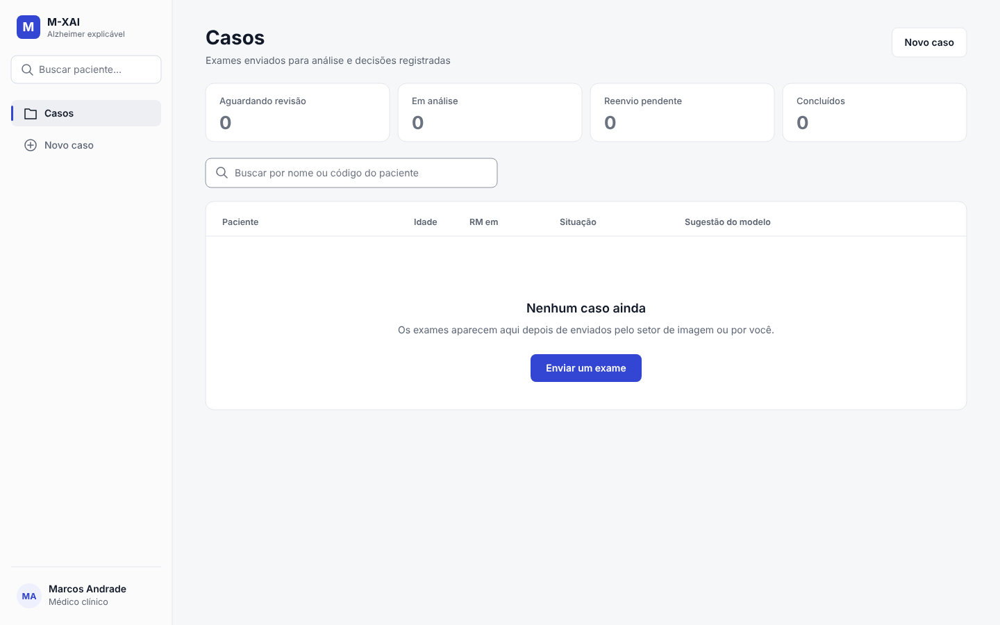

**Objetivo:** O02. **Signos:** explicação de como os casos chegam; nenhuma ação. **Origem:** estado vazio; ação retirada (lacuna da Entrega 10).

#### UI10 — Evidências do caso: parecer anterior

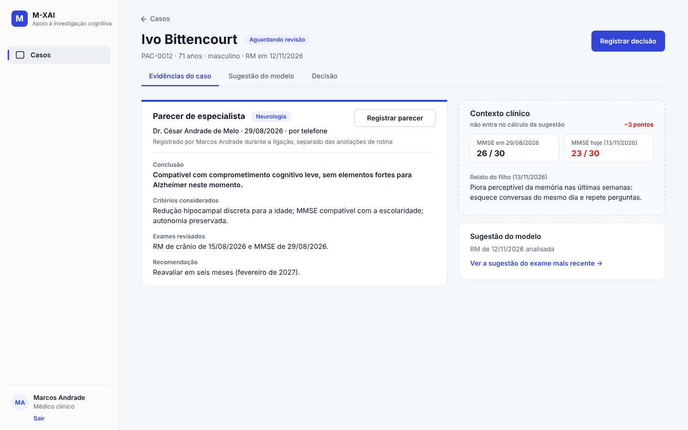

**Objetivo:** O07. **Signos:** parecer de especialista com especialista, data, canal, quem registrou, conclusão, critérios considerados, exames revisados e recomendação; contexto clínico com MMSE 26 → 23 e o relato do filho; resumo da sugestão. **Origem:** Retomar o raciocínio do parecer anterior (M02); H06.

#### UI11 — Registrar parecer de especialista

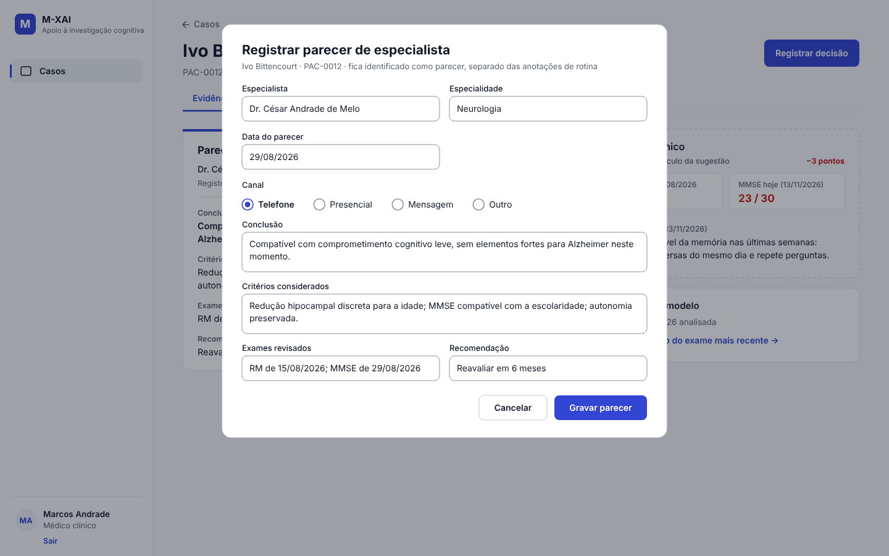

**Objetivo:** O08. **Signos:** especialista, especialidade, data, canal do parecer, conclusão, critérios considerados, exames revisados, recomendação; "fica identificado como parecer, separado das anotações de rotina". **Origem:** Registrar parecer de especialista (M02).

#### UI11b — Parecer com campo obrigatório pendente

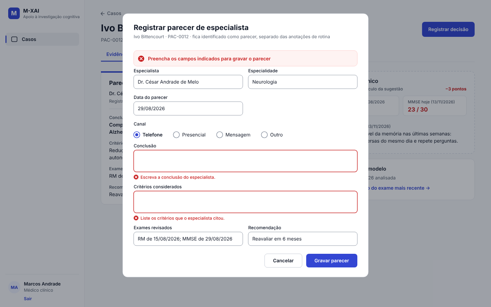

**Objetivo:** O08. **Signos:** resumo do erro e mensagem por campo. **Origem:** [RA] parecer sem campo obrigatório (M02).

#### UI03 — Sugestão do modelo

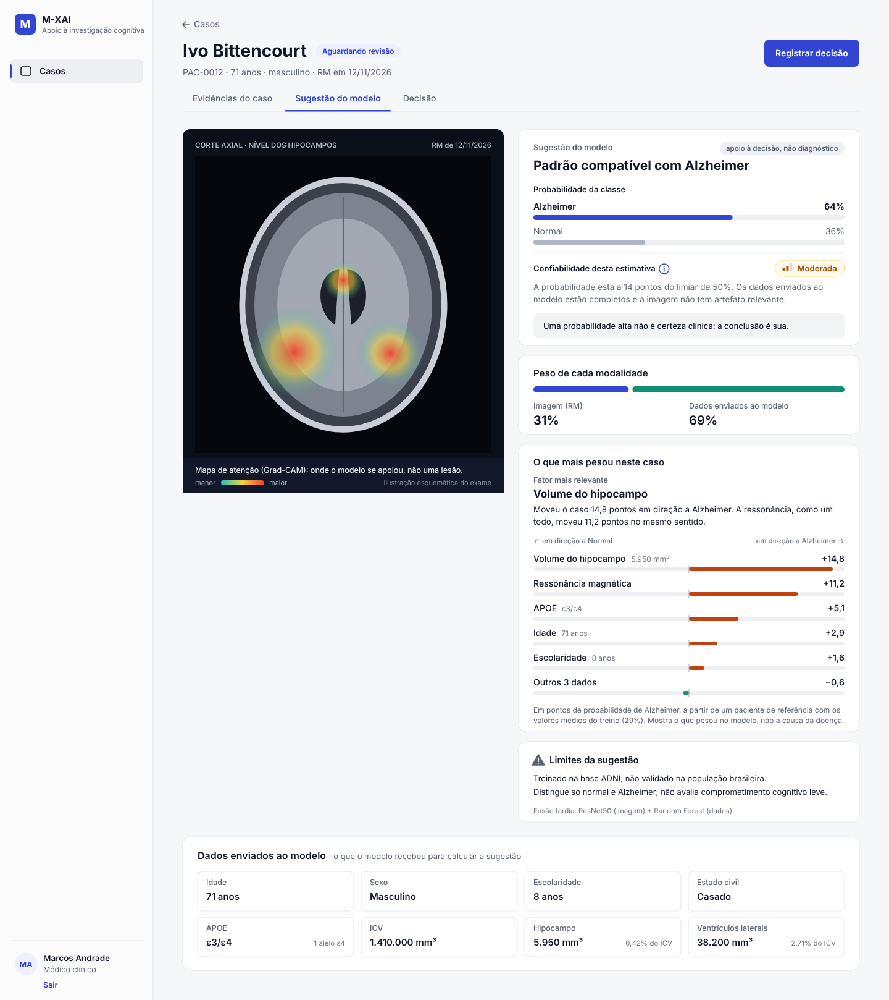

**Objetivo:** O06. **Signos:** classe sugerida com a etiqueta "apoio à decisão, não diagnóstico"; probabilidade da classe; confiabilidade desta estimativa com a razão; mapa de atenção com "onde o modelo se apoiou, não uma lesão"; peso de cada modalidade; o que mais pesou neste caso (fator mais relevante e contribuição por variável); limites da sugestão; dados enviados ao modelo. **Origem:** Interpretar a sugestão explicada (M02); correções 7 e 8.

#### UI03b — Termo do glossário aberto

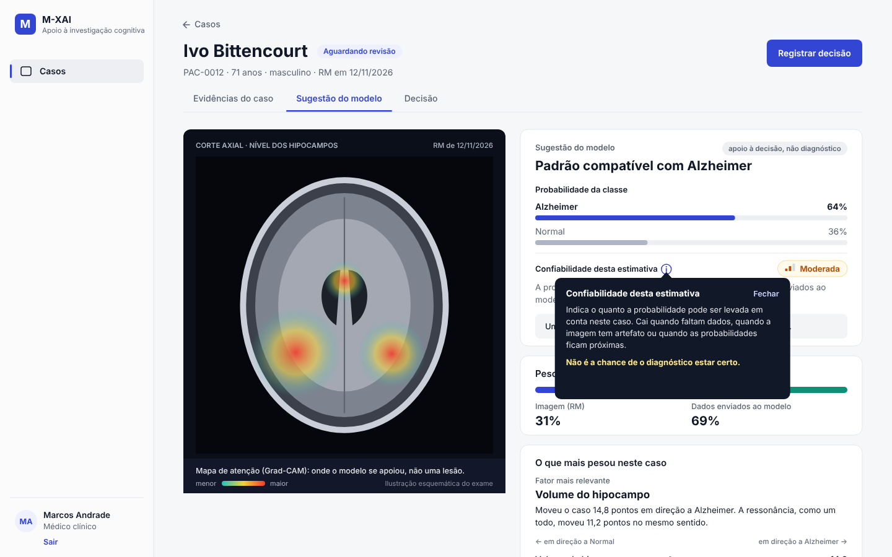

**Objetivo:** O06. **Signos:** definição e o que o termo não significa ("não é a chance de o diagnóstico estar certo"). **Origem:** Consultar termo do glossário (M02); F06; H03.

#### UI03c — Sugestão indisponível: análise com falha

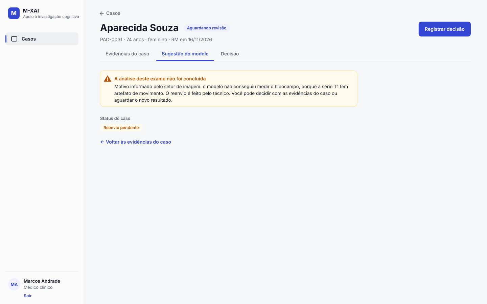

**Objetivo:** O06. **Signos:** motivo informado pelo setor de imagem, status "Reenvio pendente", quem resolve (o técnico) e o que o médico pode fazer. **Origem:** [CE] análise em andamento ou com falha (M02, M04).

#### UI05 — Registrar decisão e justificativa

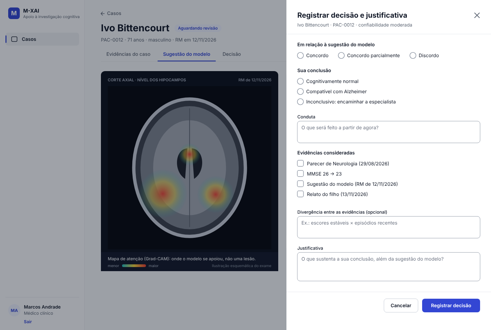

**Objetivo:** O11. **Signos:** concordância, conclusão, conduta, evidências consideradas, divergência (opcional), justificativa com pergunta-guia; o caso visível atrás do painel. **Origem:** Registrar decisão e justificativa (M02).

#### UI05b — Decisão com campos pendentes

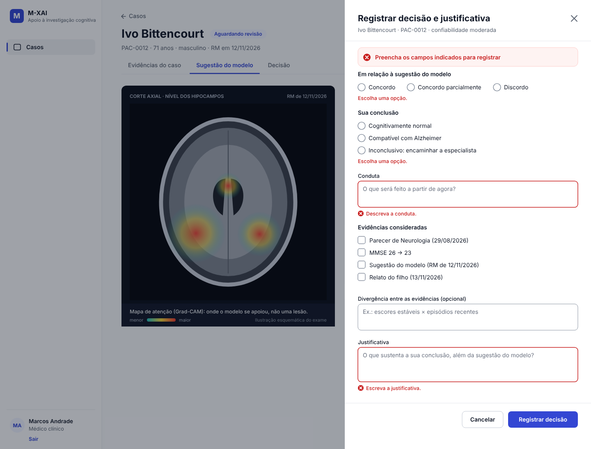

**Objetivo:** O11. **Signos:** resumo no topo e mensagem junto de cada campo. **Origem:** [RA] decisão com campo vazio (M02, M04).

#### UI05h — Decisão preenchida

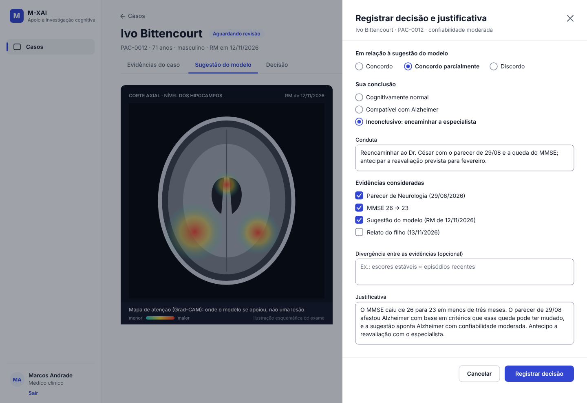

**Objetivo:** O11. **Signos:** "Concordo parcialmente", "Inconclusivo: encaminhar a especialista", evidências marcadas (parecer, MMSE 26 → 23, sugestão). **Origem:** Registrar decisão e justificativa (M02), caso do Sr. Ivo.

#### UI05d — Confirmar o registro da decisão

**Objetivo:** O11. **Signos:** resumo; "será gravada com seu nome, data e hora"; "ligada ao parecer de Neurologia de 29/08/2026"; "Voltar e revisar". **Origem:** [AL] Confirmar o registro da decisão (M02). Não afirma imutabilidade (H15).

#### UI05f — Falha ao gravar a decisão

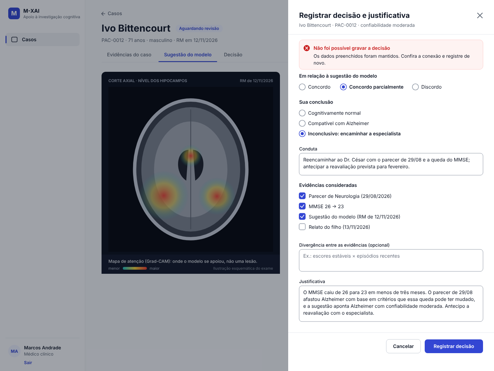

**Objetivo:** O11. **Signos:** "Não foi possível gravar a decisão"; "os dados preenchidos foram mantidos". **Origem:** [RA] falha ao gravar (M02, M04).

#### UI09 — Decisão registrada

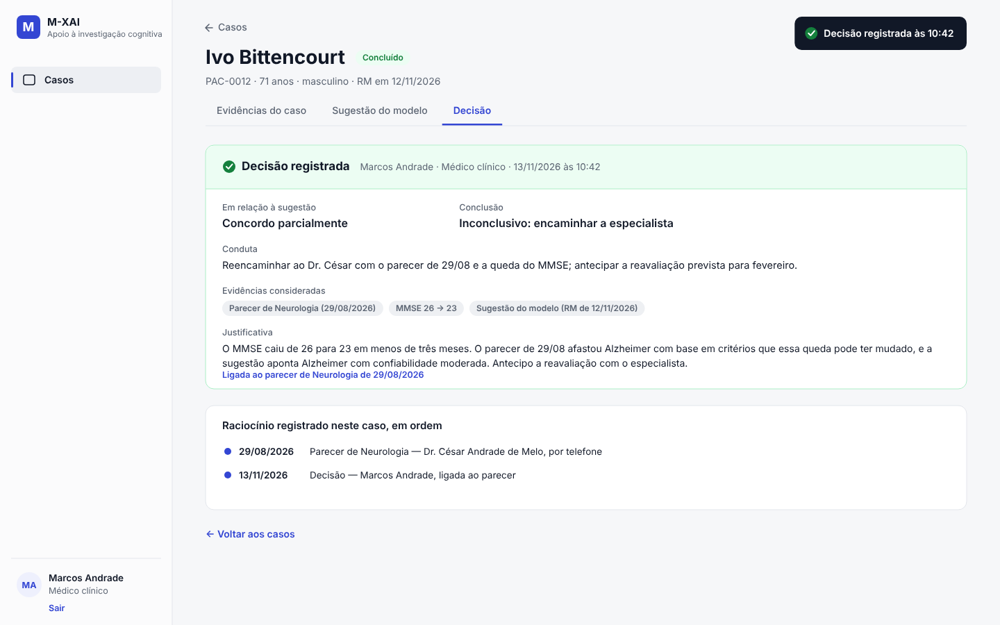

**Objetivo:** O12. **Signos:** autor, papel, data e hora; concordância, conclusão, conduta, evidências, justificativa; "ligada ao parecer de Neurologia"; raciocínio registrado neste caso, em ordem. **Origem:** Consultar a decisão registrada (M02); F05.

### Neurologista — CI04 / M04

#### UI12 — Evidências do caso: linha do tempo

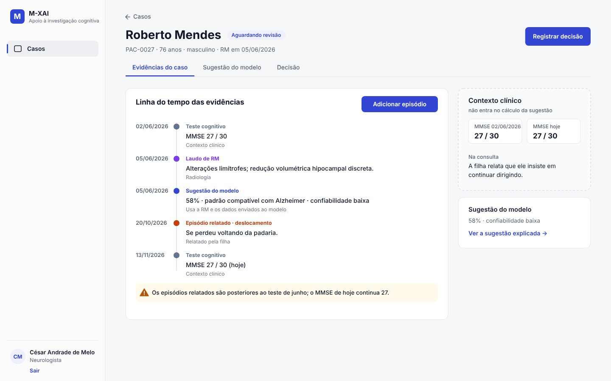

**Objetivo:** O09. **Signos:** linha do tempo com teste cognitivo, laudo de RM, sugestão e episódio relatado, cada um com a origem; contexto clínico com MMSE estável e o relato sobre dirigir. **Origem:** Confrontar evidências divergentes (M04).

#### UI12b — Registrar episódio relatado

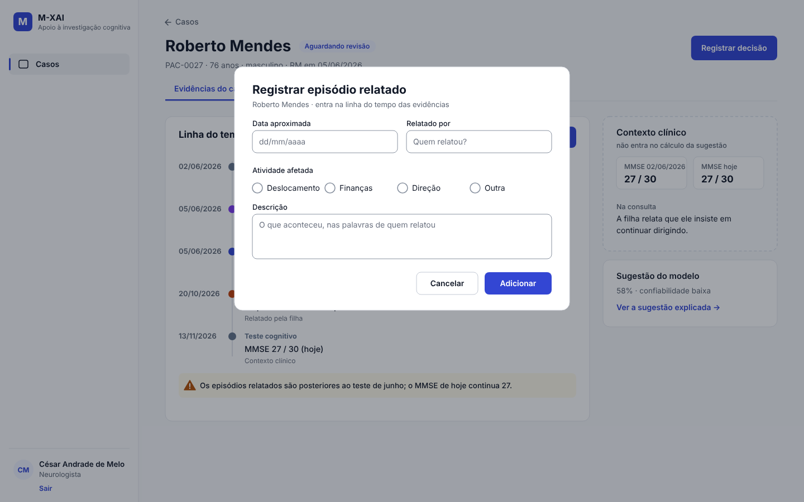

**Objetivo:** O09. **Signos:** data aproximada, relatado por, atividade afetada, descrição. **Origem:** Registrar episódio relatado (M04).

#### UI12c — Episódio com campo obrigatório pendente

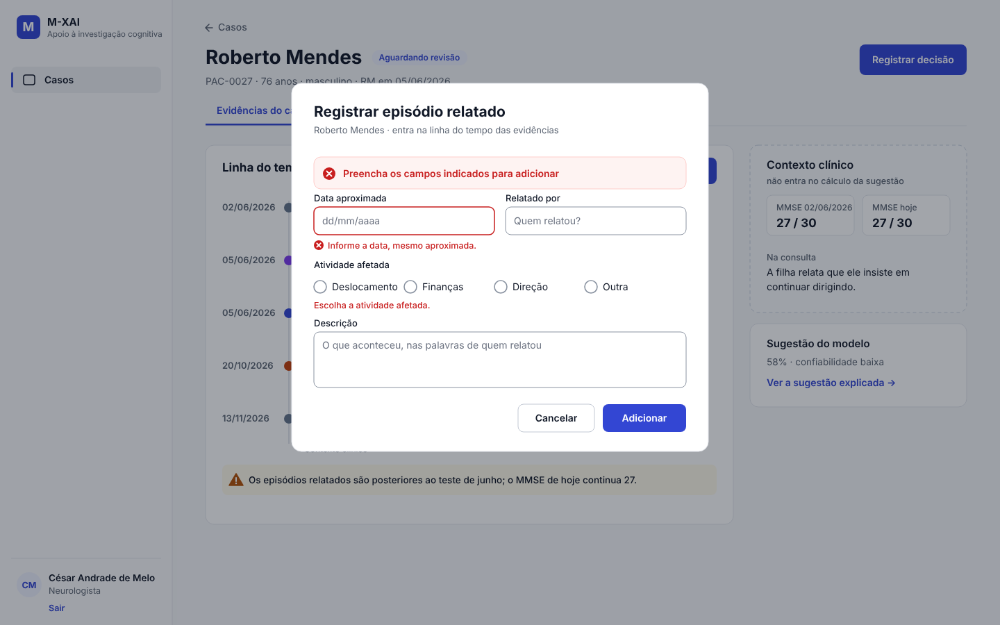

**Objetivo:** O09. **Signos:** data e atividade destacadas. **Origem:** [RA] episódio sem campo obrigatório (M04).

#### UI12e — Episódio preenchido

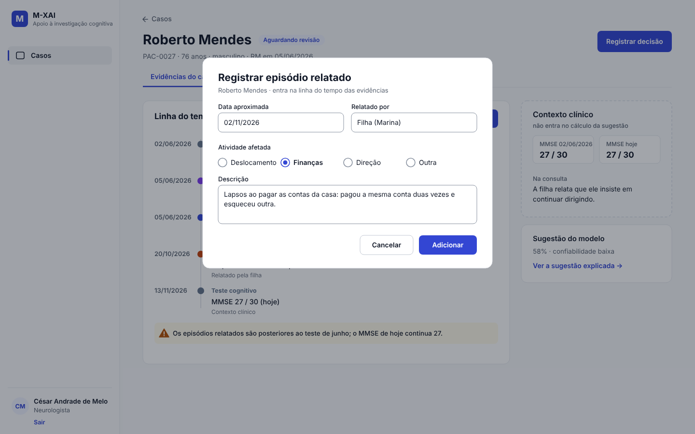

**Objetivo:** O09. **Signos:** "Finanças", "Filha (Marina)", descrição do relato. **Origem:** Registrar episódio relatado (M04).

#### UI12d — Episódio incluído na linha do tempo

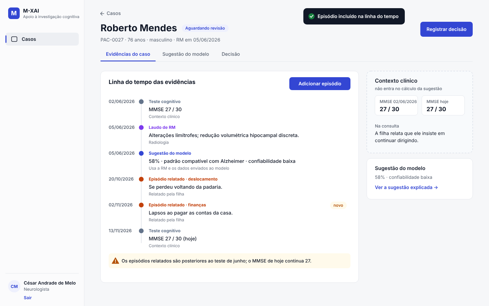

**Objetivo:** O09. **Signos:** aviso temporário, marca "novo", nota "os episódios são posteriores ao teste de junho; o MMSE de hoje continua 27". **Origem:** `d: episódio incluído na linha do tempo` (M04).

#### UI04 — Sugestão com confiabilidade baixa

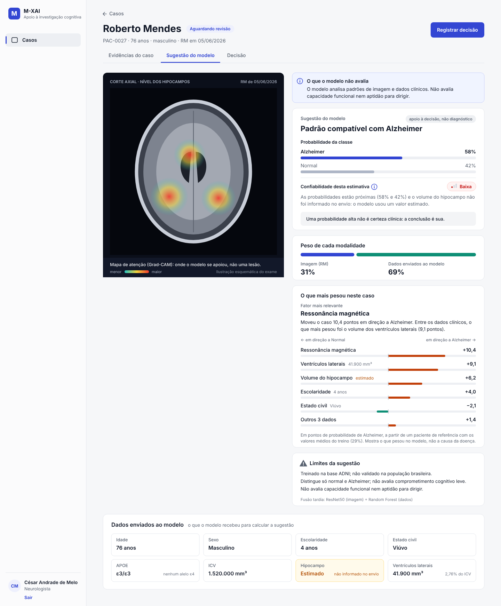

**Objetivo:** O06. **Signos:** aviso fixo "O que o modelo não avalia" (capacidade funcional, aptidão para dirigir); confiabilidade "Baixa" com a razão; hipocampo "estimado" em âmbar nos fatores e nos dados enviados. **Origem:** Interpretar a sugestão explicada com [PP] (M04).

#### UI05c — "Concordo" com confiabilidade baixa

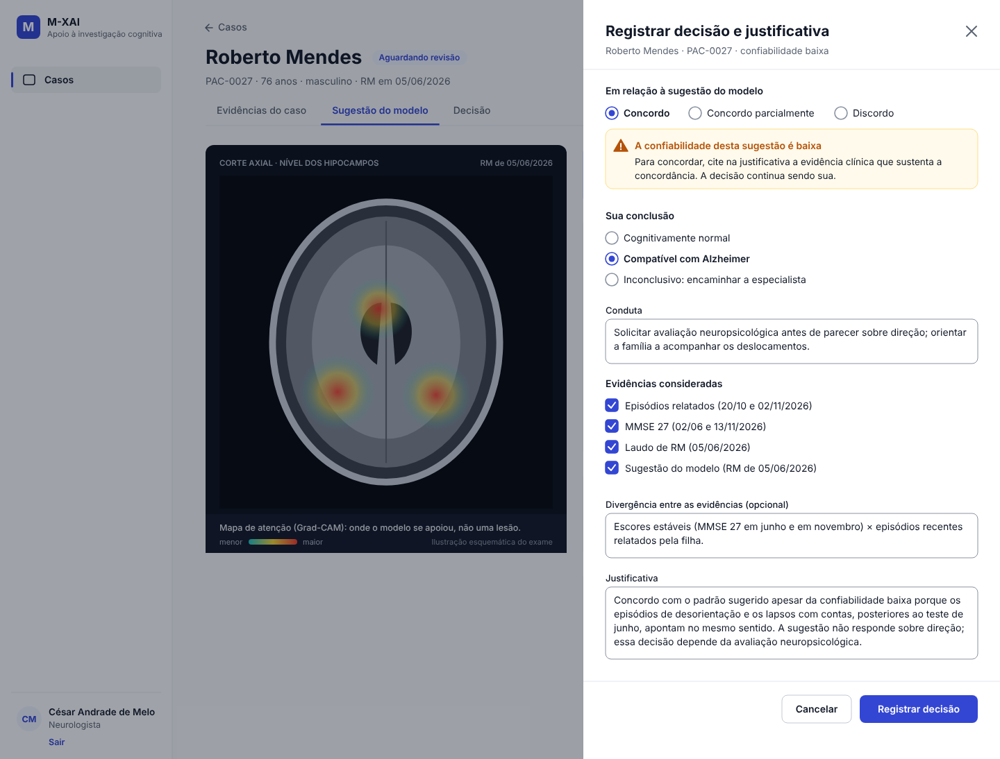

**Objetivo:** O11. **Signos:** aviso logo abaixo da escolha, que não bloqueia: "cite na justificativa a evidência clínica que sustenta a concordância"; divergência registrada. **Origem:** [PA] "Concordo" com confiabilidade baixa (M04, também previsto no M02).

#### UI05g — Confirmar o registro (neurologista)

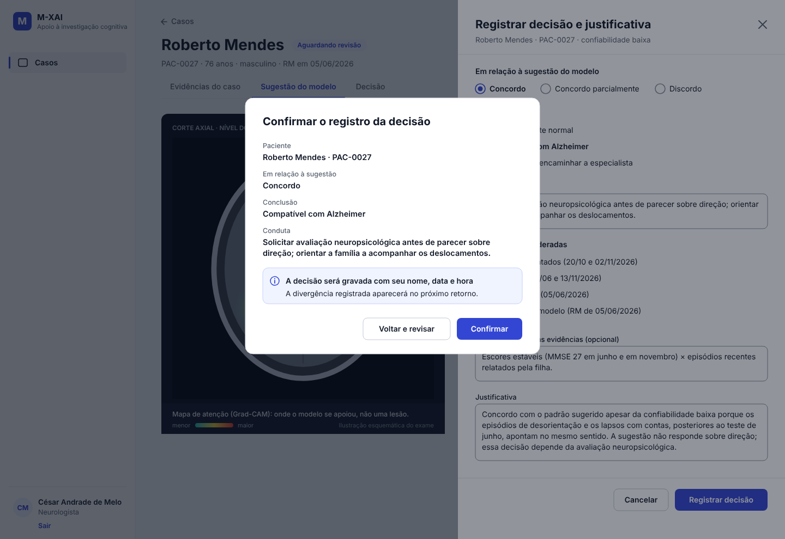

**Objetivo:** O11. **Signos:** resumo; "a divergência registrada aparecerá no próximo retorno". **Origem:** [AL] Confirmar o registro da decisão (M04).

#### UI09b — Decisão registrada com divergência

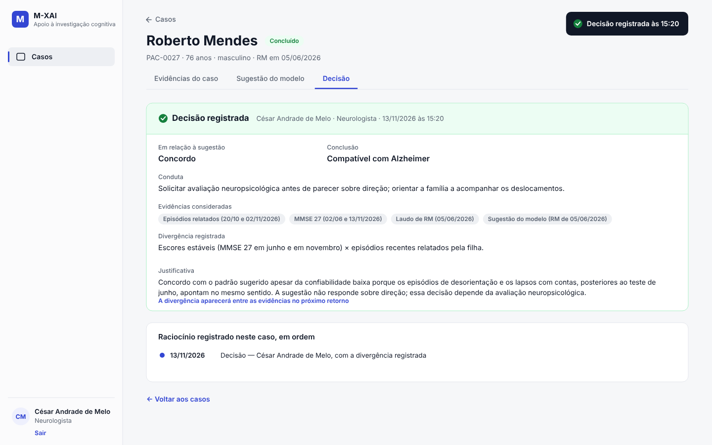

**Objetivo:** O12. **Signos:** divergência registrada (escores estáveis × episódios recentes), conduta (avaliação neuropsicológica antes de parecer sobre direção). **Origem:** Consultar a decisão registrada (M04).

### Técnico em radiologia — CI03 / M03

#### UI06 — Preparar e enviar o exame

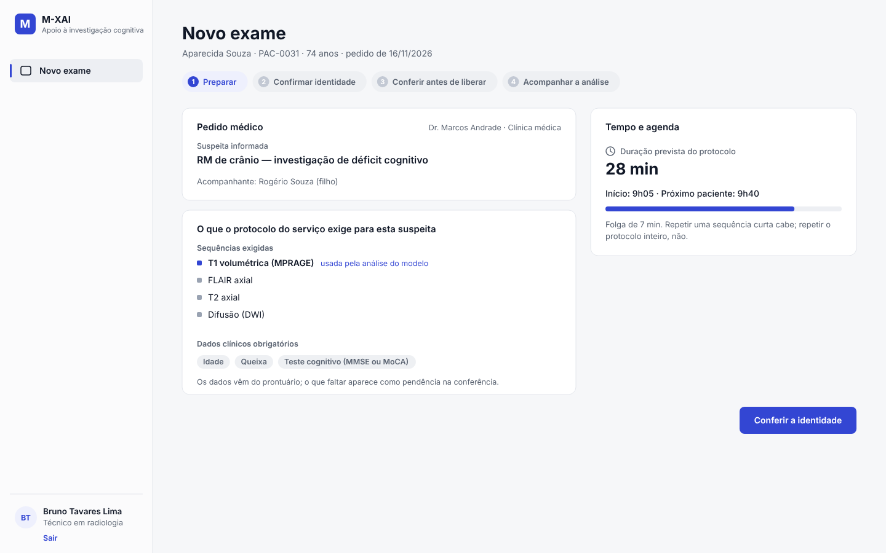

**Objetivo:** O03. **Signos:** etapas do envio; pedido médico e suspeita; sequências exigidas (T1 volumétrica "usada pela análise do modelo"); dados clínicos obrigatórios; tempo e agenda (28 min, próximo paciente às 9h40, folga de 7 min). **Origem:** Preparar e enviar o exame (M03); H09 e H10.

#### UI06e — Confirmar a identidade

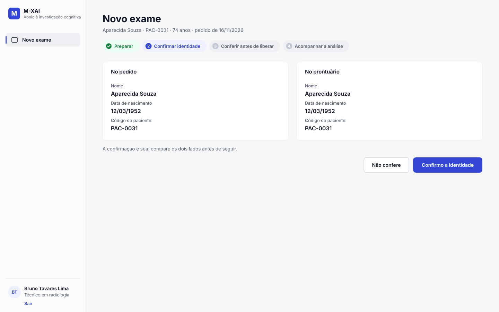

**Objetivo:** O03. **Signos:** pedido e prontuário lado a lado; "a confirmação é sua". **Origem:** Confirmar a identidade (M03).

#### UI06f — Identidade não confere

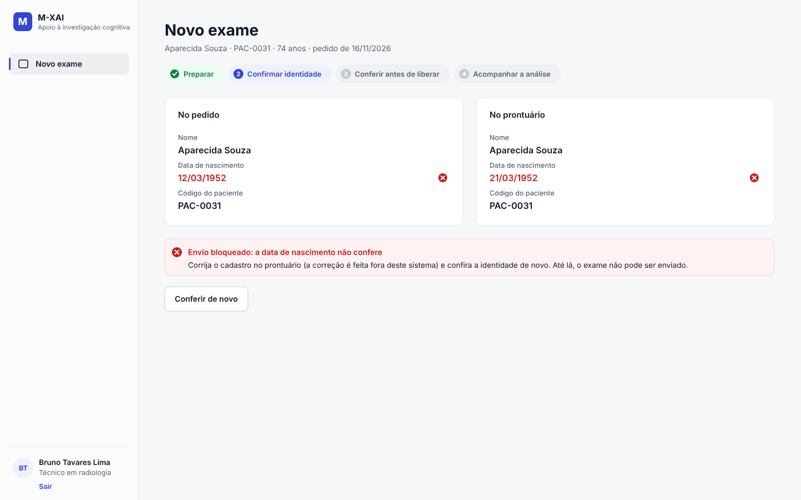

**Objetivo:** O03. **Signos:** diferença em vermelho com ícone; envio bloqueado; correção fora do sistema. **Origem:** [CE] pedido e prontuário não conferem (M03).

#### UI06c — Conferir antes de liberar: série errada

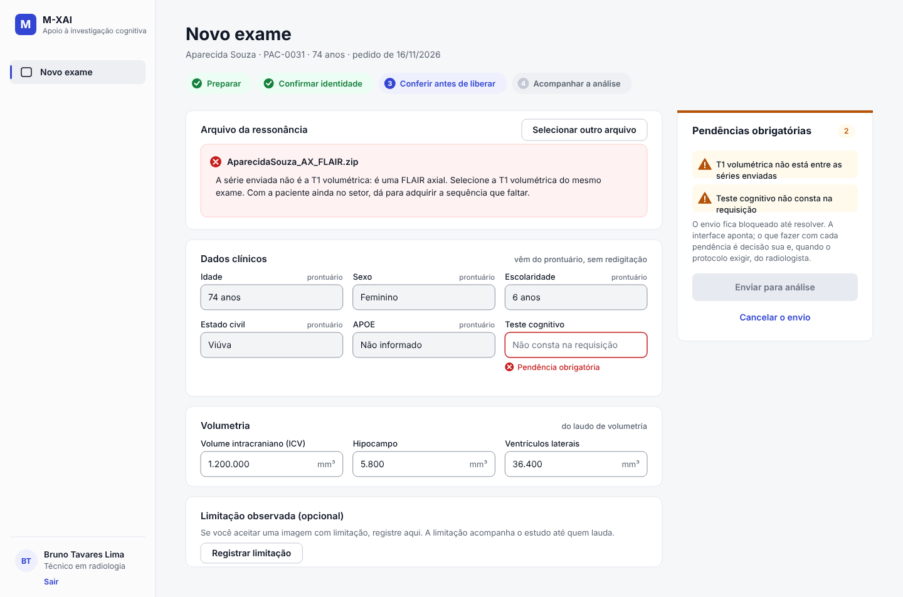

**Objetivo:** O04. **Signos:** arquivo recusado com a série identificada (FLAIR axial), o que selecionar e o que fazer com a paciente ainda no setor; painel de pendências. **Origem:** [RA] série que não é a T1 volumétrica (M03); H07.

#### UI06g — Conferir antes de liberar: pendência obrigatória

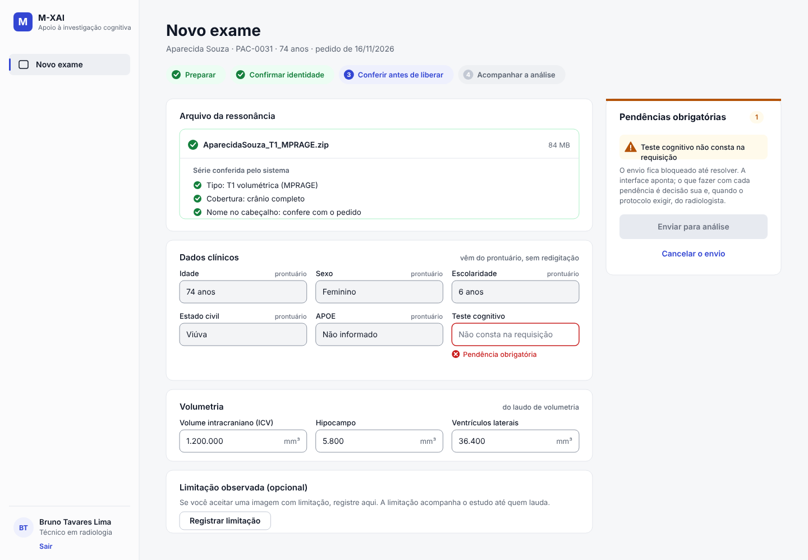

**Objetivo:** O04. **Signos:** série conferida {tipo, cobertura, nome no cabeçalho}; dados do prontuário somente leitura com a origem; teste cognitivo "não consta na requisição"; botão de envio desabilitado. **Origem:** [PA] pendência obrigatória (M03); H13.

#### UI06b — Conferir antes de liberar: valor fora da faixa

**Objetivo:** O04. **Signos:** ICV 120.000 mm³ em vermelho, com a faixa para adultos. **Origem:** [RA] valor fora da faixa (M03).

#### UI06d — Conferir antes de liberar: sem pendência

**Objetivo:** O04. **Signos:** "Nenhuma pendência", limitação registrada (movimento em T2 axial) que acompanha o estudo, "Enviar para análise" habilitado. **Origem:** Conferir antes de liberar o paciente (M03); F03.

#### UI06h — Descartar o envio

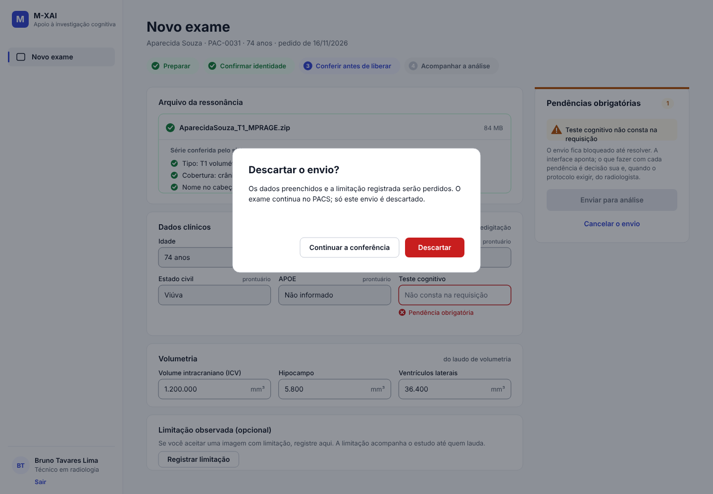

**Objetivo:** O04. **Signos:** o que se perde, o que continua no PACS, "Continuar a conferência". **Origem:** [AL] desistir do envio (M03).

#### UI07 — Acompanhar a análise

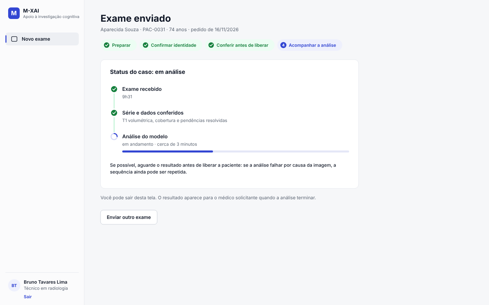

**Objetivo:** O05. **Signos:** etapas com estado, tempo estimado, recomendação de aguardar o resultado antes de liberar a paciente, "você pode sair desta tela". **Origem:** Acompanhar a análise (M03); H07, H09.

#### UI08 — Tratar a falha da análise

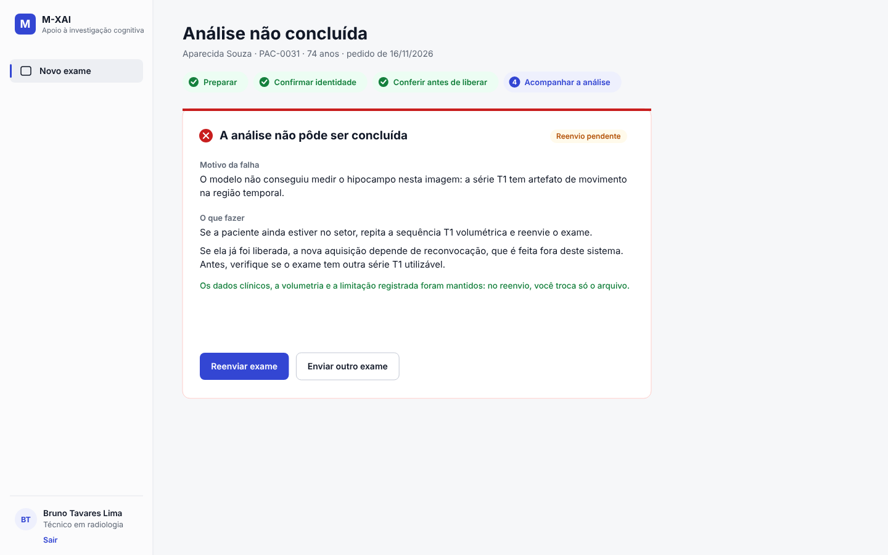

**Objetivo:** O05. **Signos:** motivo da falha em linguagem do serviço; o que fazer com a paciente no setor e já liberada; "dados mantidos: você troca só o arquivo"; "Reenviar exame". **Origem:** [RA] análise falha depois do envio e [CE] falha percebida depois da liberação (M03); F04.

#### UI08c — Reenvio com arquivo errado

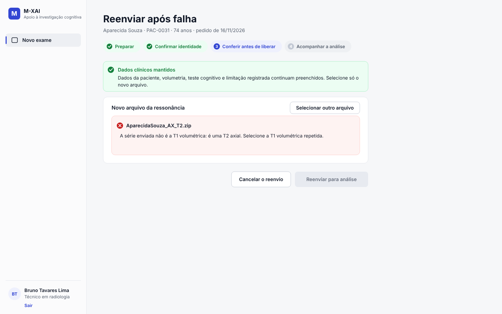

**Objetivo:** O05. **Signos:** "é uma T2 axial; selecione a T1 volumétrica repetida"; reenvio desabilitado. **Origem:** [RA] arquivo errado no reenvio (M03).

#### UI08b — Reenviar após falha

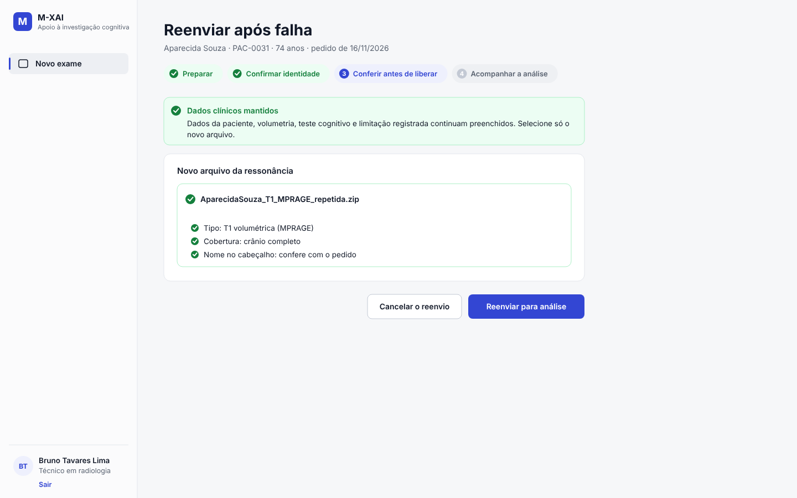

**Objetivo:** O05. **Signos:** "Dados clínicos mantidos", novo arquivo conferido, "Reenviar para análise". **Origem:** Reenviar após falha (M03); H13.

### Radiologista — CI01 / M01

#### UI13 — Fila de laudos

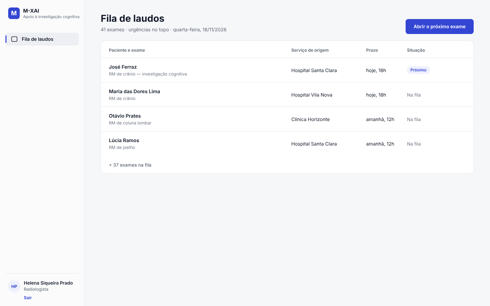

**Objetivo:** O02. **Signos:** quantidade de exames, serviço de origem, prazo, "Próximo", "Abrir o próximo exame". **Origem:** Localizar o exame na fila (M01).

#### UI13b — Fila com urgência e laudo suspenso

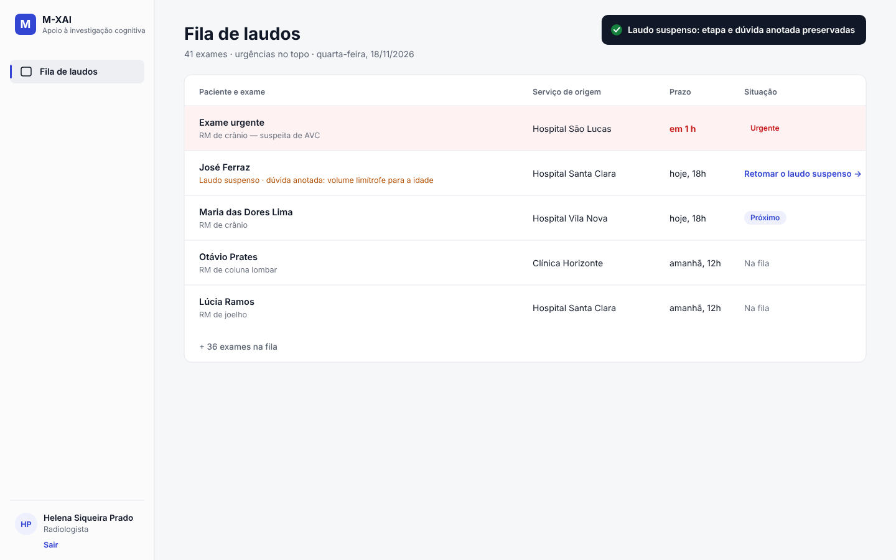

**Objetivo:** O02. **Signos:** urgência no topo; laudo suspenso com a dúvida anotada; "Retomar o laudo suspenso"; aviso "etapa e dúvida anotada preservadas". **Origem:** `d: laudo suspenso` (M01, subobjetivo "Retomar após interrupção").

#### UI13c — Fila depois de liberar o laudo

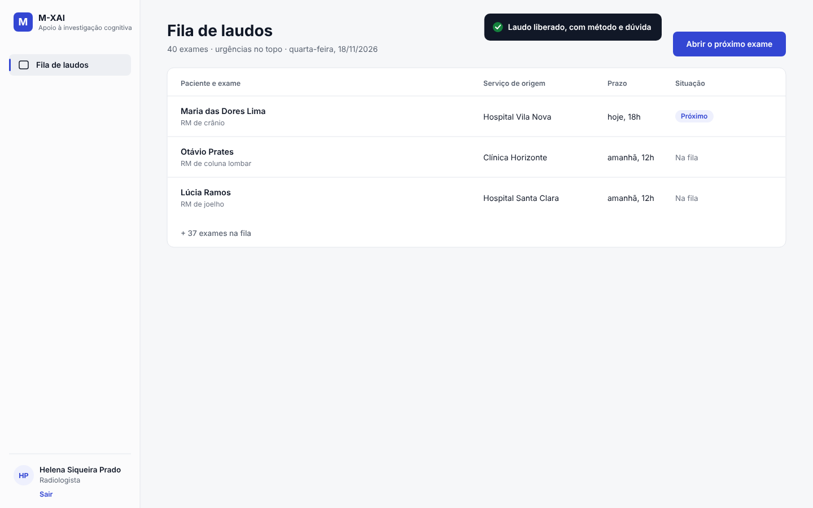

**Objetivo:** O10. **Signos:** "Laudo liberado, com método e dúvida"; um exame a menos. **Origem:** `d: laudo liberado` e gcc (M01).

#### UI14 — Ler a pergunta clínica

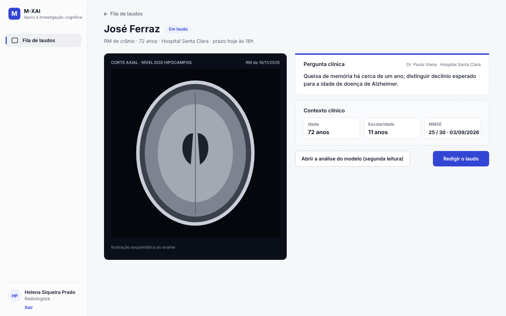

**Objetivo:** O10. **Signos:** imagem sem sobreposição; pergunta clínica com o solicitante; contexto clínico (idade, escolaridade, MMSE com data); segunda leitura como ação opcional. **Origem:** Ler a pergunta clínica (M01); H08.

#### UI14b — Análise do modelo indisponível

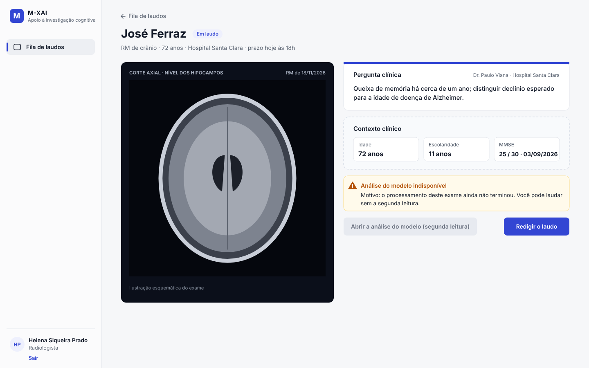

**Objetivo:** O10. **Signos:** motivo; segunda leitura desabilitada; "Redigir o laudo" continua disponível. **Origem:** [CE] análise do modelo indisponível (M01).

#### UI15 — Consultar a referência objetiva

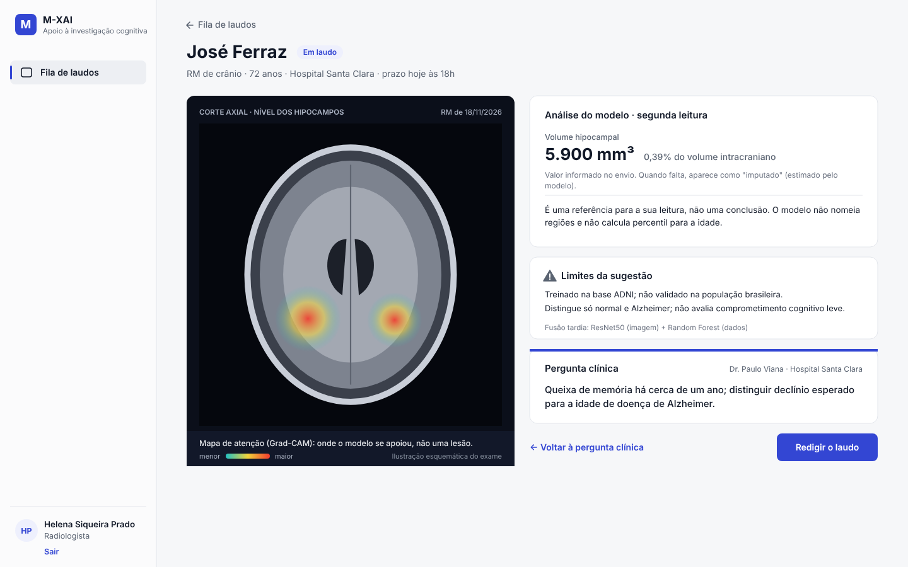

**Objetivo:** O06. **Signos:** volume hipocampal e proporção do ICV; explicação de "imputado"; "referência para a sua leitura, não uma conclusão"; limites; a pergunta clínica repetida. **Origem:** Consultar a referência objetiva (M01); R02.

#### UI16 — Registrar método e dúvida

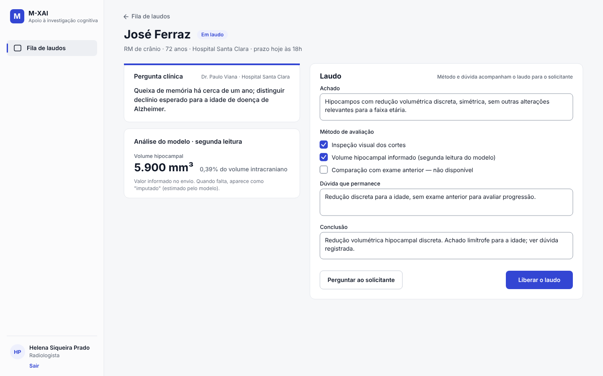

**Objetivo:** O10. **Signos:** achado; método de avaliação (inspeção visual, volume informado, comparação com exame anterior "não disponível"); dúvida que permanece; conclusão; "método e dúvida acompanham o laudo para o solicitante". **Origem:** Registrar método e dúvida (M01).

#### UI16b — Urgência chega durante o laudo

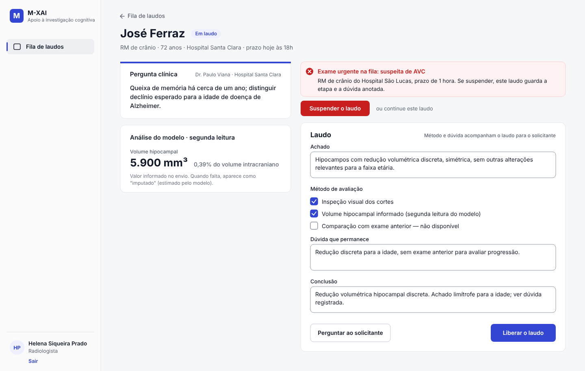

**Objetivo:** O10. **Signos:** aviso de urgência dentro da cena; "Suspender o laudo" e o que ele preserva; "ou continue este laudo". **Origem:** ruptura "exame urgente chega no meio do laudo" (M01).

#### UI16c — Conclusão obrigatória

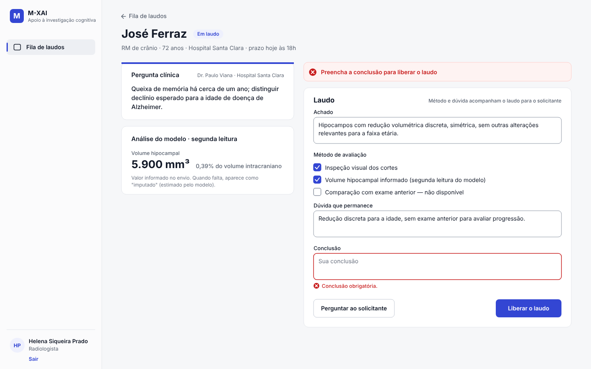

**Objetivo:** O10. **Signos:** resumo no topo e mensagem no campo. **Origem:** [RA] conclusão não preenchida (M01).

#### UI16d — Confirmar liberação sem método

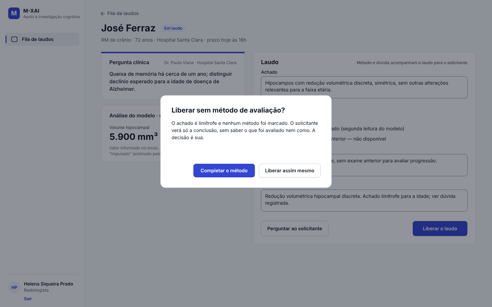

**Objetivo:** O10. **Signos:** consequência para o solicitante; "a decisão é sua"; "Completar o método" como ação principal. **Origem:** [AL] achado limítrofe sem método (M01).

#### UI16e — Laudo após enviar a pergunta

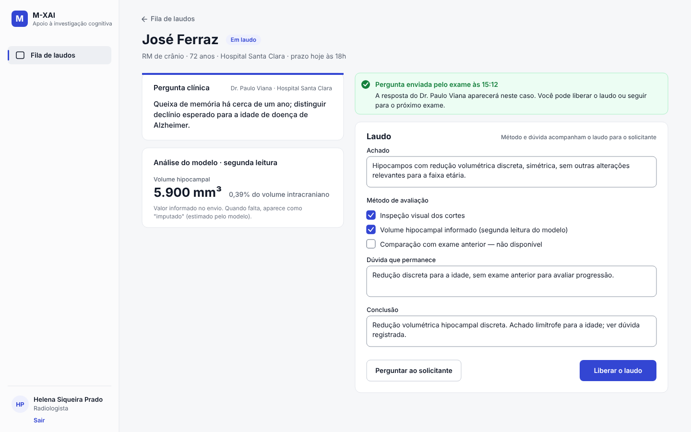

**Objetivo:** O10. **Signos:** "Pergunta enviada pelo exame às 15:12"; onde a resposta aparecerá; o laudo continua liberável. **Origem:** confirmação do processo de envio da pergunta (M01).

#### UI17 — Perguntar ao solicitante

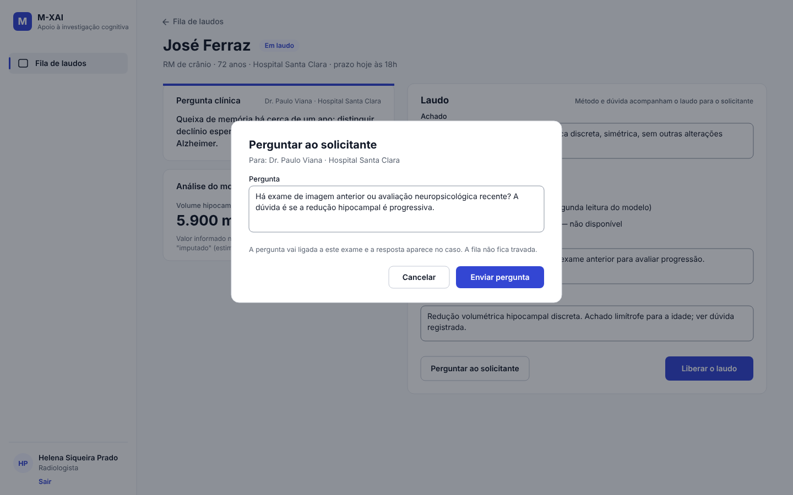

**Objetivo:** O10. **Signos:** destinatário, pergunta ligada ao exame, "a fila não fica travada". **Origem:** Perguntar ao solicitante (M01).

#### UI17b — Pergunta em branco

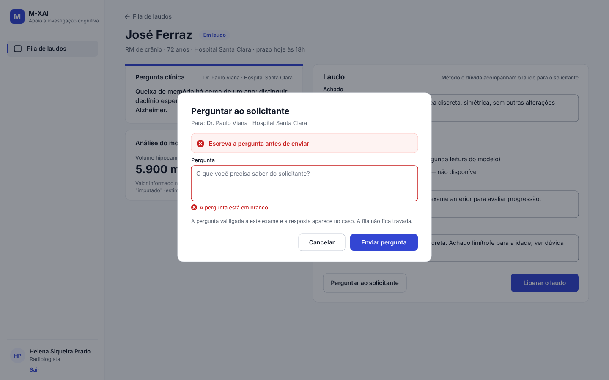

**Objetivo:** O10. **Signos:** "Escreva a pergunta antes de enviar". **Origem:** [RA] pergunta enviada em branco (M01).

## Sistema visual e consistência

| Elemento | Regra adotada | Justificativa |
|---|---|---|
| Tipografia | Inter; título de tela 28 px, título de card 15–17 px, texto 14 px, apoio 11,5–13 px. A probabilidade tem o mesmo peso dos rótulos | O número da probabilidade deixou de ser o maior elemento da tela, para não ser lido antes da confiabilidade (sessão da Entrega 6, tarefa 1) |
| Cores | Azul (#3346D3) só para interface: ação, seleção, barra de probabilidade. Verde, âmbar e vermelho só para estado: confiabilidade, validação, erro, sucesso. Laranja e verde-azulado só para a direção das contribuições | Separar cor de interface de cor de estado impede ler probabilidade e confiança como uma coisa só (correção 8) |
| Componentes | Card branco para informação do sistema; card tracejado para informação fora do modelo; campo com rótulo acima, origem à direita ("prontuário"), unidade dentro e erro abaixo; um botão primário por tela ou diálogo | O contexto clínico tem que parecer diferente do que o modelo usou, não só estar escrito diferente (correção 7) |
| Feedback | Erro de campo junto do campo e resumo no topo; aviso que não bloqueia (UI05c, UI16d) diferente de erro que bloqueia (UI06b, UI06f); aviso temporário de sucesso (UI09, UI12d, UI13b, UI13c); progresso com etapas (UI06–UI07) | Cada tipo de retorno tem forma própria, para que o usuário saiba se precisa agir |
| Identidade | Nome e papel na barra lateral; menu próprio de cada perfil (Casos, Fila de laudos, Novo exame) | Correção 3 |
| Componentes equivalentes | O painel de decisão, o card da sugestão, o contexto clínico, a falha de análise e o diálogo de confirmação são o mesmo componente em todos os perfis em que aparecem | Consistência (H4): o neurologista e o médico leem a sugestão da mesma forma |

## Verificação de acessibilidade básica

Referência: WCAG 2.2, nível AA, nos critérios que um protótipo estático permite verificar. Contrastes calculados com a fórmula de luminância relativa da WCAG sobre as cores usadas.

| Critério | Verificação | Resultado |
|---|---|---|
| 1.4.3 Contraste de texto (4,5:1) | Texto principal 17,7:1; secundário 6,0:1; apoio 4,8:1 sobre branco e 4,5:1 sobre o fundo cinza; azul de ação 7,1:1; branco em botão azul 7,1:1 e em botão vermelho 5,7:1; verde, âmbar e vermelho sobre seus fundos claros 4,8:1, 4,8:1 e 5,3:1; legendas sobre o painel escuro da imagem 6,2:1 e 9,4:1 | atende. Botão desabilitado tem 4,0:1, o que a WCAG dispensa para componentes inativos |
| 1.4.11 Contraste de componentes (3:1) | Borda de campos, rádios e caixas de seleção: 3,1:1 | atende |
| 1.4.1 Uso de cor | Confiabilidade tem rótulo e barras de nível; erro tem ícone e texto; valor estimado tem a palavra "estimado"; contribuições têm sinal (+/−) e direção escrita | atende |
| 2.5.8 Tamanho do alvo (24 × 24 px) | Botões de 32 a 44 px de altura; rádios de 18 px com o rótulo clicável | atende no desenho; na implementação, o rótulo do rádio precisa ser clicável |
| 1.1.1 Texto alternativo | A imagem da ressonância e o mapa de atenção precisam de descrição textual | pendente na implementação |
| 2.1.1 Teclado e 2.4.7 Foco visível | Não verificáveis no Figma | pendente na implementação |

## Estados considerados

| Estado do enunciado | Onde está |
|---|---|
| Vazio / sem dados | UI02d; UI16 ("comparação com exame anterior — não disponível") |
| Carregamento / processamento | UI07 |
| Sucesso | UI06d, UI07, UI09, UI09b, UI12d, UI13c, UI16e |
| Erro de entrada | UI01b, UI05b, UI06b, UI06c, UI08c, UI11b, UI12c, UI16c, UI17b |
| Erro de processamento | UI03c, UI05f, UI08, UI14b |
| Filtro sem resultados | UI02c |
| Permissão insuficiente | não prototipado: cada perfil só vê o próprio menu. Se a Entrega 13 encontrar um caminho para conteúdo de outro perfil, o estado entra |
| Confirmação de ação sem volta ou destrutiva | UI05d, UI05g, UI06h, UI16d |
| Cancelamento / desfazer / recuperação | cancelar em UI05, UI06h, UI11, UI12b, UI17; recuperação em UI05f, UI08b; retomada em UI13b |
| Interrupção | UI16b → UI13b → UI16 |
| Dados desatualizados / conflito | não ocorre com um profissional por caso. Volta a ser pertinente se H15 levar a adendos |

## O que é simulado e o que é integrado

| No protótipo | Na plataforma da equipe | Consequência para a avaliação |
|---|---|---|
| Probabilidade, confiabilidade, contribuições por variável, peso das modalidades e mapa de atenção com valores fixos por caso | Calculados pelo modelo | A avaliação mede se o profissional lê essas informações corretamente, não se estão certas |
| Parecer de especialista, linha do tempo, episódios, laudo, pergunta ao solicitante, fila de laudos | Não existem | Avalia-se a conversa; persistência, contas e permissões ficam para a implementação (F02) |
| Conferência de série, cobertura e cabeçalho; identidade; pendências; faixa no campo | A plataforma valida só campos | Avalia-se se a conferência é percebida e útil; a viabilidade técnica fica para a implementação (F03) |
| Reenvio com dados mantidos | Não existe | idem (F04) |
| Dados "do prontuário" | Não há integração com prontuário ou PACS (Entrega 8) | O protótipo mostra o que a integração permitiria; H13 continua aberta |
| Preenchimento de formulários | Simulado por clique | Tempo de digitação não é medido |
| Ressonância | Ilustração esquemática vetorial | Não deve ser objeto de leitura clínica no teste |

## Pendências

1. **Entrega 9 (consolidação):** conferir os rótulos das telas contra a tabela única de signos e o dicionário de objetivos usado acima.
2. **Entrega 7 / H15:** se a prática admitir adendo ou correção com motivo, UI09 e UI09b ganham a ação correspondente.
3. **Expiração de sessão:** modelar no MoLIC e prototipar, se a avaliação mostrar necessidade.

## Checklist

- [x] Link do Figma está acessível.
- [x] Há screenshots representativos no repositório.
- [x] Todos os MoLIC relevantes estão cobertos. *(M01–M04; lacunas declaradas na seção de cobertura)*
- [x] Estados de erro, feedback e recuperação foram prototipados.
- [ ] Terminologia/signos são consistentes com Entrega 9. *(coerentes com os signos dos MoLIC; falta conferir contra a tabela consolidada, ainda em modelo)*
- [x] Componentes equivalentes se comportam de forma consistente.
- [x] Fluxos críticos são clicáveis do início ao fim.
- [x] O protótipo está pronto para inspeção e testes, sem "links mortos" nas tarefas avaliadas.
- [x] Dashboards, relatórios, históricos, filtros, administração e CRUDs presentes possuem justificativa rastreável. *(histórico do caso: F02 e F05; filtro retirado; relatório fora do escopo, F08)*
- [x] Estados de vazio, processamento, erro e recuperação foram considerados quando pertinentes.
- [x] Resultados técnicos são apresentados de forma interpretável para o perfil de usuário.
- [x] A equipe distingue no protótipo o que é interação simulada e o que é funcionalidade técnica realmente integrada, quando necessário.
