# Entrega 11 — Protótipo no Figma

**Data:** 14/11/2026  
**Status:** 🟨 entrega parcial — aguardando as Entregas 9 e 10  
**Responsabilidade:** 1 protótipo integrado por equipe cobrindo os fluxos MoLIC. Nesta versão, telas, fluxos e documentação: Nathan Gabriel da Fonseca Leite — 22.123.028-7.

## Situação desta entrega

O enunciado pede um protótipo que materialize "os objetivos, tópicos, signos, feedbacks, alternativas e recuperações definidos anteriormente", e o checklist exige cobertura dos MoLIC e coerência com os signos da Entrega 9. **As Entregas 9 e 10 ainda não existem.** Esta versão é, portanto, parcial, e a equipe declara o que usou no lugar delas:

| O enunciado pede | O que ainda não existe | O que esta versão usou provisoriamente | O que muda quando 9 e 10 estiverem prontas |
|---|---|---|---|
| Cobertura MoLIC → Figma | Diagramas M01–M04 (Entrega 10) | Fluxos PF01–PF05 da [Entrega 6](06_prototipacao_papel.md) e tarefas T01–T04 da [Entrega 5](05_analise_tarefas.md) | A tabela de cobertura passa a partir dos MoLIC; fluxos que o MoLIC modelar e o Figma não tiver viram telas novas, e telas sem conversa correspondente são revistas |
| Terminologia e signos da Entrega 9 | Esquema conceitual de signos | O vocabulário já usado na plataforma e no glossário (UI03b), mais os termos novos desta versão ("probabilidade da classe", "confiabilidade desta estimativa", "contexto clínico") | Cada rótulo das telas é conferido contra a tabela única de signos; divergências são corrigidas no Figma |
| Papéis e permissões | Decisão sobre quem visualiza, decide e registra | Médico (P01) e técnico (P04) aparecem como usuários distintos nas telas, mas o protótipo não modela permissões | Entram as telas de perfil e o estado "permissão insuficiente" |

O que esta versão já entrega com segurança são as **correções do feedback da Entrega 6** que dependiam de mudança de tela. Elas estavam registradas como "próxima versão" na seção 5 da Entrega 6 e agora estão prototipadas (seção [O que mudou em relação à Entrega 6](#o-que-mudou-em-relação-à-entrega-6)).

## Objetivo da atividade

Materializar o modelo de interação em um protótipo navegável, preservando a lógica dos objetivos, tópicos, signos, feedbacks, alternativas e recuperações definidos anteriormente.

## Link do Figma

**Protótipo:** {{URL — a preencher depois de montar o arquivo, ver "Como montar o protótipo no Figma"}}  
**Arquivo editável:** {{URL}}  
**Última verificação de permissão:** {{dd/mm/aaaa}}

> Teste o link em janela anônima. O avaliador deve conseguir abrir o protótipo sem solicitar permissão.

### Como o protótipo foi construído

As 21 telas foram desenhadas como vetores (`assets/11_figma/figma_import/*.svg`), em 1440 px de largura e com a fonte Inter, que é a fonte padrão do Figma. Arrastadas para o Figma, viram quadros editáveis: textos continuam texto, e cada elemento clicável é uma camada com nome próprio (por exemplo, `btn_registrar_decisao`). Os nomes das camadas são os mesmos da tabela de links abaixo. As imagens PNG desta página são a renderização dessas mesmas telas.

### Como montar o protótipo no Figma

1. Criar um arquivo de design no Figma e arrastar os 21 arquivos de `assets/11_figma/figma_import/` para o canvas. Renomear cada quadro com o código e o nome da tela (por exemplo, "UI03 — Caso com sugestão").
2. Na aba **Prototype**, criar cada ligação da tabela abaixo: selecionar a camada de origem, arrastar até o quadro de destino, com gatilho *On click* e ação *Navigate to*.
3. Criar três pontos de partida (*flow starting points*): **Médico** em UI01, **Técnico — envio** em UI06 e **Técnico — falha** em UI08.
4. Os quadros mais altos que 900 px (UI03, UI04, UI06 a UI06d e UI09) devem rolar na vertical durante a apresentação. Conferir isso no modo *Present*.
5. Compartilhar com "qualquer pessoa com o link pode ver", abrir o link do protótipo numa janela anônima e preencher os links acima.

### Ligações do protótipo

| Tela | Camada | Destino | Observação |
|---|---|---|---|
| UI01 | `btn_entrar` | UI02 | UI01b é estado de inspeção: o Figma não distingue senha certa de errada |
| UI02 | `row_ivo` | UI03 | |
| UI02 | `row_roberto` | UI04 | |
| UI02 | `filtro_aguardando` | UI02b | |
| UI02 | `campo_busca` | UI02c | simula a busca por "Bitencourt", com erro de grafia |
| UI02b | `row_ivo` / `row_roberto` | UI03 / UI04 | |
| UI02b | `link_limpar_filtro` | UI02 | |
| UI02c | `btn_limpar_busca` | UI02 | |
| UI03 | `termo_confiabilidade` | UI03b | |
| UI03, UI04, UI09 | `link_voltar_casos` | UI02 | |
| UI03b | `dica_glossario` | UI03 | fecha a dica |
| UI04 | `btn_registrar_decisao` | UI05 | |
| UI05 | `opcoes_decisao` | UI05c | clicar em qualquer opção simula o preenchimento do painel |
| UI05 | `btn_registrar` | UI05b | registrar sem preencher |
| UI05b | `opcoes_decisao` | UI05c | |
| UI05, UI05b, UI05c | `btn_cancelar` / `btn_fechar_painel` | UI04 | |
| UI05c | `btn_registrar` | UI05d | |
| UI05d | `btn_confirmar_registro` | UI09 | |
| UI05d | `btn_voltar_revisar` | UI05c | |
| UI06 | `area_arquivo` | UI06c | o protótipo oferece primeiro a série FLAIR (ver Entrega 12, UT04) |
| UI06c | `btn_escolher_outro` | UI06b | o formulário chega preenchido, com o volume intracraniano digitado errado |
| UI06b | `campo_icv` | UI06d | simula a correção do valor |
| UI06d | `btn_enviar_analise` | UI07 | |
| UI07 | `btn_enviar_outro` | UI06 | |
| UI08 | `btn_reenviar_exame` | UI08b | |
| UI08b | `btn_reenviar_analise` | UI07 | |
| UI08b | `btn_cancelar_reenvio` / `link_voltar_falha` | UI08 | |

**Sem ligação, de propósito:** `btn_registrar_decisao` em UI03 (o registro é avaliado no caso de UI04, para que paciente, painel, confirmação e caso concluído mostrem os mesmos dados), as linhas de pacientes concluídos em UI02, `btn_voltar_casos` em UI08 e os itens de menu do técnico. O técnico não tem lista própria de casos enquanto a Entrega 9 não definir o que esse perfil vê. Nenhuma dessas ações faz parte das tarefas de teste da Entrega 12.

## Cobertura provisória: fluxos da Entrega 6 → Figma

> Esta tabela substitui provisoriamente a "Cobertura MoLIC → Figma". A coluna MoLIC fica vazia até a Entrega 10.

| Fluxo (Entrega 6) | Objetivo / tarefa | Telas no Figma | Estados de erro / recuperação | MoLIC | Responsável |
|---|---|---|---|---|---|
| — | Entrar no sistema | `UI01 → UI02` | `UI01b` | pendente | Nathan |
| PF01 | Interpretar a sugestão de um caso (T01 HTA 1.2 e 2.2; T04 HTA 1.2 e 2.1) | `UI02 → UI03 → UI03b` | — | pendente | Nathan |
| PF02 | Decidir num caso de confiabilidade baixa e registrar (T04 HTA 4.2; T01 HTA 4) | `UI02 → UI04 → UI05 → UI05c → UI05d → UI09` | `UI05b` (campos pendentes), `UI05c` (freio ao "concordo") | pendente | Nathan |
| PF03 | Enviar um novo caso (T03, GOMS GOAL 3 e 4) | `UI06 → UI06c → UI06b → UI06d → UI07` | `UI06c` (série errada), `UI06b` (valor fora da faixa) | pendente | Nathan |
| PF04 | Lidar com uma análise que falhou (T03; H07, H13) | `UI08 → UI08b → UI07` | `UI08` (falha), `UI08b` (recuperação) | pendente | Nathan |
| PF05 | Localizar um caso (T01 HTA 2.1) | `UI02 → UI02b`, `UI02 → UI02c` | `UI02c` (busca vazia), `UI02d` (lista vazia) | pendente | Nathan |

**Mudança em PF01.** Na Entrega 6, PF01 terminava com o registro da decisão. Aqui o registro foi concentrado em PF02, sobre o caso de Roberto Mendes, para que o Figma não mostre um paciente no painel e outro na confirmação. PF01 cobre a interpretação; o registro é o mesmo componente nos dois casos.

**Tarefa sem fluxo.** T02 (radiologista, P03) continua sem tela, como já registrado na Entrega 6. Laudar não faz parte do recorte do protótipo; se a Entrega 10 modelar essa conversa, ela entra na próxima versão.

## O que mudou em relação à Entrega 6

| Feedback da Entrega 6 | Como foi prototipado | Telas |
|---|---|---|
| Correção 8: probabilidade da classe × confiabilidade | Dois blocos separados no card "Sugestão do modelo". A probabilidade usa barras na cor de interface (azul), iguais para qualquer caso. A confiabilidade tem rótulo próprio ("Alta", "Baixa"), cor semântica e a razão escrita. O número grande colorido pela confiança, que misturava as duas leituras, saiu | UI03, UI04, UI03b |
| Correção 7: contexto clínico de volta, separado da entrada do modelo | Bloco "Contexto clínico" com MMSE, MoCA, datas, relato da família e observação do médico, com borda tracejada e a etiqueta "não entra no cálculo da sugestão". "Dados enviados ao modelo" continua como bloco à parte | UI03, UI04, UI09, UI06 (seção 4) |
| Correção 5: prevenção antes da liberação do paciente | Conferência do arquivo **no momento da seleção**: tipo de série, cobertura e nome no cabeçalho. Validação de faixa no próprio campo. Confirmação visual de movimento pelo técnico. Envio bloqueado até tudo estar conferido. Recomendação de aguardar a análise antes de liberar o paciente | UI06c, UI06b, UI06d, UI07 |
| Correção 6: recuperação direta e mensagem clínica | A falha diz o que aconteceu e o que fazer, em linguagem do setor de imagem, e oferece "Reenviar exame". O reenvio mantém todos os dados e troca só o arquivo | UI08, UI08b |
| Correção 3: identidade coerente com o papel | Telas do médico com Marcos Andrade (P01, "Médico clínico"); telas do envio com Bruno Tavares Lima (P04, "Técnico em radiologia"). P03 não aparece decidindo. O papel aparece sob o nome, não só o e-mail | todas |
| Correção 1: o técnico continua no escopo | O fluxo de envio é o do técnico, com tarefa de teste própria (Entrega 12, UT04 e UT05) | UI06–UI08b |
| Correção 9: imutabilidade é hipótese | O registro continua "somente leitura", como na plataforma, mas **a decisão não foi tomada**: H15 segue aberta e a Entrega 12 inclui uma pergunta sobre isso na conversa final | UI05d, UI09 |
| Estado vazio ausente | Lista sem nenhum caso, com ação para enviar o primeiro exame | UI02d |

## Catálogo de telas/estados

Em todas as telas, a **origem no MoLIC fica pendente (Entrega 10)**. A coluna "Origem" aponta o fluxo da Entrega 6, a tarefa da Entrega 5 e, quando for o caso, a correção do feedback.

### UI01 — Entrar

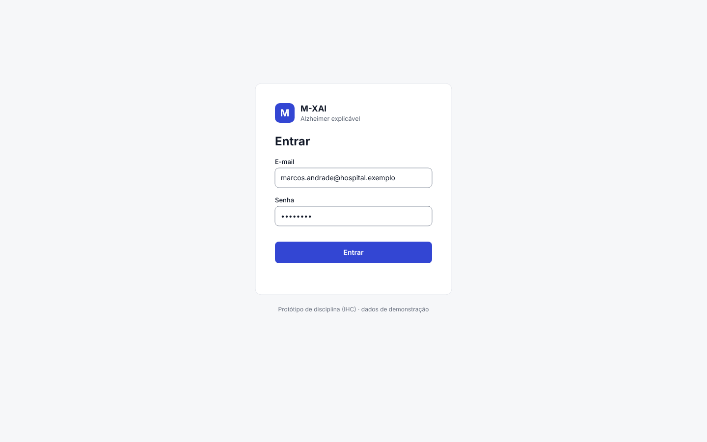

**Objetivo do usuário:** acessar os casos.  
**Signos principais:** e-mail, senha, "Entrar".  
**Origem:** acesso à plataforma; a linha "Protótipo de disciplina · dados de demonstração" evita que o participante confunda o protótipo com uma ferramenta clínica.

### UI01b — Senha incorreta

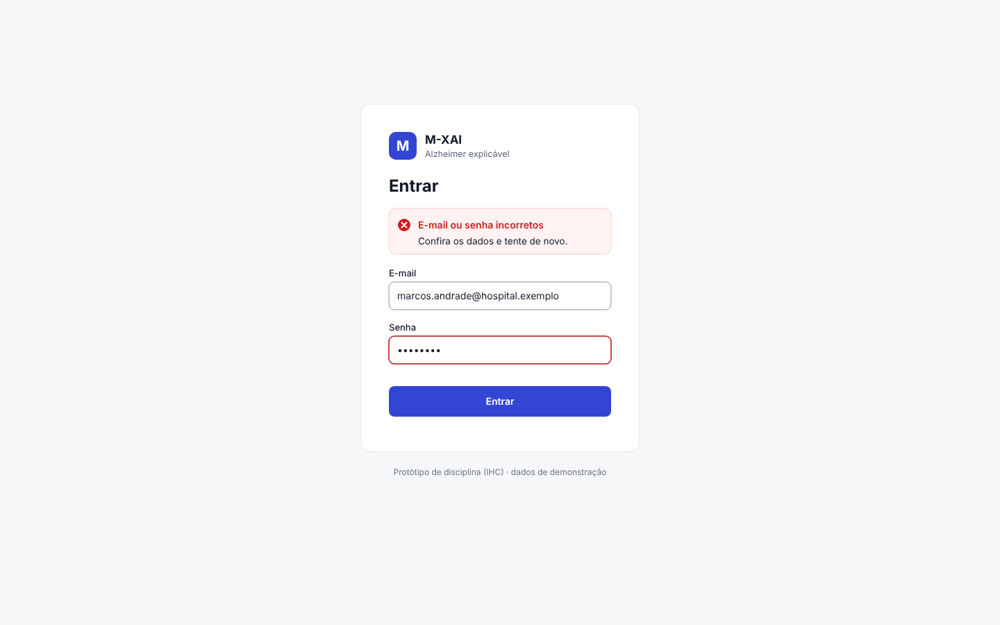

**Objetivo do usuário:** entender por que não entrou e tentar de novo.  
**Signos principais:** mensagem que não revela qual dos dois campos está errado; campo de senha destacado.  
**Origem:** erro de entrada (heurística 9).

### UI02 — Casos

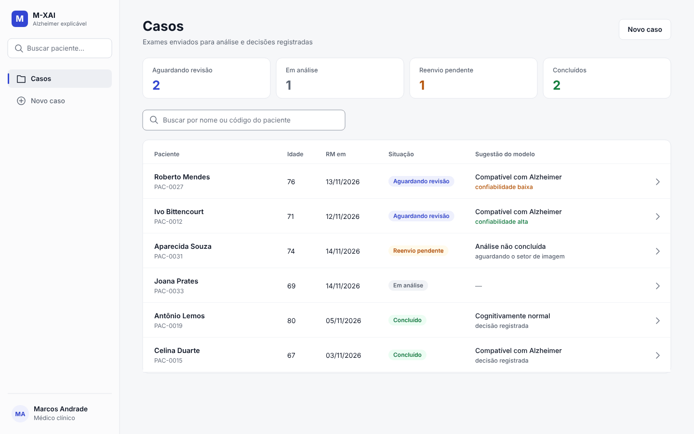

**Objetivo do usuário:** saber o que precisa da sua atenção e abrir um caso.  
**Signos principais:** contadores por situação (que também são filtros), busca, situação do caso, sugestão com a confiabilidade ao lado.  
**Origem:** PF05 e PF01; T01 HTA 2.1. A situação "Reenvio pendente" mostra ao médico que o exame dele depende do setor de imagem (PF04).

### UI02b — Lista filtrada

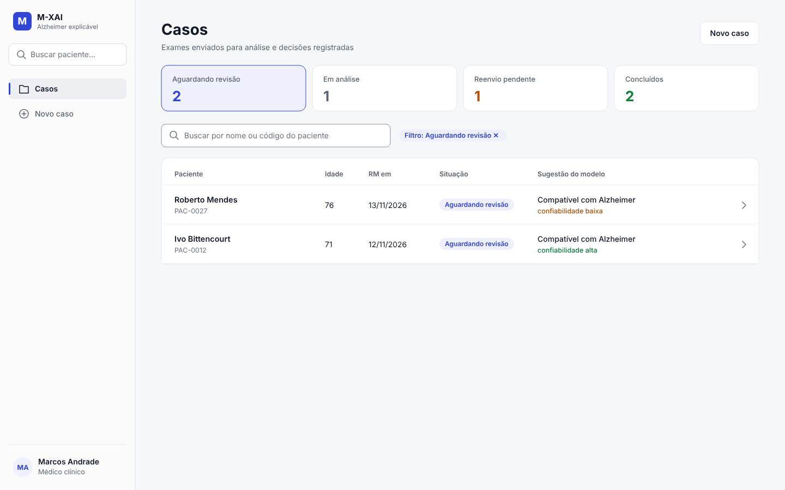

**Objetivo do usuário:** ver só os casos que aguardam revisão.  
**Signos principais:** contador ativo, etiqueta do filtro com "✕" para limpar.  
**Origem:** PF05; controle e liberdade (heurística 3).

### UI02c — Busca sem resultado

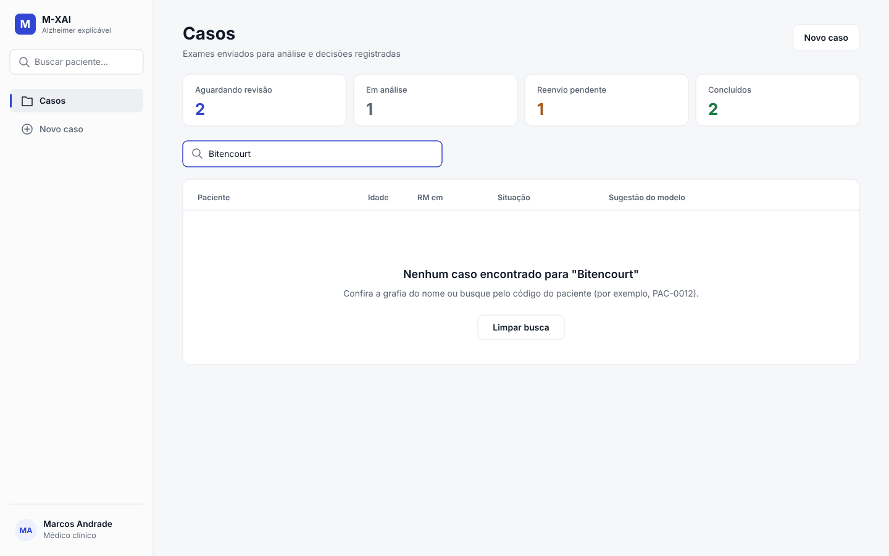

**Objetivo do usuário:** perceber que a busca não achou e corrigir.  
**Signos principais:** o termo buscado repetido na mensagem, sugestão de buscar pelo código, "Limpar busca".  
**Origem:** PF05; estado "filtro sem resultados".

### UI02d — Nenhum caso ainda

**Objetivo do usuário:** entender que a lista vazia é normal no início e saber como os casos chegam.  
**Signos principais:** contadores zerados, explicação, "Enviar um exame".  
**Origem:** estado "vazio/sem dados", que faltava na Entrega 6.

### UI03 — Caso com sugestão

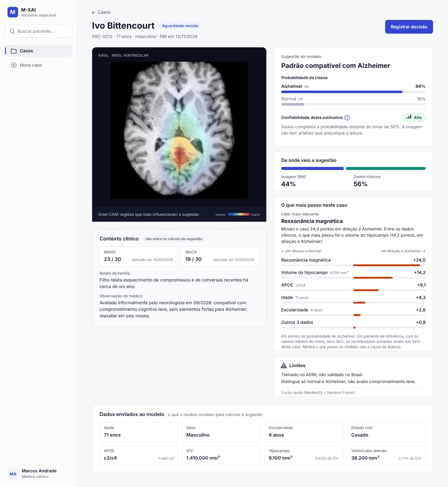

**Objetivo do usuário:** interpretar a sugestão e decidir o quanto confiar nela.  
**Signos principais:** classe sugerida; probabilidade da classe (barras); confiabilidade desta estimativa (rótulo e razão); de onde veio a sugestão (imagem × dados clínicos); o que mais pesou neste caso (contribuição por variável); limites do modelo; contexto clínico (fora do modelo); dados enviados ao modelo.  
**Origem:** PF01; T01 HTA 1.2 e 2.2, T04 HTA 1.2.1; correções 7 e 8. O caso é o do Sr. Ivo Bittencourt (C02). A observação do médico registra o parecer informal do neurologista, que no cenário se perdia. É um campo de texto livre, **não** o histórico estruturado de pareceres (F02), que continua não implementado.

### UI03b — Termo do glossário aberto

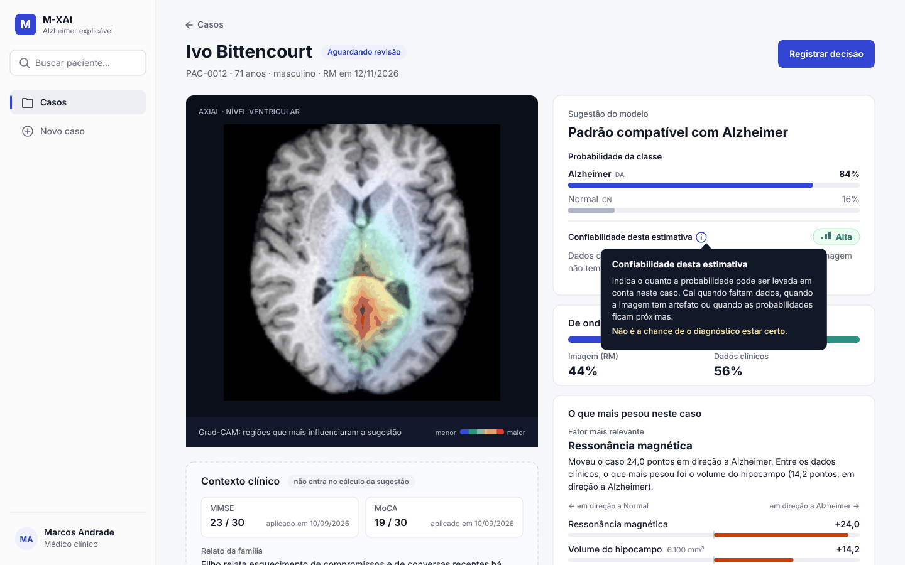

**Objetivo do usuário:** entender um termo sem sair do caso.  
**Signos principais:** dica ancorada no ícone "i", com a definição e o que o termo **não** significa ("não é a chance de o diagnóstico estar certo").  
**Origem:** F06 (glossário contextual); H03.

### UI04 — Caso com confiabilidade baixa

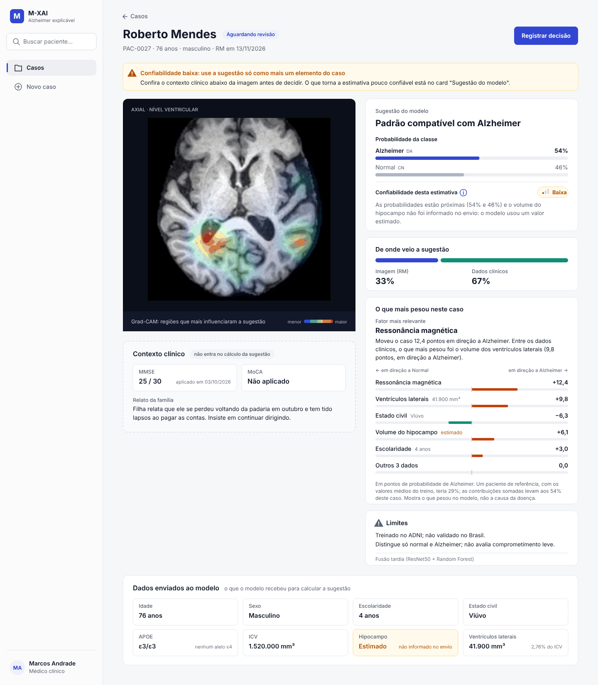

**Objetivo do usuário:** perceber que a sugestão não fecha e tratá-la como um elemento entre outros.  
**Signos principais:** faixa de aviso no topo; confiabilidade "Baixa" com a razão (probabilidades próximas e hipocampo estimado); valor estimado destacado em "Dados enviados ao modelo"; contexto clínico com MoCA "Não aplicado".  
**Origem:** PF02; T04 (C04, Sr. Roberto Mendes); H03. O caso aparece para o médico logado (P01). Se P02 terá perfil próprio é decisão da Entrega 9.

### UI05 — Sua decisão

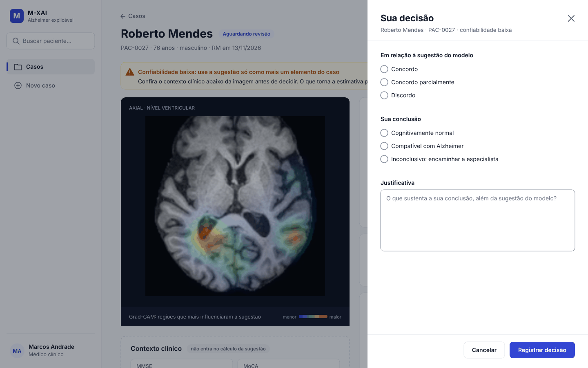

**Objetivo do usuário:** registrar a conclusão e o que a sustenta.  
**Signos principais:** relação com a sugestão (concordo / concordo parcialmente / discordo), conclusão própria, justificativa com pergunta-guia. O caso continua visível atrás do painel.  
**Origem:** PF02; T01 HTA 4, T04 HTA 4.2.

### UI05b — Campos pendentes

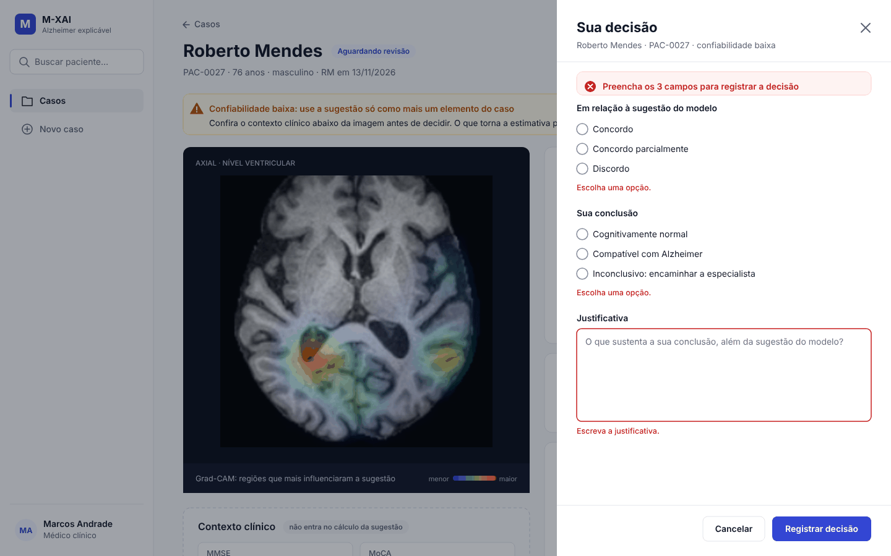

**Objetivo do usuário:** saber o que falta para registrar.  
**Signos principais:** resumo do erro no topo e mensagem junto de cada campo.  
**Origem:** erro de entrada; heurísticas 5 e 9.

### UI05c — "Concordo" com confiabilidade baixa

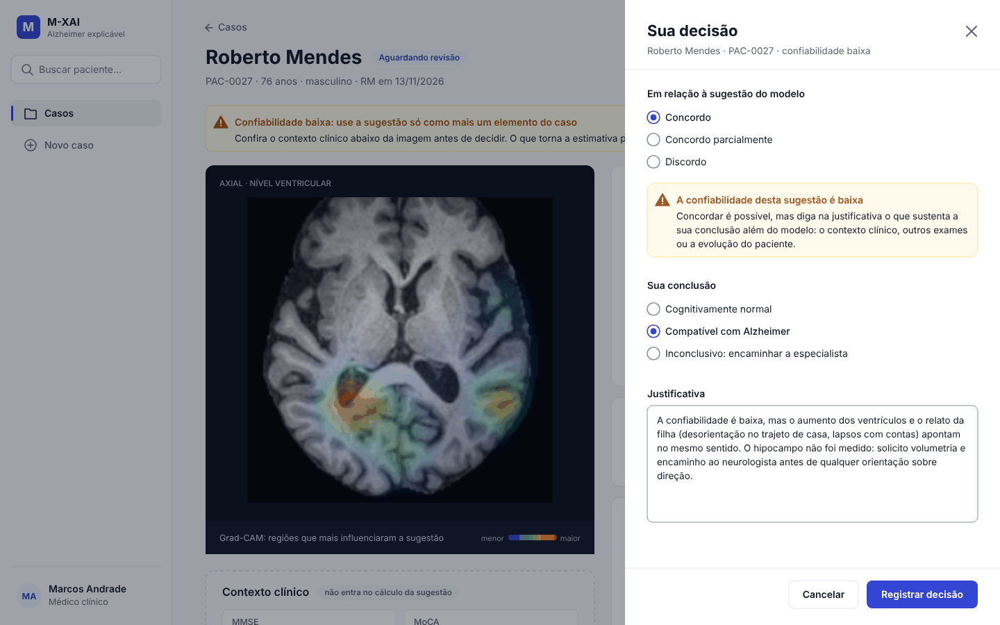

**Objetivo do usuário:** concordar, se for o caso, sabendo o que isso exige.  
**Signos principais:** aviso logo abaixo da escolha. O aviso não bloqueia: pede que a justificativa diga o que sustenta a conclusão além do modelo.  
**Origem:** PF02; H03; tarefa 2 da sessão da Entrega 6. É o "freio" ao concordo automático, sem tirar do médico a decisão.

### UI05d — Confirmar registro

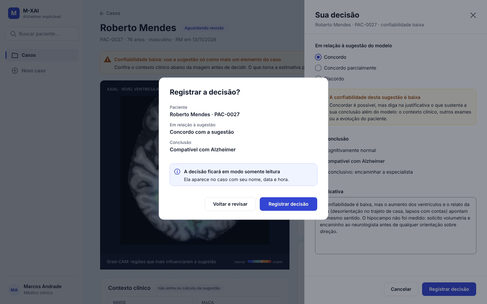

**Objetivo do usuário:** revisar antes de gravar.  
**Signos principais:** resumo do que será registrado, aviso de que o registro fica somente leitura, "Voltar e revisar".  
**Origem:** confirmação de ação sem volta. O "somente leitura" reproduz a plataforma, mas continua hipótese (H15, Entrega 6 seção 5.3).

### UI06 — Novo caso

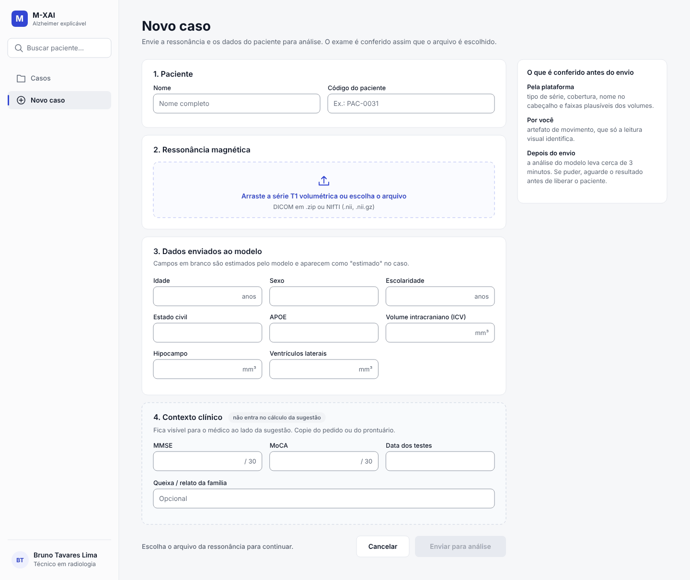

**Objetivo do usuário:** enviar o exame com os dados que o modelo usa.  
**Signos principais:** quatro seções numeradas (paciente, ressonância, dados enviados ao modelo, contexto clínico); painel "O que é conferido antes do envio"; botão de envio desabilitado com o motivo escrito ao lado.  
**Origem:** PF03; T03, GOMS GOAL 3 e 4; P04 (Bruno Tavares Lima); C03 (Sra. Aparecida Souza).

### UI06b — Valor fora da faixa

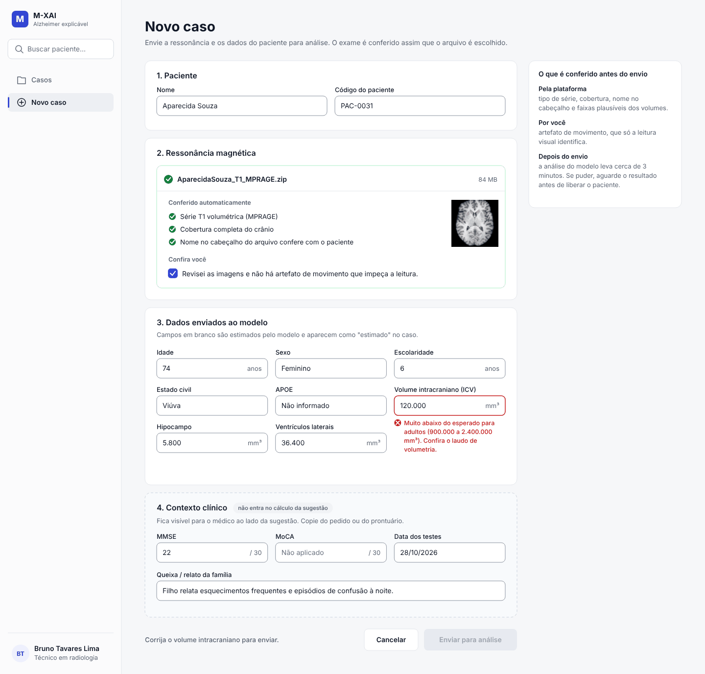

**Objetivo do usuário:** perceber e corrigir um valor digitado errado antes de enviar.  
**Signos principais:** campo em vermelho com a faixa esperada e onde conferir (laudo de volumetria).  
**Origem:** correção 5 da Entrega 6. Na plataforma, esse mesmo valor (120.000 mm³) só era recusado depois do processamento; aqui é barrado no campo.

### UI06c — Arquivo recusado na seleção

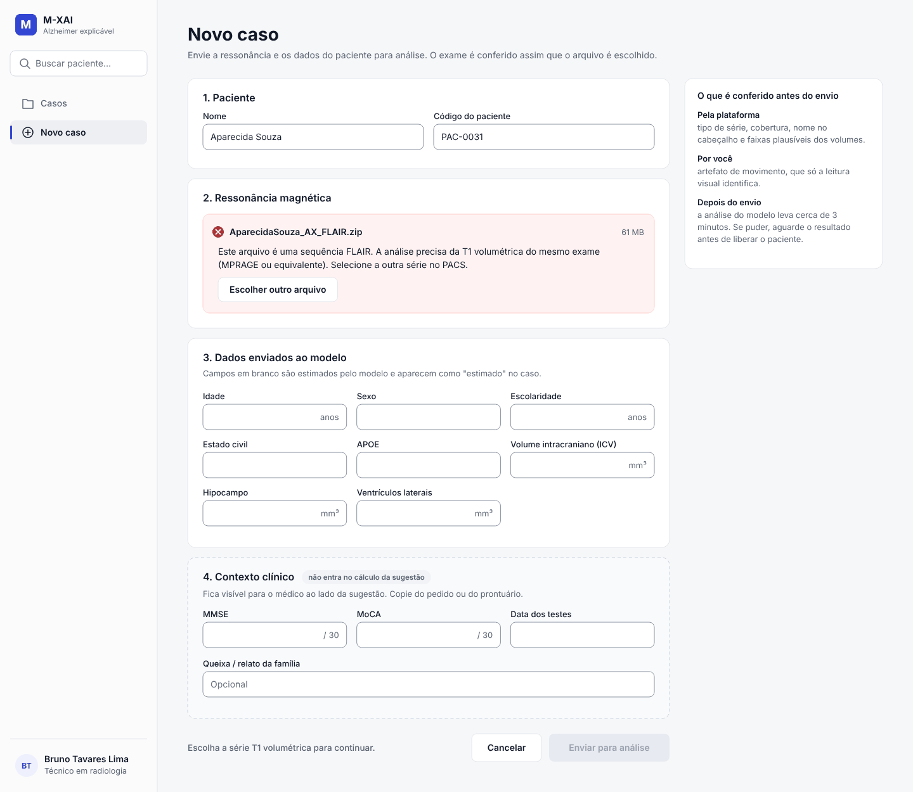

**Objetivo do usuário:** perceber que escolheu a série errada enquanto o paciente ainda está no setor.  
**Signos principais:** nome do arquivo, qual série é e qual é a necessária, onde encontrá-la (PACS), "Escolher outro arquivo".  
**Origem:** correção 5; H07; T03 HTA 3 (hoje não há nenhuma verificação entre o fim da aquisição e 3.1, liberar o paciente).

### UI06d — Pronto para enviar

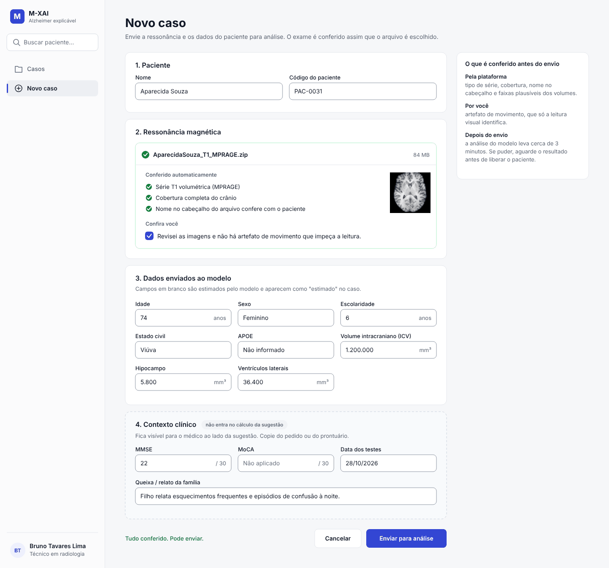

**Objetivo do usuário:** ter certeza de que o envio está completo.  
**Signos principais:** três conferências automáticas aprovadas, confirmação de movimento marcada, "Tudo conferido. Pode enviar."  
**Origem:** F03 (checklist de qualidade); GOMS T03, operador de verificação ao fim de GOAL 3.

### UI07 — Analisando o exame

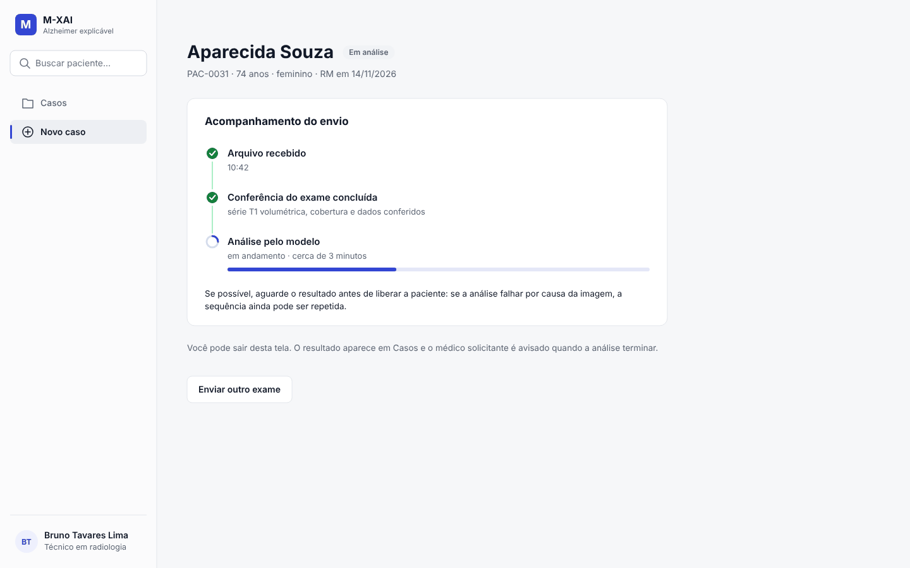

**Objetivo do usuário:** saber em que ponto está o envio e se pode liberar o paciente.  
**Signos principais:** etapas com estado (recebido, conferido, em análise), tempo estimado, recomendação de aguardar antes de liberar, aviso de que é possível sair da tela.  
**Origem:** PF03; estado de processamento; T03 HTA 3.1; H07 e H09. A recomendação de aguardar cerca de 3 minutos é, ela mesma, uma hipótese: só vale se o serviço tolerar essa espera na agenda (H09).

### UI08 — Falha na análise

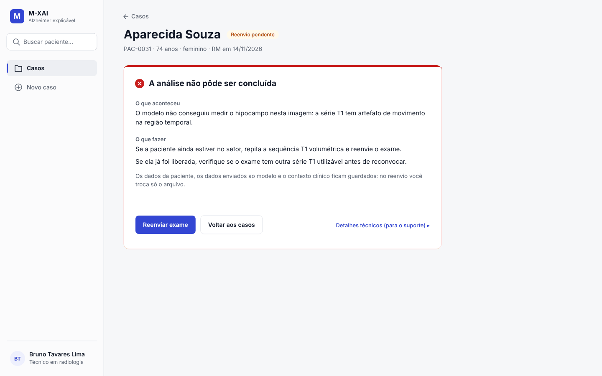

**Objetivo do usuário:** entender o que deu errado e resolver sem recomeçar.  
**Signos principais:** "O que aconteceu" e "O que fazer" em linguagem do setor de imagem, separados por quem ainda pode agir (paciente no setor ou já liberado); "Reenviar exame"; detalhes técnicos recolhidos, para o suporte.  
**Origem:** PF04; correção 6; F04. A falha mostrada (hipocampo não mensurável por artefato de movimento) é a que **não** pode ser prevenida na seleção do arquivo, por isso continua possível depois das conferências de UI06.

### UI08b — Reenviar exame

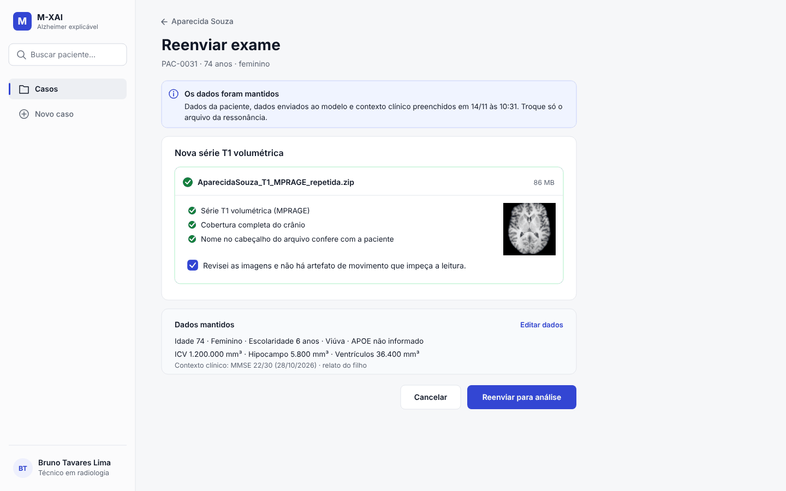

**Objetivo do usuário:** trocar só o arquivo e reenviar.  
**Signos principais:** aviso "Os dados foram mantidos" com data e hora do preenchimento, resumo dos dados mantidos, mesmas conferências do envio.  
**Origem:** PF04; H13 (a transcrição é onde o técnico erra, então redigitar introduziria um segundo erro).

### UI09 — Caso concluído

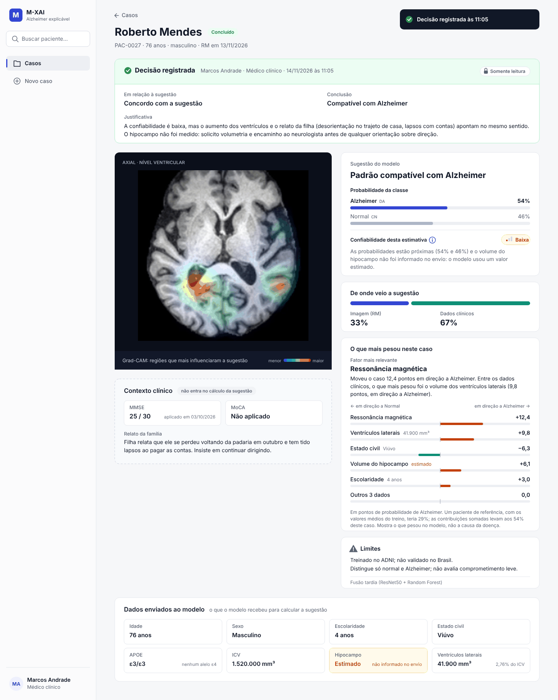

**Objetivo do usuário:** confirmar que a decisão foi gravada e consultá-la depois.  
**Signos principais:** aviso de sucesso, "Decisão registrada" no topo com nome, papel, data e hora, "Somente leitura", sugestão e contexto clínico preservados abaixo.  
**Origem:** PF02 e PF05; GOMS T01, OP. 4.4 (verificação do resultado); F05.

## Sistema visual e consistência

| Elemento | Regra adotada | Justificativa |
|---|---|---|
| Tipografia | Inter; títulos de tela 28 px, títulos de card 15–17 px, texto 14 px, apoio 12,5–13 px. Números de probabilidade com o mesmo peso dos rótulos | Inter é a fonte padrão do Figma e tem números legíveis em tamanho pequeno. O número da probabilidade deixou de ser o maior elemento da tela, para não ser lido antes da confiabilidade (achado da sessão da Entrega 6, tarefa 1) |
| Cores | Azul (#3346D3) só para interface: ações, seleção e barras de probabilidade. Verde, âmbar e vermelho só para estado: confiabilidade, validação, erro e sucesso | Na plataforma, o percentual era pintado com a cor da confiança, e as duas informações eram lidas como uma só (correção 8). Separar "cor de interface" de "cor de estado" impede essa mistura |
| Componentes | Card branco com borda clara para informação do sistema; card com borda tracejada e fundo cinza para informação **fora do modelo** (contexto clínico); campo com rótulo acima, unidade dentro e erro abaixo; botão primário único por tela | O contexto clínico tem que parecer diferente do que o modelo usou, não só estar escrito diferente (correção 7). Um único botão primário mostra o próximo passo esperado |
| Feedback | Erro de campo junto do campo; resumo de erro no topo quando há vários; aviso que não bloqueia (UI05c) diferente de erro que bloqueia (UI06b); aviso temporário de sucesso (UI09); progresso com etapas (UI07) | Cada tipo de retorno tem forma própria, para que o usuário saiba se precisa agir |
| Identidade | Nome **e papel** do usuário na barra lateral | Correção 3: a identidade precisa ser coerente com quem decide |

## Verificação de acessibilidade básica

Referência: WCAG 2.2, nível AA, nos critérios que um protótipo estático permite verificar.

| Critério | Verificação | Resultado |
|---|---|---|
| 1.4.3 Contraste de texto (4,5:1) | Calculado para os pares de cor usados em texto: texto principal 17,7:1; texto secundário 6,0:1; texto de apoio 4,8:1; azul de ação 7,1:1; verde, âmbar e vermelho sobre seus fundos claros 4,8:1, 4,8:1 e 5,3:1 | atende. O cinza de apoio da primeira montagem (3,1:1) foi escurecido |
| 1.4.11 Contraste de componentes (3:1) | Borda de campos, rádios e caixas de seleção: 3,1:1 | atende. A borda original (1,5:1) foi escurecida |
| 1.4.1 Uso de cor | Confiabilidade tem rótulo escrito e barras; erro tem ícone e texto; probabilidade tem número; contribuições têm sinal (+/−) e direção escrita | atende |
| 2.5.8 Tamanho do alvo (24 × 24 px) | Botões com 38–44 px de altura; rádios com área de 18 px mais o rótulo clicável | atende no desenho; confirmar na implementação que o rótulo do rádio é clicável |
| 1.1.1 Texto alternativo | Imagem de ressonância e mapa Grad-CAM precisam de descrição ("Corte axial no nível ventricular, com destaque nas regiões que mais influenciaram a sugestão") | pendente na implementação |
| 2.1.1 Teclado e 2.4.7 Foco visível | Não verificáveis no Figma | pendente na implementação |

## Estados considerados

| Estado do enunciado | Onde está | Observação |
|---|---|---|
| Vazio / sem dados | UI02d | |
| Carregamento / processamento | UI07 | |
| Sucesso | UI06d, UI09 | |
| Erro de entrada | UI01b, UI05b, UI06b, UI06c | |
| Erro de processamento | UI08 | |
| Filtro sem resultados | UI02c | |
| Permissão insuficiente | — | depende da definição de papéis (Entrega 9) |
| Confirmação de ação destrutiva | UI05d | o registro não é destrutivo, mas não tem volta nesta versão |
| Cancelamento / desfazer / recuperação | UI05 (cancelar), UI08b (recuperação) | |
| Dados desatualizados / conflito | — | não ocorre com um médico por caso. Volta a ser pertinente se H15 levar a adendos ou se dois profissionais puderem decidir o mesmo caso |

## O que é simulado e o que é integrado

| No protótipo | Na plataforma da equipe | Consequência para a avaliação |
|---|---|---|
| Probabilidade, confiabilidade, contribuições por variável e mapa Grad-CAM com valores fixos por caso | Calculados pelo modelo | A avaliação mede se o médico **lê** essas informações corretamente, não se elas estão certas |
| Conferência de série, cobertura e cabeçalho do arquivo | Não existe; a plataforma valida só campos | O que se avalia é se a conferência no momento da seleção é percebida e útil. A viabilidade técnica fica para a implementação |
| Validação de faixa do volume intracraniano no campo | Existe só no processamento | idem |
| Reenvio com dados mantidos | Não existe | idem |
| Preenchimento de formulários | Simulado por clique (o campo "se preenche") | Tempo de digitação não é medido |
| Imagens de ressonância | Recortes dos prints da plataforma (base pública desidentificada) | Mesma imagem para casos diferentes; não deve ser objeto de leitura clínica no teste |

## Pendências para completar a entrega

1. **Entrega 9:** conferir todos os rótulos contra a tabela de signos; definir papéis e permissões, e com isso o que o técnico vê em "Casos", o destino de `btn_voltar_casos` em UI08 e o estado "permissão insuficiente".
2. **Entrega 10:** refazer a tabela de cobertura a partir dos MoLIC, preencher a origem no MoLIC de cada tela e criar as telas das conversas que o MoLIC modelar e o Figma não tiver (candidatos: parecer do especialista, F02; laudo da radiologista, T02).
3. **Entrega 7:** se H15 for respondida, ajustar UI05d e UI09 (adendo ou correção com motivo).
4. **Figma:** montar o arquivo, criar as ligações e preencher os links desta página.

## Checklist

- [ ] Link do Figma está acessível. *(pendente: montar o arquivo)*
- [x] Há screenshots representativos no repositório.
- [ ] Todos os MoLIC relevantes estão cobertos. *(pendente: Entrega 10; cobertura provisória pelos fluxos da Entrega 6)*
- [x] Estados de erro, feedback e recuperação foram prototipados.
- [ ] Terminologia/signos são consistentes com Entrega 9. *(pendente: Entrega 9)*
- [x] Componentes equivalentes se comportam de forma consistente.
- [ ] Fluxos críticos são clicáveis do início ao fim. *(desenhados e ligados na tabela; falta montar no Figma)*
- [ ] O protótipo está pronto para inspeção e testes, sem "links mortos" nas tarefas avaliadas. *(as ações sem ligação estão listadas e não fazem parte das tarefas da Entrega 12)*
- [x] Dashboards, relatórios, históricos, filtros, administração e CRUDs presentes possuem justificativa rastreável.
- [x] Estados de vazio, processamento, erro e recuperação foram considerados quando pertinentes.
- [x] Resultados técnicos são apresentados de forma interpretável para o perfil de usuário.
- [x] A equipe distingue no protótipo o que é interação simulada e o que é funcionalidade técnica realmente integrada, quando necessário.
