# Entrega 13 — Avaliação de IHC por inspeção heurística

**Data:** 21/11/2026  
**Status:** 🟨 em andamento  
**Responsabilidade:** 1 avaliação completa por integrante, sobre todas as telas/estados relevantes do projeto.

## Objetivo da atividade

Encontrar problemas de usabilidade por inspeção sistemática da interface com as **10 heurísticas de Nielsen**. Cada avaliador trabalha individualmente primeiro; depois a equipe consolida problemas duplicados e prioridades.

> **Parte de violações:** registre somente problemas reais. Não invente uma violação para “preencher” cada heurística. Para provar que todas foram exercitadas, use a **matriz de cobertura H1–H10**. Para heurísticas sem violação, a disciplina solicita um exemplo didático de boa prática.

## 1. Heurísticas adotadas

1. Visibilidade do status do sistema
2. Compatibilidade entre o sistema e o mundo real
3. Controle e liberdade do usuário
4. Consistência e padrões
5. Prevenção de erros
6. Reconhecimento em vez de memorização
7. Flexibilidade e eficiência de uso
8. Estética e design minimalista
9. Ajudar usuários a reconhecer, diagnosticar e recuperar-se de erros
10. Ajuda e documentação

## Cobertura especial para interfaces administrativas e analíticas

Quando existirem, não limite a avaliação às “telas principais”. Inspecione também:

- dashboard em estados normal, vazio e erro;
- filtros sem resultado e filtros combinados;
- relatórios e exportação;
- histórico/listas longas;
- formulários CRUD (criação, edição, exclusão, validação);
- alteração de perfil/permissão;
- confirmações de ações destrutivas;
- processamento/loading/progresso;
- falha e recuperação;
- comparação de resultados;
- mensagens de termos técnicos, métricas e recomendações;
- ajuda/documentação contextual.

Em TCCs técnicos, observe especialmente se a interface comunica o estado do processamento e traduz informações técnicas para o vocabulário do usuário escolhido.

## 2. Escopo da inspeção

| Item | Definição |
|---|---|
| Versão avaliada | Protótipo da Entrega 11, estado de 21/11/2026 — {{link do protótipo}} |
| Telas/estados | 19 telas e 51 estados, dos 4 perfis (ver 2.1) |
| Fluxos | M01, M02, M03 e M04 (ver 2.2) |
| Dispositivo/viewport | Desktop, navegador, 1440 × 900 |
| Avaliadores | A01 Paulo, A02 Raphael, A03 Nathan, A04 Ana Carolina |

### 2.1 Telas e estados inspecionados

**Acesso**
- Login: normal e senha incorreta

**Médico clínico e neurologista (P01, P02)**
- Lista de casos: normal, busca sem resultado e vazia
- Sugestão do modelo: normal, dica de ajuda, análise não concluída e confiabilidade baixa
- Registrar decisão: vazia, campos pendentes, alerta de confiabilidade baixa, preenchida e falha ao gravar
- Confirmar registro da decisão: médico clínico e neurologista
- Decisão registrada: normal e com divergência
- Evidências do caso: parecer anterior e linha do tempo
- Registrar parecer: normal e campos pendentes
- Registrar episódio: normal, campos pendentes, preenchido e episódio incluído

**Técnico em radiologia (P04)**
- Novo exame: preparar, confirmar identidade, identidade não confere, valor fora da faixa, série errada, pendências obrigatórias, pronto para enviar e descartar envio
- Acompanhar análise
- Falha da análise
- Reenviar após falha: normal e arquivo errado

**Radiologista (P03)**
- Fila de laudos: normal, laudo suspenso e laudo liberado
- Ler pergunta clínica: normal e análise indisponível
- Análise do modelo (segunda leitura)
- Redigir laudo: normal, aviso de urgência, conclusão obrigatória e pergunta enviada
- Liberar laudo sem método
- Perguntar ao solicitante: normal e pergunta em branco

### 2.2 Fluxos avaliados

- **M01** — O laudo que registrou o que foi avaliado (P03, Raphael)
- **M02** — O parecer que ficou no caso (P01, Paulo)
- **M03** — O exame conferido antes da saída (P04, Nathan)
- **M04** — A decisão com as evidências lado a lado (P02, Ana Carolina)

## 3. Procedimento individual

Cada avaliador deve:

1. percorrer os fluxos/telas ao menos uma vez para familiarização;
2. inspecionar novamente aplicando sistematicamente H1–H10;
3. registrar cada problema com evidência e contexto;
4. atribuir severidade **depois de compreender bem o problema**, justificando a decisão;
5. não discutir achados com os demais antes de terminar a inspeção individual, quando o objetivo for preservar independência.

### Escala de severidade (0–4)

| Grau | Interpretação |
|---:|---|
| 0 | não é considerado problema de usabilidade |
| 1 | problema cosmético; corrigir se houver tempo |
| 2 | problema menor; baixa prioridade |
| 3 | problema maior; alta prioridade |
| 4 | catástrofe de usabilidade; correção imperativa antes de disponibilizar |

Ao justificar, considere **frequência, impacto e persistência** do problema no contexto real de uso.

---

---

## Avaliador A01 — Paulo Hudson Josué da Silva — 22.222.013-9

### 4. Matriz de cobertura das 10 heurísticas

| Heurística | Telas/fluxos examinados | Houve violação? | IDs dos achados | Exemplo de boa prática se não violada |
|---|---|---|---|---|
| H1 | Lista de casos, Sugestão do modelo, Sugestão do modelo — análise não concluída, Registrar decisão — falha ao gravar, Acompanhar análise, Decisão registrada | sim | V01 | — |
| H2 | Sugestão do modelo, Sugestão do modelo — dica de ajuda, Sugestão do modelo — confiabilidade baixa, Evidências do caso — parecer anterior | sim | V02 | — |
| H3 | Registrar decisão, Confirmar registro da decisão, Registrar decisão — preenchida, Registrar parecer, Lista de casos — busca sem resultado | não | — | "Voltar e revisar" na confirmação devolve ao formulário com tudo preenchido (Confirmar registro da decisão) |
| H4 | Lista de casos, Sugestão do modelo, Sugestão do modelo — confiabilidade baixa, Decisão registrada, Evidências do caso — parecer anterior | não | — | Abas e botão "Registrar decisão" no mesmo lugar em todos os casos (Sugestão do modelo, Sugestão do modelo — confiabilidade baixa, Evidências do caso — parecer anterior) |
| H5 | Registrar decisão, Registrar decisão — campos pendentes, Registrar decisão — alerta de confiabilidade baixa, Confirmar registro da decisão, Registrar parecer, Registrar parecer — campos pendentes | sim | V03, V04 | — |
| H6 | Registrar decisão, Registrar decisão — preenchida, Evidências do caso — parecer anterior | não | — | O painel de decisão repete paciente, código e confiabilidade e já lista as evidências do caso (Registrar decisão) |
| H7 | Lista de casos, Lista de casos — busca sem resultado | sim | V05 | — |
| H8 | Sugestão do modelo, Sugestão do modelo — confiabilidade baixa | sim | V06 | — |
| H9 | Login — senha incorreta, Lista de casos — busca sem resultado, Registrar decisão — campos pendentes, Registrar decisão — falha ao gravar, Registrar parecer — campos pendentes | sim | V07 | — |
| H10 | Sugestão do modelo, Sugestão do modelo — dica de ajuda, Sugestão do modelo — confiabilidade baixa | sim | V08 | — |

### 5. Declaração de violações

| ID | Heurística | Tela/estado | Problema observado | Evidência | Severidade | Justificativa da severidade | Recomendação |
|---|---|---|---|---|---:|---|---|
| V01 | H1 | Sugestão do modelo — análise não concluída | O selo ao lado do nome diz "Aguardando revisão", mas o status do caso logo abaixo e a lista (Lista de casos) dizem "Reenvio pendente". O médico não sabe se o caso espera por ele ou pelo setor de imagem. | 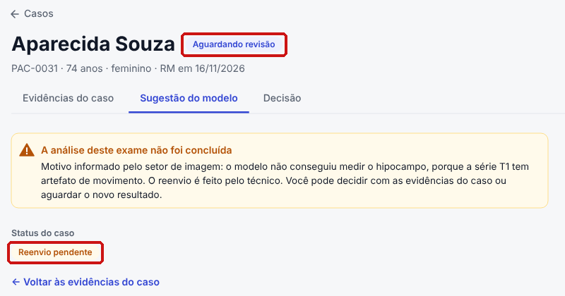 | 2 | Acontece em todo caso com falha de análise. O aviso amarelo esclarece, então o impacto é baixo, mas o selo é o primeiro sinal que o médico lê. | Um status só por caso, vindo da mesma fonte, no selo do cabeçalho e na lista. |
| V02 | H2 | Sugestão do modelo | Termos de ML e siglas sem tradução para o clínico: "Fusão tardia: ResNet50 + Random Forest", "paciente de referência com os valores médios do treino (29%)", "ICV", "1 alelo ε4". | 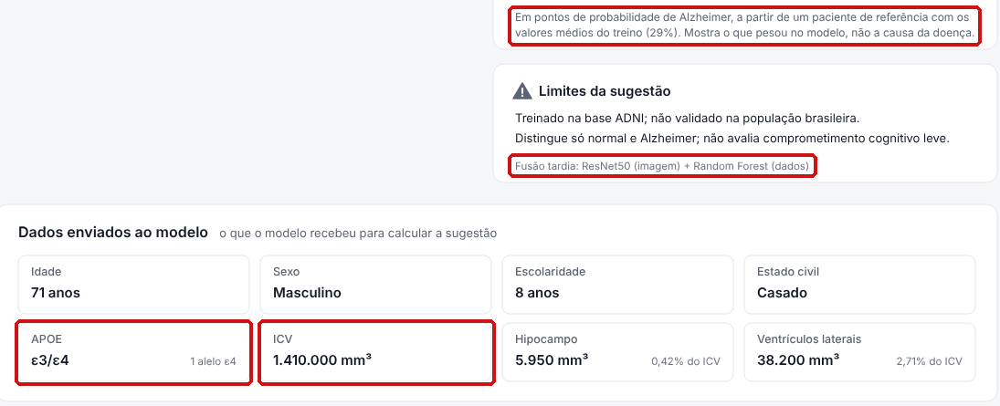 | 2 | Aparece em toda sugestão. P01 não interpreta esses termos (Entrega 3); não trava a tarefa, mas atrapalha entender a explicação (H03). | Linguagem clínica ("ponto de partida: média dos pacientes do treino"), "volume intracraniano" por extenso e a arquitetura do modelo numa camada de detalhes técnicos. |
| V03 | H5 | Registrar decisão / Registrar decisão — campos pendentes | Nada indica quais campos são obrigatórios; só "Divergência (opcional)" tem marcação. O médico descobre os obrigatórios ao tentar registrar (Registrar decisão — campos pendentes). O mesmo ocorre em Registrar parecer (Registrar parecer/Registrar parecer — campos pendentes). | 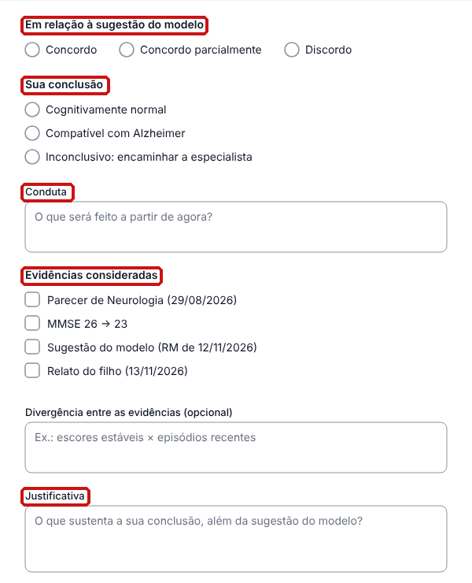 | 2 | Frequente no primeiro uso e corrigido fácil pelas mensagens; persiste até o usuário decorar o formulário. | Marcar os obrigatórios com * e legenda, como no MoLIC (conclusão*, conduta*, justificativa*). |
| V04 | H5 | Confirmar registro da decisão | O resumo antes de gravar mostra concordância, conclusão e conduta, mas não as evidências marcadas nem a justificativa. Depois de confirmada a decisão não pode ser editada (Entrega 1, seção 8), e marcar a evidência errada é fácil. | 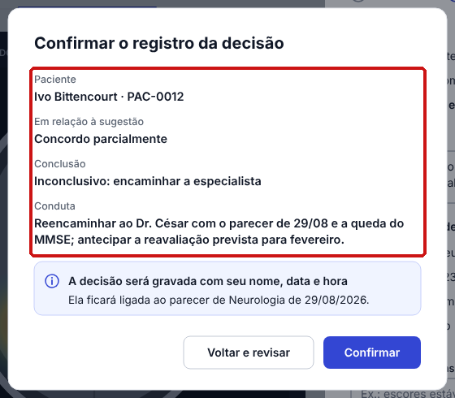 | 2 | Toda decisão passa por aqui; o erro só aparece em Consultar a decisão registrada, quando já não dá para corrigir. | Incluir no resumo as evidências marcadas e o começo da justificativa, como o M02 previa (resumo {concordância, conduta, evidências consideradas}). |
| V05 | H7 | Lista de casos | A lista só tem busca por nome/código. Não dá para filtrar por status (ex.: só "Aguardando revisão"), embora o M02 tenha `u: filtrar por status`. | 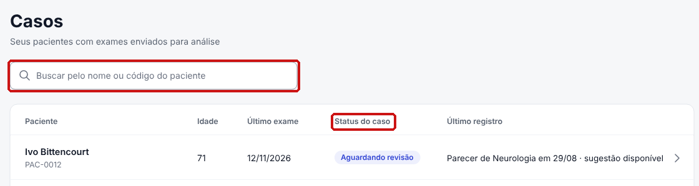 | 1 | Com 5 casos não atrapalha; o impacto cresce com o volume real de casos [H]. | Filtro por status acima da tabela, ou ordenar a lista por status. |
| V06 | H8 | Sugestão do modelo | A tela tem seis blocos e rola até ~1600 px. Em 1440 × 900 (linha tracejada), "Limites da sugestão" e "Dados enviados ao modelo" ficam abaixo da dobra, enquanto detalhes técnicos disputam espaço com o que importa para decidir. | 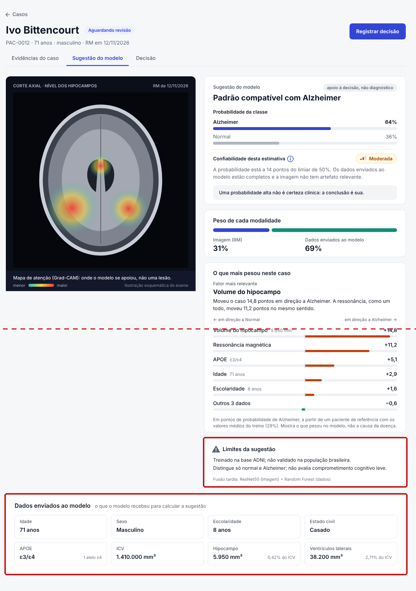 | 2 | Toda sugestão; P01 tem pouco tempo por consulta e pode não rolar até os limites. | Uma linha de limites junto da sugestão, com "ver mais", e os detalhes técnicos recolhidos. |
| V07 | H9 | Login — senha incorreta | Depois do erro não há caminho para recuperar a senha. A mensagem diz "E-mail ou senha incorretos", mas só o campo senha fica vermelho, o que sugere que o problema é só a senha. |  | 2 | Raro, mas quando acontece o usuário fica sem saída dentro do sistema. | Incluir "Esqueci minha senha" e destacar os dois campos (ou nenhum) quando a mensagem não diz qual está errado. |
| V08 | H10 | Sugestão do modelo | Só "Confiabilidade desta estimativa" tem ⓘ com explicação (Sugestão do modelo — dica de ajuda). Mapa de atenção, peso de cada modalidade, "pontos" e ICV não têm ajuda, embora o M02 preveja o glossário para mais termos. | 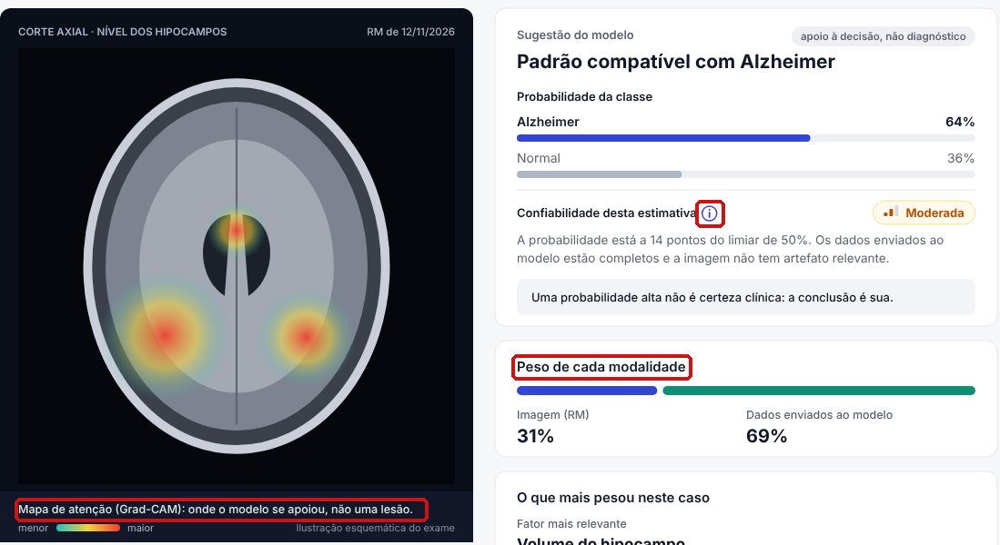 | 2 | Toda sugestão; quem não conhece o termo adivinha ou ignora (H03). | ⓘ nos demais termos da sugestão, no mesmo formato da dica de confiabilidade (o que é / o que não é). |

**Qualidade do relato:** o problema deve ser observável e localizado. Evite “interface confusa” sem dizer **o que**, **onde**, **quando** e **para quem**.

### 6. Boas práticas — heurísticas não violadas (atividade didática)

| Heurística sem violação | Exemplo no sistema | Evidência | Por que atende |
|---|---|---|---|
| H3 | "Voltar e revisar" na confirmação do registro | 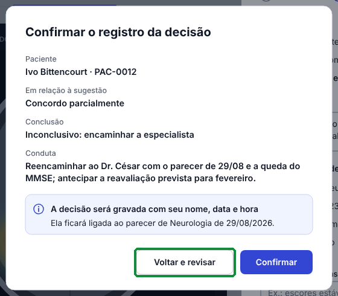 | Saída clara antes de uma ação que não pode ser desfeita; volta ao formulário sem perder o que foi digitado. |
| H4 | Abas "Evidências do caso / Sugestão do modelo / Decisão" e botão "Registrar decisão" sempre no mesmo lugar | 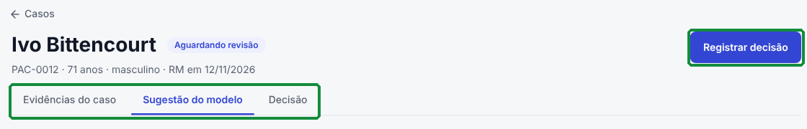 | A mesma ação aparece no mesmo local e com o mesmo nome em todos os casos (Sugestão do modelo, Sugestão do modelo — confiabilidade baixa, Evidências do caso — parecer anterior). |
| H6 | Cabeçalho do painel com paciente, código e confiabilidade; evidências do caso já listadas para marcar | 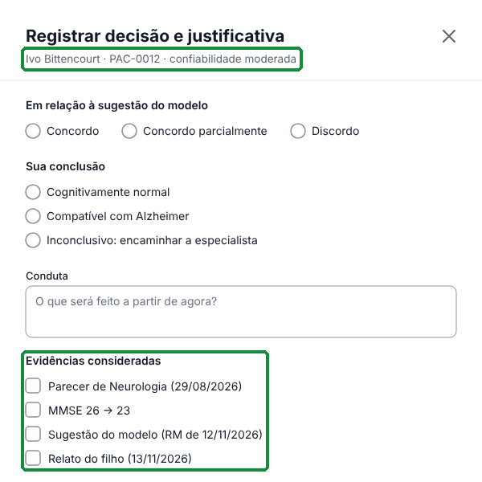 | O médico não precisa lembrar o que viu nas outras abas para justificar a decisão. |

## Avaliador A02 — Raphael Garavati Erbert — 22.123.014-7

### 4. Matriz de cobertura das 10 heurísticas

| Heurística | Telas/fluxos examinados | Houve violação? | IDs dos achados | Exemplo de boa prática se não violada |
|---|---|---|---|---|
| H1 | Fila de laudos — laudo suspenso, Fila de laudos — laudo liberado, Ler pergunta clínica — análise indisponível, Redigir laudo — pergunta enviada | sim | V04 | — |
| H2 | Ler pergunta clínica, Análise do modelo — segunda leitura, Redigir laudo | sim | V01 | — |
| H3 | Fila de laudos — laudo suspenso, Redigir laudo — aviso de urgência, Liberar laudo sem método, Perguntar ao solicitante | não | — | Suspender o laudo e retomá-lo depois pela fila, com etapa e dúvida guardadas (Fila de laudos — laudo suspenso) |
| H4 | Fila de laudos, Análise do modelo — segunda leitura, Redigir laudo — aviso de urgência, Lista de casos, Sugestão do modelo — confiabilidade baixa | sim | V03, V06, V07 | — |
| H5 | Redigir laudo, Redigir laudo — conclusão obrigatória, Liberar laudo sem método, Perguntar ao solicitante — pergunta em branco | sim | V02 | — |
| H6 | Ler pergunta clínica, Redigir laudo | não | — | Pergunta clínica e volume hipocampal ficam visíveis ao lado do laudo (Redigir laudo) |
| H7 | Fila de laudos, Análise do modelo — segunda leitura | sim | V05 | — |
| H8 | Ler pergunta clínica, Redigir laudo | não | — | Tela de leitura só com imagem, pergunta clínica, contexto e duas ações (Ler pergunta clínica) |
| H9 | Ler pergunta clínica — análise indisponível, Redigir laudo — conclusão obrigatória, Perguntar ao solicitante — pergunta em branco | não | — | "Preencha a conclusão para liberar o laudo" com o campo destacado (Redigir laudo — conclusão obrigatória) |
| H10 | Análise do modelo — segunda leitura, Liberar laudo sem método | não | — | A análise diz o que é e o que não é: "referência para a sua leitura, não uma conclusão" (Análise do modelo — segunda leitura) |

### 5. Declaração de violações

| ID | Heurística | Tela/estado | Problema observado | Evidência | Severidade | Justificativa da severidade | Recomendação |
|---|---|---|---|---|---:|---|---|
| V01 | H2 | Redigir laudo | "Método de avaliação" só oferece inspeção visual, volume informado pelo modelo e comparação com exame anterior. Escala visual (MTA) e medida com régua, que a radiologista usa hoje (HTA T02 2.3; GOMS 2.7), não existem; ela teria que escrever isso no achado. | 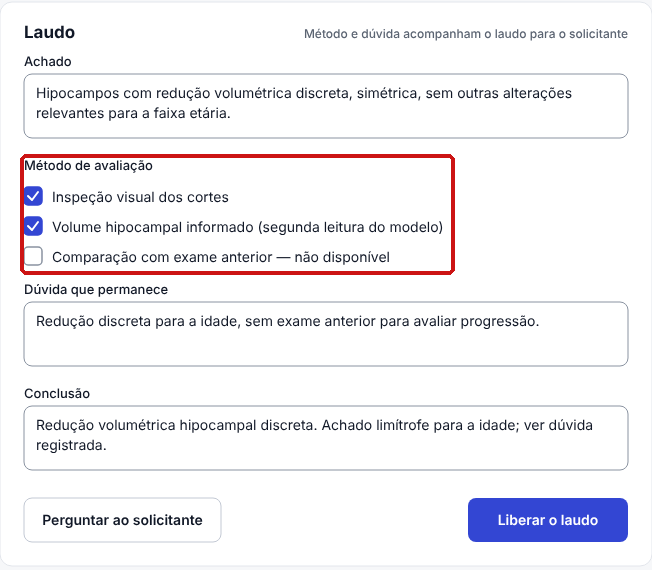 | 3 | Todo caso limítrofe passa por aqui. Se o método usado não cabe na lista, o laudo volta a não dizer como foi avaliado, que é o problema de H08. | Incluir "escala visual (MTA), com a nota" e "medida linear", mais um "outro" com texto curto. |
| V02 | H5 | Redigir laudo | "Comparação com exame anterior — não disponível" aparece como checkbox normal, que dá para marcar. | 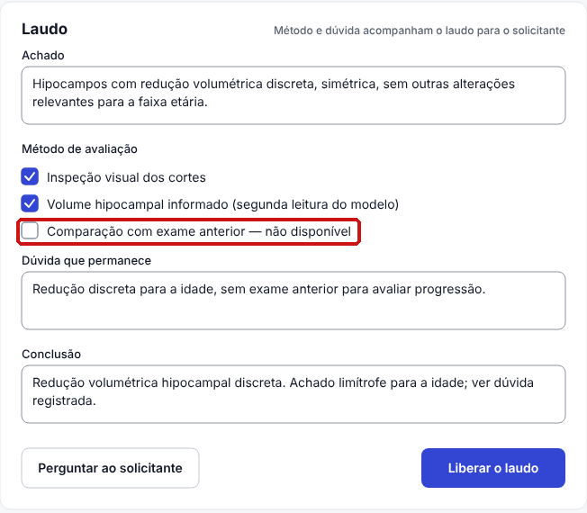 | 1 | Raro alguém marcar, e o texto avisa; mas um método inexistente pode ir para o laudo. | Mostrar a opção desabilitada (cinza, sem clique) ou só como informação. |
| V03 | H4 | Redigir laudo — aviso de urgência | O aviso de urgência usa ícone e cor de erro; "Suspender o laudo" é vermelho, cor que no sistema marca ação destrutiva (Descartar, Novo exame — descartar envio); "ou continue este laudo" é texto, não botão. | 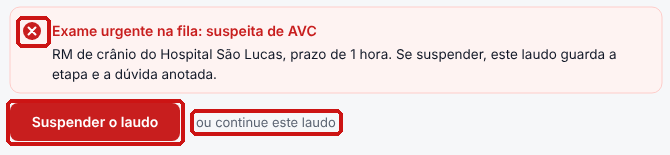 | 1 | O texto deixa claro o que fazer; o risco é hesitar ou achar que suspender apaga algo. | Aviso em tom de alerta (amarelo), suspender com cor neutra e "Continuar este laudo" como botão. |
| V04 | H1 | Ler pergunta clínica — análise indisponível | "O processamento deste exame ainda não terminou", sem previsão de tempo e sem dizer se a tela atualiza sozinha. | 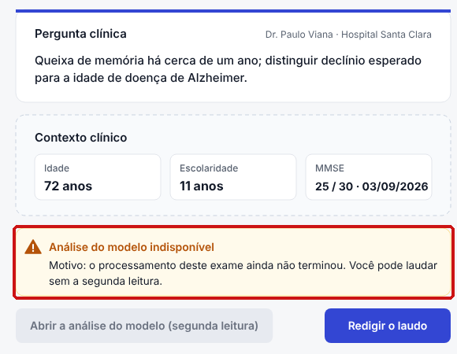 | 2 | Com fila e prazo, a radiologista decide entre esperar e laudar sem a segunda leitura sem saber quanto falta; acontece a cada exame recém-chegado [H]. | Mostrar o tempo estimado (como no Acompanhar análise, "cerca de 3 minutos") e sinalizar na fila quando a análise ficar pronta. |
| V05 | H7 | Análise do modelo — segunda leitura | O mapa de atenção vem num único corte axial, fixo: não dá para ligar/desligar a sobreposição, ajustar a opacidade nem trocar de corte. Para comparar com a própria leitura (M01) ela precisa voltar ao PACS. | 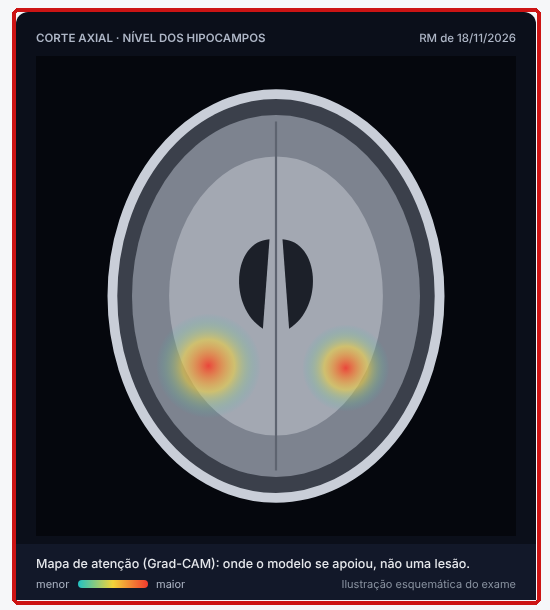 | 3 | Todo exame com segunda leitura; usuária especialista, uso contínuo, obrigada a alternar sistemas. | Botão para mostrar/ocultar o mapa e controle de opacidade; no mínimo, o corte sem sobreposição ao lado. |
| V06 | H4 | Análise do modelo — segunda leitura × Sugestão do modelo — confiabilidade baixa | O mesmo caso (volume hipocampal não informado no envio) é chamado de "imputado" na tela da radiologista e de "estimado" na tela do médico. | 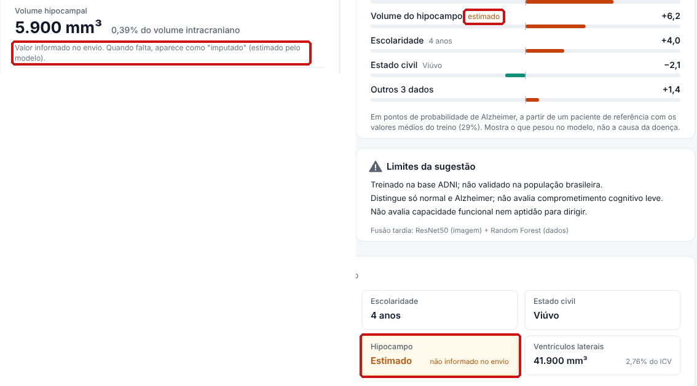 | 2 | Médico e radiologista falam do mesmo exame; nomes diferentes geram dúvida se são coisas diferentes. | Um termo só ("estimado pelo modelo") em todas as telas e no glossário. |
| V07 | H4 | Fila de laudos × Lista de casos | As linhas da fila não têm a seta que a lista de casos usa para indicar que a linha abre. Não fica claro se dá para abrir um exame específico ou só "Abrir o próximo exame". | 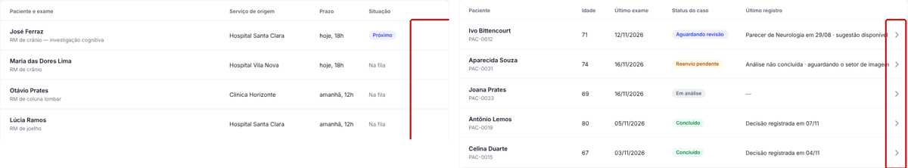 | 1 | O botão principal resolve o caso comum; a dúvida aparece quando ela quer abrir outro exame. | Mesma indicação de linha clicável da lista de casos, ou deixar claro que a fila é só sequencial. |

**Qualidade do relato:** o problema deve ser observável e localizado. Evite “interface confusa” sem dizer **o que**, **onde**, **quando** e **para quem**.

### 6. Boas práticas — heurísticas não violadas (atividade didática)

| Heurística sem violação | Exemplo no sistema | Evidência | Por que atende |
|---|---|---|---|
| H3 | Laudo suspenso aparece na fila com "Retomar o laudo suspenso" | 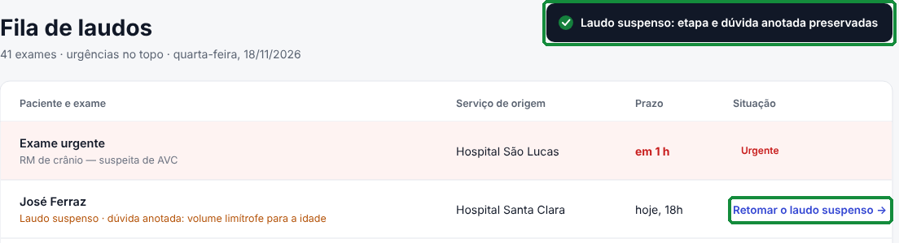 | A urgência não obriga a perder o trabalho: há como sair e voltar ao ponto em que parou. |
| H6 | Pergunta clínica e volume hipocampal ao lado do formulário do laudo | 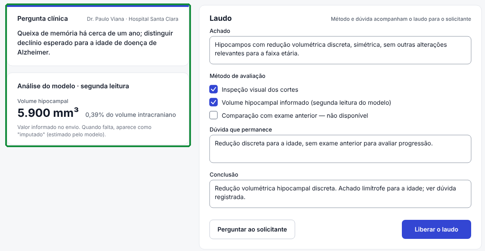 | Ela não precisa lembrar o que leu nas telas anteriores para redigir a conclusão. |
| H8 | Tela de leitura com imagem, pergunta, contexto e duas ações | 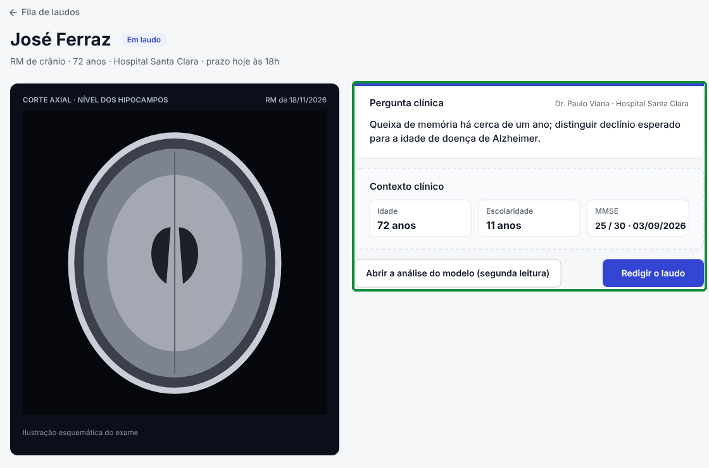 | Só o necessário para começar o laudo; a análise do modelo fica a um clique, sem poluir a primeira leitura. |
| H9 | Erro de conclusão vazia no topo e no campo | 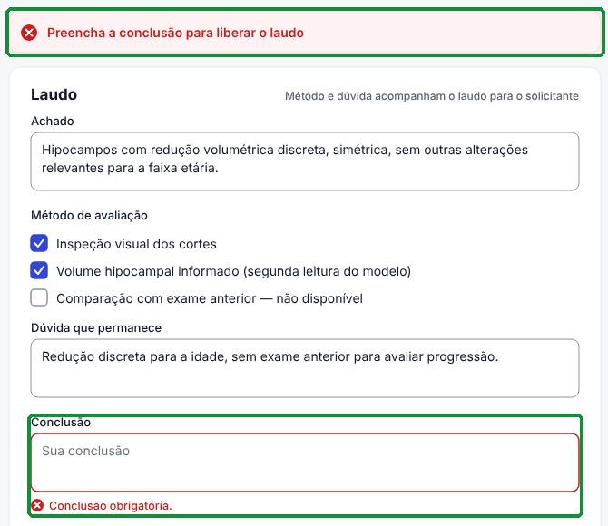 | Diz qual é o problema, onde está e o que fazer, sem códigos. |
| H10 | Texto da análise do modelo explicando o que ela é e o que não é | 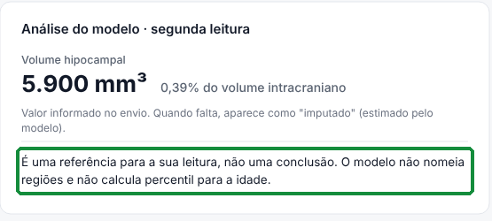 | A ajuda está no lugar da tarefa e é curta. |

## Avaliador A03 — Nathan Gabriel da Fonseca Leite — 22.123.028-7

### 4. Matriz de cobertura das 10 heurísticas

| Heurística | Telas/fluxos examinados | Houve violação? | IDs dos achados | Exemplo de boa prática se não violada |
|---|---|---|---|---|
| H1 | Novo exame — pronto para enviar, Acompanhar análise, Falha da análise | não | — | Acompanhar a análise mostra etapas concluídas, progresso e tempo estimado (Acompanhar análise) |
| H2 | Novo exame — preparar, Novo exame — série errada, Novo exame — pronto para enviar, Falha da análise | não | — | Série conferida em linguagem de aquisição: tipo, cobertura, nome no cabeçalho (Novo exame — pronto para enviar) |
| H3 | Novo exame — identidade não confere, Novo exame — descartar envio, Reenviar após falha — arquivo errado | sim | V01 | — |
| H4 | Falha da análise, Sugestão do modelo — análise não concluída, Lista de casos | sim | V05 | — |
| H5 | Novo exame — valor fora da faixa, Novo exame — pronto para enviar, Novo exame — pendências obrigatórias | sim | V02, V03 | — |
| H6 | Reenviar após falha | sim | V04 | — |
| H7 | Novo exame — pronto para enviar, Acompanhar análise | não | — | Dados clínicos já vêm do prontuário, sem redigitação (Novo exame — pronto para enviar) |
| H8 | Novo exame — confirmar identidade | não | — | Conferência de identidade só com os três dados comparados lado a lado (Novo exame — confirmar identidade) |
| H9 | Login — senha incorreta, Novo exame — valor fora da faixa, Novo exame — série errada, Reenviar após falha — arquivo errado | sim | V06 | — |
| H10 | Novo exame — preparar, Falha da análise | não | — | "O que fazer" na falha da análise, com os dois casos (paciente no setor ou já liberada) (Falha da análise) |

### 5. Declaração de violações

| ID | Heurística | Tela/estado | Problema observado | Evidência | Severidade | Justificativa da severidade | Recomendação |
|---|---|---|---|---|---:|---|---|
| V01 | H3 | Novo exame — identidade não confere | Com a identidade bloqueada, a única ação é "Conferir de novo". Não há como cancelar o envio ou voltar ao preparo; como a correção é feita fora do sistema e pode demorar, o técnico fica preso na tela e só sai pelo menu lateral. | 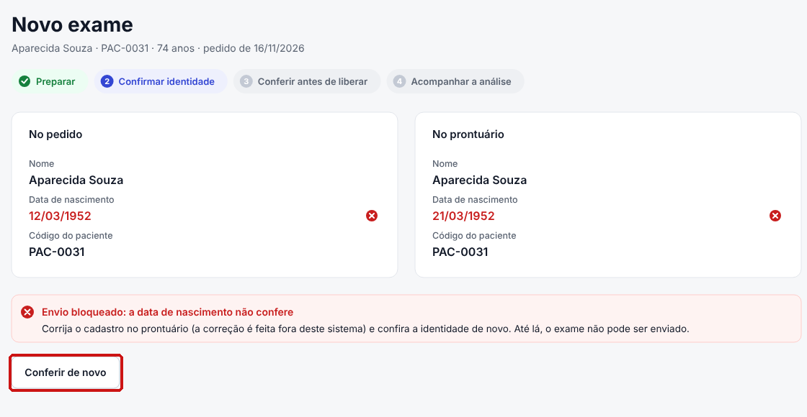 | 2 | Raro, mas sem saída clara, e acontece com o paciente ainda no setor e a agenda correndo. | "Cancelar o envio" com o mesmo aviso de descarte (Novo exame — descartar envio) e opção de deixar o exame pendente. |
| V02 | H5 | Novo exame — valor fora da faixa | A volumetria (ICV, hipocampo, ventrículos) é digitada à mão, enquanto os dados clínicos vêm "sem redigitação". O print mostra 120.000 em vez de 1.200.000. A validação de faixa pega o erro grosseiro, mas não um erro dentro da faixa (ex.: 5.800 × 8.500). | 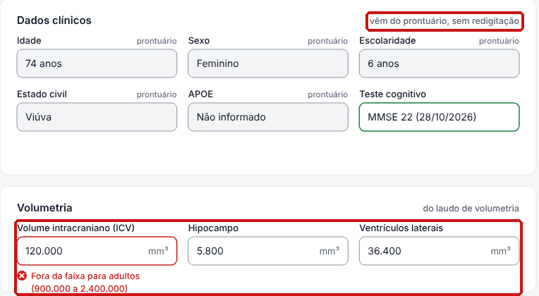 | 2 | Todo exame passa por aqui; um erro dentro da faixa entra no modelo sem aviso. | Importar os valores do laudo de volumetria, como os dados do prontuário, ou pedir confirmação dos três valores. |
| V03 | H5 | Novo exame — pronto para enviar / Novo exame — pendências obrigatórias | O teste cognitivo é um campo de texto livre ("MMSE 22 (28/10/2026)"). Nada impede trocar teste, escore e data ou escrever em outro formato. | 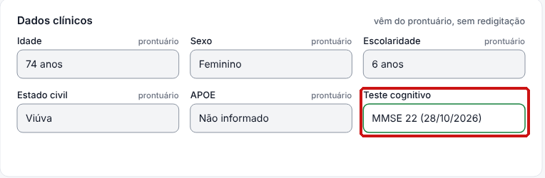 | 2 | Frequente: o escore costuma não estar no prontuário (GOMS T03, 3.B) e é digitado nesse campo. | Separar em teste (MMSE/MoCA), escore (0–30) e data. |
| V04 | H6 | Reenviar após falha | O reenvio avisa que dados, volumetria e limitação foram mantidos, mas não mostra quais. A limitação registrada era da aquisição anterior e pode não valer para a nova série; o técnico precisa lembrar o que tinha preenchido. | 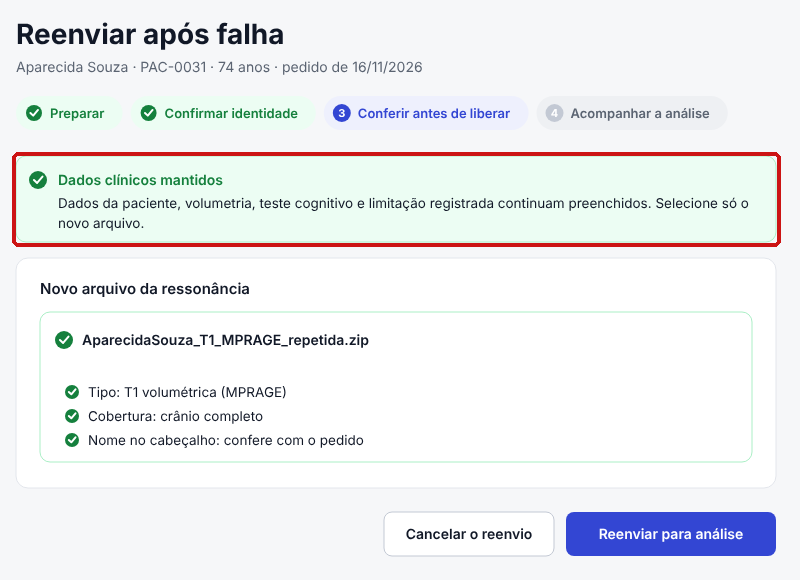 | 1 | Só no reenvio, e o técnico preencheu os dados minutos antes. | Resumo recolhível dos dados mantidos, com opção de editar a limitação. |
| V05 | H4 | Falha da análise × Sugestão do modelo — análise não concluída | O mesmo caso aparece como "Reenvio pendente" para o técnico (Falha da análise) e na lista do médico, mas como "Aguardando revisão" no cabeçalho do caso (Sugestão do modelo — análise não concluída). | 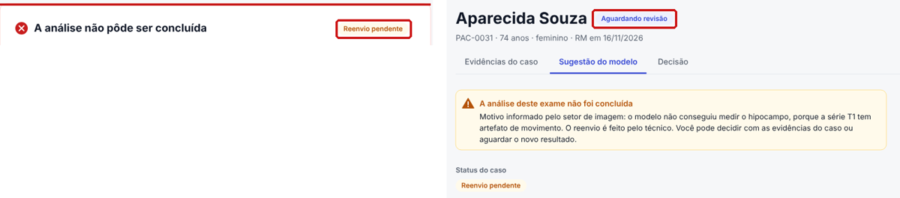 | 2 | Todo caso com falha; técnico e médico podem achar que o outro já resolveu. | Um status único, com o mesmo nome em todas as telas. |
| V06 | H9 | Login — senha incorreta | Sem caminho para recuperar a senha; a mensagem fala em "e-mail ou senha", mas só a senha fica destacada. | 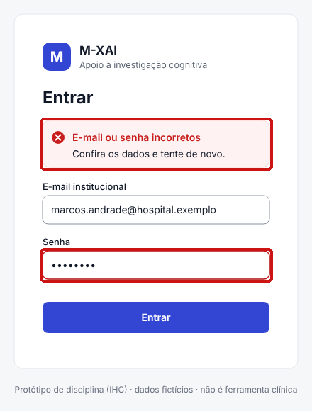 | 1 | Raro; em estação compartilhada a recuperação costuma passar pela TI [H]. | "Esqueci minha senha" e destaque coerente com a mensagem. |

**Qualidade do relato:** o problema deve ser observável e localizado. Evite “interface confusa” sem dizer **o que**, **onde**, **quando** e **para quem**.

### 6. Boas práticas — heurísticas não violadas (atividade didática)

| Heurística sem violação | Exemplo no sistema | Evidência | Por que atende |
|---|---|---|---|
| H1 | Etapas e barra de progresso da análise, com tempo estimado | 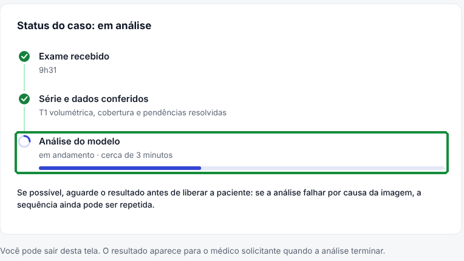 | O técnico sabe o que já foi feito, o que está rodando e quanto falta. |
| H2 | Conferência da série em termos de aquisição | 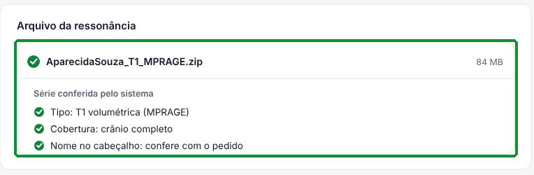 | Usa o vocabulário do técnico (sequência, cobertura, cabeçalho), não métricas do modelo (Entrega 1, item 2.4). |
| H7 | Dados clínicos que já vêm do prontuário | 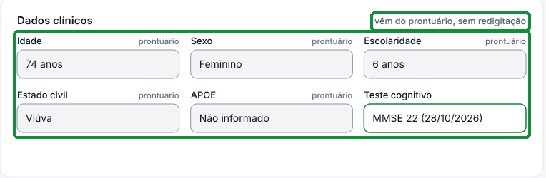 | Elimina o caminho mais lento da tarefa (copiar e transcrever, HTA T03 2.2). |
| H8 | Conferência de identidade com só três dados lado a lado | 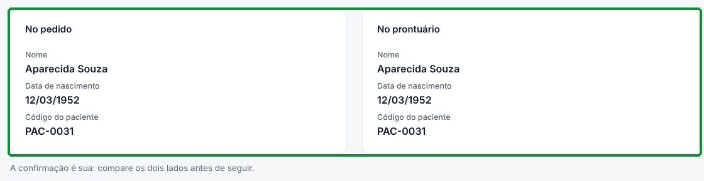 | Nada além do que é preciso para comparar pedido e prontuário. |
| H10 | "O que fazer" na falha da análise | 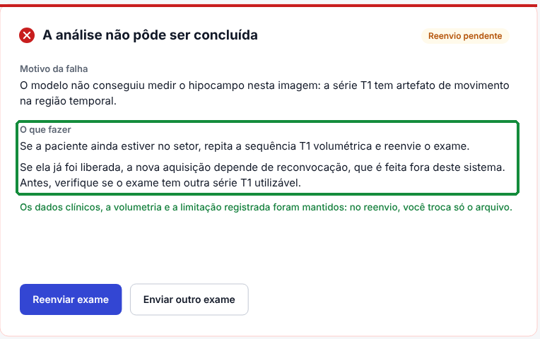 | Ajuda focada na situação, com passos concretos para cada caso. |

## Avaliador A04 — Ana Carolina Lazzuri — 22.123.001-4

### 4. Matriz de cobertura das 10 heurísticas

| Heurística | Telas/fluxos examinados | Houve violação? | IDs dos achados | Exemplo de boa prática se não violada |
|---|---|---|---|---|
| H1 | Linha do tempo — episódio incluído, Decisão registrada — com divergência, Confirmar registro da decisão — neurologista | não | — | Aviso "Episódio incluído na linha do tempo" e selo "novo" no item (Linha do tempo — episódio incluído) |
| H2 | Sugestão do modelo — confiabilidade baixa, Evidências do caso — linha do tempo, Registrar episódio | sim | V03 | — |
| H3 | Registrar episódio, Registrar decisão — alerta de confiabilidade baixa, Confirmar registro da decisão — neurologista | não | — | "Cancelar" no registro de episódio fecha sem gravar nada (Registrar episódio) |
| H4 | Sugestão do modelo — confiabilidade baixa, Análise do modelo — segunda leitura | sim | V01 | — |
| H5 | Registrar episódio, Registrar episódio — campos pendentes, Registrar decisão — alerta de confiabilidade baixa, Confirmar registro da decisão — neurologista | sim | V02, V05, V07 | — |
| H6 | Evidências do caso — linha do tempo, Registrar decisão — alerta de confiabilidade baixa | não | — | Linha do tempo com data e fonte de cada evidência e o aviso de que os episódios são posteriores ao teste (Evidências do caso — linha do tempo) |
| H7 | Sugestão do modelo — confiabilidade baixa | sim | V04 | — |
| H8 | Decisão registrada — com divergência | não | — | Decisão registrada só com o que foi decidido, em blocos curtos (Decisão registrada — com divergência) |
| H9 | Registrar decisão — campos pendentes, Registrar episódio — campos pendentes | não | — | Erro geral no topo e mensagem em cada campo pendente (Registrar decisão — campos pendentes) |
| H10 | Sugestão do modelo — confiabilidade baixa | sim | V06 | — |

### 5. Declaração de violações

| ID | Heurística | Tela/estado | Problema observado | Evidência | Severidade | Justificativa da severidade | Recomendação |
|---|---|---|---|---|---:|---|---|
| V01 | H4 | Sugestão do modelo — confiabilidade baixa × Análise do modelo — segunda leitura | O volume hipocampal não informado aparece como "estimado" na tela do neurologista e como "imputado" na da radiologista. | 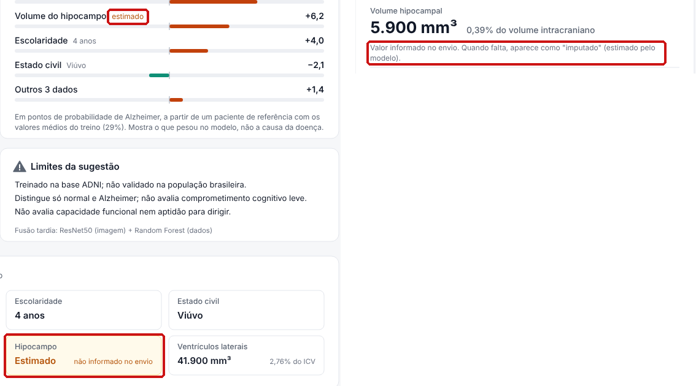 | 2 | Os dois perfis comentam o mesmo exame; termos diferentes para a mesma coisa geram dúvida. | Um termo só em todas as telas. |
| V02 | H5 | Registrar episódio — campos pendentes | Ao tentar adicionar sem dados, data e atividade ficam marcadas, mas "Relatado por" vazio não. O M04 trata "relatado por" como obrigatório; sem ele a linha do tempo não diz quem relatou, justamente na evidência que diverge dos testes. | 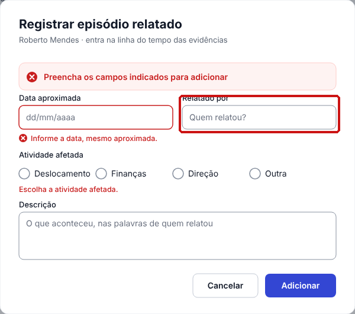 | 2 | Todo episódio; o erro é silencioso e só aparece quando alguém consulta a linha do tempo. | Tornar "Relatado por" obrigatório e validar junto dos outros campos. |
| V03 | H2 | Registrar episódio | "Data aproximada" pede dd/mm/aaaa. A família costuma lembrar "começo do mês" ou "semana passada", e o formato obriga a inventar um dia exato. | 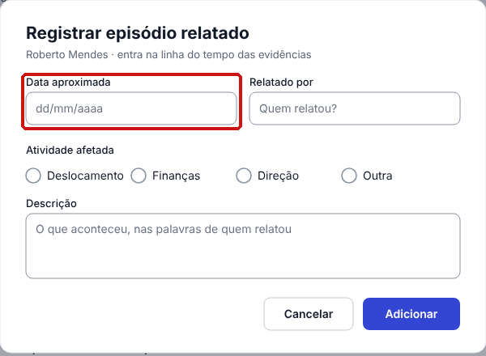 | 1 | Contornável escolhendo um dia; o custo é uma data falsa na linha do tempo. | Aceitar mês/ano ou marcar a data como aproximada. |
| V04 | H7 | Sugestão do modelo — confiabilidade baixa | Mapa de atenção num corte fixo, sem ajuste de opacidade nem troca de corte. O neurologista quer conferir a anatomia sob o destaque. | 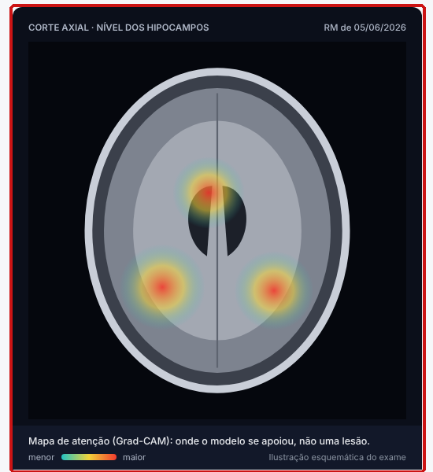 | 2 | Recorrente nos casos que o neurologista revisa; dá para contornar no PACS. | Mostrar/ocultar o mapa e controle de opacidade (hipótese de P02, Entrega 3). |
| V05 | H5 | Confirmar registro da decisão — neurologista | A confirmação mostra concordância, conclusão e conduta, mas não a divergência registrada nem as evidências marcadas, que são o centro da decisão no caso divergente (T04). | 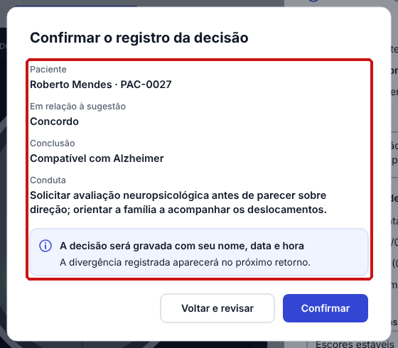 | 2 | Toda decisão de caso divergente; o erro fica gravado sem edição. | Incluir divergência e evidências no resumo. |
| V06 | H10 | Sugestão do modelo — confiabilidade baixa | Só a confiabilidade tem ⓘ. "Peso de cada modalidade", "ventrículos laterais" como fator e a nota sobre "pontos" e "valores médios do treino" ficam sem ajuda. | 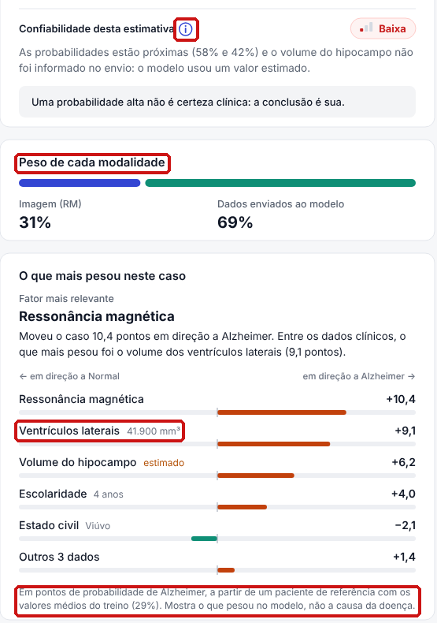 | 2 | Toda sugestão; mesmo o especialista pode ler "pontos" como probabilidade final. | ⓘ nos demais termos, no formato da dica de confiabilidade. |
| V07 | H5 | Registrar episódio | Nenhum campo indica ser obrigatório antes de tentar adicionar; o mesmo vale para o registro da decisão. | 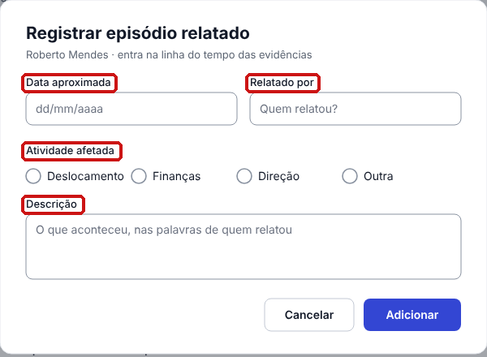 | 2 | Primeiro uso de cada formulário; resolvido pelas mensagens, mas gera retrabalho. | Marcar os obrigatórios com *. |

**Qualidade do relato:** o problema deve ser observável e localizado. Evite “interface confusa” sem dizer **o que**, **onde**, **quando** e **para quem**.

### 6. Boas práticas — heurísticas não violadas (atividade didática)

| Heurística sem violação | Exemplo no sistema | Evidência | Por que atende |
|---|---|---|---|
| H1 | Aviso de episódio incluído e selo "novo" | 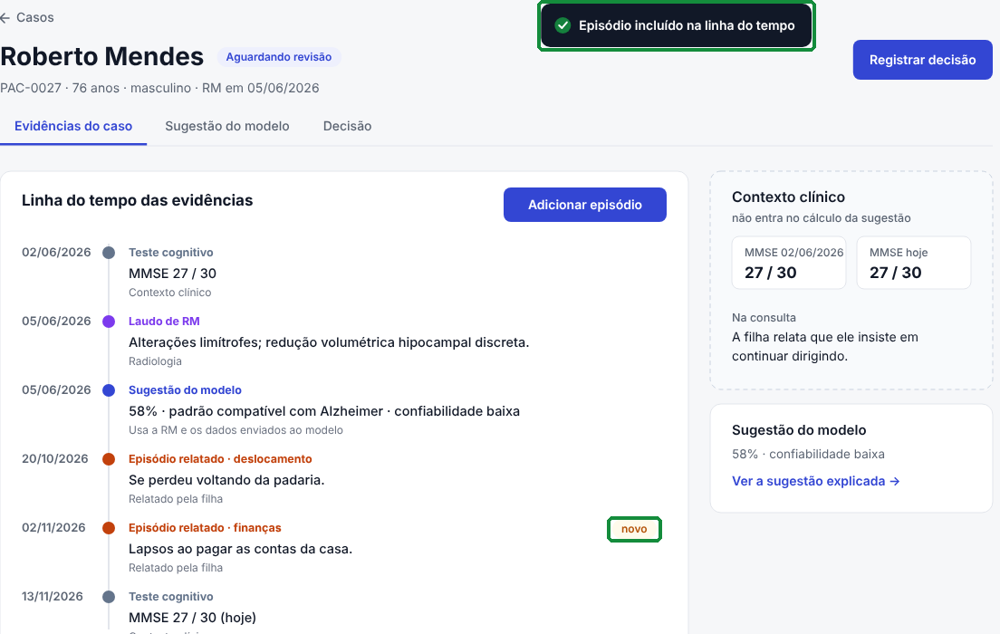 | Confirma na hora que o episódio entrou e mostra onde. |
| H3 | "Cancelar" no registro de episódio | 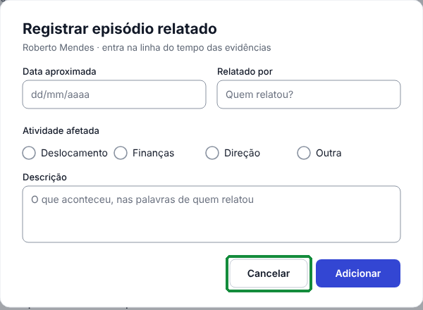 | Saída clara de um formulário aberto por engano. |
| H6 | Linha do tempo com data, tipo e fonte de cada evidência | 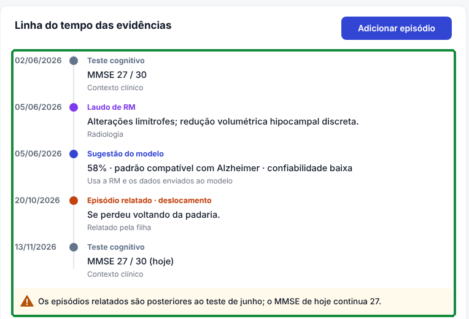 | O neurologista vê escores, laudo, sugestão e episódios juntos, sem lembrar de outra tela (HTA T04, 2.1). |
| H8 | Tela de decisão registrada | 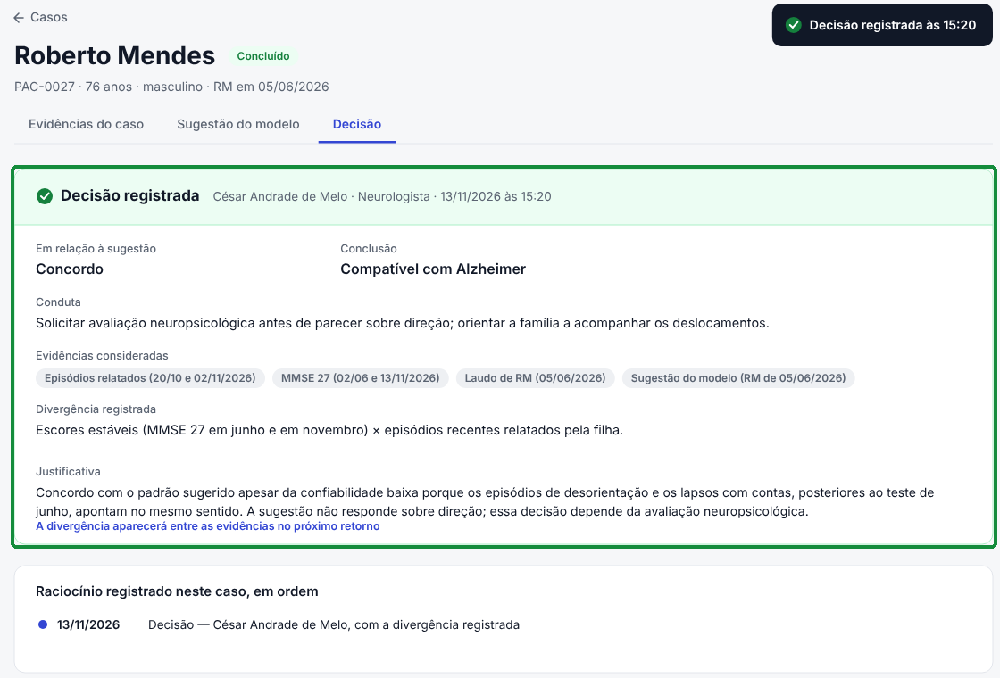 | Mostra só o que foi decidido, com divergência e justificativa, sem repetir a sugestão inteira. |
| H9 | Erro geral e mensagens por campo no registro da decisão | 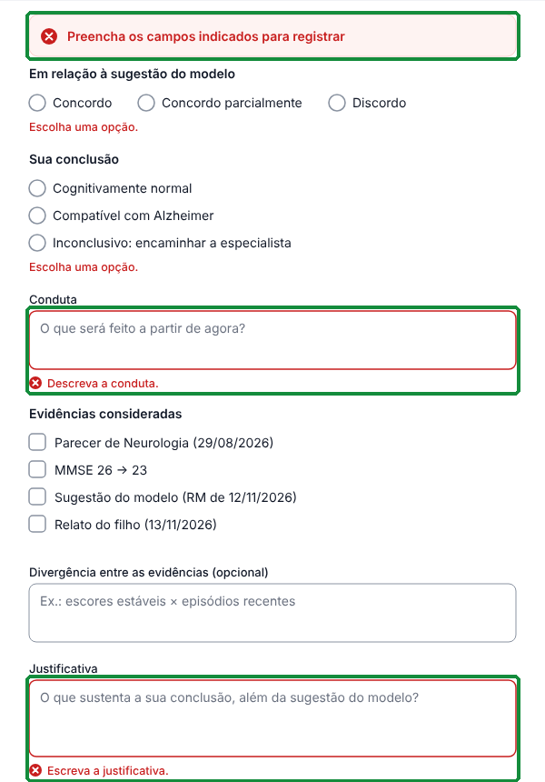 | Linguagem simples, aponta o campo e diz o que preencher. |

> Repita a seção para A02, A03... um avaliador por integrante.
    

## 7. Consolidação da equipe

Problemas iguais ou muito semelhantes encontrados por avaliadores diferentes devem ser consolidados, preservando quem os encontrou.

| ID consolidado | Achados individuais | Heurística | Problema | Severidade final | Prioridade | Responsável pela correção |
|---|---|---|---|---:|---|---|
| HC01 | V01(A01), V04(A02) | H1 | {{...}} | {{...}} | alta | {{...}} |

## 8. Síntese e plano de melhoria

- Quantidade de problemas por heurística e severidade.
- Problemas críticos/graves que bloqueiam teste ou release.
- Padrões recorrentes entre telas.
- Correções que serão feitas antes/para a avaliação com usuários.

## Checklist

- [ ] Cada integrante fez uma inspeção completa e identificada.
- [ ] Todas as telas/estados relevantes foram examinados.
- [ ] Estados administrativos, filtros, relatórios, históricos, processamento e erros foram incluídos quando existentes.
- [ ] A inspeção avaliou a interface/protótipo, não o mérito técnico do algoritmo/modelo.
- [ ] H1–H10 aparecem na matriz de cobertura de cada avaliador.
- [ ] Parte de violações contém apenas violações, sem “forçar” exemplos.
- [ ] Todo problema tem print/localização e contexto.
- [ ] Severidade possui justificativa, não apenas número.
- [ ] Recomendação resolve a causa ou reduz o impacto.
- [ ] Achados duplicados foram consolidados ao final.
