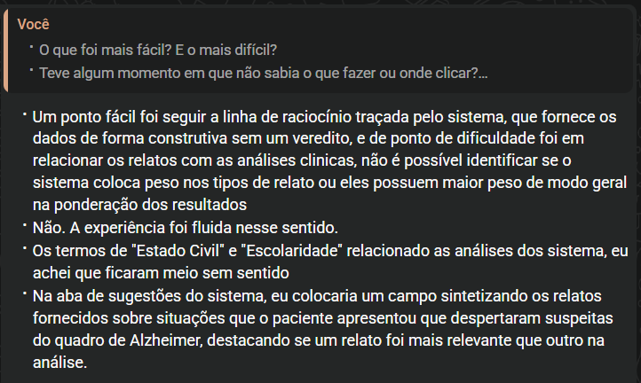
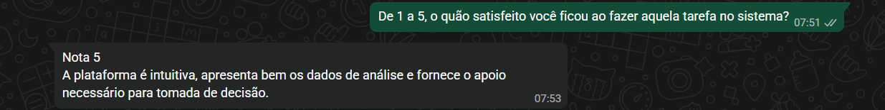

# Entrega 14 — Avaliação de usabilidade por observação de usuários

**Data:** 24/11/2026  
**Status:** 🟨 em andamento  
**Responsabilidade:** solução consolidada por equipe. O número de participantes finais observados deve ser igual ao número de integrantes, conforme o modelo da disciplina; recomenda-se que cada integrante seja responsável por conduzir/analisar ao menos um participante.

## Objetivo da atividade

Observar usuários representativos realizando tarefas reais ou realisticamente simuladas para identificar problemas de eficácia, eficiência, compreensão e satisfação que não podem ser inferidos apenas por inspeção.

> **Participantes finais não devem ser membros da equipe.** Um integrante pode participar do teste piloto apenas para validar roteiro/equipamentos, sem contar na amostra final.

### Quando o usuário é um perfil profissional especializado

Em TCCs técnicos, o público pode ser DBA, analista, pesquisador, administrador, técnico ou outro especialista. Priorize participantes que possuam relação real com as tarefas. Se não for possível recrutar o perfil ideal, qualquer participante aproximado/proxy deve ser **justificado previamente e tratado como limitação**; não apresente o resultado como equivalente ao de especialistas reais.

O teste avalia a **interação com o protótipo**. Não é necessário que o participante valide o desempenho científico do algoritmo. Resultados simulados podem ser usados quando declarados e coerentes com a tarefa.

Tarefas podem envolver, por exemplo, interpretar um dashboard, configurar uma análise, encontrar uma execução no histórico usando filtros, comparar resultados, gerar relatório, revisar alerta ou administrar permissões.

## A. Fluxograma do processo — equipe

```mermaid
flowchart TD
    A["<b>1. Planejamento</b><br/>Objetivo, escopo e metas MU01–MU06 (Entrega 8)<br/>Tarefas UT01–UT04 e critérios de sucesso"]
    B["<b>2. Recrutamento</b><br/>4 participantes leigos (proxies), 1 por integrante<br/>Fora da equipe e sem contato com o protótipo"]
    C["<b>3. Preparação</b><br/>Cenários situacionais, sem indicar o caminho<br/>Planilha de observação e definições de sucesso, erro e ajuda<br/>Protótipo no Figma e sala virtual com gravação"]
    D{"<b>4. Teste piloto</b><br/>Roteiro, protótipo e<br/>gravação funcionam?"}
    E["<b>5. Consentimento e pré-teste</b><br/>Termo, autorização de gravação<br/>e perfil do participante"]
    F["<b>6. Execução e observação</b><br/>Moderador lê o cenário e não ajuda<br/>Participante faz 1 tarefa pensando em voz alta<br/>Tela e áudio gravados"]
    G["<b>7. Pós-teste</b><br/>Notas de 1 a 5: clareza, facilidade e satisfação<br/>Perguntas de compreensão (UT02) e entrevista"]
    H["<b>8. Registro</b><br/>Planilha preenchida a partir da gravação:<br/>tempo, sucesso, erros, ajudas e falas com minuto<br/>Vídeo publicado com link na seção C"]
    I["<b>9. Consolidação e análise</b><br/>Resultados por participante e por tarefa (x/1)<br/>Metas atingidas ou não<br/>Comparação com a avaliação heurística (Entrega 13)"]
    J["<b>10. Recomendações</b><br/>Achados AU com evidência e impacto<br/>Revisão do Figma, signos e MoLIC<br/>Atualização da rastreabilidade"]
 
    A --> B --> C --> D
    D -- "não: ajustar" --> C
    D -- sim --> E --> F --> G --> H
    H -- "próximo participante" --> E
    H -- "4 participantes concluídos" --> I --> J
```

O fluxograma deve representar, no mínimo: planejamento → recrutamento → consentimento → preparação → execução das tarefas/observação → pós-teste → consolidação/análise → recomendações.

## B. Procedimento de preparação e execução — equipe

### Passo 1 — Objetivos e versão avaliada

- **Versão/commit/Figma:** protótipo da Entrega 11 no Figma, a mesma versão inspecionada na Entrega 13, com as telas adicionadas para as tarefas deste teste — [{{link do protótipo}} ](https://www.figma.com/design/wQIeoySFfUvRdhjPRIj1HJ/M-XAI-%E2%80%94-Entrega-11--prot%C3%B3tipo-?node-id=9-2&t=Yz9SznpQ3YgKnjLe-0) 
- **Metas de usabilidade relacionadas:** MU01 a MU06, da Entrega 8

#### Objetivo e escopo

- **Objetivo:** ver se uma pessoa sem contato prévio com o protótipo consegue cumprir, sozinha, a tarefa principal de cada perfil, e se entende que a saída do modelo é uma sugestão de apoio, não um diagnóstico.
- **Escopo:** um fluxo por perfil no protótipo: médico clínico (UT01), neurologista (UT02), radiologista (UT03) e técnico em radiologia (UT04).
- **Método:** teste de usabilidade por observação, com pensar em voz alta, em sala virtual gravada (Barbosa e Silva, 2010).
- **Participantes:** 4, um por integrante. Cada participante faz uma tarefa.
- **Como as metas são medidas neste teste:**
  - MU01, MU02 e MU04: em todas as tarefas.
  - MU03: na UT02, como referência de tempo.
  - MU05 e MU06: na UT02, a única tarefa em que o participante interpreta a sugestão do modelo. A Entrega 8 previa medi-las com o médico clínico; com uma tarefa por participante, elas passam para a UT02.

### Passo 2 — Participantes

| ID | Perfil | Critérios que justificam participação | Integrante responsável |
|---|---|---|---|
| U01 | Estudante de TI, com formação e atuação em gestão — no papel de médico clínico (UT01) | Sem formação na área da saúde; nunca usou o protótipo; não é da equipe | Paulo Hudson Josué da Silva |
| U02 | Engenheiro eletricista, ex-aluno da FEI — no papel de neurologista (UT02) | Sem formação na área da saúde; nunca usou o protótipo; não é da equipe | Ana Carolina Lazzuri |
| U03 | {{perfil resumido}} — no papel de radiologista (UT03) |  | Raphael Garavati Erbert |
| U04 | {{perfil resumido}} — no papel de técnico em radiologia (UT04) | | Nathan Gabriel da Fonseca Leite |

#### Participantes proxy

Todos os participantes são proxies. Nenhum é profissional de saúde, e a equipe decidiu isso antes das sessões.

- **Por que:** Há uma certa dificuldade em recrutar médicos, radiologistas e técnicos. Além disso, o teste avalia a interação com o protótipo, não o conhecimento clínico.
- **Como:** cada participante assume o papel descrito no cenário. A tela traz todos os dados de que ele precisa, e os casos são fictícios.
- **Limitação:**
  - Os resultados mostram se a interface é compreensível para quem não é da área. Eles não equivalem aos de profissionais reais e não são generalizados para eles.
  - Um profissional entenderia termos clínicos que o leigo não entende. Por outro lado, o leigo não completa com conhecimento próprio o que a tela não explica.
  - Problemas de leitura da explicação do modelo (probabilidade, confiabilidade, pesos) tendem a aparecer também com o médico clínico, que não é especialista em neuroimagem (H01 e H03 da Entrega 8).

### Passo 3 — Consentimento e privacidade

- Termo/registro de consentimento: [Termo de consentimento](https://github.com/rapha661/Alzheimer-XAI-ihc2026/blob/main/instrumentos/termo_consentimento_modelo.md); aceite registrado {{forma: no início da gravação / por mensagem}}.
- Gravação de tela/áudio/vídeo: sim, tela e áudio pela sala virtual, para conferir tempos, erros e falas depois da sessão.
- Forma de anonimização: IDs `UT01`, `UT02`... no relatório e nas planilhas. Nos vídeos, o nome do participante aparece na sala virtual, por isso o link só é publicado com a autorização dele.
- Local e período de armazenamento: vídeos no YouTube {{como não listados}}, com o link em cada participante na seção C. Planilhas de observação em `assets/14_testes/`.

### Passo 4 — Teste piloto

**Data:** 22/11/2026  
**O que foi validado:** roteiro, duração, entendimento das instruções, protótipo, gravação.  
**Mudanças após piloto:** sem alterações pós piloto

### Passo 5 — Tarefas

| ID | Cenário/instrução apresentada | Critério de sucesso | Métricas | Ligação com modelo |
|---|---|---|---|---|
| UT01 | Médico clínico: o filho do Sr. Ivo pergunta o que o neurologista concluiu (U01) | Informa a conclusão do especialista e a data da reavaliação | sucesso, tempo, erros, ajudas, satisfação | T01 / M02 |
| UT02 | Neurologista: a filha do Sr. Roberto pergunta se "o sistema disse que é Alzheimer" (U02) | Diz que é sugestão de apoio, não diagnóstico, e que a confiabilidade é baixa, com um motivo da tela | sucesso, tempo, erros, ajudas, satisfação, compreensão | T04 / M04 |
| UT03 | Radiologista: dúvida no laudo do Sr. José Ferraz (U03) | Chega a "Pergunta enviada" com o laudo ainda preenchido | sucesso, tempo, erros, ajudas, satisfação | T02 / M01 |
| UT04 | Técnico: exame da Dona Aparecida antes de ela ir embora (U04) | Confirma a identidade, troca o arquivo para a série T1, completa o teste cognitivo e envia | sucesso, tempo, erros, ajudas, satisfação | T03 / M03 |

#### Cenários apresentados aos participantes

O cenário dá a situação, o papel e o objetivo, mas nunca o caminho na interface, para o teste não virar tutorial. O moderador lê o cenário e o participante conduz a interação a partir dele.

- **UT01** — Você é o Dr. Marcos Andrade, 38 anos, clínico geral. O Sr. Ivo Bittencourt, 71 anos, volta à consulta com o filho, que anda preocupado com a memória do pai. Há algum tempo um neurologista avaliou o caso. O filho quer saber o que o especialista concluiu e quando o pai deve ser avaliado de novo. Veja no sistema e responda a ele.
- **UT02** — Você é o Dr. César Andrade de Melo, 52 anos, neurologista. Na consulta do Sr. Roberto Mendes, 76 anos, a filha pergunta: "Doutor, esse programa disse que é Alzheimer?". Veja o que o sistema mostra sobre ele e diga em voz alta o que responderia a ela e por quê.
- **UT03** — Você é a Dra. Helena Siqueira Prado, 44 anos, radiologista. Você está laudando a RM do Sr. José Ferraz e ficou com uma dúvida que só o médico que pediu o exame pode responder. Mande a pergunta sem perder o que já escreveu do laudo.
- **UT04** — Você é o Bruno Tavares Lima, 32 anos, técnico em radiologia. A Dona Aparecida Souza, 74 anos, acabou de fazer a RM de crânio e o próximo paciente já está esperando. Antes de ela ir embora, confira se está tudo certo com o exame e envie para análise.

Tempo-limite de 5 minutos por tarefa. Se passar disso, a tarefa conta como falha.

#### Registro do pensar em voz alta

- O participante fala em voz alta durante toda a tarefa. O moderador só lembra com "continue falando", sem sugerir caminho.
- Falas e reações (hesitação, volta de tela, clique no lugar errado) são anotadas na planilha de observação com o minuto da gravação.
- Tempo, erros e ajudas são conferidos na gravação depois da sessão. Nenhum valor é estimado ou ajustado.
- Logo após a tarefa, o participante dá notas de 1 a 5 para clareza, facilidade e satisfação geral (MU04).
- As definições de sucesso, erro e ajuda foram combinadas antes da coleta e estão em [`instrumentos.md`](https://github.com/rapha661/Alzheimer-XAI-ihc2026/tree/main/instrumentos), junto com o termo e o pós-teste.

### Passo 6 — Protocolo do moderador

1. Receber participante e explicar que **o produto está sendo avaliado, não a pessoa**.
2. Obter consentimento.
3. Aplicar perfil pré-teste mínimo necessário.
4. Ler instruções padronizadas.
5. Observar sem ensinar o caminho; registrar pedidos de ajuda separadamente.
6. Se usar *think aloud*, explicar e aplicar de forma consistente.
7. Após cada tarefa, registrar satisfação/SEQ ou escala definida.
8. Fazer pós-teste/entrevista breve.
9. Encerrar e explicar uso dos dados.

## C. Resultados — por participante

### U01 — estudante de TI, no papel de médico clínico (UT01)

| Tarefa | Grau de sucesso | Erros | Tipos de erro/dificuldade | Ajudas | Tempo | Satisfação | Evidência/observação |
|---|---|---:|---|---:|---|---|---|
| UT01 | parcial | 1 | Abriu "Registrar parecer" e gravou o formulário; falou a data da reavaliação só ao ler a conduta já preenchida; não conhecia a sigla MMSE | 0 | 03:50 | 5 (coletada após a sessão) | Leu a conclusão do parecer em voz alta (01:42–01:50) |

**Link da gravação (se autorizado):** [Gravação do U01](https://www.youtube.com/watch?v=s4iZQaoxC9U) — o participante autoriza o uso da gravação em 04:59  
**Resposta pós-teste:** respostas enviadas por mensagem depois da sessão (imagem abaixo)

#### Perfil pré-teste

Estudante de TI, com formação e atuação em gestão. Não tem conhecimento prévio da área da saúde. É um participante proxy: o resultado mostra se um leigo encontra a informação na tela e não equivale ao de um médico clínico. O perfil foi apresentado pelo moderador no início da gravação (00:14–00:34).

#### Cenário apresentado

O moderador apresentou o projeto e o protótipo (00:34–00:56) e leu o cenário UT01 (00:56–01:04): ele é o médico que atende o Sr. Ivo Bittencourt, que voltou com o filho relatando piora da memória; em agosto o paciente foi avaliado por um especialista; antes da consulta, deve descobrir o que o especialista concluiu e quando recomendou reavaliar o paciente. O cenário não indicou tela nem botão.

#### Percurso observado

Os tempos são do vídeo (mm:ss).

- **01:00:** a lista de casos abre depois do login.
- **01:14–01:16:** abre o caso do Sr. Ivo, na aba "Evidências do caso".
- **01:16–01:58:** lê o status ("Aguardando revisão"), a última RM (12/11), o MMSE e o parecer do Dr. César Andrade de Melo, por telefone, de 29/08: conclusão e exames revisados. A recomendação do parecer, "Reavaliar em seis meses (fevereiro de 2027)", está na tela, mas não é lida em voz alta.
- **01:59–02:07:** clica em "Registrar parecer", que abre o formulário já preenchido com o mesmo parecer, e clica em "Gravar parecer". Volta às evidências.
- **02:10–02:48:** abre "Ver a sugestão do exame mais recente" e lê a sugestão do modelo; rola até "Dados enviados ao modelo".
- **02:44–03:13:** alterna entre as abas "Decisão" ("Nenhuma decisão registrada ainda"), "Sugestão do modelo" e "Evidências do caso".
- **03:16:** abre "Registrar decisão e justificativa", o que o cenário não pedia.
- **03:19–03:31:** tenta marcar "Concordo" e "Compatível com Alzheimer"; os campos não respondem ao clique.
- **03:48–03:52:** clica em "Registrar decisão" com o formulário vazio e recebe "Preencha os campos indicados para registrar".
- **03:54:** ao clicar num campo, o protótipo preenche o formulário inteiro com outras escolhas: "Concordo parcialmente" e "Inconclusivo: encaminhar a especialista", com conduta e justificativa prontas.
- **04:04–04:20:** lê a conduta e a justificativa preenchidas, incluindo a reavaliação prevista para fevereiro e a queda do MMSE de 26 para 23.
- **04:24–04:36:** registra, vê a confirmação do registro e confirma; abre a decisão registrada.
- **04:42–04:56:** clica em "Voltar aos casos". O protótipo não volta à lista: mostra de novo as evidências, com o status ainda "Aguardando revisão" (04:44), e passa pelo parecer, pelo registro e pela confirmação até a decisão registrada (04:56).
- **04:54:** encerra com "É isso".

#### Pensar em voz alta

Ele falou em voz alta durante toda a tarefa. O moderador não interveio entre o fim do cenário (01:04) e o encerramento (04:54). As falas abaixo vêm da legenda da gravação, com o minuto:

- "Aqui no caso sou o Marcos Andrade e o paciente Ivo, 71 anos de idade" (01:06)
- "Com base aqui no painel a gente tem aqui o status aguardando a revisão" (01:14)
- "Contato no caso aqui com o Dr. César Andrade Melo e telefone de 29/08" (01:32)
- "Conclusão: [sem] fortes elementos para [Alzheimer] neste momento" (01:42)
- "Temos a sugestão de modelo, no caso que seria compatível com Alzheimer" (02:20)
- "Aqui as informações do paciente que ele usou para calcular" (02:38)
- "Por enquanto isso é uma decisão. Mas acredito que seja isso" (02:50)
- "Vai estar aqui anotado a decisão minha […] confirmando ali o Alzheimer ou não?" (03:06)
- "Paciente aqui, ó, tava oculta, não tinha visto" (03:22)
- "Ainda não consigo preencher" (03:28)
- "Reavaliação prevista para fevereiro? O [MMSE] caiu de 26 para 23" (04:14)
- "Voltar aos casos. É isso" (04:44–04:54)

#### Análise do resultado

O resultado foi **parcial**: cumpriu um item do critério de sucesso e o outro ficou incompleto.

- **Item cumprido:** achou o parecer e leu a conclusão do especialista em voz alta (01:42), sem ajuda.
- **Item incompleto:** a recomendação do parecer, "Reavaliar em seis meses (fevereiro de 2027)", estava na tela desde 01:16, mas ele não a leu. Só falou "reavaliação prevista para fevereiro" em 04:14, lendo a conduta que o protótipo preencheu no registro da decisão, e não como recomendação do especialista. Também não chegou a formular a resposta ao filho, que era o que o cenário pedia.
- **Erro não crítico:** procurou o parecer no botão "Registrar parecer" e gravou o formulário já preenchido (01:59–02:07).
- **Além da tarefa:** registrou uma decisão. As escolhas que ele tentou marcar ("Concordo", "Compatível com Alzheimer") foram trocadas pelo preenchimento do protótipo ("Concordo parcialmente", "Inconclusivo"), e ele confirmou o registro sem perceber a diferença.
- **Dificuldade relatada:** não conhecia a sigla MMSE.

Esses pontos aparecem nos achados AU04 a AU07 (seção E).

#### Metas de usabilidade (Entrega 8)

| Meta | Resultado do U01 na UT01 | Atingida? |
|---|---|---|
| MU01 — eficácia | Parcial, sem ajuda (0/1 com sucesso total) | não |
| MU02 — erros críticos | 0 erros críticos | sim |
| MU03 — eficiência | 03:50 (medida na UT02; aqui só referência) | — |
| MU04 — satisfação | Nota 5 (meta ≥ 4) | sim, com ressalva |
| MU05 — papel de apoio da IA | não medida na UT01 | — |
| MU06 — elementos da explicação | não medida na UT01 | — |

- **MU01:** faltou informar a data da reavaliação como recomendação do especialista.
- **MU02:** ele não apontou a sugestão do modelo como a conclusão do especialista, que é o erro crítico ligado à UT01.
- **MU04:** só a satisfação geral foi coletada, por mensagem e depois da sessão. Os itens de clareza e de facilidade previstos na meta não foram perguntados.

> Repita para U02, U03...

### U02 — engenheiro eletricista, no papel de neurologista (UT02)

| Tarefa | Grau de sucesso | Erros | Tipos de erro/dificuldade | Ajudas | Tempo | Satisfação | Evidência/observação |
|---|---|---:|---|---:|---|---|---|
| UT02 | parcial | 0 | Não citou a confiabilidade baixa; leu errado os pesos da explicação | 0 | 03:00 | 5 (coletada após a sessão) | Disse que o sistema "não é um veredito" (05:03) |

**Link da gravação (se autorizado):** [{{link da gravação}} ](https://www.youtube.com/watch?v=HkwDZDBbXOQ)  
**Resposta pós-teste:** Vide imagem abaixo

> **Observação sobre a gravação:** por um problema técnico, a voz do participante ficou baixa no vídeo. É necessário usar fone de ouvido para escutá-lo. As falas também estão nas legendas.

#### Perfil pré-teste

Formado em Engenharia Elétrica pela FEI. Não tem conhecimento prévio da área da saúde e conhecia o TCC só de forma geral. É um participante proxy: o resultado mostra se um leigo entende a tela e não equivale ao de um neurologista. O perfil foi apresentado pela moderadora no início da gravação (00:06–00:36).

#### Cenário apresentado

A moderadora apresentou o protótipo, avisou que a navegação é limitada por ser um Figma e que não faria intervenções. Depois leu o cenário UT02 (01:27–02:10): ele é o neurologista que acompanha o Sr. Roberto Mendes, a filha soube que "o sistema deu um diagnóstico" e quer entender; ele deve ver o que o sistema mostra e dizer o que responderia a ela e por quê. O cenário não indicou tela nem botão. Foi lido de forma resumida, sem o nome e a idade do personagem do cartão.

#### Percurso observado

Os tempos são do vídeo (mm:ss).

- **02:12–02:18:** abriu o caso do Roberto direto na lista de casos.
- **02:18–02:48:** leu a linha do tempo das evidências: o histórico, a sugestão do modelo e o episódio relatado pela filha.
- **02:48–02:51:** entrou na sugestão pelo link "Ver a sugestão explicada", sem usar a aba "Sugestão do modelo".
- **02:51–05:00:** leu probabilidade, confiabilidade, peso de cada modalidade e "O que mais pesou". Rolou a tela para cima e para baixo várias vezes, chegando até "Limites da sugestão" e "Dados enviados ao modelo".
- Não clicou no ícone de informação da confiabilidade, não abriu a aba "Decisão" e não comentou o mapa de atenção.
- **05:12:** encerrou com "Acho que seria isso".

#### Pensar em voz alta

Ele falou em voz alta durante toda a tarefa. A moderadora não interveio entre o início e o fim. As falas abaixo foram anotadas com o minuto da gravação:

- "Porém, o próprio sistema adverte que uma probabilidade alta não é certeza clínica" (03:15)
- "Vemos aqui que o peso dos relatos é maior na análise" (03:21)
- "A plataforma não dá, no tempo, 100% de assertividade em dizer que o paciente tem Alzheimer" (03:57)
- "O paciente não tem 100% Alzheimer constatado, mas apresenta uma forte tendência" (04:18)
- "Não é um veredito, mas apresenta uma tendência para manifestação dessa condição" (05:03)

#### Análise do resultado

O resultado foi **parcial**: cumpriu um item do critério de sucesso e deixou o outro de fora.

- **Item cumprido:** deixou claro que o sistema dá uma sugestão e não um diagnóstico, citando o aviso da própria tela.
- **Item que faltou:** não falou da confiabilidade "Baixa" nem do motivo dela (probabilidades próximas, 58% × 42%, e volume do hipocampo estimado).
- **Leituras erradas:**
  - entendeu "Dados enviados ao modelo 69%" como o peso dos relatos da família;
  - leu "O que mais pesou" como "a maioria dos casos tende a Alzheimer";
  - concluiu que o paciente está "em estágio de início de progressão", o que a tela não afirma.

Esses pontos aparecem nos achados AU01 a AU03 (seção E).

#### Metas de usabilidade (Entrega 8)

| Meta | Resultado do U02 na UT02 | Atingida? |
|---|---|---|
| MU01 — eficácia | Parcial, sem ajuda (0/1 com sucesso total) | não |
| MU02 — erros críticos | 0 erros críticos | sim |
| MU03 — eficiência | 03:00 (limite ≤ 10 min) | sim, como referência |
| MU04 — satisfação | Nota 5 (meta ≥ 4) | sim, com ressalva |
| MU05 — papel de apoio da IA | Identificou que é sugestão, não diagnóstico | sim |
| MU06 — elementos da explicação | 0 de 3 interpretados corretamente | não |

- **MU01:** faltou citar a confiabilidade baixa e o motivo, item essencial do critério de sucesso.
- **MU02:** ele não tratou a sugestão como diagnóstico definitivo, que é o erro crítico ligado à UT02. A leitura de que o paciente está "em estágio de início de progressão" exagera o que a tela mostra, mas não chega a esse erro.
- **MU03:** a meta foi definida para a A03 do médico clínico e inclui registrar a avaliação. A UT02 não tem registro, então o tempo vale só como referência.
- **MU04:** só a satisfação geral foi coletada, e depois da sessão. Os itens de clareza e de facilidade previstos na meta não foram perguntados.
- **MU06:** as perguntas de compreensão não foram feitas, então a contagem saiu das falas espontâneas:
  - (1) probabilidade: entendeu que não é certeza, mas sem a confiabilidade;
  - (2) mapa de atenção (Grad-CAM): não comentou;
  - (3) pesos da imagem e dos dados clínicos (SHAP): leu errado.

### U03 — {{perfil resumido}}, no papel de radiologista (UT03)

| Tarefa | Grau de sucesso | Erros | Tipos de erro/dificuldade | Ajudas | Tempo | Satisfação | Evidência/observação |
|---|---|---:|---|---:|---|---|---|
| UT03 | total/parcial/falha | {{n}} | {{...}} | {{n}} | {{mm:ss}} | {{1–5}} | {{fala/comportamento}} |

**Link da gravação (se autorizado):** {{...}}  
**Resposta pós-teste:** {{...}}

### U04 — {{perfil resumido}}, no papel de técnico em radiologia (UT04)

| Tarefa | Grau de sucesso | Erros | Tipos de erro/dificuldade | Ajudas | Tempo | Satisfação | Evidência/observação |
|---|---|---:|---|---:|---|---|---|
| UT04 | total/parcial/falha | {{n}} | {{...}} | {{n}} | {{mm:ss}} | {{1–5}} | {{fala/comportamento}} |

**Link da gravação (se autorizado):** {{...}}  
**Resposta pós-teste:** {{...}}

## D. Consolidação por tarefa

| Tarefa | Taxa de sucesso | Tempo típico | Erros recorrentes | Satisfação | Meta atendida? | Problemas prioritários |
|---|---:|---|---|---|---|---|
| UT01 | 0/1 total (1 parcial) | 03:50 | 1 erro não crítico (gravou o parecer de novo) | 5 | não (MU01) | Recomendação do parecer não lida; botão "Registrar parecer" confundido com o parecer; preenchimento simulado diferente do escolhido |
| UT02 | 0/1 total (1 parcial) | 03:00 | nenhum erro | 5 | não (MU01, MU06) | Confiabilidade não percebida; pesos da explicação lidos errado |
| UT03 | {{x/1}} | {{mm:ss}} | {{...}} | {{1–5}} | sim/não | {{...}} |
| UT04 | {{x/1}} | {{mm:ss}} | {{...}} | {{1–5}} | sim/não | {{...}} |

Com um participante por tarefa, os resultados são contagens individuais (x/1), sem percentual nem média.

## E. Achados e recomendações

| ID | Achado | Evidência (quant. + qual.) | Impacto | Recomendação | Artefatos a revisar |
|---|---|---|---|---|---|
| AU01 | Confiabilidade "Baixa" não percebida | UT02: 1/1 não citou; não abriu a ajuda | Alto | Mostrar o motivo junto da probabilidade | Figma, signos, MoLIC M04 |
| AU02 | Peso dos dados clínicos lido como peso dos relatos da família | UT02: 1/1 + fala 03:21 | Alto | Renomear e listar os dados que entram | Figma, signos |
| AU03 | "O que mais pesou" lido como frequência de casos; estágio da doença inferido | UT02: 1/1 + falas 03:39 e 04:06 | Médio | Frase-resumo e aviso de que não indica estágio | Figma, signos |
| AU04 | Recomendação do parecer não percebida | UT01: 1/1 não leu "Reavaliar em seis meses (fevereiro de 2027)", na tela desde 01:16 | Alto | Destacar a recomendação e a data no topo do parecer | Figma, signos, MoLIC M02 |
| AU05 | "Registrar parecer" confundido com o parecer existente | UT01: 1/1 abriu e gravou o formulário (01:59–02:07) | Médio | Formulário vazio e rótulo "Registrar novo parecer" | Figma |
| AU06 | Registro confirmado sem conferir o resumo | UT01: tentou "Concordo" e "Compatível com Alzheimer" (03:19–03:31), registrou "Concordo parcialmente" e "Inconclusivo" (04:24–04:36) sem comentar | Médio | Destacar concordância e conclusão na confirmação | Figma, MoLIC M02 |
| AU07 | "Voltar aos casos" não volta à lista; status não muda depois da decisão | UT01: 04:42–04:56 | Médio | Corrigir a ligação e o status no protótipo | Figma |
| AU08 | Sigla MMSE sem explicação | UT01: pós-teste ("não conhecia o termo MMSE") | Baixo | Nome por extenso na primeira ocorrência e termo no glossário | Figma, signos |
| AU__ | {{achados de UT03 e UT04}} | {{...}} | {{...}} | {{...}} | {{...}} |

#### AU01 — confiabilidade "Baixa" não percebida

- **Evidência:** o U02 leu a probabilidade de 58% e o aviso de que probabilidade alta não é certeza clínica, mas não citou a confiabilidade "Baixa" nem o motivo dela. Também não abriu a ajuda do ícone de informação.
- **Impacto:** sem a confiabilidade, 58% parece uma tendência firme ("forte tendência", 04:27). É a leitura que a sugestão quer evitar.
- **Recomendação:** colocar a confiabilidade ao lado da probabilidade, com o mesmo destaque, e escrever o motivo em linguagem simples, sem depender da ajuda: "Probabilidades próximas (58% × 42%) e volume do hipocampo estimado".

#### AU02 — peso dos dados clínicos lido como peso dos relatos

- **Evidência:** em "Peso de cada modalidade", ele leu "Dados enviados ao modelo 69%" como o peso do que a família contou: "o peso dos relatos é maior na análise" (03:21).
- **Por que isso pesa:** o card "Contexto clínico" da mesma tela diz que o relato da filha não entra no cálculo da sugestão.
- **Impacto:** a pessoa pode explicar à família que o modelo se baseou no relato dela, o que é falso.
- **Recomendação:** trocar o rótulo por "Dados clínicos (idade, escolaridade, testes…)" e repetir, perto do gráfico, que os relatos da família não entram no cálculo.

#### AU03 — "O que mais pesou" e estágio da doença

- **Evidência:** ele leu as barras como "a maioria dos casos aqui tendem em direção ao Alzheimer" (03:39). Concluiu que o paciente está "em um estágio de início de progressão" (04:06), mas a tela não fala de estágio.
- **Impacto:** a explicação vira uma afirmação sobre a doença que o modelo não faz.
- **Recomendação:**
  - abrir o bloco com uma frase-resumo, como "A ressonância foi o que mais puxou a sugestão para Alzheimer";
  - incluir em "O que o modelo não avalia" que ele não indica estágio nem progressão.

#### AU04 — recomendação do parecer não percebida

- **Evidência:** o U01 leu o especialista, a data, o canal e a conclusão do parecer (01:32–01:50), mas não a recomendação "Reavaliar em seis meses (fevereiro de 2027)", que estava no mesmo card desde 01:16. Só falou em fevereiro em 04:14, lendo a conduta preenchida no registro da decisão.
- **Impacto:** alto. A data da reavaliação é metade da resposta que o filho pediu, e é a informação que o parecer registra para orientar o retorno (H06).
- **Recomendação:** colocar a recomendação e a data em destaque no topo do card do parecer, junto da conclusão, e não como último item do card.

#### AU05 — "Registrar parecer" confundido com o parecer existente

- **Evidência:** procurando o parecer, ele clicou em "Registrar parecer" (01:59). O formulário abriu já preenchido com os dados do parecer de 29/08, e ele clicou em "Gravar parecer" (02:06).
- **Impacto:** médio. Num sistema real, isso duplicaria o parecer no caso. O formulário preenchido também faz o botão parecer um "ver parecer".
- **Recomendação:** abrir o formulário vazio e trocar o rótulo para "Registrar novo parecer".

#### AU06 — registro confirmado sem conferir o resumo

- **Evidência:** ele tentou marcar "Concordo" e "Compatível com Alzheimer" (03:19–03:31). O protótipo preencheu "Concordo parcialmente" e "Inconclusivo: encaminhar a especialista" (03:54). Ele leu a conduta e a justificativa (04:04–04:20) e confirmou o registro (04:24–04:36) sem comentar a diferença.
- **Impacto:** médio. A troca foi causada pelo preenchimento simulado, que é limitação do protótipo. Mas a confirmação não serviu para ele conferir o que estava gravando, que é o papel dela (H5).
- **Recomendação:** na confirmação, destacar concordância e conclusão. No protótipo, preencher o formulário com escolhas neutras ou com as que o participante clicar.

#### AU07 — "Voltar aos casos" e status depois da decisão

- **Evidência:** depois de registrar, ele clicou em "Voltar aos casos" (04:42). O protótipo não abriu a lista: mostrou as evidências com o status "Aguardando revisão" (04:44) e repassou parecer, registro e confirmação até a decisão registrada (04:56).
- **Impacto:** médio. O participante não percebe que saiu do caso, e o status contradiz a decisão registrada como "Concluído".
- **Recomendação:** corrigir a ligação de "Voltar aos casos" para a lista (UI02) e mostrar o status "Concluído" em todas as telas do caso depois do registro.

#### AU08 — sigla MMSE sem explicação

- **Evidência:** no pós-teste, o U01 disse que nenhum termo ficou sem sentido, "apenas não conhecia o termo MMSE".
- **Impacto:** baixo para o público real, porque o médico clínico conhece a sigla.
- **Recomendação:** escrever "MMSE (Mini-Exame do Estado Mental)" na primeira ocorrência e incluir o termo no glossário.

## F. Comparação com a avaliação heurística

| Problema | Detectado na heurística? | Detectado por usuários? | O que aprendemos |
|---|---|---|---|
| Ajuda contextual só em "Confiabilidade" (UT02) | sim — HC07 | sim — U02 | Ajuda escondida em ícone não é usada |
| Jargão técnico na sugestão (UT02) | sim — HC09 | parcial — U02 | O problema maior foram os rótulos dos pesos |
| Limites da sugestão abaixo da dobra (UT02) | sim — HC10 | não — U02 | Ele rolou até lá; não atrapalhou |
| Mapa de atenção fixo, sem controles (UT02) | sim — HC01 | não observado | O U02 não interagiu com o mapa |
| "Estimado" e "imputado" para o mesmo valor (UT02) | sim — HC04 | não observado | O U02 não comentou o hipocampo estimado |
| Status do caso diferente entre telas; lista sem filtro (UT01) | sim — HC03, HC16 | parcial — U01 | O status ficou "Aguardando revisão" depois da decisão registrada (04:44), mas ele não comentou. A falta de filtro não apareceu: ele abriu o caso direto |
| Método sem MTA; análise indisponível sem previsão; fila sem indicação de clique (UT03) | sim — HC02, HC11, HC19 | {{sim/não}} | {{...}} |
| Identidade sem voltar; volumetria digitada; teste cognitivo em texto livre (UT04) | sim — HC12, HC13, HC14 | {{sim/não}} | {{...}} |
| Peso dos dados clínicos lido como peso dos relatos (UT02) | não | sim — U02 | Ver AU02 |
| Estágio da doença inferido da explicação (UT02) | não | sim — U02 | Ver AU03 |
| Resumo da confirmação não confere o que foi escolhido (UT01) | sim — V04 (A01) | sim — U01 | Ver AU06. O participante confirmou escolhas diferentes das que tentou marcar |
| Recomendação do parecer não percebida (UT01) | não | sim — U01 | Ver AU04 |
| "Registrar parecer" confundido com o parecer (UT01) | não | sim — U01 | Ver AU05 |
| "Voltar aos casos" leva ao lugar errado (UT01) | não | sim — U01 | Ver AU07. Falha de ligação do protótipo |
| {{problema que só apareceu com usuários em UT03 ou UT04}} | não | sim | {{...}} |

## G. Conclusão

A conclusão deve responder:

1. Quais metas de usabilidade foram atingidas?
2. Quais problemas foram recorrentes e com quais perfis/tarefas?
3. O que surpreendeu a equipe?
4. Quais mudanças são prioritárias?
5. Que limitações do teste impedem generalizações amplas?

**1. Metas atingidas.**

- **UT02:** atingiu MU02 (nenhum erro crítico), MU04 (nota 5) e MU05 (entendeu que é sugestão, não diagnóstico). Não atingiu MU01 (sucesso parcial) nem MU06 (0 de 3 elementos). O tempo (03:00) fica dentro da referência da MU03.
- **UT01:** atingiu MU02 (nenhum erro crítico) e MU04 (nota 5). Não atingiu MU01 (sucesso parcial: achou a conclusão do especialista, mas não a data da reavaliação no parecer). O tempo foi 03:50, dentro do limite de 5 minutos.
- **UT03 e UT04:** {{...}}

**2. Problemas recorrentes.** {{a preencher quando houver os quatro resultados}}

**3. O que surpreendeu.**

- **UT02:** o participante entendeu bem o papel de apoio da IA, ajudado pelo aviso da tela. Mesmo assim, leu errado justamente a parte da explicação: confiabilidade, pesos e "O que mais pesou". Esses dois problemas de leitura (AU02, AU03) não tinham aparecido na avaliação heurística.
- **UT01:** o participante achou o parecer em 15 segundos, mas leu só a conclusão e pulou a recomendação, que estava no mesmo card. Depois seguiu sozinho até registrar uma decisão que o cenário não pedia, e confirmou escolhas que não eram as dele sem perceber.
- **Outras tarefas:** {{...}}

**4. Mudanças prioritárias.** AU01 e AU02, porque levam a explicar o caso para a família de forma errada, e AU04, porque a data da reavaliação é a informação que o parecer existe para guardar. {{incluir as de UT03 e UT04}}

**5. Limitações.**

- Os quatro participantes são leigos no papel de profissionais de saúde (proxies) e cada um fez uma única tarefa.
- Os resultados são casos individuais: não permitem taxa nem média e não equivalem aos de profissionais reais.
- O teste foi feito num protótipo do Figma com navegação limitada e casos fictícios.

## Checklist

- [ ] Número de participantes finais atende ao enunciado.
- [ ] Participantes são representativos do público e não são membros da equipe.
- [x] Se foram usados participantes proxy, a justificativa e a limitação estão explícitas.
- [x] O teste avalia a interação; não confunde usabilidade do protótipo com desempenho técnico do TCC.
- [x] Tarefas administrativas/analíticas usadas no teste são rastreáveis a objetivos e cenários.
- [ ] Há consentimento e anonimização.
- [ ] Foi realizado teste piloto.
- [x] Tarefas têm critérios de sucesso definidos antes do teste.
- [ ] Moderadores não ensinaram o caminho durante a tarefa.
- [ ] Resultados estão separados por usuário e por tarefa.
- [ ] Foram registrados sucesso, erros, ajudas, tempo e satisfação quando aplicáveis.
- [ ] Conclusão combina evidência quantitativa e qualitativa.
- [ ] Achados geram recomendações e atualização da rastreabilidade.
