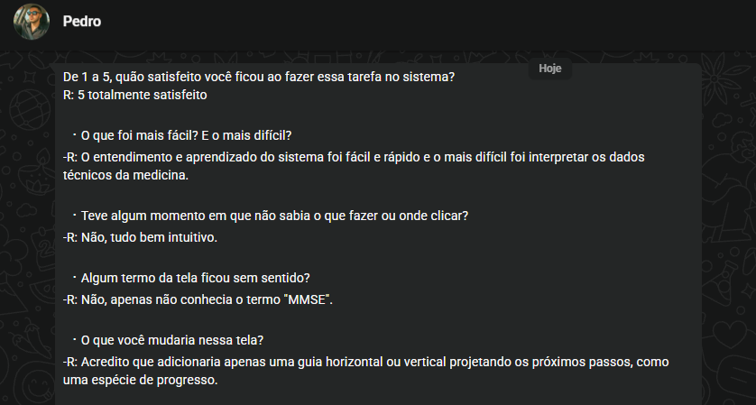

# Entrega 14 — Avaliação de usabilidade por observação de usuários

**Data:** 24/11/2026  
**Status:** 🟩 concluída  
**Responsabilidade:** solução consolidada por equipe. O número de participantes finais observados deve ser igual ao número de integrantes, conforme o modelo da disciplina; recomenda-se que cada integrante seja responsável por conduzir/analisar ao menos um participante.

## Objetivo da atividade

Observar usuários representativos realizando tarefas reais ou realisticamente simuladas para identificar problemas de eficácia, eficiência, compreensão e satisfação que não podem ser inferidos apenas por inspeção.

> **Participantes finais não devem ser membros da equipe.** Um integrante pode participar do teste piloto apenas para validar roteiro/equipamentos, sem contar na amostra final.

### Quando o usuário é um perfil profissional especializado

Em TCCs técnicos, o público pode ser DBA, analista, pesquisador, administrador, técnico ou outro especialista. Priorize participantes que possuam relação real com as tarefas. Se não for possível recrutar o perfil ideal, qualquer participante aproximado/proxy deve ser **justificado previamente e tratado como limitação**; não apresente o resultado como equivalente ao de especialistas reais.

O teste avalia a **interação com o protótipo**. Não é necessário que o participante valide o desempenho científico do algoritmo. Resultados simulados podem ser usados quando declarados e coerentes com a tarefa.

Tarefas podem envolver, por exemplo, interpretar um dashboard, configurar uma análise, encontrar uma execução no histórico usando filtros, comparar resultados, gerar relatório, revisar alerta ou administrar permissões.

## A. Fluxograma do processo — equipe

```mermaid
flowchart TD
    A["<b>1. Planejamento</b><br/>Objetivo, escopo e metas MU01–MU06 (Entrega 8)<br/>Tarefas UT01–UT04 e critérios de sucesso"]
    B["<b>2. Recrutamento</b><br/>4 participantes leigos (proxies), 1 por integrante<br/>Fora da equipe e sem contato com o protótipo"]
    C["<b>3. Preparação</b><br/>Cenários situacionais, sem indicar o caminho<br/>Planilha de observação e definições de sucesso, erro e ajuda<br/>Protótipo no Figma e sala virtual com gravação"]
    D{"<b>4. Teste piloto</b><br/>Roteiro, protótipo e<br/>gravação funcionam?"}
    E["<b>5. Consentimento e pré-teste</b><br/>Termo, autorização de gravação<br/>e perfil do participante"]
    F["<b>6. Execução e observação</b><br/>Moderador lê o cenário e não ajuda<br/>Participante faz 1 tarefa pensando em voz alta<br/>Tela e áudio gravados"]
    G["<b>7. Pós-teste</b><br/>Notas de 1 a 5: clareza, facilidade e satisfação<br/>Perguntas de compreensão (UT02) e entrevista"]
    H["<b>8. Registro</b><br/>Planilha preenchida a partir da gravação:<br/>tempo, sucesso, erros, ajudas e falas com minuto<br/>Vídeo publicado com link na seção C"]
    I["<b>9. Consolidação e análise</b><br/>Resultados por participante e por tarefa (x/1)<br/>Metas atingidas ou não<br/>Comparação com a avaliação heurística (Entrega 13)"]
    J["<b>10. Recomendações</b><br/>Achados AU com evidência e impacto<br/>Revisão do Figma, signos e MoLIC<br/>Atualização da rastreabilidade"]
 
    A --> B --> C --> D
    D -- "não: ajustar" --> C
    D -- sim --> E --> F --> G --> H
    H -- "próximo participante" --> E
    H -- "4 participantes concluídos" --> I --> J
```

O fluxograma deve representar, no mínimo: planejamento → recrutamento → consentimento → preparação → execução das tarefas/observação → pós-teste → consolidação/análise → recomendações.

## B. Procedimento de preparação e execução — equipe

### Passo 1 — Objetivos e versão avaliada

- **Versão/commit/Figma:** protótipo da Entrega 11 no Figma, a mesma versão inspecionada na Entrega 13, com as telas adicionadas para as tarefas deste teste — [link do protótipo](https://www.figma.com/design/wQIeoySFfUvRdhjPRIj1HJ/M-XAI-%E2%80%94-Entrega-11--prot%C3%B3tipo-?node-id=9-2&t=Yz9SznpQ3YgKnjLe-0) 
- **Metas de usabilidade relacionadas:** MU01 a MU06, da Entrega 8

#### Objetivo e escopo

- **Objetivo:** ver se uma pessoa sem contato prévio com o protótipo consegue cumprir, sozinha, a tarefa principal de cada perfil, e se entende que a saída do modelo é uma sugestão de apoio, não um diagnóstico.
- **Escopo:** um fluxo por perfil no protótipo: médico clínico (UT01), neurologista (UT02), radiologista (UT03) e técnico em radiologia (UT04).
- **Método:** teste de usabilidade por observação, com pensar em voz alta, em sala virtual gravada (Barbosa e Silva, 2010).
- **Participantes:** 4, um por integrante. Cada participante faz uma tarefa.
- **Como as metas são medidas neste teste:**
  - MU01, MU02 e MU04: em todas as tarefas.
  - MU03: na UT02, como referência de tempo.
  - MU05 e MU06: na UT02, a única tarefa em que o participante interpreta a sugestão do modelo. A Entrega 8 previa medi-las com o médico clínico; com uma tarefa por participante, elas passam para a UT02.

### Passo 2 — Participantes

| ID | Perfil | Critérios que justificam participação | Integrante responsável |
|---|---|---|---|
| U01 | Estudante de TI, com formação e atuação em gestão — no papel de médico clínico (UT01) | Sem formação na área da saúde; nunca usou o protótipo; não é da equipe | Paulo Hudson Josué da Silva |
| U02 | Engenheiro eletricista, ex-aluno da FEI — no papel de neurologista (UT02) | Sem formação na área da saúde; nunca usou o protótipo; não é da equipe | Ana Carolina Lazzuri |
| U03 | Graduando em Ciência da Computação na FEI, trabalha como engenheiro de dados e IA — no papel de radiologista (UT03) | Sem formação na área da saúde; nunca usou o protótipo; não é da equipe | Nathan Gabriel da Fonseca Leite |
| U04 | Graduando em Ciência da Computação na UNESP de Rio Claro — no papel de técnico em radiologia (UT04) | Sem formação na área da saúde; nunca usou o protótipo; não é da equipe | Raphael Garavati Erbert |

#### Participantes proxy

Todos os participantes são proxies. Nenhum é profissional de saúde, e a equipe decidiu isso antes das sessões.

- **Por que:** Há uma certa dificuldade em recrutar médicos, radiologistas e técnicos. Além disso, o teste avalia a interação com o protótipo, não o conhecimento clínico.
- **Como:** cada participante assume o papel descrito no cenário. A tela traz todos os dados de que ele precisa, e os casos são fictícios.
- **Limitação:**
  - Os resultados mostram se a interface é compreensível para quem não é da área. Eles não equivalem aos de profissionais reais e não são generalizados para eles.
  - Um profissional entenderia termos clínicos que o leigo não entende. Por outro lado, o leigo não completa com conhecimento próprio o que a tela não explica.
  - Problemas de leitura da explicação do modelo (probabilidade, confiabilidade, pesos) tendem a aparecer também com o médico clínico, que não é especialista em neuroimagem (H01 e H03 da Entrega 8).

### Passo 3 — Consentimento e privacidade

- Termo/registro de consentimento: [Termo de consentimento](https://github.com/rapha661/Alzheimer-XAI-ihc2026/blob/main/instrumentos/termo_consentimento_modelo.md); aceite registrado por mensagem, com o código do participante e a data: U01 e U02 em 23/11/2026, U03 em 24/11/2026 e U04 em 25/11/2026 (imagens em `assets/14_testes/`). O U01 e o U03 também autorizaram em voz alta, no fim da gravação.
- Gravação de tela/áudio/vídeo: sim, tela e áudio pela sala virtual, para conferir tempos, erros e falas depois da sessão.
- Forma de anonimização: IDs `U01`, `U02`... no relatório e nas planilhas (`UT01`, `UT02`... são as tarefas). Nos vídeos, o nome do participante aparece na sala virtual, por isso o link só é publicado com a autorização dele.
- Local e período de armazenamento: vídeos no YouTube como não listados, com o link em cada participante na seção C. Planilhas de observação em `assets/14_testes/`.

### Passo 4 — Teste piloto

**Data:** 22/11/2026  
**O que foi validado:** roteiro, duração, entendimento das instruções, protótipo, gravação.  
**Mudanças após piloto:** sem alterações pós piloto

### Passo 5 — Tarefas

| ID | Cenário/instrução apresentada | Critério de sucesso | Métricas | Ligação com modelo |
|---|---|---|---|---|
| UT01 | Médico clínico: o filho do Sr. Ivo pergunta o que o neurologista concluiu (U01) | Informa a conclusão do especialista e a data da reavaliação | sucesso, tempo, erros, ajudas, satisfação | T01 / M02 |
| UT02 | Neurologista: a filha do Sr. Roberto pergunta se "o sistema disse que é Alzheimer" (U02) | Diz que é sugestão de apoio, não diagnóstico, e que a confiabilidade é baixa, com um motivo da tela | sucesso, tempo, erros, ajudas, satisfação, compreensão | T04 / M04 |
| UT03 | Radiologista: ~~dúvida no laudo do Sr. José Ferraz~~ laudar o próximo exame da fila (U03) | ~~Chega a "Pergunta enviada" com o laudo ainda preenchido~~ Libera o laudo e diz que o solicitante recebe o método e a dúvida | sucesso, tempo, erros, ajudas, satisfação | T02 / M01 |
| UT04 | Técnico: exame da Dona Aparecida antes de ela ir embora (U04) | Confirma a identidade, troca o arquivo para a série T1, completa o teste cognitivo e envia | sucesso, tempo, erros, ajudas, satisfação | T03 / M03 |

#### Cenários apresentados aos participantes

O cenário dá a situação, o papel e o objetivo, mas nunca o caminho na interface, para o teste não virar tutorial. O moderador lê o cenário e o participante conduz a interação a partir dele.

- **UT01** — Você é o Dr. Marcos Andrade, 38 anos, clínico geral. O Sr. Ivo Bittencourt, 71 anos, volta à consulta com o filho, que anda preocupado com a memória do pai. Há algum tempo um neurologista avaliou o caso. O filho quer saber o que o especialista concluiu e quando o pai deve ser avaliado de novo. Veja no sistema e responda a ele.
- **UT02** — Você é o Dr. César Andrade de Melo, 52 anos, neurologista. Na consulta do Sr. Roberto Mendes, 76 anos, a filha pergunta: "Doutor, esse programa disse que é Alzheimer?". Veja o que o sistema mostra sobre ele e diga em voz alta o que responderia a ela e por quê.
- **UT03** — ~~Você é a Dra. Helena Siqueira Prado, 44 anos, radiologista. Você está laudando a RM do Sr. José Ferraz e ficou com uma dúvida que só o médico que pediu o exame pode responder. Mande a pergunta sem perder o que já escreveu do laudo.~~ Você é a Dra. Helena e está na fila do dia. Laude o próximo exame. Se faltar alguma informação para concluir, resolva como faria no seu serviço.
- **UT04** — Você é o Bruno Tavares Lima, 32 anos, técnico em radiologia. A Dona Aparecida Souza, 74 anos, acabou de fazer a RM de crânio e o próximo paciente já está esperando. Antes de ela ir embora, confira se está tudo certo com o exame e envie para análise.

Tempo-limite de 5 minutos por tarefa. Se passar disso, a tarefa conta como falha.

#### Registro do pensar em voz alta

- O participante fala em voz alta durante toda a tarefa. O moderador só lembra com "continue falando", sem sugerir caminho.
- Falas e reações (hesitação, volta de tela, clique no lugar errado) são anotadas na planilha de observação com o minuto da gravação.
- Tempo, erros e ajudas são conferidos na gravação depois da sessão. Nenhum valor é estimado ou ajustado.
- Logo após a tarefa, o participante dá notas de 1 a 5 para clareza, facilidade e satisfação geral (MU04).
- As definições de sucesso, erro e ajuda foram combinadas antes da coleta e estão em [`instrumentos.md`](https://github.com/rapha661/Alzheimer-XAI-ihc2026/tree/main/instrumentos), junto com o termo e o pós-teste.

### Passo 6 — Protocolo do moderador

1. Receber participante e explicar que **o produto está sendo avaliado, não a pessoa**.
2. Obter consentimento.
3. Aplicar perfil pré-teste mínimo necessário.
4. Ler instruções padronizadas.
5. Observar sem ensinar o caminho; registrar pedidos de ajuda separadamente.
6. Se usar *think aloud*, explicar e aplicar de forma consistente.
7. Após cada tarefa, registrar satisfação/SEQ ou escala definida.
8. Fazer pós-teste/entrevista breve.
9. Encerrar e explicar uso dos dados.

## C. Resultados — por participante

### U01 — estudante de TI, no papel de médico clínico (UT01)

| Tarefa | Grau de sucesso | Erros | Tipos de erro/dificuldade | Ajudas | Tempo | Satisfação | Evidência/observação |
|---|---|---:|---|---:|---|---|---|
| UT01 | parcial | 1 | Abriu "Registrar parecer" e gravou o formulário; falou a data da reavaliação só ao ler a conduta já preenchida; não conhecia a sigla MMSE | 0 | 03:50 | 5 (coletada após a sessão) | Leu a conclusão do parecer em voz alta (01:42–01:50) |

**Link da gravação (se autorizado):** [Gravação do U01](https://www.youtube.com/watch?v=s4iZQaoxC9U) — o participante autoriza o uso da gravação em 04:59  
**Resposta pós-teste:** respostas enviadas por mensagem depois da sessão (imagem abaixo)

#### Perfil pré-teste

Estudante de TI, com formação e atuação em gestão. Não tem conhecimento prévio da área da saúde. É um participante proxy: o resultado mostra se um leigo encontra a informação na tela e não equivale ao de um médico clínico. O perfil foi apresentado pelo moderador no início da gravação (00:14–00:34).

#### Cenário apresentado

O moderador apresentou o projeto e o protótipo (00:34–00:56) e leu o cenário UT01 (00:56–01:04): ele é o médico que atende o Sr. Ivo Bittencourt, que voltou com o filho relatando piora da memória; em agosto o paciente foi avaliado por um especialista; antes da consulta, deve descobrir o que o especialista concluiu e quando recomendou reavaliar o paciente. O cenário não indicou tela nem botão.

#### Percurso observado

Os tempos são do vídeo (mm:ss).

- **01:00:** a lista de casos abre depois do login.
- **01:14–01:16:** abre o caso do Sr. Ivo, na aba "Evidências do caso".
- **01:16–01:58:** lê o status ("Aguardando revisão"), a última RM (12/11), o MMSE e o parecer do Dr. César Andrade de Melo, por telefone, de 29/08: conclusão e exames revisados. A recomendação do parecer, "Reavaliar em seis meses (fevereiro de 2027)", está na tela, mas não é lida em voz alta.
- **01:59–02:07:** clica em "Registrar parecer", que abre o formulário já preenchido com o mesmo parecer, e clica em "Gravar parecer". Volta às evidências.
- **02:10–02:48:** abre "Ver a sugestão do exame mais recente" e lê a sugestão do modelo; rola até "Dados enviados ao modelo".
- **02:44–03:13:** alterna entre as abas "Decisão" ("Nenhuma decisão registrada ainda"), "Sugestão do modelo" e "Evidências do caso".
- **03:16:** abre "Registrar decisão e justificativa", o que o cenário não pedia.
- **03:19–03:31:** tenta marcar "Concordo" e "Compatível com Alzheimer"; os campos não respondem ao clique.
- **03:48–03:52:** clica em "Registrar decisão" com o formulário vazio e recebe "Preencha os campos indicados para registrar".
- **03:54:** ao clicar num campo, o protótipo preenche o formulário inteiro com outras escolhas: "Concordo parcialmente" e "Inconclusivo: encaminhar a especialista", com conduta e justificativa prontas.
- **04:04–04:20:** lê a conduta e a justificativa preenchidas, incluindo a reavaliação prevista para fevereiro e a queda do MMSE de 26 para 23.
- **04:24–04:36:** registra, vê a confirmação do registro e confirma; abre a decisão registrada.
- **04:42–04:56:** clica em "Voltar aos casos". O protótipo não volta à lista: mostra de novo as evidências, com o status ainda "Aguardando revisão" (04:44), e passa pelo parecer, pelo registro e pela confirmação até a decisão registrada (04:56).
- **04:54:** encerra com "É isso".

#### Pensar em voz alta

Ele falou em voz alta durante toda a tarefa. O moderador não interveio entre o fim do cenário (01:04) e o encerramento (04:54). As falas abaixo vêm da legenda da gravação, com o minuto:

- "Aqui no caso sou o Marcos Andrade e o paciente Ivo, 71 anos de idade" (01:06)
- "Com base aqui no painel a gente tem aqui o status aguardando a revisão" (01:14)
- "Contato no caso aqui com o Dr. César Andrade Melo e telefone de 29/08" (01:32)
- "Conclusão: [sem] fortes elementos para [Alzheimer] neste momento" (01:42)
- "Temos a sugestão de modelo, no caso que seria compatível com Alzheimer" (02:20)
- "Aqui as informações do paciente que ele usou para calcular" (02:38)
- "Por enquanto isso é uma decisão. Mas acredito que seja isso" (02:50)
- "Vai estar aqui anotado a decisão minha […] confirmando ali o Alzheimer ou não?" (03:06)
- "Paciente aqui, ó, tava oculta, não tinha visto" (03:22)
- "Ainda não consigo preencher" (03:28)
- "Reavaliação prevista para fevereiro? O [MMSE] caiu de 26 para 23" (04:14)
- "Voltar aos casos. É isso" (04:44–04:54)

#### Análise do resultado

O resultado foi **parcial**: cumpriu um item do critério de sucesso e o outro ficou incompleto.

- **Item cumprido:** achou o parecer e leu a conclusão do especialista em voz alta (01:42), sem ajuda.
- **Item incompleto:** a recomendação do parecer, "Reavaliar em seis meses (fevereiro de 2027)", estava na tela desde 01:16, mas ele não a leu. Só falou "reavaliação prevista para fevereiro" em 04:14, lendo a conduta que o protótipo preencheu no registro da decisão, e não como recomendação do especialista. Também não chegou a formular a resposta ao filho, que era o que o cenário pedia.
- **Erro não crítico:** procurou o parecer no botão "Registrar parecer" e gravou o formulário já preenchido (01:59–02:07).
- **Além da tarefa:** registrou uma decisão. As escolhas que ele tentou marcar ("Concordo", "Compatível com Alzheimer") foram trocadas pelo preenchimento do protótipo ("Concordo parcialmente", "Inconclusivo"), e ele confirmou o registro sem perceber a diferença.
- **Dificuldade relatada:** não conhecia a sigla MMSE.

Esses pontos aparecem nos achados AU04 a AU07 (seção E).

#### Metas de usabilidade (Entrega 8)

| Meta | Resultado do U01 na UT01 | Atingida? |
|---|---|---|
| MU01 — eficácia | Parcial, sem ajuda (0/1 com sucesso total) | não |
| MU02 — erros críticos | 0 erros críticos | sim |
| MU03 — eficiência | 03:50 (medida na UT02; aqui só referência) | — |
| MU04 — satisfação | Nota 5 (meta ≥ 4) | sim, com ressalva |
| MU05 — papel de apoio da IA | não medida na UT01 | — |
| MU06 — elementos da explicação | não medida na UT01 | — |

- **MU01:** faltou informar a data da reavaliação como recomendação do especialista.
- **MU02:** ele não apontou a sugestão do modelo como a conclusão do especialista, que é o erro crítico ligado à UT01.
- **MU04:** só a satisfação geral foi coletada, por mensagem e depois da sessão. Os itens de clareza e de facilidade previstos na meta não foram perguntados.

### U02 — engenheiro eletricista, no papel de neurologista (UT02)

| Tarefa | Grau de sucesso | Erros | Tipos de erro/dificuldade | Ajudas | Tempo | Satisfação | Evidência/observação |
|---|---|---:|---|---:|---|---|---|
| UT02 | parcial | 0 | Não citou a confiabilidade baixa; leu errado os pesos da explicação | 0 | 03:00 | 5 (coletada após a sessão) | Disse que o sistema "não é um veredito" (05:03) |

**Link da gravação (se autorizado):** [Gravação do U02](https://www.youtube.com/watch?v=HkwDZDBbXOQ)  
**Resposta pós-teste:** Vide imagem abaixo

> **Observação sobre a gravação:** por um problema técnico, a voz do participante ficou baixa no vídeo. É necessário usar fone de ouvido para escutá-lo. As falas também estão nas legendas.

#### Perfil pré-teste

Formado em Engenharia Elétrica pela FEI. Não tem conhecimento prévio da área da saúde e conhecia o TCC só de forma geral. É um participante proxy: o resultado mostra se um leigo entende a tela e não equivale ao de um neurologista. O perfil foi apresentado pela moderadora no início da gravação (00:06–00:36).

#### Cenário apresentado

A moderadora apresentou o protótipo, avisou que a navegação é limitada por ser um Figma e que não faria intervenções. Depois leu o cenário UT02 (01:27–02:10): ele é o neurologista que acompanha o Sr. Roberto Mendes, a filha soube que "o sistema deu um diagnóstico" e quer entender; ele deve ver o que o sistema mostra e dizer o que responderia a ela e por quê. O cenário não indicou tela nem botão. Foi lido de forma resumida, sem o nome e a idade do personagem do cartão.

#### Percurso observado

Os tempos são do vídeo (mm:ss).

- **02:12–02:18:** abriu o caso do Roberto direto na lista de casos.
- **02:18–02:48:** leu a linha do tempo das evidências: o histórico, a sugestão do modelo e o episódio relatado pela filha.
- **02:48–02:51:** entrou na sugestão pelo link "Ver a sugestão explicada", sem usar a aba "Sugestão do modelo".
- **02:51–05:00:** leu probabilidade, confiabilidade, peso de cada modalidade e "O que mais pesou". Rolou a tela para cima e para baixo várias vezes, chegando até "Limites da sugestão" e "Dados enviados ao modelo".
- Não clicou no ícone de informação da confiabilidade, não abriu a aba "Decisão" e não comentou o mapa de atenção.
- **05:12:** encerrou com "Acho que seria isso".

#### Pensar em voz alta

Ele falou em voz alta durante toda a tarefa. A moderadora não interveio entre o início e o fim. As falas abaixo foram anotadas com o minuto da gravação:

- "Porém, o próprio sistema adverte que uma probabilidade alta não é certeza clínica" (03:15)
- "Vemos aqui que o peso dos relatos é maior na análise" (03:21)
- "A plataforma não dá, no tempo, 100% de assertividade em dizer que o paciente tem Alzheimer" (03:57)
- "O paciente não tem 100% Alzheimer constatado, mas apresenta uma forte tendência" (04:18)
- "Não é um veredito, mas apresenta uma tendência para manifestação dessa condição" (05:03)

#### Análise do resultado

O resultado foi **parcial**: cumpriu um item do critério de sucesso e deixou o outro de fora.

- **Item cumprido:** deixou claro que o sistema dá uma sugestão e não um diagnóstico, citando o aviso da própria tela.
- **Item que faltou:** não falou da confiabilidade "Baixa" nem do motivo dela (probabilidades próximas, 58% × 42%, e volume do hipocampo estimado).
- **Leituras erradas:**
  - entendeu "Dados enviados ao modelo 69%" como o peso dos relatos da família;
  - leu "O que mais pesou" como "a maioria dos casos tende a Alzheimer";
  - concluiu que o paciente está "em estágio de início de progressão", o que a tela não afirma.

Esses pontos aparecem nos achados AU01 a AU03 (seção E).

#### Metas de usabilidade (Entrega 8)

| Meta | Resultado do U02 na UT02 | Atingida? |
|---|---|---|
| MU01 — eficácia | Parcial, sem ajuda (0/1 com sucesso total) | não |
| MU02 — erros críticos | 0 erros críticos | sim |
| MU03 — eficiência | 03:00 (limite ≤ 10 min) | sim, como referência |
| MU04 — satisfação | Nota 5 (meta ≥ 4) | sim, com ressalva |
| MU05 — papel de apoio da IA | Identificou que é sugestão, não diagnóstico | sim |
| MU06 — elementos da explicação | 0 de 3 interpretados corretamente | não |

- **MU01:** faltou citar a confiabilidade baixa e o motivo, item essencial do critério de sucesso.
- **MU02:** ele não tratou a sugestão como diagnóstico definitivo, que é o erro crítico ligado à UT02. A leitura de que o paciente está "em estágio de início de progressão" exagera o que a tela mostra, mas não chega a esse erro.
- **MU03:** a meta foi definida para a A03 do médico clínico e inclui registrar a avaliação. A UT02 não tem registro, então o tempo vale só como referência.
- **MU04:** só a satisfação geral foi coletada, e depois da sessão. Os itens de clareza e de facilidade previstos na meta não foram perguntados.
- **MU06:** as perguntas de compreensão não foram feitas, então a contagem saiu das falas espontâneas:
  - (1) probabilidade: entendeu que não é certeza, mas sem a confiabilidade;
  - (2) mapa de atenção (Grad-CAM): não comentou;
  - (3) pesos da imagem e dos dados clínicos (SHAP): leu errado.

### U03 — graduando em Ciência da Computação, no papel de radiologista (UT03)

| Tarefa | Grau de sucesso | Erros | Tipos de erro/dificuldade | Ajudas | Tempo | Satisfação | Evidência/observação |
|---|---|---:|---|---:|---|---|---|
| UT03 | parcial | 0 | Procurou como voltar à fila; saiu do laudo para rever a análise do modelo; não disse o que o solicitante recebe do laudo | 0 | 02:27 | não coletada (comentários: "ficou fácil", 03:33; "ficou muito bom", 04:18) | "Acho que seria legal poder visualizar aqui a imagem também" (03:18) |

**Link da gravação (se autorizado):** [Gravação do U03](https://youtu.be/-Ha1jvNS_EE) — o participante autoriza a gravação da voz em 04:25, no fim da sessão  
**Resposta pós-teste:** dada em voz alta, na própria gravação (03:36–04:20). Não houve questionário depois da sessão.

#### Perfil pré-teste

Graduando em Ciência da Computação na FEI, trabalha como engenheiro de dados e IA. Não tem relação com a área da saúde e nunca tinha visto o protótipo. É um participante proxy: o resultado mostra se um leigo consegue laudar o exame na tela e não equivale ao de um radiologista. Ele mesmo lembra disso durante a tarefa: "não sou radiologista, né?" (02:48). O perfil foi informado ao moderador antes da gravação e não aparece no vídeo.

#### Cenário apresentado

A gravação começa com o participante perguntando o que é o projeto (00:00). O moderador explicou que é uma interface em que o radiologista sobe laudos para os médicos avaliarem o paciente e verem a resposta da IA (00:03–00:23), e que, por ser um protótipo com exemplos, "vai tá tudo meio pronto já, você só meio que realiza a ação" (00:39–00:51). Depois deu a tarefa (00:51–01:02): fazer o laudo da próxima pessoa a ser atendida, falando em voz alta e sem dicas.

O cenário seguiu a UT03 da [Entrega 12](12_planejamento_avaliacao.md) ("Laude o próximo exame"). Foi dito de forma resumida, sem o papel da Dra. Helena e sem a frase "se faltar alguma informação para concluir, resolva como faria no seu serviço". A explicação de que tudo estaria pronto adiantou que o laudo viria preenchido.

#### Percurso observado

Os tempos são do vídeo (mm:ss).

- **01:02–01:07:** na fila de laudos, identifica o José Ferraz como o próximo e abre o exame pela linha da fila.
- **01:08–01:16:** procura como voltar à fila ("Como que eu faço para voltar?") e volta pelo link "Fila de laudos".
- **01:16–01:23:** testa os dois jeitos de abrir o exame, a linha e o botão "Abrir o próximo exame", e comenta que gostou.
- **01:23–01:31:** lê a pergunta clínica e o contexto clínico e comenta a imagem.
- **01:31:** abre "Abrir a análise do modelo (segunda leitura)".
- **01:43–01:48:** volta à pergunta clínica e abre "Redigir o laudo". Pergunta se consegue ver o que a IA gerou e redigir ao mesmo tempo.
- **01:52–02:00:** sai do laudo pelo link "Fila de laudos", reabre o exame e volta à análise do modelo.
- **02:00–03:04:** lê a análise: volume do hipocampo, limites da sugestão e mapa de atenção. Em 02:27 pergunta o que aquilo está dizendo.
- **03:05:** abre "Redigir o laudo" de novo e lê o laudo já preenchido (03:06–03:28).
- **03:29:** clica em "Liberar o laudo". A fila mostra "Laudo liberado, com método e dúvida" e o José Ferraz sai da lista (03:30).
- Não abriu "Perguntar ao solicitante" e não comentou o método de avaliação nem a dúvida registrados no laudo.

Depois da tarefa, ao dar a opinião (03:36–04:20), ele refez o caminho para mostrar o que achou estranho. Clicou em "Abrir o próximo exame" (03:46), e o protótipo reabriu o mesmo José Ferraz (03:52). Passou de novo pela análise e pelo laudo e liberou outra vez (04:16).

#### Pensar em voz alta

Ele falou em voz alta durante toda a tarefa. As falas abaixo vêm da legenda da gravação, com o minuto:

- "Esse daqui é o próximo cara que eu vou atender, que eu vou gerar o [laudo], o José" (01:02)
- "Consegui voltar aqui? Não, ainda não dá, né? Como que eu faço para voltar para aqui?" (01:08–01:16)
- "Eu posso ir pro próximo exame, ele já vai pro José Ferraz, ou eu venho por aqui, isso é legal" (01:16–01:23)
- "Aí aqui é o que o modelo gerou pra mim, que é o XAI mesmo, né?" (01:35)
- "Como que funciona esse redigir? Aí eu consigo ver o que a IA gerou e redigiu ao mesmo tempo?" (01:48)
- "O limite da sugestão: [base ADNI], não validado na população brasileira" (02:01)
- "Isso daqui tá explicando o que que a IA fez, né?" (02:10)
- "Aí aqui é o que o modelo retornou, né? O volume do hipocampo" (02:14)
- "Daqui o que ele está me dizendo então?" (02:27)
- "E aí eu só tenho essa informação que a IA gerou, né? E não tenho mais [a] imagem" (03:08)
- "Aí aqui já tá o exemplo do que eu irei escrever e aí eu libero" (03:13)
- "Acho que seria legal poder visualizar aqui a imagem também […] pra eu lembrar" (03:18–03:26)
- "Aí eu libero o laudo, aí o próximo lá já foi. Perfeito" (03:28)
- "Ah, ficou fácil aqui, né?" (03:33)

**Intervenções do moderador durante a tarefa:**

- **01:55:** respondeu que "como é um exemplo, já vai estar tudo pronto". Esclarece a simulação e não conta como ajuda (Entrega 12, seção D).
- **01:38, 02:13 e 02:19:** "Isso", confirmando o que o participante leu.
- **02:51:** "lembra da tarefa, você vai ter que fazer um laudo pro médico ver". Repete a instrução e não conta como ajuda.

#### Opinião depois da tarefa

Perguntado sobre o que achou (03:36–03:45), ele disse que ficou fácil e apontou um problema:

- "Essa daqui é a tela da análise da IA, né? Essa daqui é a imagem […] sem a IA ainda, né? E aí, pra abrir a análise do modelo, tá nessa página" (03:50–04:00)
- "Aí, se eu for pro laudo, eu […] não vejo mais a imagem que foi enviada e nem que o modelo analisou. Se eu quiser ver pra enviar o laudo, fica de ir [e voltar], tá estranho" (04:03–04:16)
- "Mas acho que é isso, na minha opinião, ficou muito bom" (04:16–04:20)

#### Análise do resultado

O resultado foi **parcial**, pelo critério da UT03 da Entrega 12 (o cenário que foi aplicado): liberar o laudo **e** dizer que o solicitante recebe o método e a dúvida.

- **Item cumprido:** abriu o exame certo, passou pela pergunta clínica e pela análise do modelo e liberou o laudo (03:29), sem erro.
- **Item que faltou:** a pergunta "O que o solicitante vai receber deste laudo?" (QA09) não foi feita, e ele não falou do método nem da dúvida por conta própria. Ao chegar ao laudo, leu o texto como "o exemplo do que eu irei escrever" (03:13) e liberou.
- **Ajuda:** Nenhuma
- **Dificuldades:**
  - procurou como voltar do exame para a fila (01:08–01:16);
  - para redigir, precisou sair do laudo e voltar à análise, porque o laudo não mostra a imagem nem o mapa de atenção (01:52–02:00; opinião em 04:03–04:16).
- **Pergunta ao solicitante:** pelo cenário aplicado, era opcional, e ele não precisou dela.

Esses pontos aparecem nos achados AU09 a AU11 (seção E).

#### Metas de usabilidade (Entrega 8)

| Meta | Resultado do U03 na UT03 | Atingida? |
|---|---|---|
| MU01 — eficácia | Parcial, sem ajuda (0/1 com sucesso total) | não |
| MU02 — erros críticos | 0 erros críticos | sim |
| MU03 — eficiência | 02:27 (medida na UT02; aqui só referência) | — |
| MU04 — satisfação | Notas de 1 a 5 não coletadas | não medida |
| MU05 — papel de apoio da IA | não medida na UT03 | — |
| MU06 — elementos da explicação | não medida na UT03 | — |

- **MU01:** liberou o laudo, mas faltou o segundo item do critério.
- **MU02:** ele não tratou o volume do hipocampo como conclusão nem liberou o laudo sem conclusão, que são os erros críticos ligados à UT03.
- **MU04:** as notas não foram pedidas. A opinião dada em voz alta foi positiva ("ficou fácil", 03:33; "ficou muito bom", 04:18), mas não substitui a escala da meta.
- **Consentimento:** a autorização de gravação foi pedida no fim (04:21–04:28), e não antes da tarefa, como prevê o protocolo.

### U04 — graduando em Ciência da Computação, no papel de técnico em radiologia (UT04)

| Tarefa | Grau de sucesso | Erros | Tipos de erro/dificuldade | Ajudas | Tempo | Satisfação | Evidência/observação |
|---|---|---:|---|---:|---|---|---|
| UT04 | parcial | 1 | Abriu "Cancelar o envio" para ver o que acontecia; a troca para a série T1 apareceu pelo protótipo, não por uma ação dele; teste cognitivo e uma limitação foram preenchidos pelo protótipo | 0 | 02:16 | não coletada (opinião em voz alta: "bem satisfatório", 05:56) | "Ele corrigiu já no caso" (03:44–03:46) |

**Link da gravação (se autorizado):** [Gravação do U04](https://youtu.be/dbwC-iDbJj0) — autorização de participação, gravação e publicação por mensagem em 25/11/2026 (imagem em `assets/14_testes/`)  
**Resposta pós-teste:** dada em voz alta, na própria gravação (04:44–06:04), a partir de um pedido de opinião geral. As perguntas da entrevista pós-teste (seção 6 dos instrumentos) não foram feitas uma a uma.

> **Sobre as falas:** a sala virtual estava com legendas automáticas ligadas. As falas abaixo vêm dessas legendas, conferidas com o que acontece na tela no mesmo minuto; trechos entre colchetes corrigem erros de transcrição.

#### Perfil pré-teste

Graduando em Ciência da Computação na UNESP de Rio Claro. Não tem conhecimento prévio da área da saúde e nunca tinha visto o protótipo. É um participante proxy: o resultado mostra se um leigo consegue conferir e enviar o exame pela tela e não equivale ao de um técnico em radiologia. Ele mesmo disse, no fim, que "a única facilidade que eu tenho é por conhecer interfaces" (05:44–05:52). O perfil foi apresentado pelo moderador (00:34–01:00) e pelo próprio participante (02:08–02:20).

#### Cenário apresentado

O moderador apresentou o projeto (00:00–00:34) e o participante, e leu o cenário UT04 (01:12–01:36): ele é técnico do setor de ressonância; a paciente Aparecida Souza acabou de fazer o exame e ainda está no setor; antes de ela ir embora, deve enviar o exame para análise; a análise usa a série chamada "T1", e o último teste de memória dela foi MMSE 22, feito em 28/10/2026. Foi lido sem o nome e a idade do personagem do cartão (Bruno Tavares Lima, 32 anos). O MMSE 22 de 28/10 é o mesmo dado da ficha impressa prevista para o técnico na UT05 da [Entrega 12](12_planejamento_avaliacao.md).

**Desvio do protocolo:** logo depois do cenário (01:36–01:52), o moderador resumiu o que precisava ser feito: "confirmar a identidade dela, trocar o arquivo pelo correto e completar o teste cognitivo, enviando o exame". É o critério de sucesso, que deveria ficar só com o moderador. A frase não indica telas nem botões e foi dita antes da tarefa, por isso não conta como ajuda pela definição combinada. Mesmo assim, adiantou ao participante que haveria um arquivo errado e um teste faltando, e enfraquece a leitura da QA11 (se o técnico percebe as pendências sozinho). Em seguida, o moderador avisou que não ajudaria durante a tarefa (01:52–02:04).

#### Percurso observado

Os tempos são do vídeo (mm:ss).

- **02:20–02:42:** na lista "Novo exame", vê a Aparecida Souza marcada como "Próximo", comenta o botão "Iniciar o próximo exame" e clica nele (02:42).
- **02:42–03:17:** na etapa "Preparar", lê o pedido médico, o acompanhante e o médico solicitante, e comenta o card "Tempo e agenda" com a barra de tempo (02:58–03:16).
- **03:18:** clica em "Conferir a identidade". Compara os dados do pedido e do prontuário (nome, nascimento e código PAC-0031) e clica em "Confirmo a identidade" (03:27). Não usou "Não confere".
- **03:28:** a conferência mostra o arquivo `AparecidaSouza_AX_FLAIR.zip` com erro e duas pendências (T1 ausente e teste cognitivo ausente); "Enviar para análise" fica bloqueado.
- **03:33–03:35:** para o cursor sobre "Selecionar outro arquivo". A tela não muda (a gravação não deixa claro se houve clique).
- **03:38:** clica em "Cancelar o envio" para ver o que acontece. Abre o diálogo "Descartar o envio?". Ao fundo do diálogo, o arquivo já aparece trocado para `AparecidaSouza_T1_MPRAGE.zip`, com uma pendência só.
- **03:41:** clica em "Continuar a conferência" e volta à conferência com a T1 já conferida.
- **03:54:** clica no campo "Teste cognitivo". O protótipo preenche "MMSE 22 (28/10/2026)" e, ao mesmo tempo, registra uma limitação que ele não escreveu: "Movimento na sequência T2 axial — leitura possível com ressalva". O painel passa a "Nenhuma pendência" (03:55).
- **03:56–04:14:** confere os campos e lê a limitação.
- **04:15:** clica em "Enviar para análise". A tela "Exame enviado" mostra o status "em análise" e o aviso de aguardar o resultado antes de liberar a paciente (04:16).
- **04:26:** clica em "Enviar outro exame" e volta à lista, onde a Aparecida Souza continua como "Próximo" (04:27).
- **04:36:** encerra com "acho que a navegação tá concluída".
- Não editou a volumetria, não abriu "Registrar limitação" e não comentou o aviso de aguardar o resultado antes de liberar a paciente.

#### Pensar em voz alta

Ele falou em voz alta durante toda a tarefa. O moderador não interveio entre o fim das instruções (02:04) e o pedido de opinião (04:44). As falas abaixo vêm da legenda da gravação, com o minuto:

- "O botão de iniciar o próximo exame, ele segue também de fato. A própria interface deixa bem intuitivo" (02:24–02:34)
- "Já puxou todas as informações aqui, até o acompanhante, o doutor" (02:40–02:48)
- "O tempo de agenda, ele tá acompanhando na barra de completude aqui, então ponto positivo nesse sentido" (02:58–03:08)
- "Bem visual, usuário geralmente gosta disso" (03:14–03:16)
- "[A identidade] batendo também, boa para mostrar para [a] paciente" (03:22–03:26)
- "Aqui no caso, [o] formato errado, a gente tem opção de cancelar. Vamos ver" (03:34–03:38)
- "A gente vai ter a opção de continuar com conferência, ele corrigiu já no caso" (03:42–03:46)
- "Então a gente já tá com o teste certo" (03:50)
- "[A] limitação também é importante aqui para observar. E parece bem representada" (04:08–04:14)
- "Demonstra que [está] em andamento, visual também bem interessante" (04:20–04:24)
- "Acho que a navegação tá concluída" (04:34–04:36)

#### Opinião depois da tarefa

O moderador pediu "um feedback geral" (04:44–04:48). O participante não apontou nenhum problema:

- "A interface tá boa, bem apresentada, principalmente quando você vai pensar em usuário que tem pouco domínio de tecnologia" (04:50–05:00)
- "Estar tudo bem estruturado e as etapas bem organizadas faz com que seja fácil a navegação. Eu, por exemplo, naveguei aqui de primeira, deu para entender tudo" (05:22–05:36)
- "Para uma pessoa que tem mais domínio da área especificamente, poderia ter até mais facilidade do que eu" (05:38–05:46)

#### Análise do resultado

O resultado foi **parcial**. O critério tem quatro itens: confirmar a identidade, trocar o arquivo para a série T1, completar o teste cognitivo e enviar.

- **Itens cumpridos:**
  - identidade: comparou os dois lados e confirmou (03:19–03:27);
  - envio: enviou sem pendência aberta (04:15) e viu o status "em análise".
- **Teste cognitivo:** clicou no campo certo, e o protótipo preencheu o valor do cenário. Conta como cumprido dentro do limite do Figma, mas não mostra se ele digitaria o valor certo.
- **Item que faltou — troca do arquivo:** ele chegou a "Selecionar outro arquivo", mas a T1 só apareceu quando abriu "Cancelar o envio" (03:38), por uma ligação do protótipo. A conclusão dele foi que o sistema "corrigiu já no caso" (03:44–03:46). O item ficou cumprido na tela, mas não por uma ação dele, e o que ficou foi a ideia de que a correção é automática.
- **Erro não crítico:** abriu "Cancelar o envio" para explorar (03:38) e desfez com "Continuar a conferência" (03:41). O diálogo funcionou como previsto: avisou o que seria perdido e ofereceu voltar.
- **Além da tarefa:** enviou o exame com uma limitação (movimento na T2) que não registrou, e a leu como "bem representada" (04:08–04:14).
- **Pontos positivos citados por ele:** botão "Iniciar o próximo exame", barra de "Tempo e agenda", comparação lado a lado da identidade e etapas numeradas no topo.
- **Ressalva:** as etapas da tarefa foram adiantadas na leitura do cenário (01:36–01:52). Sem isso, não dá para afirmar que ele perceberia sozinho o arquivo errado e o teste faltando, embora a tela mostre as duas pendências em destaque.

Esses pontos aparecem nos achados AU12 a AU14 (seção E).

#### Metas de usabilidade (Entrega 8)

| Meta | Resultado do U04 na UT04 | Atingida? |
|---|---|---|
| MU01 — eficácia | Parcial, sem ajuda durante a tarefa (0/1 com sucesso total) | não |
| MU02 — erros críticos | 0 erros críticos | sim |
| MU03 — eficiência | 02:16 (medida na UT02; aqui só referência) | — |
| MU04 — satisfação | Notas de 1 a 5 não coletadas | não medida |
| MU05 — papel de apoio da IA | não medida na UT04 | — |
| MU06 — elementos da explicação | não medida na UT04 | — |

- **MU01:** a troca do arquivo não foi feita por ele, e as etapas foram adiantadas pelo moderador antes da tarefa.
- **MU02:** ele não declarou a paciente liberada com pendência aberta, que é o erro crítico ligado à tarefa do técnico (Entrega 12). Também não descartou o envio, o que tornaria a tarefa uma falha: abriu o diálogo de descarte, mas voltou à conferência.
- **MU03:** o tempo vai do início da tarefa, depois da apresentação do participante (02:20), ao encerramento (04:36). O envio aconteceu em 04:15, 01:55 depois do início.
- **MU04:** as notas de 1 a 5 não foram pedidas na gravação. A opinião em voz alta foi positiva ("deu para entender tudo", 05:36; "bem satisfatório", 05:56), mas não substitui a escala da meta.
- **Consentimento:** a gravação não mostra o pedido; o aceite e a autorização de publicação foram registrados por mensagem em 25/11/2026.

## D. Consolidação por tarefa

| Tarefa | Taxa de sucesso | Tempo típico | Erros recorrentes | Satisfação | Meta atendida? | Problemas prioritários |
|---|---:|---|---|---|---|---|
| UT01 | 0/1 total (1 parcial) | 03:50 | 1 erro não crítico (gravou o parecer de novo) | 5 | não (MU01) | Recomendação do parecer não lida; botão "Registrar parecer" confundido com o parecer; preenchimento simulado diferente do escolhido |
| UT02 | 0/1 total (1 parcial) | 03:00 | nenhum erro | 5 | não (MU01, MU06) | Confiabilidade não percebida; pesos da explicação lidos errado |
| UT03 | 0/1 total (1 parcial) | 02:27 | nenhum erro | não coletada | não (MU01) | Laudo sem a imagem e a análise do modelo; volta à fila pouco visível |
| UT04 | 0/1 total (1 parcial) | 02:16 | 1 erro não crítico (abriu "Cancelar o envio") | não coletada | não (MU01) | Troca do arquivo lida como automática; limitação enviada sem ter sido registrada; status da paciente não muda depois do envio |

Com um participante por tarefa, os resultados são contagens individuais (x/1), sem percentual nem média.

## E. Achados e recomendações

| ID | Achado | Evidência (quant. + qual.) | Impacto | Recomendação | Artefatos a revisar |
|---|---|---|---|---|---|
| AU01 | Confiabilidade "Baixa" não percebida | UT02: 1/1 não citou; não abriu a ajuda | Alto | Mostrar o motivo junto da probabilidade | Figma, signos, MoLIC M04 |
| AU02 | Peso dos dados clínicos lido como peso dos relatos da família | UT02: 1/1 + fala 03:21 | Alto | Renomear e listar os dados que entram | Figma, signos |
| AU03 | "O que mais pesou" lido como frequência de casos; estágio da doença inferido | UT02: 1/1 + falas 03:39 e 04:06 | Médio | Frase-resumo e aviso de que não indica estágio | Figma, signos |
| AU04 | Recomendação do parecer não percebida | UT01: 1/1 não leu "Reavaliar em seis meses (fevereiro de 2027)", na tela desde 01:16 | Alto | Destacar a recomendação e a data no topo do parecer | Figma, signos, MoLIC M02 |
| AU05 | "Registrar parecer" confundido com o parecer existente | UT01: 1/1 abriu e gravou o formulário (01:59–02:07) | Médio | Formulário vazio e rótulo "Registrar novo parecer" | Figma |
| AU06 | Registro confirmado sem conferir o resumo | UT01: tentou "Concordo" e "Compatível com Alzheimer" (03:19–03:31), registrou "Concordo parcialmente" e "Inconclusivo" (04:24–04:36) sem comentar | Médio | Destacar concordância e conclusão na confirmação | Figma, MoLIC M02 |
| AU07 | "Voltar aos casos" não volta à lista; status não muda depois da decisão | UT01: 04:42–04:56 | Médio | Corrigir a ligação e o status no protótipo | Figma |
| AU08 | Sigla MMSE sem explicação | UT01: pós-teste ("não conhecia o termo MMSE") | Baixo | Nome por extenso na primeira ocorrência e termo no glossário | Figma, signos |
| AU09 | Ao redigir o laudo, a imagem e a análise do modelo saem da tela | UT03: 1/1 saiu do laudo para rever a análise (01:52–02:00) + falas 01:48, 03:18 e 04:03–04:16 | Médio | Manter a imagem, com o mapa de atenção, ao lado do formulário do laudo | Figma, MoLIC M01 |
| AU10 | Volta do exame para a fila pouco visível | UT03: procurou por cerca de 8 s (01:08–01:16) + fala 01:08 | Baixo | Dar mais destaque ao link "Fila de laudos" no topo do exame | Figma |
| AU11 | "Abrir o próximo exame" reabre o exame já liberado | U03: depois de liberar, o botão abriu o mesmo José Ferraz (03:46–03:52) | Baixo | Ligar o botão a outro exame ou a uma tela de fim da demonstração | Figma |
| AU12 | Troca do arquivo entendida como correção automática | UT04: "Selecionar outro arquivo" sem resposta (03:33–03:35); T1 apareceu ao abrir "Cancelar o envio" (03:38) + fala 03:44–03:46 | Alto | Diálogo de descarte voltando ao estado de origem; confirmar a troca feita pelo técnico | Figma, MoLIC M03 |
| AU13 | Limitação enviada sem ter sido registrada pelo técnico | UT04: o clique no teste cognitivo preencheu também a limitação (03:55); ele a aceitou (04:08–04:14) e enviou | Médio | Preencher só o campo clicado; resumir o que vai junto antes do envio | Figma, MoLIC M03 |
| AU14 | Status da paciente não muda depois do envio | UT04: a lista mostra a Aparecida Souza como "Próximo" depois do envio (04:27) | Baixo | Mostrar "Enviado — em análise" na lista | Figma |

#### AU01 — confiabilidade "Baixa" não percebida

- **Evidência:** o U02 leu a probabilidade de 58% e o aviso de que probabilidade alta não é certeza clínica, mas não citou a confiabilidade "Baixa" nem o motivo dela. Também não abriu a ajuda do ícone de informação.
- **Impacto:** sem a confiabilidade, 58% parece uma tendência firme ("forte tendência", 04:27). É a leitura que a sugestão quer evitar.
- **Recomendação:** colocar a confiabilidade ao lado da probabilidade, com o mesmo destaque, e escrever o motivo em linguagem simples, sem depender da ajuda: "Probabilidades próximas (58% × 42%) e volume do hipocampo estimado".

#### AU02 — peso dos dados clínicos lido como peso dos relatos

- **Evidência:** em "Peso de cada modalidade", ele leu "Dados enviados ao modelo 69%" como o peso do que a família contou: "o peso dos relatos é maior na análise" (03:21).
- **Por que isso pesa:** o card "Contexto clínico" da mesma tela diz que o relato da filha não entra no cálculo da sugestão.
- **Impacto:** a pessoa pode explicar à família que o modelo se baseou no relato dela, o que é falso.
- **Recomendação:** trocar o rótulo por "Dados clínicos (idade, escolaridade, testes…)" e repetir, perto do gráfico, que os relatos da família não entram no cálculo.

#### AU03 — "O que mais pesou" e estágio da doença

- **Evidência:** ele leu as barras como "a maioria dos casos aqui tendem em direção ao Alzheimer" (03:39). Concluiu que o paciente está "em um estágio de início de progressão" (04:06), mas a tela não fala de estágio.
- **Impacto:** a explicação vira uma afirmação sobre a doença que o modelo não faz.
- **Recomendação:**
  - abrir o bloco com uma frase-resumo, como "A ressonância foi o que mais puxou a sugestão para Alzheimer";
  - incluir em "O que o modelo não avalia" que ele não indica estágio nem progressão.

#### AU04 — recomendação do parecer não percebida

- **Evidência:** o U01 leu o especialista, a data, o canal e a conclusão do parecer (01:32–01:50), mas não a recomendação "Reavaliar em seis meses (fevereiro de 2027)", que estava no mesmo card desde 01:16. Só falou em fevereiro em 04:14, lendo a conduta preenchida no registro da decisão.
- **Impacto:** alto. A data da reavaliação é metade da resposta que o filho pediu, e é a informação que o parecer registra para orientar o retorno (H06).
- **Recomendação:** colocar a recomendação e a data em destaque no topo do card do parecer, junto da conclusão, e não como último item do card.

#### AU05 — "Registrar parecer" confundido com o parecer existente

- **Evidência:** procurando o parecer, ele clicou em "Registrar parecer" (01:59). O formulário abriu já preenchido com os dados do parecer de 29/08, e ele clicou em "Gravar parecer" (02:06).
- **Impacto:** médio. Num sistema real, isso duplicaria o parecer no caso. O formulário preenchido também faz o botão parecer um "ver parecer".
- **Recomendação:** abrir o formulário vazio e trocar o rótulo para "Registrar novo parecer".

#### AU06 — registro confirmado sem conferir o resumo

- **Evidência:** ele tentou marcar "Concordo" e "Compatível com Alzheimer" (03:19–03:31). O protótipo preencheu "Concordo parcialmente" e "Inconclusivo: encaminhar a especialista" (03:54). Ele leu a conduta e a justificativa (04:04–04:20) e confirmou o registro (04:24–04:36) sem comentar a diferença.
- **Impacto:** médio. A troca foi causada pelo preenchimento simulado, que é limitação do protótipo. Mas a confirmação não serviu para ele conferir o que estava gravando, que é o papel dela (H5).
- **Recomendação:** na confirmação, destacar concordância e conclusão. No protótipo, preencher o formulário com escolhas neutras ou com as que o participante clicar.

#### AU07 — "Voltar aos casos" e status depois da decisão

- **Evidência:** depois de registrar, ele clicou em "Voltar aos casos" (04:42). O protótipo não abriu a lista: mostrou as evidências com o status "Aguardando revisão" (04:44) e repassou parecer, registro e confirmação até a decisão registrada (04:56).
- **Impacto:** médio. O participante não percebe que saiu do caso, e o status contradiz a decisão registrada como "Concluído".
- **Recomendação:** corrigir a ligação de "Voltar aos casos" para a lista (UI02) e mostrar o status "Concluído" em todas as telas do caso depois do registro.

#### AU08 — sigla MMSE sem explicação

- **Evidência:** no pós-teste, o U01 disse que nenhum termo ficou sem sentido, "apenas não conhecia o termo MMSE".
- **Impacto:** baixo para o público real, porque o médico clínico conhece a sigla.
- **Recomendação:** escrever "MMSE (Mini-Exame do Estado Mental)" na primeira ocorrência e incluir o termo no glossário.

#### AU09 — imagem e análise somem ao redigir o laudo

- **Evidência:**
  - ao abrir "Redigir o laudo", o U03 perguntou se conseguiria "ver o que a IA gerou e redigir ao mesmo tempo" (01:48);
  - saiu do laudo, voltou à fila, reabriu o exame e voltou à análise do modelo (01:52–02:00);
  - no laudo, disse que "não tenho mais [a] imagem" (03:08) e que "seria legal poder visualizar aqui a imagem também […] pra eu lembrar" (03:18–03:26);
  - na opinião final, chamou o ir e voltar de "estranho" (04:03–04:16).
- **Impacto:** médio. A radiologista lauda olhando a imagem; sem ela ao lado, precisa lembrar o que viu ou alternar telas, o que vai contra o reconhecimento em vez da memorização (H6). O laudo mostra só o volume do hipocampo, sem a imagem e sem o mapa de atenção.
- **Recomendação:** na tela do laudo, manter a imagem com o mapa de atenção ao lado do formulário, como já acontece na análise do modelo, e deixar a pergunta clínica visível.

#### AU10 — volta do exame para a fila pouco visível

- **Evidência:** logo depois de abrir o exame, o U03 perguntou "como que eu faço para voltar para aqui?" (01:08–01:16) e só então achou o link "Fila de laudos" no topo.
- **Impacto:** baixo. Ele achou sozinho em poucos segundos, mas a radiologista alterna entre fila e exame o dia todo.
- **Recomendação:** dar mais destaque ao link "Fila de laudos" no topo do exame e do laudo.

#### AU11 — "Abrir o próximo exame" reabre o exame liberado

- **Evidência:** depois de liberar o laudo, o U03 clicou em "Abrir o próximo exame" (03:46) e o protótipo abriu de novo o José Ferraz (03:52), que já tinha saído da fila. Ele estava mostrando a opinião e não comentou.
- **Impacto:** baixo. É falha de ligação do protótipo, mas contradiz o aviso de laudo liberado.
- **Recomendação:** ligar o botão a outro exame da fila ou a uma tela de fim da demonstração.

#### AU12 — troca do arquivo entendida como correção automática

- **Evidência:**
  - o U04 parou o cursor sobre "Selecionar outro arquivo" (03:33–03:35), mas a gravação não mostra clique, e a tela não mudou;
  - abriu "Cancelar o envio" para ver o que acontecia (03:38); o diálogo "Descartar o envio?" apareceu sobre a tela já com a T1 conferida;
  - ao voltar com "Continuar a conferência", disse que "ele corrigiu já no caso" (03:44–03:46).
- **Causa no protótipo:** o diálogo de descarte (UI06h) foi montado sobre o estado com a T1 já conferida (UI06g), e "Continuar a conferência" leva a esse estado ([Entrega 11](11_figma.md)). Aberto a partir da tela com a FLAIR (UI06c), o diálogo pula a troca do arquivo.
- **Impacto:** alto. A causa imediata é uma ligação do protótipo, mas o efeito pega o ponto central da tarefa (H07): o técnico precisa escolher a série certa ou adquirir a que faltou com a paciente ainda no setor. Quem sai achando que o sistema troca o arquivo sozinho pode liberar a paciente sem a T1.
- **Recomendação:**
  - no protótipo, criar uma versão do diálogo de descarte para cada estado da conferência, em que "Continuar a conferência" volta à tela de onde saiu (UI06c com a FLAIR, UI06g com a T1);
  - no sistema, fazer "Selecionar outro arquivo" abrir a lista de séries do exame, com a T1 volumétrica indicada;
  - depois da troca, registrar no card do arquivo que a mudança foi do técnico, por exemplo "Você trocou a FLAIR axial pela T1 volumétrica".

#### AU13 — limitação enviada sem ter sido registrada

- **Evidência:** ao clicar no campo "Teste cognitivo" (03:54), o protótipo preencheu o MMSE e também a "Limitação observada": "Movimento na sequência T2 axial — leitura possível com ressalva" (03:55). O U04 não abriu "Registrar limitação", leu a limitação como "bem representada" (04:08–04:14) e enviou.
- **Impacto:** médio. A limitação acompanha o estudo até quem lauda; uma ressalva que o técnico não fez chega à radiologista como se fosse dele. É o mesmo padrão do AU06: o preenchimento simulado coloca escolhas que o participante não fez, e ele confirma sem conferir.
- **Recomendação:** no protótipo, preencher só o campo clicado e deixar a limitação entrar apenas por "Registrar limitação". No painel "Nenhuma pendência", listar o que vai junto com o envio (série, teste cognitivo e limitação) antes do botão "Enviar para análise".

#### AU14 — status da paciente não muda depois do envio

- **Evidência:** depois de enviar, o U04 clicou em "Enviar outro exame" (04:26). Na lista, a Aparecida Souza continuava como "Próximo" (04:27). Ele não comentou.
- **Impacto:** baixo. É falha de ligação do protótipo, mas a lista contradiz a tela "Exame enviado", e o técnico usa essa lista para saber quem ainda falta.
- **Recomendação:** mostrar "Enviado — em análise" na linha da paciente e passar a marcação "Próximo" para o paciente seguinte.

## F. Comparação com a avaliação heurística

| Problema | Detectado na heurística? | Detectado por usuários? | O que aprendemos |
|---|---|---|---|
| Ajuda contextual só em "Confiabilidade" (UT02) | sim — HC07 | sim — U02 | Ajuda escondida em ícone não é usada |
| Jargão técnico na sugestão (UT02) | sim — HC09 | parcial — U02 | O problema maior foram os rótulos dos pesos |
| Limites da sugestão abaixo da dobra (UT02) | sim — HC10 | não — U02 | Ele rolou até lá; não atrapalhou |
| Mapa de atenção fixo, sem controles (UT02) | sim — HC01 | não observado | O U02 não interagiu com o mapa |
| "Estimado" e "imputado" para o mesmo valor (UT02) | sim — HC04 | não observado | O U02 não comentou o hipocampo estimado |
| Status do caso diferente entre telas; lista sem filtro (UT01) | sim — HC03, HC16 | parcial — U01 | O status ficou "Aguardando revisão" depois da decisão registrada (04:44), mas ele não comentou. A falta de filtro não apareceu: ele abriu o caso direto |
| Método sem MTA; análise indisponível sem previsão; fila sem indicação de clique (UT03) | sim — HC02, HC11, HC19 | não — U03 | Ele não comentou o método e não passou pela análise indisponível. Na fila, abriu o exame pela linha e depois achou o botão (01:02–01:23): a falta de indicação de clique não atrapalhou |
| Identidade sem voltar; volumetria digitada; teste cognitivo em texto livre (UT04) | sim — HC12, HC13, HC14 | não observado — U04 | Ele confirmou a identidade sem precisar de "Não confere", não mexeu na volumetria e não digitou o teste: o protótipo preencheu ao clique e foi direto a "Nenhuma pendência", sem o estado de valor fora da faixa. Os três problemas não foram exercitados, então o teste nem confirma nem descarta |
| Peso dos dados clínicos lido como peso dos relatos (UT02) | não | sim — U02 | Ver AU02 |
| Estágio da doença inferido da explicação (UT02) | não | sim — U02 | Ver AU03 |
| Resumo da confirmação não confere o que foi escolhido (UT01) | sim — V04 (A01) | sim — U01 | Ver AU06. O participante confirmou escolhas diferentes das que tentou marcar |
| Recomendação do parecer não percebida (UT01) | não | sim — U01 | Ver AU04 |
| "Registrar parecer" confundido com o parecer (UT01) | não | sim — U01 | Ver AU05 |
| "Voltar aos casos" leva ao lugar errado (UT01) | não | sim — U01 | Ver AU07. Falha de ligação do protótipo |
| Imagem e análise somem ao redigir o laudo (UT03) | não | sim — U03 | Ver AU09. A inspeção olhou cada tela sozinha; o problema só apareceu quando o participante precisou das duas ao mesmo tempo |
| Volta do exame para a fila pouco visível (UT03) | não | sim — U03 | Ver AU10 |
| "Abrir o próximo exame" reabre o exame liberado (UT03) | não | sim — U03 | Ver AU11. Falha de ligação do protótipo |
| Troca do arquivo entendida como correção automática (UT04) | não | sim — U04 | Ver AU12. A inspeção avaliou o diálogo "descartar envio" (H3, sem violação), mas como tela isolada; o problema só aparece quando o diálogo é aberto a partir da tela com a FLAIR |
| Limitação enviada sem ter sido registrada (UT04) | não | sim — U04 | Ver AU13. Mesmo padrão do AU06 na UT01 |
| Status da paciente não muda depois do envio (UT04) | não | sim — U04 | Ver AU14. Falha de ligação do protótipo |

## G. Conclusão

A conclusão deve responder:

1. Quais metas de usabilidade foram atingidas?
2. Quais problemas foram recorrentes e com quais perfis/tarefas?
3. O que surpreendeu a equipe?
4. Quais mudanças são prioritárias?
5. Que limitações do teste impedem generalizações amplas?

**1. Metas atingidas.**

- **UT01:** atingiu MU02 (nenhum erro crítico) e MU04 (nota 5). Não atingiu MU01 (sucesso parcial: achou a conclusão do especialista, mas não a data da reavaliação no parecer). O tempo foi 03:50, dentro do limite de 5 minutos.
- **UT02:** atingiu MU02 (nenhum erro crítico), MU04 (nota 5) e MU05 (entendeu que é sugestão, não diagnóstico). Não atingiu MU01 (sucesso parcial) nem MU06 (0 de 3 elementos). O tempo (03:00) fica dentro da referência da MU03.
- **UT03:** atingiu MU02 (nenhum erro crítico). Não atingiu MU01 (sucesso parcial: liberou o laudo, mas não disse o que o solicitante recebe). MU04 não foi medida, porque as notas não foram pedidas. O tempo foi 02:27, dentro do limite de 5 minutos.
- **UT04:** atingiu MU02 (nenhum erro crítico: não descartou o envio nem liberou a paciente com pendência). Não atingiu MU01 (sucesso parcial: a troca para a T1 apareceu pelo protótipo, não por uma ação dele). MU04 não foi medida, porque as notas não foram pedidas. O tempo foi 02:16, dentro do limite de 5 minutos.

**2. Problemas recorrentes.**

- **Nenhuma tarefa teve sucesso total, e nenhuma teve erro crítico.** As quatro terminaram em sucesso parcial, sempre por um item do critério que ficou de fora ou foi cumprido pela tela, e não por um bloqueio.
- **Leitura parcial da tela (UT01, UT02):** a informação estava visível, mas o participante leu só parte do card ou do bloco e pulou o que completava a resposta (recomendação do parecer, AU04; confiabilidade, AU01).
- **Confirmar o que não escolheu (UT01, UT04):** o preenchimento simulado do protótipo colocou escolhas que o participante não fez, e ele confirmou ou enviou sem conferir (AU06, AU13). Parte é limitação do Figma, mas mostra que a confirmação e o resumo antes do envio não chamam a atenção para o que vai ser gravado.
- **Ligações e status do protótipo (UT01, UT03, UT04):** botões que levam ao lugar errado e status que não muda depois da ação concluída (AU07, AU11, AU12, AU14). No caso da UT04, a ligação errada mudou o entendimento da tarefa.

**3. O que surpreendeu.**

- **UT01:** o participante achou o parecer em 15 segundos, mas leu só a conclusão e pulou a recomendação, que estava no mesmo card. Depois seguiu sozinho até registrar uma decisão que o cenário não pedia, e confirmou escolhas que não eram as dele sem perceber.
- **UT02:** o participante entendeu bem o papel de apoio da IA, ajudado pelo aviso da tela. Mesmo assim, leu errado justamente a parte da explicação: confiabilidade, pesos e "O que mais pesou". Esses dois problemas de leitura (AU02, AU03) não tinham aparecido na avaliação heurística.
- **UT03:** o participante achou sozinho os dois caminhos para abrir o exame e chegou à liberação sem erro. O que mais o incomodou não estava em nenhuma tela isolada: foi ter que sair do laudo para rever a imagem e a análise do modelo (AU09), problema que a inspeção heurística não pegou.
- **UT04:** o participante passou pelas quatro etapas em menos de dois minutos e elogiou a organização da tela. Mesmo assim, a única pendência que exigia uma ação dele, trocar o arquivo, foi resolvida por uma ligação do protótipo, e ele saiu achando que o sistema corrige sozinho (AU12). Também enviou, sem estranhar, uma limitação que não tinha registrado.

**4. Mudanças prioritárias.** AU01 e AU02, porque levam a explicar o caso para a família de forma errada, e AU04, porque a data da reavaliação é a informação que o parecer existe para guardar. AU09, porque a radiologista precisa da imagem enquanto escreve o laudo. AU12, porque o técnico pode liberar a paciente achando que a série certa foi trocada sozinha.

**5. Limitações.**

- Os quatro participantes são leigos no papel de profissionais de saúde (proxies) e cada um fez uma única tarefa.
- Os resultados são casos individuais: não permitem taxa nem média e não equivalem aos de profissionais reais.
- O teste foi feito num protótipo do Figma com navegação limitada e casos fictícios.
- Houve desvios de protocolo: na UT04, o moderador adiantou as etapas da tarefa ao ler o cenário; na UT03 e na UT04, as notas de satisfação não foram pedidas na sessão.

## Checklist

- [x] Número de participantes finais atende ao enunciado.
- [x] Participantes são representativos do público e não são membros da equipe.
- [x] Se foram usados participantes proxy, a justificativa e a limitação estão explícitas.
- [x] O teste avalia a interação; não confunde usabilidade do protótipo com desempenho técnico do TCC.
- [x] Tarefas administrativas/analíticas usadas no teste são rastreáveis a objetivos e cenários.
- [x] Há consentimento e anonimização.
- [x] Foi realizado teste piloto.
- [x] Tarefas têm critérios de sucesso definidos antes do teste.
- [x] Moderadores não ensinaram o caminho durante a tarefa.
- [x] Resultados estão separados por usuário e por tarefa.
- [x] Foram registrados sucesso, erros, ajudas, tempo e satisfação quando aplicáveis.
- [x] Conclusão combina evidência quantitativa e qualitativa.
- [x] Achados geram recomendações e atualização da rastreabilidade.
