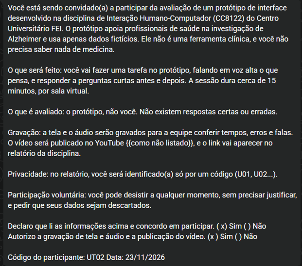
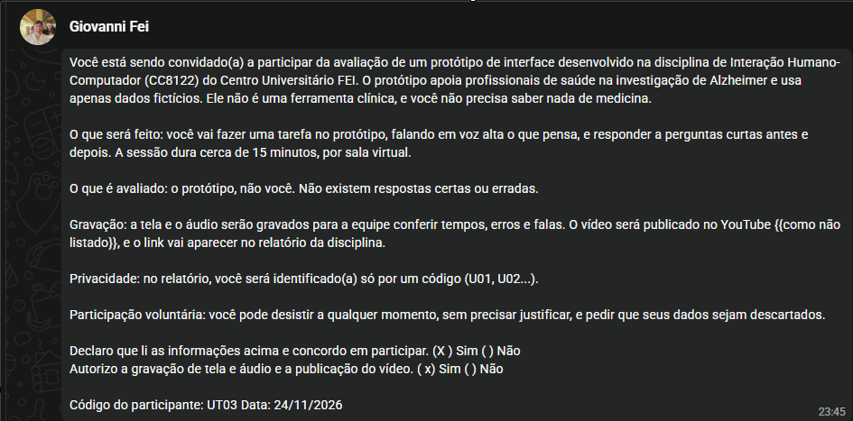

# Modelo acadêmico — Termo/registro de consentimento

**Projeto:** Protótipo de interface de apoio à investigação de Alzheimer com IA explicável, desenvolvido na disciplina CC8122 — Interação Humano-Computador (Centro Universitário FEI)  
**Atividade:** teste de usabilidade  
**Responsáveis:** Ana Carolina Lazzuri, Paulo Hudson Josué da Silva, Raphael Garavati Erbert e Nathan Gabriel da Fonseca Leite  
**Contato institucional:** unifalazzuri@fei.edu.br

## Convite e objetivo

Você está sendo convidado(a) a participar de um teste de usabilidade de um protótipo de interface. O objetivo é avaliar se a interface é fácil de entender e de usar por quem nunca teve contato com ela. **Estamos avaliando o produto/processo, não a sua capacidade.**

## O que será solicitado

Você vai assumir o papel de um neurologista e fazer uma tarefa no protótipo, feito no Figma: ver o que o sistema mostra sobre um paciente fictício e dizer o que responderia à filha dele. Durante a tarefa, você fala em voz alta o que está pensando. Depois, responde a algumas perguntas rápidas sobre a experiência. Não é preciso nenhum conhecimento de medicina, e todos os dados são fictícios. A sessão dura cerca de 10 minutos e é feita por sala virtual, com compartilhamento de tela.

## Registros

- [ ] Não haverá gravação.
- [x] Haverá gravação de tela.
- [x] Haverá gravação de áudio.
- [ ] Haverá gravação de vídeo.

Explique finalidade, quem terá acesso e prazo/critério de descarte: a gravação serve para a equipe conferir depois o tempo, os erros e as falas da tarefa, sem depender de anotações feitas durante a sessão. Têm acesso os quatro integrantes da equipe e o professor da disciplina. O vídeo é disponibilizado por link do YouTube {{não listado}} e será apagado {{ao fim do semestre / prazo combinado}}.

## Privacidade

Os resultados publicados utilizarão identificador anônimo, salvo autorização explícita em contrário. Dados não necessários à atividade não serão coletados.

## Voluntariedade

A participação é voluntária e pode ser interrompida a qualquer momento, sem necessidade de justificativa.

## Consentimento

Declaro que recebi informações suficientes sobre a atividade e concordo em participar nos termos acima.

**Participante:** U02 — aceite da participação e da gravação de tela e áudio enviado por mensagem (print abaixo)  
**Data:** 23/11/2026

**Participante:** U03 — aceite da participação e da gravação de tela e áudio enviado por mensagem (print abaixo)  
**Data:** 24/11/2026

**Participante:** U04 — aceite da participação e da gravação de tela e áudio enviado por mensagem (print abaixo)  
**Data:** 24/11/2026

